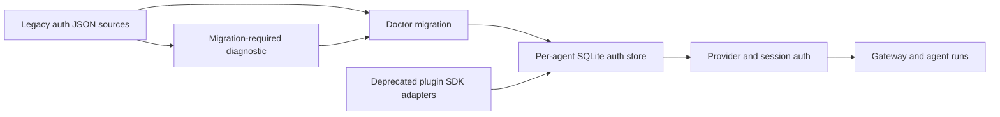

Codex review: needs maintainer review before merge. _Reviewed July 26, 2026, 7:21 AM ET / 11:21 UTC._

# ClawSweeper review

## What this changes

This PR makes per-agent SQLite the only steady-state auth-profile store, migrates four retired credential-file sources through `openclaw doctor --fix`, and retains SQLite-backed deprecated session-auth adapters for plugin compatibility.

## Merge readiness

⚠️ **Ready for maintainer review - 4 items remain**

Keep this PR open for maintainer review rather than cleanup: it has strong upgrade proof and no discrete patch defect found, but it intentionally changes the persistence-location contract of two shipped Plugin SDK entry points. The existing `maintainer` label and the prior ClawSweeper review correctly make that public-contract decision human-owned.

**Priority:** P1
**Reviewed head:** `1645a677bf2e5d7ef1193d4555ef0663ebd36f76`
**Owner decision:** Required. See [Decision needed](#decision-needed).

## Review scores

| Measure | Result | What it means |
|---|---|---|
| **Overall readiness** | 🐚 platinum hermit **(4/6)** | Strong real upgrade proof and broad targeted validation support a mergeable implementation, with the remaining gate being maintainer acceptance of the public SDK compatibility contract. |
| **Proof confidence** | 🦞 diamond lobster **(5/6)** ✨ media proof bonus | Sufficient (linked_artifact): The PR body provides after-fix packaged-upgrade evidence for the exact head, including Doctor migration, gateway startup, health/readiness checks, and status; the linked Testbox run is appropriate real behavior proof for this non-visual auth migration. |
| **Patch quality** | 🐚 platinum hermit **(4/6)** | No actionable review findings were identified. |

## Verification

| Check | Result | Evidence |
|---|---|---|
| **Real behavior** | Verified | Sufficient (linked_artifact): The PR body provides after-fix packaged-upgrade evidence for the exact head, including Doctor migration, gateway startup, health/readiness checks, and status; the linked Testbox run is appropriate real behavior proof for this non-visual auth migration. |
| **Evidence reviewed** | 5 items | Packaged upgrade proof: The PR body records a packaged upgrade-survivor run from `openclaw@2026.7.1` to the candidate build using an auth-profile fixture from `v2026.7.2-beta.5`; Doctor migration, gateway startup, health endpoints, and status all passed. Migration boundary: The proposed runtime detects retired auth credential files by path and routes the owner to a redacted Doctor-required diagnostic instead of reading file contents or falling back to environment/config credentials. SDK compatibility surface: The PR documents `AuthStorage.forAgent(agentDir)` as the canonical API while retaining `AuthStorage.create(path)` and `FileAuthStorageBackend` as SQLite-backed deprecated compatibility adapters through the announced window. |
| **Findings** | None | None. |
| **Security** | None | None. |

## How this fits together

OpenClaw resolves provider credentials from each agent’s auth profile store before model requests and gateway startup. This PR moves that durable state fully into the agent SQLite database, while Doctor imports and archives old JSON credential sources before runtime proceeds.

## Decision needed

| Question | Recommendation |
|---|---|
| Should OpenClaw approve the compatibility contract in which `AuthStorage.create(path)` and `FileAuthStorageBackend` remain callable but stop using their named file as the persistence location during the deprecation window? | **Approve the SQLite-backed deprecation:** Merge with `AuthStorage.forAgent(agentDir)` as the canonical API and preserve the documented warning/removal window for the two deprecated path-based adapters. |

Why: This is a deliberate public Plugin SDK behavior change, not a mechanical correctness defect: preserving old file semantics conflicts with the repository’s SQLite-only runtime policy, while changing them can affect external plugins with nonstandard paths.

## Before merge

- [ ] **Resolve merge risk (P1)** - Published plugins that used a nonstandard path with `AuthStorage.create(path)` or constructed `FileAuthStorageBackend` may retain the symbol but resolve to a different agent-owned SQLite persistence target after upgrade.
- [ ] **Resolve merge risk (P1)** - A user with credential-bearing retired JSON files must run `openclaw doctor --fix`; runtime intentionally fails closed for that affected agent instead of falling back to file, environment, or config credentials.
- [ ] **Resolve merge risk (P1)** - The PR is mergeable but behind current `main`, so the exact merge result should be refreshed before landing.

<strong>Agent review details</strong>

### Security

None.

### PR surface

Source +1266, Tests +1088, Docs +22, Other +127. Total +2503 across 64 files.

View PR surface stats

| Area | Files | Added | Removed | Net |
|---|---:|---:|---:|---:|
| Source | 35 | 1958 | 692 | +1266 |
| Tests | 19 | 1535 | 447 | +1088 |
| Docs | 7 | 47 | 25 | +22 |
| Config | 0 | 0 | 0 | 0 |
| Generated | 0 | 0 | 0 | 0 |
| Other | 3 | 127 | 0 | +127 |
| **Total** | **64** | **3667** | **1164** | **+2503** |

### Review metrics

| Metric | Value | Why it matters |
|---|---|---|
| **Retired credential sources** | 4 sources migrated | `auth-profiles.json`, `auth-state.json`, per-agent `auth.json`, and shared `credentials/oauth.json` now require Doctor migration before runtime use. |
| **Deprecated SDK adapters** | 2 retained adapters | The path-taking `AuthStorage.create(path)` and `FileAuthStorageBackend` symbols remain available but now use SQLite-backed persistence, making their upgrade contract central to merge review. |

### Stored data model

Persistent data-model change detected: `durable storage schema: src/secrets/storage-scan.ts`, `migration/backfill/repair: docs/concepts/model-failover.md`, `migration/backfill/repair: docs/concepts/oauth.md`, `migration/backfill/repair: docs/docs_map.md`, `migration/backfill/repair: docs/plugins/sdk-migration.md`, `migration/backfill/repair: extensions/qa-lab/src/providers/shared/auth-store.test.ts`, and 42 more. Migration or upgrade compatibility proof is recorded; maintainers should verify it before merge.

### Merge-risk options

**Maintainer options:**
1. **Confirm the deprecated SDK contract (recommended)**  
   Approve the SQLite-backed behavior for both deprecated path-taking adapters, including the published-plugin migration window, before merging.
2. **Add targeted external-plugin compatibility proof**  
   Before merge, demonstrate that supported published plugins using the deprecated adapters retain the intended agent ownership or receive the documented failure diagnostic.
3. **Pause the cutover**  
   Defer the runtime cutover if maintainers want to preserve arbitrary legacy file-location semantics beyond the stated migration window.

### Technical review

Best possible solution:

Land only after the responsible maintainer confirms the documented Plugin SDK deprecation contract and the intended fail-closed upgrade behavior; retain the Doctor-owned migration and migration-window documentation as the single canonical path.

Do we have a high-confidence way to reproduce the issue?

Yes, source-reproducible: the PR includes a packaged upgrade fixture from the stated beta-era JSON sources and reports a successful Doctor-to-gateway survivor run. I could not independently execute that scenario in this read-only review environment.

Is this the best way to solve the issue?

Unclear pending maintainer intent: a Doctor-owned, receipt-backed migration plus SQLite-only runtime matches repository storage policy, but the changed behavior of deprecated public SDK adapters needs explicit acceptance rather than a reviewer-only judgment.

AGENTS.md: found and applied where relevant.

Codex review notes: model internal, reasoning high; reviewed against [53e3f296b1cc](https://github.com/openclaw/openclaw/commit/53e3f296b1cc1ef2e772ec79c1a9acb693fa02e1).

### Labels

Label justifications:

- `P1`: This upgrade-sensitive auth cutover can block provider authentication for affected users until Doctor completes migration.
- `merge-risk: 🚨 compatibility`: Deprecated Plugin SDK path-based storage APIs retain their names while their persistence-location behavior changes.
- `merge-risk: 🚨 auth-provider`: Unmigrated legacy credential owners deliberately fail closed before provider environment/config fallback can supply credentials.
- `merge-risk: 🚨 session-state`: Session SDK credential storage moves from path-named JSON semantics to provider-keyed agent SQLite state.
- `rating: 🐚 platinum hermit`: Overall readiness is 🐚 platinum hermit; proof is 🦞 diamond lobster and patch quality is 🐚 platinum hermit.
- `status: 👀 ready for maintainer look`: ClawSweeper has no concrete contributor-facing blocker left for this PR. Sufficient (linked_artifact): The PR body provides after-fix packaged-upgrade evidence for the exact head, including Doctor migration, gateway startup, health/readiness checks, and status; the linked Testbox run is appropriate real behavior proof for this non-visual auth migration.
- `proof: sufficient`: Contributor real behavior proof is sufficient. The PR body provides after-fix packaged-upgrade evidence for the exact head, including Doctor migration, gateway startup, health/readiness checks, and status; the linked Testbox run is appropriate real behavior proof for this non-visual auth migration.

### Evidence

What I checked:

- **Packaged upgrade proof:** The PR body records a packaged upgrade-survivor run from `openclaw@2026.7.1` to the candidate build using an auth-profile fixture from `v2026.7.2-beta.5`; Doctor migration, gateway startup, health endpoints, and status all passed. ([`scripts/e2e/lib/upgrade-survivor/assertions.mjs:20`](https://github.com/openclaw/openclaw/blob/1645a677bf2e/scripts/e2e/lib/upgrade-survivor/assertions.mjs#L20), [1645a677bf2e](https://github.com/openclaw/openclaw/commit/1645a677bf2e))
- **Migration boundary:** The proposed runtime detects retired auth credential files by path and routes the owner to a redacted Doctor-required diagnostic instead of reading file contents or falling back to environment/config credentials. ([`src/agents/auth-profiles/legacy-source-diagnostic.ts:1`](https://github.com/openclaw/openclaw/blob/1645a677bf2e/src/agents/auth-profiles/legacy-source-diagnostic.ts#L1), [1645a677bf2e](https://github.com/openclaw/openclaw/commit/1645a677bf2e))
- **SDK compatibility surface:** The PR documents `AuthStorage.forAgent(agentDir)` as the canonical API while retaining `AuthStorage.create(path)` and `FileAuthStorageBackend` as SQLite-backed deprecated compatibility adapters through the announced window. Public docs: [`docs/plugins/sdk-migration.md`](https://docs.openclaw.ai/plugins/sdk-migration). ([`docs/plugins/sdk-migration.md:85`](https://docs.openclaw.ai/plugins/sdk-migration), [1645a677bf2e](https://github.com/openclaw/openclaw/commit/1645a677bf2e))
- **Current review continuity:** The prior ClawSweeper cycle at the same head found no line-level defects, but identified the changed persistence-location contract for plugins using nonstandard paths as the remaining maintainer decision. ([`src/agents/sessions/auth-storage.ts:1`](https://github.com/openclaw/openclaw/blob/1645a677bf2e/src/agents/sessions/auth-storage.ts#L1), [1645a677bf2e](https://github.com/openclaw/openclaw/commit/1645a677bf2e))
- **Validation evidence:** The PR body reports 511 focused tests, changed-surface checks including SDK/deprecation and database-first guards, a clean autoreview, and a linked successful packaged-upgrade Testbox run. ([`src/commands/doctor-auth-flat-profiles.test.ts:1`](https://github.com/openclaw/openclaw/blob/1645a677bf2e/src/commands/doctor-auth-flat-profiles.test.ts#L1), [1645a677bf2e](https://github.com/openclaw/openclaw/commit/1645a677bf2e))

Likely related people:

- **steipete:** The PR’s 17 commits implement the current SQLite-only auth-profile migration, Doctor recovery path, and session-storage compatibility adapters; broader merged-history ownership could not be independently inspected in this read-only environment. (role: recent auth-migration contributor; confidence: low; commits: [a5ff1fdc8921](https://github.com/openclaw/openclaw/commit/a5ff1fdc89210eaf1e67cd6c400d57db4b794f2c), [1645a677bf2e](https://github.com/openclaw/openclaw/commit/1645a677bf2e5d7ef1193d4555ef0663ebd36f76); files: `src/commands/doctor-auth-flat-profiles.ts`, `src/agents/sessions/auth-storage.ts`, `src/agents/auth-profiles/store.ts`)

### Rank-up moves

Optional improvements that raise the rating; they are not merge blockers.

- Obtain explicit maintainer confirmation of the deprecated path-based SDK behavior before merge.
- Refresh the merge result against current `main` and recheck the focused upgrade/compatibility evidence if the rebase changes this surface.

### Rating scale

| Score | Internal tier | Crab rank | Meaning |
|---:|:---:|---|---|
| **6/6** | S | 🦀 challenger crab | Exceptional readiness |
| **5/6** | A | 🦞 diamond lobster | Very strong readiness |
| **4/6** | B | 🐚 platinum hermit | Good normal PR; ordinary maintainer review |
| **3/6** | C | 🦐 gold shrimp | Useful, but confidence is limited |
| **2/6** | D | 🦪 silver shellfish | Proof or implementation needs work |
| **1/6** | F | 🧂 unranked krab | Not merge-ready |
| N/A | NA | 🌊 off-meta tidepool | Rating does not apply |

Overall follows the weaker of proof and patch quality.
Shiny media proof means a screenshot, video, or linked artifact directly shows the changed behavior. Runtime, network, CSP, and security claims still need visible diagnostics.

### Workflow

- ClawSweeper keeps one durable marker-backed review comment per issue or PR.
- Re-runs edit this comment so the latest verdict, findings, and automation markers stay together instead of adding duplicate bot comments.
- A fresh review can be triggered by eligible `@clawsweeper re-review` comments, exact-item GitHub events, scheduled/background review runs, or manual workflow dispatch.
- PR/issue authors and users with repository write access can comment `@clawsweeper re-review` or `@clawsweeper re-run` on an open PR or issue to request a fresh review only.
- Maintainers can also comment `@clawsweeper review` to request a fresh review only.
- Fresh-review commands do not start repair, autofix, rebase, CI repair, or automerge.
- Maintainer-only repair and merge flows require explicit commands such as `@clawsweeper autofix`, `@clawsweeper automerge`, `@clawsweeper fix ci`, or `@clawsweeper address review`.
- Maintainers can comment `@clawsweeper explain` to ask for more context, or `@clawsweeper stop` to stop active automation.

### History

Review history (2 earlier review cycles)

<!-- clawsweeper-review-history v=1 total=2 -->
- reviewed 2026-07-26T05:18:05.502Z sha 667f0ff942bb790a0e3144f3af887a9a60ee1070 :: needs maintainer review before merge. :: none
- reviewed 2026-07-26T11:10:37.069Z sha 1645a677bf2e5d7ef1193d4555ef0663ebd36f76 :: needs maintainer review before merge. :: none

<!-- clawsweeper-verdict:needs-human item=114033 sha=1645a677bf2e5d7ef1193d4555ef0663ebd36f76 confidence=medium updated_at=2026-07-26T11:20:24Z reviewed_at=2026-07-26T11:21:25.913Z lease_owner=github-run-30199893465-1 lease_comment_id=5083248772 source_revision=a5070b1b02e954f5caede7195aaae3a771c94bf035c22ef9044b0984055eecc4 -->

<!-- clawsweeper-review-version item=114033 reviewed_at=2026-07-26T11:21:25.913Z sha=1645a677bf2e5d7ef1193d4555ef0663ebd36f76 source_revision=a5070b1b02e954f5caede7195aaae3a771c94bf035c22ef9044b0984055eecc4 lease_owner=github-run-30199893465-1 lease_comment_id=5083248772 v=1 -->

<!-- clawsweeper-review item=114033 -->