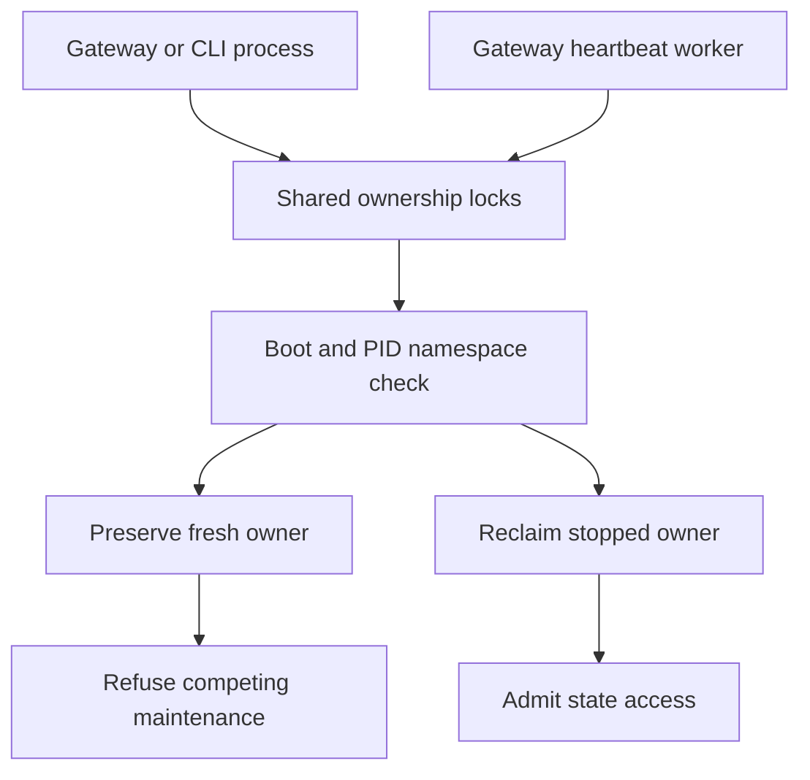

Codex review: blocked before merge. _Reviewed October 3, 2026, 12:14 PM ET / 16:14 UTC (Revision 5)._

# ClawSweeper review

## What this changes

The PR qualifies Gateway ownership by boot and Docker PID namespace, renews ownership locks in a worker, documents safe CLI container use, and repairs affected test fixtures.

## Merge readiness

⛔ **Blocked before merge - 3 items remain**

The fix remains necessary and has meaningful Docker boundary proof, but the previously reported shutdown retry defect remains in the current head.

**Priority:** P1
**Reviewed head:** `4ba582e8976f7415cc27acccdc61dc6af7960e9f`

## Review scores

| Measure | Result | What it means |
|---|---|---|
| **Overall readiness** | 🦐 gold shrimp **(3/6)** | Strong ownership-boundary evidence supports the repair, but a definite shutdown lifecycle defect still blocks readiness. |
| **Proof confidence** | 🦞 diamond lobster **(5/6)** | Sufficient (terminal): The captured Docker production ownership-API run exercises separate PID namespaces, fresh-owner refusal, crashed-owner recovery, and renewal during synchronous SQLite work. Production inputs are unchanged in the latest test-only round. Additive lock metadata preserves legacy decoding and recovery rules without a schema migration; authenticated RPC/TUI execution is not claimed. |
| **Patch quality** | 🦐 gold shrimp **(3/6)** | 1 actionable review finding remain. |

## Verification

| Check | Result | Evidence |
|---|---|---|
| **Real behavior** | Verified | Sufficient (terminal): The captured Docker production ownership-API run exercises separate PID namespaces, fresh-owner refusal, crashed-owner recovery, and renewal during synchronous SQLite work. Production inputs are unchanged in the latest test-only round. Additive lock metadata preserves legacy decoding and recovery rules without a schema migration; authenticated RPC/TUI execution is not claimed. |
| **Evidence reviewed** | 10 items | Introduced shutdown defect survives the verified merge: The introduced close wrapper permanently caches its promise, including rejection. The verified test merge has the pinned base and head as its two recorded parents, and its diff against that base retains this wrapper.<br>Inner shutdown deliberately supports retained-cleanup retries: The core server clears closePromise when a retained plugin-runtime cleanup error occurs. The new outer cache prevents later public close calls from reaching that retry and the subsequent ownership release.<br>Re-review continuity: The completed previous review reported this same close-cache blocker. Inspection of the earlier reviewed SHA failed because its object was unavailable and remote hydration returned HTTP 403; the finding is independently established by the pinned introduction diff and current source, without claiming a verified earlier-tree comparison. |
| **Findings** | 1 actionable finding | [P2] Allow rejected close attempts to retry retained cleanup |
| **Security** | None | None. |

## How this fits together

Gateway ownership coordinates access to shared OpenClaw state across the serving Gateway and maintenance processes. Namespace checks and heartbeat renewal determine whether another process must preserve ownership or may reclaim it.



## Before merge

- [ ] **Allow rejected close attempts to retry retained cleanup (P2)** - Previously reported and still present: when plugin cleanup throws a retained-runtime error, `server-start.ts` clears its inner close promise so cleanup can retry. This newly introduced outer `closing` promise remains rejected forever, so subsequent public `close()` calls never reach that retry or `ownedLock.release()`. Clear the failed outer attempt while preserving concurrent-call coalescing and custody retention until cleanup succeeds.
- [ ] **Resolve merge risk (P1)** - A retained plugin-cleanup failure permanently rejects the public close handle, leaving cleanup and direct ownership release unreachable on subsequent attempts.
- [ ] **Complete next step (P2)** - Repair the rejected outer close cache and demonstrate successful cleanup retry before releasing ownership.

## Findings

- [P2] Allow rejected close attempts to retry retained cleanup — `src/gateway/server.ts:59-63`


<details>
<summary><strong>Agent review details</strong></summary>

### Security

None.

### PR surface

Source +484, Tests +1148, Docs +11, Other +4. Total +1647 across 33 files.

<details>
<summary>View PR surface stats</summary>

| Area | Files | Added | Removed | Net |
|---|---:|---:|---:|---:|
| Source | 18 | 566 | 82 | +484 |
| Tests | 12 | 1160 | 12 | +1148 |
| Docs | 1 | 11 | 0 | +11 |
| Config | 0 | 0 | 0 | 0 |
| Generated | 0 | 0 | 0 | 0 |
| Other | 2 | 4 | 0 | +4 |
| **Total** | **33** | **1741** | **94** | **+1647** |

</details>

### Review metrics

| Metric | Value | Why it matters |
|---|---|---|
| **Production versus test growth** | production +566/-82; tests/support +1160/-12 | Production growth implements namespace classification, independent renewal, and custody fencing; the latest commit adds only fixture isolation and its regression. |

### Root-cause cluster

Relationship: `fixed_by_candidate`
Canonical: https://github.com/openclaw/openclaw/issues/163961
Summary: This PR explicitly proposes the namespace-aware ownership fix for the open Docker report.

Members:
- `canonical`: https://github.com/openclaw/openclaw/issues/163961 - The report describes the separate Docker CLI ownership failure addressed by the branch.

Proposal only: this assessment does not dispatch repair, suppress jobs, mutate sibling items, close, or merge anything.

### Merge-risk options

**Maintainer options:**
1. **Restore shutdown retry (recommended)**  
   Clear the failed outer close attempt while coalescing concurrent calls and releasing ownership only after successful cleanup.

<details>
<summary>Copy recommended automerge instruction</summary>

```text
@clawsweeper automerge

Special instructions:
Repair the outer close promise cache in src/gateway/server.ts and add a regression proving retained cleanup can fail, retry successfully, and release ownership only after success while concurrent callers remain coalesced.
```

</details>

### Technical review

Best possible solution:

Keep namespace-qualified ownership and descriptor-bound renewal, with retryable shutdown that retains custody until cleanup succeeds.

Do we have a high-confidence way to reproduce the issue?

Yes, from source: make retained plugin cleanup reject the first public close call, then retry; the cached rejected promise prevents another inner cleanup attempt. No runtime reproduction was executed during this read-only review.

Is this the best way to solve the issue?

The ownership approach fits the existing coordinator, but the shutdown wrapper must preserve the core server's retry contract before this is a complete repair.

Full review comments:

- [P2] Allow rejected close attempts to retry retained cleanup — `src/gateway/server.ts:59-63`
  Previously reported and still present: when plugin cleanup throws a retained-runtime error, `server-start.ts` clears its inner close promise so cleanup can retry. This newly introduced outer `closing` promise remains rejected forever, so subsequent public `close()` calls never reach that retry or `ownedLock.release()`. Clear the failed outer attempt while preserving concurrent-call coalescing and custody retention until cleanup succeeds.
  Confidence: 0.99

Overall correctness: patch is incorrect
Overall confidence: 0.97

AGENTS.md: found and applied where relevant.

Codex review notes: model internal, reasoning medium; reviewed against [f1b983fac8fa](https://github.com/openclaw/openclaw/commit/f1b983fac8faf6bc83959aa1869484fc350b7e9b).

### Labels

Label changes:

- remove `merge-risk: 🚨 compatibility`: Current PR review merge-risk labels are `merge-risk: 🚨 availability`.

Label justifications:

- `P1`: The linked report describes persistent Gateway access failures after a documented separate-container CLI workflow.
- `merge-risk: 🚨 availability`: The introduced close cache can prevent recovery and ownership release after retryable cleanup failure.
- `rating: 🦐 gold shrimp`: Overall readiness is 🦐 gold shrimp; proof is 🦞 diamond lobster and patch quality is 🦐 gold shrimp.
- `status: ⏳ waiting on author`: ClawSweeper has contributor-facing work open and is waiting for author action. Sufficient (terminal): The captured Docker production ownership-API run exercises separate PID namespaces, fresh-owner refusal, crashed-owner recovery, and renewal during synchronous SQLite work. Production inputs are unchanged in the latest test-only round. Additive lock metadata preserves legacy decoding and recovery rules without a schema migration; authenticated RPC/TUI execution is not claimed.
- `proof: sufficient`: Contributor real behavior proof is sufficient. The captured Docker production ownership-API run exercises separate PID namespaces, fresh-owner refusal, crashed-owner recovery, and renewal during synchronous SQLite work. Production inputs are unchanged in the latest test-only round. Additive lock metadata preserves legacy decoding and recovery rules without a schema migration; authenticated RPC/TUI execution is not claimed.

### Evidence

Acceptance criteria:

- [P1] pnpm test src/gateway/server.state-owner.test.ts --maxWorkers=1.
- [P1] pnpm test src/gateway/server.sessions.fixture-lifecycle.test.ts --maxWorkers=1.
- [P1] node scripts/check-changed.mjs.
- [P1] git diff --check.

What I checked:

- **Introduced shutdown defect survives the verified merge:** The introduced close wrapper permanently caches its promise, including rejection. The verified test merge has the pinned base and head as its two recorded parents, and its diff against that base retains this wrapper. ([`src/gateway/server.ts:59`](https://github.com/openclaw/openclaw/blob/4ba582e8976f7415cc27acccdc61dc6af7960e9f/src/gateway/server.ts#L59), [4ba582e8976f](https://github.com/openclaw/openclaw/commit/4ba582e8976f7415cc27acccdc61dc6af7960e9f))
- **Inner shutdown deliberately supports retained-cleanup retries:** The core server clears closePromise when a retained plugin-runtime cleanup error occurs. The new outer cache prevents later public close calls from reaching that retry and the subsequent ownership release. ([`src/gateway/server-start.ts:147`](https://github.com/openclaw/openclaw/blob/4ba582e8976f7415cc27acccdc61dc6af7960e9f/src/gateway/server-start.ts#L147), [4ba582e8976f](https://github.com/openclaw/openclaw/commit/4ba582e8976f7415cc27acccdc61dc6af7960e9f))
- **Re-review continuity:** The completed previous review reported this same close-cache blocker. Inspection of the earlier reviewed SHA failed because its object was unavailable and remote hydration returned HTTP 403; the finding is independently established by the pinned introduction diff and current source, without claiming a verified earlier-tree comparison. ([`src/gateway/server.ts:59`](https://github.com/openclaw/openclaw/blob/4ba582e8976f7415cc27acccdc61dc6af7960e9f/src/gateway/server.ts#L59), [4ba582e8976f](https://github.com/openclaw/openclaw/commit/4ba582e8976f7415cc27acccdc61dc6af7960e9f))
- **Captured proof body fully inspected:** The live body matched captured SHA-256 9596df717807f298aa4a5617d21a8cbc991a000f66051c3ad5e863b7cde5c8f9 and the pinned head. Its Docker production ownership-API run records sibling refusal in 19.57 ms, crashed-owner recovery in 90.48 seconds, and preserved ownership during 93.01 seconds of synchronous SQLite overlap. This is boundary proof, not authenticated RPC/TUI proof. The current round changes only test support. ([4ba582e8976f](https://github.com/openclaw/openclaw/commit/4ba582e8976f7415cc27acccdc61dc6af7960e9f))
- **Existing-state compatibility:** The namespace field is optional; absent legacy identity retains the prior PID rules. Maintenance regressions cover legacy records, same namespaces, previous boots, and expired heartbeats. The v2026.9.8 decoder uses a non-strict object schema, allowing the additive field without a database migration. ([`src/infra/gateway-lock-payload.ts:66`](https://github.com/openclaw/openclaw/blob/fc23bc864e4553c2d215e479eeec47b67a0bf943/src/infra/gateway-lock-payload.ts#L66), [fc23bc864e45](https://github.com/openclaw/openclaw/commit/fc23bc864e4553c2d215e479eeec47b67a0bf943))
- **Current main still needs the fix:** Current main retains the earlier public close wrapper. Its ownership history and the latest-release lock decoder do not establish namespace-qualified recovery as already implemented. The explicitly linked Docker report remains open at https://github.com/openclaw/openclaw/issues/163961. ([`src/gateway/server.ts:35`](https://github.com/openclaw/openclaw/blob/f1b983fac8faf6bc83959aa1869484fc350b7e9b/src/gateway/server.ts#L35), [f1b983fac8fa](https://github.com/openclaw/openclaw/commit/f1b983fac8faf6bc83959aa1869484fc350b7e9b))

Likely related people:

- **steipete:** Suggested for follow-up; no historical authorship or introduction is verified. (role: unverified routing candidate; confidence: low)

### Rank-up moves

Optional improvements that raise the rating; they are not merge blockers.

- Repair the outer close cache and prove failed retained cleanup can retry successfully before ownership is released.

### Rating scale

| Score | Internal tier | Crab rank | Meaning |
|---:|:---:|---|---|
| **6/6** | S | 🦀 challenger crab | Exceptional readiness |
| **5/6** | A | 🦞 diamond lobster | Very strong readiness |
| **4/6** | B | 🐚 platinum hermit | Good normal PR; ordinary maintainer review |
| **3/6** | C | 🦐 gold shrimp | Useful, but confidence is limited |
| **2/6** | D | 🦪 silver shellfish | Proof or implementation needs work |
| **1/6** | F | 🧂 unranked krab | Not merge-ready |
| N/A | NA | 🌊 off-meta tidepool | Rating does not apply |

Overall follows the weaker of proof and patch quality.
Shiny media proof means a screenshot, video, or linked artifact directly shows the changed behavior. Runtime, network, CSP, and security claims still need visible diagnostics.

### Workflow

- ClawSweeper keeps one durable marker-backed review comment per issue or PR.
- Re-runs edit this comment so the latest verdict, findings, and automation markers stay together instead of adding duplicate bot comments.
- A fresh review can be triggered by eligible `@clawsweeper re-review` comments, exact-item GitHub events, scheduled/background review runs, or manual workflow dispatch.
- PR/issue authors and users with repository write access can comment `@clawsweeper re-review` or `@clawsweeper re-run` on an open PR or issue to request a fresh review only.
- Maintainers can also comment `@clawsweeper review` to request a fresh review only.
- Fresh-review commands do not start repair, autofix, rebase, CI repair, or automerge.
- Maintainer-only repair and merge flows require explicit commands such as `@clawsweeper autofix`, `@clawsweeper automerge`, `@clawsweeper fix ci`, or `@clawsweeper address review`.
- Maintainers can comment `@clawsweeper explain` to ask for more context, or `@clawsweeper stop` to stop active automation.

### History

<details>
<summary>Review history (4 earlier review cycles)</summary>

<!-- clawsweeper-review-history v=1 total=4 -->
- reviewed 2026-10-03T10:10:40.723Z sha c497c731ba5093724eefd7f9a3d8a639d82327b3 :: needs maintainer review before merge. :: none
- reviewed 2026-10-03T13:13:56.311Z sha 82a6eafcbc1f5a2ce3c2cb0c35c0b8b1e219dcf3 :: needs changes before merge. :: none
- reviewed 2026-10-03T14:07:51.497Z sha a2ae915250ae1724b124f434521e35566e90167c :: blocked before merge. :: [P2] Allow rejected close attempts to retry retained cleanup
- reviewed 2026-10-03T15:17:15.690Z sha 8b683d7fa94a1de008cea0f25b2070cb731a0881 :: blocked before merge. :: [P2] Allow rejected close attempts to retry retained cleanup

</details>

</details>

<!-- clawsweeper-verdict:needs-human item=164236 sha=4ba582e8976f7415cc27acccdc61dc6af7960e9f confidence=high updated_at=2026-10-03T16:11:06Z reviewed_at=2026-10-03T16:14:37.543Z lease_owner=github-run-37135855320-1 lease_comment_id=5970929776 source_revision=09df29bc0daff2da2f5e8ed75de157883702f6212ebd99393c1720e5bb308372 live_verification=absent -->
<!-- clawsweeper-review-state:blocked item=164236 sha=4ba582e8976f7415cc27acccdc61dc6af7960e9f v=1 -->

<!-- clawsweeper-review-version item=164236 reviewed_at=2026-10-03T16:14:37.543Z sha=4ba582e8976f7415cc27acccdc61dc6af7960e9f source_revision=09df29bc0daff2da2f5e8ed75de157883702f6212ebd99393c1720e5bb308372 lease_owner=github-run-37135855320-1 lease_comment_id=5970929776 v=1 -->

<!-- clawsweeper-review item=164236 -->