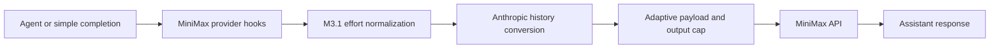

Codex review: needs maintainer review before merge.

## What this changes

The MiniMax plugin adds M3.1 Flash Preview to its catalog and translates its five thinking effort levels into adaptive Anthropic requests.

**Example:** Select low thinking effort for minimax/MiniMax-M3.1-Flash-Preview.
- **Before:** The inherited M3 profile rejects low; selecting off can produce HTTP 400.
- **After:** The request sends adaptive thinking with output_config.effort set to low; the recorded live probe completed with OK.

## Review scores

| Measure | Result | What it means |
|---|---|---|
| **Overall readiness** | 🐚 platinum hermit **(4/6)** | A focused, useful patch with repaired replay findings, live provider-contract evidence, and meaningful builder coverage; proof does not include a full shipped CLI or Gateway flow. |
| **Proof confidence** | 🐚 platinum hermit **(4/6)** | Sufficient (live_output): Recorded live output exercises the registered MiniMax wrapper and real Anthropic streaming client against the CN endpoint with a 256-token cap: low and max both sent adaptive thinking with the selected effort and completed with OK; subsequent replay repairs preserve that ordinary wire shape and have current-head real-builder coverage. |
| **Patch quality** | 🦞 diamond lobster **(5/6)** | No actionable review findings were identified. |

## Product

**Kind:** Bug fix · **Worth it:** Yes · **Fix scope:** Complete
**User problem:** M3.1 users cannot select its supported effort levels and can receive provider rejection for an advertised off setting.
**Reason:** The documented provider contract and independent release reports establish a concrete defect, and the maintainer-supported repair stays within the existing MiniMax integration.

## Merge readiness

✅ **Ready for maintainer review**

Keep this PR open: current main still needs the M3.1 fix, both previously reported replay defects are repaired, and no new blocking finding was identified.

**Priority:** P2
**Reviewed head:** `90114e616e18c16b27abda7d0ef7bc97e28934aa`

## Before merge

None.

## Findings

None.

### Tests

- Missing end-to-end proof: The expanded cap/budget regressions have not been demonstrated failing on their pre-repair heads; live evidence covers low/max API-key requests, while OAuth and signed replay use the real-builder harness.

<strong>Agent review details</strong>

### How this fits together

MiniMax provider hooks receive model metadata, conversation history, and generation options, then prepare requests for the shared Anthropic client and return streamed assistant responses.

### Technical review

Best possible solution:

Keep the M3.1 profile and request shaping in the MiniMax plugin while preserving signed history, output caps, and existing M3/M2 behavior.

Do we have a high-confidence way to reproduce the issue?

Current-main source exposes off/adaptive for M3.1 and lacks its effort translation; independent released-version reports confirm HTTP 400 for disabled thinking, but this read-only review ran no target code.

Is this the best way to solve the issue?

The existing provider hooks are the appropriate boundary, and the current producer repair preserves replay before conversion rather than attempting to restore lost history afterward.

AGENTS.md: found and applied where relevant.

Codex review notes: model internal, reasoning medium; reviewed against [c44c2e51ad3f](https://github.com/openclaw/openclaw/commit/c44c2e51ad3fdeaa84a0aa35a36c4f83a116c746).

### Provenance checked

- `M3-family thinking profile` changes intended behavior with a stated reason (443ac732a11da91feefeda7dd79898be5c74a01c: Keep M3 on its working omitted/adaptive path while preserving explicit off and M2.x leak prevention.)
- `Shared provider hooks` keeps the original intent (25efa8cf81586d48944fe6bab2a9f80bbfd8adfc: Share the replay, stream, and reasoning hooks across API-key and portal providers.)
- `Catalog and documentation defaults` keeps the original intent (0369672691cfb2b37f6f34e5e86f79c7620d6366: Add M3 support and make it the default while retaining existing configured model references.)

### Testing

Proof path: in-process harness.

### Security

None.

### Evidence

What I checked:

- **Current main still lacks the fix:** Current main assigns M3.1 the general M3 off/adaptive profile and does not register the model-specific effort wrapper. ([`extensions/minimax/thinking.ts:10`](https://github.com/openclaw/openclaw/blob/c44c2e51ad3fdeaa84a0aa35a36c4f83a116c746/extensions/minimax/thinking.ts#L10), [c44c2e51ad3f](https://github.com/openclaw/openclaw/commit/c44c2e51ad3fdeaa84a0aa35a36c4f83a116c746))
- **Replay repairs verified in source:** The wrapper supplies calculation allowance before history conversion, ignores manual thinking budgets, and restores requested/configured output caps in the final payload. ([`extensions/minimax/stream.ts:25`](https://github.com/openclaw/openclaw/blob/90114e616e18c16b27abda7d0ef7bc97e28934aa/extensions/minimax/stream.ts#L25), [90114e616e18](https://github.com/openclaw/openclaw/commit/90114e616e18c16b27abda7d0ef7bc97e28934aa))
- **Actual replay boundary:** The Anthropic builder decides whether to retain signed thinking before invoking the payload hook, confirming why normalization must precede conversion. ([`packages/ai/src/transports/anthropic-messages.ts:533`](https://github.com/openclaw/openclaw/blob/90114e616e18c16b27abda7d0ef7bc97e28934aa/packages/ai/src/transports/anthropic-messages.ts#L533), [90114e616e18](https://github.com/openclaw/openclaw/commit/90114e616e18c16b27abda7d0ef7bc97e28934aa))
- **Focused regression coverage:** The real-builder matrix exercises both registered hooks and provider IDs, all five efforts, legacy selections, missing/small model caps, omitted request limits, signed completed-turn replay, and zero manual budgets. ([`extensions/minimax/index.test.ts:493`](https://github.com/openclaw/openclaw/blob/90114e616e18c16b27abda7d0ef7bc97e28934aa/extensions/minimax/index.test.ts#L493), [90114e616e18](https://github.com/openclaw/openclaw/commit/90114e616e18c16b27abda7d0ef7bc97e28934aa))
- **Provider contract and independent reports:** The open canonical issue https://github.com/openclaw/openclaw/issues/160037 includes php737's five-effort live captures; olveww-dot reports the disabled-thinking rejection on 2026.9.9. MiniMax's current documentation confirms mandatory thinking and the five effort values: [Anthropic API contract](https://platform.minimax.io/docs/api-reference/text-anthropic-api).
- **Maintainer-supported repair:** RomneyDa's MEMBER-associated request explicitly asks for review of the repaired current head and describes preserving signed replay and wire caps; no additional product approval is needed for those repairs. ([90114e616e18](https://github.com/openclaw/openclaw/commit/90114e616e18c16b27abda7d0ef7bc97e28934aa))

Likely related people:

- **Vincent Koc:** Raw commit 25efa8cf81586d48944fe6bab2a9f80bbfd8adfc adds extensions/minimax/provider-registration.ts:41 relative to its recorded parents. This identifies author metadata, not feature responsibility or a PR merger. (role: source-line author; confidence: high; commits: [25efa8cf8158](https://github.com/openclaw/openclaw/commit/25efa8cf81586d48944fe6bab2a9f80bbfd8adfc); files: `extensions/minimax/provider-registration.ts`)

### PR surface

Source +80, Tests +220, Docs +6. Total +306 across 7 files. Added test files: 0.

View PR surface stats

| Area | Files | Added | Removed | Net |
|---|---:|---:|---:|---:|
| Source | 5 | 82 | 2 | +80 |
| Tests | 1 | 222 | 2 | +220 |
| Docs | 1 | 18 | 12 | +6 |
| Config | 0 | 0 | 0 | 0 |
| Generated | 0 | 0 | 0 | 0 |
| Other | 0 | 0 | 0 | 0 |
| **Total** | **7** | **322** | **16** | **+306** |

### Review metrics

| Metric | Value | Why it matters |
|---|---|---|
| **Production versus test changes** | Production +82/-2 lines; tests +222/-2 lines. | The added production code handles the model-specific contract; the larger test contribution exercises the real builder's replay and cap interactions without network calls or timers. |

### Root-cause cluster

Relationship: `fixed_by_candidate`
Canonical: https://github.com/openclaw/openclaw/issues/160037
Summary: This PR addresses the canonical M3.1 catalog, effort-selection, and disabled-thinking failures.

Members:
- `canonical`: https://github.com/openclaw/openclaw/issues/160037 - The open issue records all three behaviors addressed by this PR.
- `duplicate`: https://github.com/openclaw/openclaw/issues/160491 - The closed satellite reports the same M3.1 disabled-thinking rejection.

Proposal only: this assessment does not dispatch repair, suppress jobs, mutate sibling items, close, or merge anything.

### Labels

Label changes:

- add `rating: 🐚 platinum hermit`: Overall readiness is 🐚 platinum hermit; proof is 🐚 platinum hermit and patch quality is 🦞 diamond lobster.
- add `status: 👀 ready for maintainer look`: ClawSweeper has no concrete contributor-facing blocker left for this PR.
- remove `rating: 🦐 gold shrimp`: Current PR rating is `rating: 🐚 platinum hermit`, so this older rating label is no longer current.
- remove `status: ⏳ waiting on author`: Current PR status label is `status: 👀 ready for maintainer look`.

Label justifications:

- `P2`: A bounded preview-model integration bug prevents supported effort selection and can reject inference requests.
- `rating: 🐚 platinum hermit`: Overall readiness is 🐚 platinum hermit; proof is 🐚 platinum hermit and patch quality is 🦞 diamond lobster.
- `status: 👀 ready for maintainer look`: ClawSweeper has no concrete contributor-facing blocker left for this PR.
- `proof: sufficient`: Contributor real behavior proof is sufficient.

### Rating scale

6/6 🦀 challenger crab · 5/6 🦞 diamond lobster · 4/6 🐚 platinum hermit · 3/6 🦐 gold shrimp · 2/6 🦪 silver shellfish · 1/6 🧂 unranked krab. Overall follows the weaker of proof and patch quality; ✨ marks media proof (a screenshot, video, or linked artifact) that directly shows the changed behavior.

### Workflow

ClawSweeper edits this one comment on every review. Comment `@clawsweeper re-review` for a fresh review only; repair and merge need explicit maintainer commands such as `@clawsweeper autofix` or `@clawsweeper automerge`.

### History

Review history (7 earlier review cycles)

<!-- clawsweeper-review-history v=1 total=7 -->
- reviewed 2026-09-28T04:15:39.228Z sha c75f75607f714bae4209afa7b569ac7f00a987c2 :: needs maintainer review before merge. :: none
- reviewed 2026-09-28T10:14:11.029Z sha c75f75607f714bae4209afa7b569ac7f00a987c2 :: needs maintainer review before merge. :: none
- reviewed 2026-09-30T15:03:26.349Z sha c75f75607f714bae4209afa7b569ac7f00a987c2 :: needs maintainer review before merge. :: none
- reviewed 2026-09-30T15:18:58.499Z sha c375286472f5401554d6c22691910a51b2c5425e :: needs maintainer review before merge. :: none
- reviewed 2026-10-06T12:30:30.159Z sha df25dd7bad9dda0783c67eb36106b39f1e469d30 :: needs maintainer review before merge. :: none
- reviewed 2026-10-10T02:59:34.660Z sha b823bf64dc8ca2fea46ac1d3970d3508ee13371a :: needs changes before merge. :: [P2] Keep mandatory thinking enabled before converting missing-cap history
- reviewed 2026-10-10T03:15:24.481Z sha 826bf30c045c078db2f2256f64451cba0d825e01 :: needs changes before merge. :: [P2] Preserve mandatory thinking replay with small explicit model caps

_Reviewed October 9, 2026, 11:46 PM ET / October 10, 2026, 03:46 UTC (Revision 8)._

<!-- clawsweeper-verdict:needs-human item=160089 sha=90114e616e18c16b27abda7d0ef7bc97e28934aa confidence=high updated_at=2026-10-10T03:41:43Z reviewed_at=2026-10-10T03:46:59.979Z lease_owner=github-run-38021397113-1 lease_comment_id=6093394920 source_revision=407936a3560357d37fd8dd097471cb085ab9364902d385a8aa6904128a285517 live_verification=absent hold=not_opted_in findings=0 -->
<!-- clawsweeper-review-state:ready item=160089 sha=90114e616e18c16b27abda7d0ef7bc97e28934aa v=1 -->

<!-- clawsweeper-review-version item=160089 reviewed_at=2026-10-10T03:46:59.979Z sha=90114e616e18c16b27abda7d0ef7bc97e28934aa source_revision=407936a3560357d37fd8dd097471cb085ab9364902d385a8aa6904128a285517 lease_owner=github-run-38021397113-1 lease_comment_id=6093394920 v=1 -->

<!-- clawsweeper-review item=160089 -->