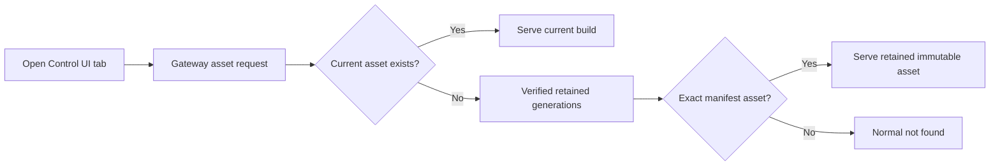

Codex review: needs maintainer review before merge. _Reviewed August 26, 2026, 8:27 AM ET / 12:27 UTC._

# ClawSweeper review

## What this changes

Adds a verified cache of recent bundled Control UI asset generations so already-open browser tabs can load old lazy-route modules after a Gateway update.

## Merge readiness

⚠️ **Ready for maintainer review - 3 items remain**

The PR remains necessary: current main still serves missing bundled assets only from the current build root. The exact head addresses the prior lifecycle findings and supplies a bounded, manifest-verified fallback for old immutable assets; it should proceed through rebase and exact-head checks.

**Priority:** P1
**Reviewed head:** `4fe3d6ce87d1c2cb1c758ac6e414f09031aa0adb`

## Review scores

| Measure | Result | What it means |
|---|---|---|
| **Overall readiness** | 🐚 platinum hermit **(4/6)** | Strong behavior evidence and focused ownership tests support a substantial but bounded Gateway/UI repair. |
| **Proof confidence** | 🦞 diamond lobster **(5/6)** ✨ media proof bonus | Sufficient (recording): The PR body provides after-fix WebKit screenshots and a recording for the old-document route load, and the exact-head browser E2E mirrors that replacement-and-delete scenario. |
| **Patch quality** | 🐚 platinum hermit **(4/6)** | No actionable review findings were identified. |

## Verification

| Check | Result | Evidence |
|---|---|---|
| **Real behavior** | Verified | Sufficient (recording): The PR body provides after-fix WebKit screenshots and a recording for the old-document route load, and the exact-head browser E2E mirrors that replacement-and-delete scenario. |
| **Evidence reviewed** | 5 items | Current-main behavior: Current main only resolves the requested immutable asset under the active Control UI root, so it has no retained-generation fallback.<br>Exact-head repair path: The proposed request path consults retained assets only after the current bundled asset is absent, then reopens the retained representation with containment checks.<br>Post-ready lifecycle: Retention preparation is started through the existing post-ready sidecar and receives both cancellation mechanisms; the scheduler originates from recent Gateway lifecycle work. |
| **Findings** | None | None. |
| **Security** | None | None. |


### Live Verification

**Command:** `OPENCLAW_CONTROL_UI_E2E_BROWSER=webkit node scripts/run-vitest.mjs run --config test/vitest/vitest.ui-e2e.config.ts --configLoader runner ui/src/e2e/control-ui-retained-assets.e2e.test.ts`

**Result:** FAIL (failed) — step 1 `run` `OPENCLAW_CONTROL_UI_E2E_BROWSER=webkit node scripts/run-vitest.mjs run --config test/vitest/vitest.ui-e2e.config.ts --configLoader runner ui/src/e2e/control-ui-retained-assets.e2e.test.ts`: `previous terminal command was still running after 30 seconds: "OPENCLAW_CONTROL_UI_E2E_BROWSER=webkit node scripts/run-vitest.mjs run --config test/vitest/vitest.ui-e2e.config.ts --configLoader runner ui/src/e2e/control-ui-retained-assets.e2e.test.ts"`

```text
RUN  v4.1.11 /tmp/clawsweeper-live-proof-129922-8zP4hP/target

 ❯  ui-e2e  ui/src/e2e/control-ui-retained-assets.e2e.test.ts (1 test | 1 failed) 36ms
   × keeps an old document's unvisited lazy module available across builds 35ms

⎯⎯⎯⎯⎯⎯⎯ Failed Tests 1 ⎯⎯⎯⎯⎯⎯⎯

 FAIL   ui-e2e  ui/src/e2e/control-ui-retained-assets.e2e.test.ts › keeps an old document's unvisited lazy module available across builds
Error: browserType.launch: Executable doesn't exist at /tmp/clawsweeper-live-proof-129922-8zP4hP/profile/cache/ms-playwright/webkit-2336/pw_run.sh
╔════════════════════════════════════════════════════════════╗
║ Looks like Playwright was just installed or updated.       ║
║ Please run the following command to download new browsers: ║
║                                                            ║
║     npx playwright install                                 ║
║                                                            ║
║ ‹3 Playwright Team                                         ║
╚════════════════════════════════════════════════════════════╝
 ❯ ui/src/e2e/control-ui-retained-assets.e2e.test.ts:143:24
    141|       server = await startGatewayAssetServer(root);
    142|       browser = useWebKit
    143|         ? await webkit.launch()
       |                        ^
    144|         : await chromium.launch({ executablePath: chromiumExecutablePa…
    145|       const context = await browser.newContext({
 ❯ withEnvAsync src/test-utils/env.ts:147:12
 ❯ ui/src/e2e/control-ui-retained-assets.e2e.test.ts:132:5

⎯⎯⎯⎯⎯⎯⎯⎯⎯⎯⎯⎯⎯⎯⎯⎯⎯⎯⎯⎯⎯⎯⎯⎯[1/1]⎯


 Test Files  1 failed (1)
      Tests  1 failed (1)
   Start at  12:28:35
   Duration  28.14s (transform 11.16s, setup 141ms, import 14.19s, tests 36ms, environment 0ms)


::error file=/tmp/clawsweeper-live-proof-129922-8zP4hP/target/ui/src/e2e/control-ui-retained-assets.e2e.test.ts,title=[ui-e2e] ui/src/e2e/control-ui-retained-as
sets.e2e.test.ts › keeps an old document's unvisited lazy module available across builds,line=143,column=24::Error: browserType.launch: Executable doesn't exist
 at /tmp/clawsweeper-live-proof-129922-8zP4hP/profile/cache/ms-playwright/webkit-2336/pw_run.sh%0A╔════════════════════════════════════════════════════════════╗
%0A║ Looks like Playwright was just installed or updated.       ║%0A║ Please run the following command to download new browsers: ║%0A║
                                  ║%0A║     npx playwright install                                 ║%0A║
    ║%0A║ ‹3 Playwright Team                                         ║%0A╚════════════════════════════════════════════════════════════╝%0A ❯ ui/src/e2e/control-
ui-retained-assets.e2e.test.ts:143:24%0A ❯ withEnvAsync src/test-utils/env.ts:147:12%0A ❯ ui/src/e2e/control-ui-retained-assets.e2e.test.ts:132:5%0A%0A⎯⎯⎯⎯⎯⎯⎯⎯⎯
⎯⎯⎯⎯⎯⎯⎯⎯⎯⎯⎯⎯⎯⎯⎯⎯⎯⎯⎯⎯⎯%0ASerialized Error: { log: [] }%0A
[vitest] FAILED (exit 1)
[test] FAILED (exit 1)
```

**Assertions:**

- FAIL `expect_output`: keeps an old document's unvisited lazy module available across builds

## How this fits together

The Gateway serves the bundled Control UI and starts nonessential work after listeners are ready. When an old tab requests a missing immutable asset, this cache can supply it from a retained, hash-verified build generation.



## Before merge

- [ ] **Resolve merge risk (P1)** - The branch is behind current main and required checks are still incomplete, so merge needs a rebase and exact-head validation.
- [ ] **Resolve merge risk (P1)** - This bug fix adds a bounded on-disk artifact owner (+633 production lines); its 96 MiB ceiling, manifest verification, and current-plus-two-generation retention should remain intact.
- [ ] **Complete next step (P2)** - No discrete repair remains; rebase and exact-head checks are ordinary maintainer landing gates.


<details>
<summary><strong>Agent review details</strong></summary>

### Security

None.

### PR surface

Source +633, Tests +542. Total +1175 across 15 files.

<details>
<summary>View PR surface stats</summary>

| Area | Files | Added | Removed | Net |
|---|---:|---:|---:|---:|
| Source | 8 | 652 | 19 | +633 |
| Tests | 7 | 603 | 61 | +542 |
| Docs | 0 | 0 | 0 | 0 |
| Config | 0 | 0 | 0 | 0 |
| Generated | 0 | 0 | 0 | 0 |
| Other | 0 | 0 | 0 | 0 |
| **Total** | **15** | **1255** | **80** | **+1175** |

</details>

### Review metrics

| Metric | Value | Why it matters |
|---|---|---|
| **Production versus test delta** | production +633, tests +542 | The production growth implements the new verified retention boundary; the tests cover parsing, cache limits, lifecycle cancellation, HTTP serving, and browser behavior. |
| **Retained artifact budget** | 1 cache, current plus 2 prior generations, maximum 96 MiB | This bounds the new operator disk footprint while preserving old-tab route availability. |

### Stored data model

Persistent data-model change detected: `persistent cache schema: src/gateway/control-ui-asset-retention.ts`, `persistent cache schema: src/infra/backup-volatile-filter.test.ts`, `persistent cache schema: src/infra/backup-volatile-filter.ts`, `serialized state: src/gateway/control-ui-asset-retention.test.ts`, `serialized state: src/gateway/control-ui.http.test.ts`, `serialized state: ui/src/e2e/control-ui-retained-assets.e2e.test.ts`. Confirm migration or upgrade compatibility proof before merge.

### Root-cause cluster

Relationship: `fixed_by_candidate`
Canonical: https://github.com/openclaw/openclaw/issues/128055
Summary: This PR is a concrete candidate fix for the canonical retained-asset bug report.

Members:
- `canonical`: https://github.com/openclaw/openclaw/issues/128055 - The PR explicitly implements the report's bounded retained-generation requirement.

Proposal only: this assessment does not dispatch repair, suppress jobs, mutate sibling items, close, or merge anything.

### Merge-risk options

**Maintainer options:**
1. **Decide the mitigation before merge**  
   Keep the cache as the sole owner of bounded old-build bytes, serving only exact verified immutable assets and leaving HTML, service workers, and configured roots current-only.
2. **Pause or close**  
   Do not merge this PR until maintainers decide whether the risk is worth taking.

### Technical review

Best possible solution:

Keep the cache as the sole owner of bounded old-build bytes, serving only exact verified immutable assets and leaving HTML, service workers, and configured roots current-only.

Do we have a high-confidence way to reproduce the issue?

Yes. Current-main serving has no fallback for a deleted immutable asset, and the exact-head E2E exercises an old document requesting a lazy module only after its original build is removed.

Is this the best way to solve the issue?

Yes. Retaining only manifest-listed immutable bytes at the Gateway owner preserves the old document without weakening SPA routing or serving old HTML and service-worker metadata.

AGENTS.md: found and applied where relevant.

Codex review notes: model internal, reasoning high; reviewed against [6b6f1969c11d](https://github.com/openclaw/openclaw/commit/6b6f1969c11d4eed660439cbb4d0eb3dc4572039).

### Labels

Label changes:

- add `proof: sufficient`: Contributor real behavior proof is sufficient. The PR body provides after-fix WebKit screenshots and a recording for the old-document route load, and the exact-head browser E2E mirrors that replacement-and-delete scenario.
- add `proof: 🎥 video`: Contributor real behavior proof includes video or recording evidence. The PR body provides after-fix WebKit screenshots and a recording for the old-document route load, and the exact-head browser E2E mirrors that replacement-and-delete scenario.
- add `rating: 🐚 platinum hermit`: Overall readiness is 🐚 platinum hermit; proof is 🦞 diamond lobster and patch quality is 🐚 platinum hermit.
- add `status: 👀 ready for maintainer look`: ClawSweeper has no concrete contributor-facing blocker left for this PR. Sufficient (recording): The PR body provides after-fix WebKit screenshots and a recording for the old-document route load, and the exact-head browser E2E mirrors that replacement-and-delete scenario.
- remove `rating: 🦐 gold shrimp`: Current PR rating is `rating: 🐚 platinum hermit`, so this older rating label is no longer current.
- remove `merge-risk: 🚨 availability`: Current PR review selected no merge-risk labels.
- remove `status: ⏳ waiting on author`: Current PR status label is `status: 👀 ready for maintainer look`.

Label justifications:

- `P1`: An already-open Control UI document can lose access to a lazy route after an update until the browsing context is replaced.
- `rating: 🐚 platinum hermit`: Overall readiness is 🐚 platinum hermit; proof is 🦞 diamond lobster and patch quality is 🐚 platinum hermit.
- `status: 👀 ready for maintainer look`: ClawSweeper has no concrete contributor-facing blocker left for this PR. Sufficient (recording): The PR body provides after-fix WebKit screenshots and a recording for the old-document route load, and the exact-head browser E2E mirrors that replacement-and-delete scenario.
- `proof: sufficient`: Contributor real behavior proof is sufficient. The PR body provides after-fix WebKit screenshots and a recording for the old-document route load, and the exact-head browser E2E mirrors that replacement-and-delete scenario.
- `proof: 🎥 video`: Contributor real behavior proof includes video or recording evidence. The PR body provides after-fix WebKit screenshots and a recording for the old-document route load, and the exact-head browser E2E mirrors that replacement-and-delete scenario.

### Evidence

What I checked:

- **Current-main behavior:** Current main only resolves the requested immutable asset under the active Control UI root, so it has no retained-generation fallback. ([`src/gateway/control-ui.ts:1010`](https://github.com/openclaw/openclaw/blob/6b6f1969c11d/src/gateway/control-ui.ts#L1010), [6b6f1969c11d](https://github.com/openclaw/openclaw/commit/6b6f1969c11d))
- **Exact-head repair path:** The proposed request path consults retained assets only after the current bundled asset is absent, then reopens the retained representation with containment checks. ([`src/gateway/control-ui.ts:1019`](https://github.com/openclaw/openclaw/blob/4fe3d6ce87d1/src/gateway/control-ui.ts#L1019), [4fe3d6ce87d1](https://github.com/openclaw/openclaw/commit/4fe3d6ce87d1))
- **Post-ready lifecycle:** Retention preparation is started through the existing post-ready sidecar and receives both cancellation mechanisms; the scheduler originates from recent Gateway lifecycle work. ([`src/gateway/server-control-ui-root.ts:107`](https://github.com/openclaw/openclaw/blob/63bf19de27cd/src/gateway/server-control-ui-root.ts#L107), [63bf19de27cd](https://github.com/openclaw/openclaw/commit/63bf19de27cd))
- **Behavior coverage:** The browser E2E opens an old document, replaces and removes its build root, then verifies its unvisited lazy module loads from retained assets. ([`ui/src/e2e/control-ui-retained-assets.e2e.test.ts:118`](https://github.com/openclaw/openclaw/blob/4fe3d6ce87d1/ui/src/e2e/control-ui-retained-assets.e2e.test.ts#L118), [4fe3d6ce87d1](https://github.com/openclaw/openclaw/commit/4fe3d6ce87d1))
- **Release status:** No local release tag contains the PR head; it is unmerged work and the provided latest release predates it. ([4fe3d6ce87d1](https://github.com/openclaw/openclaw/commit/4fe3d6ce87d1))

Likely related people:

- **Peter Steinberger:** Introduced the current post-ready sidecar scheduler and has substantial recent Control UI history. (role: recent area contributor; confidence: high; commits: [63bf19de27cd](https://github.com/openclaw/openclaw/commit/63bf19de27cd754cd6e2f6e72a8462191b4c4572), [5d80b62d2113](https://github.com/openclaw/openclaw/commit/5d80b62d211344b3ebaaaa8bf481bbc9d7b3e579); files: `src/gateway/server-startup-post-attach.ts`, `ui/vite.config.ts`)

### Rank-up moves

Optional improvements that raise the rating; they are not merge blockers.

- Rebase onto current main and require the focused browser and Gateway checks to pass on the exact rebased head.

### Rating scale

| Score | Internal tier | Crab rank | Meaning |
|---:|:---:|---|---|
| **6/6** | S | 🦀 challenger crab | Exceptional readiness |
| **5/6** | A | 🦞 diamond lobster | Very strong readiness |
| **4/6** | B | 🐚 platinum hermit | Good normal PR; ordinary maintainer review |
| **3/6** | C | 🦐 gold shrimp | Useful, but confidence is limited |
| **2/6** | D | 🦪 silver shellfish | Proof or implementation needs work |
| **1/6** | F | 🧂 unranked krab | Not merge-ready |
| N/A | NA | 🌊 off-meta tidepool | Rating does not apply |

Overall follows the weaker of proof and patch quality.
Shiny media proof means a screenshot, video, or linked artifact directly shows the changed behavior. Runtime, network, CSP, and security claims still need visible diagnostics.

### Workflow

- ClawSweeper keeps one durable marker-backed review comment per issue or PR.
- Re-runs edit this comment so the latest verdict, findings, and automation markers stay together instead of adding duplicate bot comments.
- A fresh review can be triggered by eligible `@clawsweeper re-review` comments, exact-item GitHub events, scheduled/background review runs, or manual workflow dispatch.
- PR/issue authors and users with repository write access can comment `@clawsweeper re-review` or `@clawsweeper re-run` on an open PR or issue to request a fresh review only.
- Maintainers can also comment `@clawsweeper review` to request a fresh review only.
- Fresh-review commands do not start repair, autofix, rebase, CI repair, or automerge.
- Maintainer-only repair and merge flows require explicit commands such as `@clawsweeper autofix`, `@clawsweeper automerge`, `@clawsweeper fix ci`, or `@clawsweeper address review`.
- Maintainers can comment `@clawsweeper explain` to ask for more context, or `@clawsweeper stop` to stop active automation.

### History

<details>
<summary>Review history (5 earlier review cycles)</summary>

<!-- clawsweeper-review-history v=1 total=5 -->
- reviewed 2026-08-26T06:26:53.619Z sha fc117998e81170c7b69f780f4d4422cbc1264ce3 :: found issues before merge. :: [P1] Schedule retention for already-ready bundled roots
- reviewed 2026-08-26T07:16:29.886Z sha fece7e004ea403aaa45876bea08759d6f6a8ed12 :: needs maintainer review before merge. :: none
- reviewed 2026-08-26T07:42:07.108Z sha 1a4ecf8bdf61d37c23cec57cb16ab60968f5fabc :: found issues before merge. :: [P2] Run the claimed WebKit regression in WebKit
- reviewed 2026-08-26T08:16:11.059Z sha 5bba3e27b9f8f5b28d8a146d6a5cfcb57e7f2a42 :: needs maintainer review before merge. :: none
- reviewed 2026-08-26T08:42:57.676Z sha bf50422bb96152b392448c5f36d9b8181b7b3819 :: found issues before merge. :: [P1] Defer retained-cache verification until after Gateway bind | [P1] Honor cancellation while copying retained generations | [P2] Enforce the 96 MiB limit before retaining the current generation

</details>

</details>

<!-- clawsweeper-verdict:needs-human item=129922 sha=4fe3d6ce87d1c2cb1c758ac6e414f09031aa0adb confidence=high updated_at=2026-08-26T12:24:36Z reviewed_at=2026-08-26T12:27:48.992Z lease_owner=github-run-32968289232-1 lease_comment_id=5425240973 source_revision=323c0b7ac119c610f9afb398873b21ddd2337d7079eaf2ee063973eb89c221e3 -->

<!-- clawsweeper-review-version item=129922 reviewed_at=2026-08-26T12:27:48.992Z sha=4fe3d6ce87d1c2cb1c758ac6e414f09031aa0adb source_revision=323c0b7ac119c610f9afb398873b21ddd2337d7079eaf2ee063973eb89c221e3 lease_owner=github-run-32968289232-1 lease_comment_id=5425240973 v=1 -->

<!-- clawsweeper-review item=129922 -->