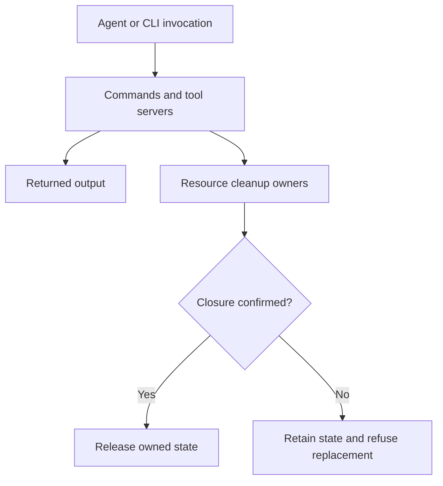

Codex review: blocked before merge. _Reviewed September 6, 2026, 1:02 AM ET / 05:02 UTC._

# ClawSweeper review

## What this changes

The PR carries cleanup uncertainty through agent, CLI, tool-server, and Gateway lifecycles, retains owned state when closure is unconfirmed, and rechecks authority before retained actions.

## Merge readiness

⛔ **Blocked before merge - 3 items remain**

The cleanup-consumer work remains necessary beyond the merged process foundation. No concrete blocking defect was found in the inspected paths; the maintainer’s explicit acceptance of conservative cleanup refusal resolves the prior intent concern.

**Priority:** P2
**Reviewed head:** `5b16717a71e0ed2d5b507e8154f54ee4bd45fa09`

## Review scores

| Measure | Result | What it means |
|---|---|---|
| **Overall readiness** | 🐚 platinum hermit **(4/6)** | A coherent owner-level repair with meaningful boundary coverage and explicit operational tradeoffs; no actionable blocking finding was established. |
| **Proof confidence** | 🌊 off-meta tidepool | Not applicable: The ordinary contributor proof gate is exempt for this maintainer-authored PR. Reported macOS process runs exercise cleanup ownership; inspected real-file revocation tests support the authority checks, with Windows and installed-upgrade limits explicitly retained. |
| **Patch quality** | 🐚 platinum hermit **(4/6)** | No actionable review findings were identified. |

## Verification

| Check | Result | Evidence |
|---|---|---|
| **Real behavior** | Not applicable | Not applicable: The ordinary contributor proof gate is exempt for this maintainer-authored PR. Reported macOS process runs exercise cleanup ownership; inspected real-file revocation tests support the authority checks, with Windows and installed-upgrade limits explicitly retained. |
| **Evidence reviewed** | 12 items | Pinned introduction scope: Inspected the complete introduced file list from the pinned merge base to HEAD, recovering paths omitted from the supplied patches. Base-only Mattermost changes were excluded. Current main still lacks cleanup propagation: Current main's cleanup helper logs failure or timeout and returns without the new cleanup scope or retained uncertainty result. The supplied merged foundation explicitly leaves agent and transport consumers to this dependent PR. Merged foundation provenance: The raw commit record for https://github.com/openclaw/openclaw/pull/139517 describes the process foundation and explicitly defers the remaining consumers. It does not establish that this PR is implemented. |
| **Findings** | None | None. |
| **Security** | None | None. |

## How this fits together

Agent runs launch commands and tool servers whose resources can outlive their returned output. Cleanup owners report whether those resources closed, controlling state release and whether subsequent work may proceed.

## Before merge

- [ ] **Resolve merge risk (P1)** - Previously successful one-shot commands can report cleanup failure and retain state or locks; failed CLI or Gateway cleanup can prevent subsequent owned work. The PR body explicitly accepts this behavior.
- [ ] **Resolve merge risk (P1)** - Native Windows execution and the installed fresh/existing-state matrix remain deferred; the inspected boundary tests do not establish those deployment outcomes.
- [ ] **Review config compatibility** - Confirm compatibility and upgrade impact for the changed config or default surface before merge.

<strong>Agent review details</strong>

### Security

None.

### PR surface

PR surface statistics unavailable: the file list is incomplete.

### Review metrics

| Metric | Value | Why it matters |
|---|---|---|
| **Cleanup API compatibility** | 1 optional cleanup hook; existing dispose retained | Older MCP runtimes remain usable while inability to certify cleanup is represented explicitly. |

### Stored data model

Persistent data-model change detected: `serialized state: src/agents/memory-write-provenance.ts`, `unknown-data-model-change: src/agents/sessions/tools/edit.ts`, `unknown-data-model-change: src/agents/sessions/tools/write.ts`, `unknown-truncated-pull-files`, `vector/embedding metadata: src/agents/memory-write-provenance.ts`. Migration or upgrade compatibility proof is recorded; maintainers should verify it before merge.

### Merge-risk options

**Maintainer options:**
1. **Retain the accepted conservative contract (recommended)**  
   Proceed under the documented refusal behavior and preserve the explicit Stage 5 disposition for installed and Windows validation.

### Technical review

Best possible solution:

Keep cleanup certification with resource owners, preserve completed output and existing plugin disposal, and carry the documented platform and installation validation into the recovery rollout.

Do we have a high-confidence way to reproduce the issue?

Yes, from source: current main logs cleanup failure or timeout without carrying uncertainty to the outer owner. The PR includes targeted regressions, but this read-only review did not execute them.

Is this the best way to solve the issue?

Yes for the reviewed boundary: carrying cleanup evidence from existing owners avoids equating returned output with resource closure, while preserving best-effort plugin disposal.

AGENTS.md: found and applied where relevant.

Codex review notes: model internal, reasoning medium; reviewed against [883d4d65bad1](https://github.com/openclaw/openclaw/commit/883d4d65bad1791755c203a8dfd854e14b4f6e33).

### Labels

Label justifications:

- `P2`: This is a substantive lifecycle reliability repair without evidence of an urgent user-facing regression requiring escalation.
- `merge-risk: 🚨 compatibility`: Stronger cleanup certification can change successful command outcomes and adds an optional plugin cleanup contract.
- `merge-risk: 🚨 availability`: Unconfirmed cleanup intentionally prevents replacement or lifecycle completion, potentially blocking subsequent work.
- `rating: 🐚 platinum hermit`: Overall readiness is 🐚 platinum hermit; proof is 🌊 off-meta tidepool and patch quality is 🐚 platinum hermit.
- `status: 👀 ready for maintainer look`: ClawSweeper has no concrete contributor-facing blocker left for this PR. Not applicable: The ordinary contributor proof gate is exempt for this maintainer-authored PR. Reported macOS process runs exercise cleanup ownership; inspected real-file revocation tests support the authority checks, with Windows and installed-upgrade limits explicitly retained.

### Evidence

What I checked:

- **Pinned introduction scope:** Inspected the complete introduced file list from the pinned merge base to HEAD, recovering paths omitted from the supplied patches. Base-only Mattermost changes were excluded. ([5b16717a71e0](https://github.com/openclaw/openclaw/commit/5b16717a71e0ed2d5b507e8154f54ee4bd45fa09))
- **Current main still lacks cleanup propagation:** Current main's cleanup helper logs failure or timeout and returns without the new cleanup scope or retained uncertainty result. The supplied merged foundation explicitly leaves agent and transport consumers to this dependent PR. ([`src/agents/run-cleanup-timeout.ts:88`](https://github.com/openclaw/openclaw/blob/883d4d65bad1791755c203a8dfd854e14b4f6e33/src/agents/run-cleanup-timeout.ts#L88), [883d4d65bad1](https://github.com/openclaw/openclaw/commit/883d4d65bad1791755c203a8dfd854e14b4f6e33))
- **Merged foundation provenance:** The raw commit record for https://github.com/openclaw/openclaw/pull/139517 describes the process foundation and explicitly defers the remaining consumers. It does not establish that this PR is implemented. ([220578ba3408](https://github.com/openclaw/openclaw/commit/220578ba340863ac127d2076604e461fa693eb6e))
- **Maintainer disposition and review continuity:** The captured PR body accepts retained state and replacement refusal, preserves optional MCP cleanup compatibility, and explicitly defers installed-upgrade and native Windows validation. The previous completed review reports no findings or published rank-up moves. Its earlier SHA was unavailable locally, so patch equivalence across the rebase was not independently established. ([5b16717a71e0](https://github.com/openclaw/openclaw/commit/5b16717a71e0ed2d5b507e8154f54ee4bd45fa09))
- **Affirmative Codex dependency boundary:** The client distinguishes physical transport exit from cleanup certification and marks observed native execution uncertain; the PR explicitly bases this on the pinned Codex terminal contract. ([`extensions/codex/src/app-server/client.ts:752`](https://github.com/openclaw/openclaw/blob/5b16717a71e0ed2d5b507e8154f54ee4bd45fa09/extensions/codex/src/app-server/client.ts#L752), [5b16717a71e0](https://github.com/openclaw/openclaw/commit/5b16717a71e0ed2d5b507e8154f54ee4bd45fa09))
- **Pinned upstream termination semantics:** Personally inspected rust-v0.153.4: local terminate_confirmed requests termination and signals logical exit without awaiting kernel extinction. The backing cache's origin was verified as https://github.com/openai/codex.git. ([`codex-rs/core/src/unified_exec/process.rs:240`](https://github.com/openai/codex/blob/3d2ee51ca2d5db578f328aa75e20aa22c0197c9a/codex-rs/core/src/unified_exec/process.rs#L240), [3d2ee51ca2d5](https://github.com/openai/codex/commit/3d2ee51ca2d5db578f328aa75e20aa22c0197c9a))

Likely related people:

- **steipete:** Suggested for follow-up; no historical authorship or introduction is verified. (role: unverified routing candidate; confidence: low)
- **Sebastien Tardif:** Suggested for follow-up; no historical authorship or introduction is verified. (role: unverified routing candidate; confidence: low)

### Rating scale

| Score | Internal tier | Crab rank | Meaning |
|---:|:---:|---|---|
| **6/6** | S | 🦀 challenger crab | Exceptional readiness |
| **5/6** | A | 🦞 diamond lobster | Very strong readiness |
| **4/6** | B | 🐚 platinum hermit | Good normal PR; ordinary maintainer review |
| **3/6** | C | 🦐 gold shrimp | Useful, but confidence is limited |
| **2/6** | D | 🦪 silver shellfish | Proof or implementation needs work |
| **1/6** | F | 🧂 unranked krab | Not merge-ready |
| N/A | NA | 🌊 off-meta tidepool | Rating does not apply |

Overall follows the weaker of proof and patch quality.
Shiny media proof means a screenshot, video, or linked artifact directly shows the changed behavior. Runtime, network, CSP, and security claims still need visible diagnostics.

### Workflow

- ClawSweeper keeps one durable marker-backed review comment per issue or PR.
- Re-runs edit this comment so the latest verdict, findings, and automation markers stay together instead of adding duplicate bot comments.
- A fresh review can be triggered by eligible `@clawsweeper re-review` comments, exact-item GitHub events, scheduled/background review runs, or manual workflow dispatch.
- PR/issue authors and users with repository write access can comment `@clawsweeper re-review` or `@clawsweeper re-run` on an open PR or issue to request a fresh review only.
- Maintainers can also comment `@clawsweeper review` to request a fresh review only.
- Fresh-review commands do not start repair, autofix, rebase, CI repair, or automerge.
- Maintainer-only repair and merge flows require explicit commands such as `@clawsweeper autofix`, `@clawsweeper automerge`, `@clawsweeper fix ci`, or `@clawsweeper address review`.
- Maintainers can comment `@clawsweeper explain` to ask for more context, or `@clawsweeper stop` to stop active automation.

### History

Review history (3 earlier review cycles)

<!-- clawsweeper-review-history v=1 total=3 -->
- reviewed 2026-09-06T03:09:36.130Z sha f57f2b4a571ce3d4453c4e7b57e4a44ebc92afe0 :: blocked before merge. :: none
- reviewed 2026-09-06T04:02:31.688Z sha cb3bd2bd5bbed4ab30ba10a8ee9ebcdf99b5e868 :: blocked before merge. :: none
- reviewed 2026-09-06T04:48:43.326Z sha f7bc2cebc6bf2051a366a34b71fad0c68dda65fb :: blocked before merge. :: none

<!-- clawsweeper-verdict:needs-human item=139657 sha=5b16717a71e0ed2d5b507e8154f54ee4bd45fa09 confidence=high updated_at=2026-09-06T04:58:44Z reviewed_at=2026-09-06T05:02:13.757Z lease_owner=github-run-34012767825-1 lease_comment_id=5557054402 source_revision=618708211f3f3fa660a6b211c6e7eea6d58626cc8e77c2f5f9beae2dd1870b5e live_verification=absent -->
<!-- clawsweeper-review-state:blocked item=139657 sha=5b16717a71e0ed2d5b507e8154f54ee4bd45fa09 v=1 -->

<!-- clawsweeper-review-version item=139657 reviewed_at=2026-09-06T05:02:13.757Z sha=5b16717a71e0ed2d5b507e8154f54ee4bd45fa09 source_revision=618708211f3f3fa660a6b211c6e7eea6d58626cc8e77c2f5f9beae2dd1870b5e lease_owner=github-run-34012767825-1 lease_comment_id=5557054402 v=1 -->

<!-- clawsweeper-review item=139657 -->