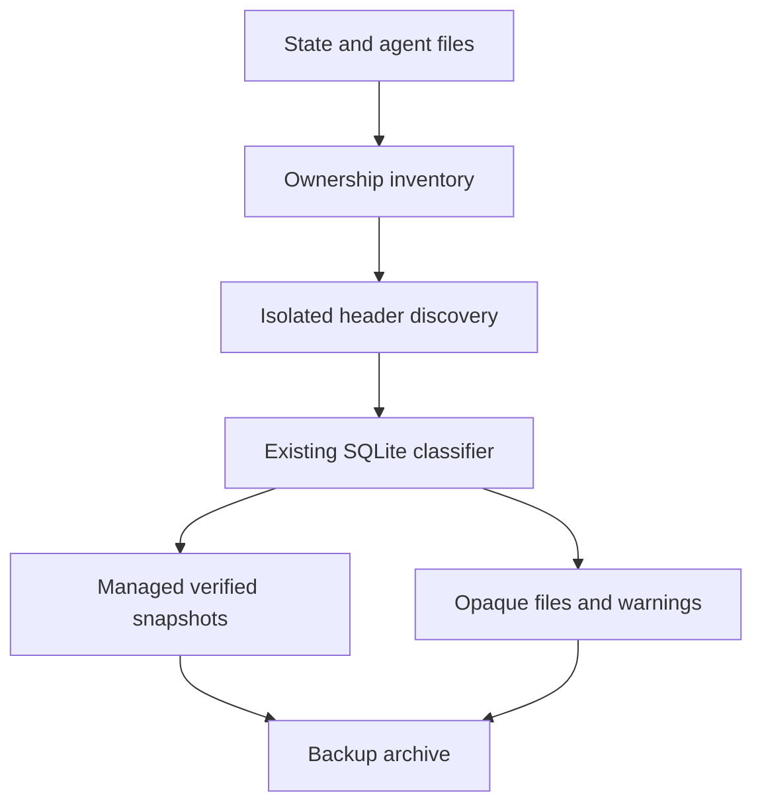

Codex review: needs maintainer review before merge.

## What this changes

Recognize alternatively named SQLite files by their headers and apply the existing managed-snapshot or opaque-copy handling.

**Example:** A declared plugin keeps committed WAL rows in plugins/dedicated/cron-log.db.
- **Before:** Backup copies the raw database and sidecars without managed SQLite snapshot guarantees.
- **After:** Backup captures a verified database image containing the committed rows and omits its sidecars.

## Review scores

| Measure | Result | What it means |
|---|---|---|
| **Overall readiness** | 🐚 platinum hermit **(4/6)** | A focused, correct repair supported by a concrete CLI validation transcript, meaningful owner-level regressions, and successful exact-head CI. |
| **Proof confidence** | 🐚 platinum hermit **(4/6)** | Sufficient (live_output): The supplied CLI validation transcript exercises create, verify, and restore through the changed production owner with a live WAL writer, restored witness rows, integrity checks, opaque warnings, excluded files, ordinary bytes, and capability-refusal guidance; the subsequent head changes tests only. |
| **Patch quality** | 🦞 diamond lobster **(5/6)** | No actionable review findings were identified. |

## Product

**Kind:** Bug fix · **Worth it:** Yes · **Fix scope:** Complete
**User problem:** A verified backup can silently treat an alternatively named managed SQLite database as ordinary files.
**Reason:** Filename spelling should not bypass the established managed backup contract; the patch preserves the deliberate distinction between managed snapshots and opaque foreign files.

## Merge readiness

✅ **Ready for maintainer review**

Keep open: this PR repairs a current filename-dependent backup gap, with no remaining actionable findings.

**Priority:** P2
**Reviewed head:** `67772220d8ab1d32b8db7330e3dcf9fb0c17d171`

## Before merge

None.

## Findings

None.

<strong>Agent review details</strong>

### How this fits together

Backup creation discovers files under state and agent roots, applies the sealed ownership inventory, and emits verified database snapshots or opaque archive entries with warnings.

### Technical review

Best possible solution:

Land header discovery through the existing ownership inventory and verified-snapshot machinery.

Do we have a high-confidence way to reproduce the issue?

Current main's suffix gate independently establishes the reported path, and the linked report supplies an official-release reproduction with a live WAL connection; no target code was executed during this review.

Is this the best way to solve the issue?

The patch is a focused repair: header recognition feeds existing policy and capture owners, while child-process reads avoid releasing live SQLite POSIX locks.

AGENTS.md: found and applied where relevant.

Codex review notes: model internal, reasoning medium; reviewed against [e8b251188f50](https://github.com/openclaw/openclaw/commit/e8b251188f502b088dd037936062a1711ea302e1).

### Provenance checked

- `SQLite filename discovery` changes intended behavior with a stated reason (2f17d11e9018ee9b2536c813fa2a02cd2042c443: The ownership-inventory refactor carried the .sqlite classifier into this module to preserve configured agent roots and canonical validation; the earlier introduction could not be established because an older blob was unavailable.)
- `Managed versus opaque classification` keeps the original intent (b10035faa9d3e0683bef2eb085a0c260e8e40cb5: Keep unrelated databases from preventing backups while retaining strict capture and capability requirements for managed databases.)
- `Hardlink capture and writer locks` keeps the original intent (0b48b3e78c91576a2ad9d02654f474d694d3fae6: Preserve committed WAL data across aliases without releasing the live writer's locks.)
- `Discovery and archive traversal cost` keeps the original intent (4247fa2fccdba8c6c99127c627fe52fb01999947: Avoid expensive privacy checks for every unrelated file; retained batching and cheap rejection preserve that boundary.)

### Testing

Proof path: shipped entry point.

### Security

None.

### Evidence

What I checked:

- **Current main still has the filename restriction:** Current main recognizes only .sqlite names and their sidecars before ownership classification, so the central problem remains unfixed there. ([`src/infra/backup-sqlite-snapshot.ts:93`](https://github.com/openclaw/openclaw/blob/e8b251188f502b088dd037936062a1711ea302e1/src/infra/backup-sqlite-snapshot.ts#L93), [e8b251188f50](https://github.com/openclaw/openclaw/commit/e8b251188f502b088dd037936062a1711ea302e1))
- **Pinned introduced change:** The introduced patch batches regular-file header reads in an isolated Node process, retains answers per inventory, and routes recognized files through existing ownership and capture operations. ([`src/infra/backup-sqlite-snapshot.ts:111`](https://github.com/openclaw/openclaw/blob/67772220d8ab1d32b8db7330e3dcf9fb0c17d171/src/infra/backup-sqlite-snapshot.ts#L111), [67772220d8ab](https://github.com/openclaw/openclaw/commit/67772220d8ab1d32b8db7330e3dcf9fb0c17d171))
- **Supplied CLI behavior and compatibility proof:** The contributor's validation transcript at https://github.com/openclaw/openclaw/pull/148857#issuecomment-6393378612 reports source CLI create, verify, and restore with a live WAL writer; restored witness rows and integrity checks pass, unmanaged files warn, ordinary bytes survive, excluded siblings remain unopened, and unsupported managed capabilities refuse capture. It also verifies and restores a pre-change raw-family archive. ([36e91a7f49fb](https://github.com/openclaw/openclaw/commit/36e91a7f49fb67e851e7027f890ce60331bdccc8))
- **Behavior proof remains applicable to the reviewed head:** The only change after the demonstrated CLI head replaces mocked probe-failure tests with a real archive-owner permission failure regression; production behavior is unchanged. ([`src/infra/backup-create.sqlite-header-probe.test.ts:11`](https://github.com/openclaw/openclaw/blob/67772220d8ab1d32b8db7330e3dcf9fb0c17d171/src/infra/backup-create.sqlite-header-probe.test.ts#L11), [67772220d8ab](https://github.com/openclaw/openclaw/commit/67772220d8ab1d32b8db7330e3dcf9fb0c17d171))
- **Existing ownership contract is preserved:** Merged https://github.com/openclaw/openclaw/pull/146700 deliberately distinguishes managed databases from opaque foreign files and refuses unavailable managed SQLite capabilities; this PR extends recognition without replacing that policy. ([`src/commands/backup-resource-inventory.ts:383`](https://github.com/openclaw/openclaw/blob/b10035faa9d3e0683bef2eb085a0c260e8e40cb5/src/commands/backup-resource-inventory.ts#L383), [b10035faa9d3](https://github.com/openclaw/openclaw/commit/b10035faa9d3e0683bef2eb085a0c260e8e40cb5))
- **Area-owner implementation records the refusal choice:** GitHub verifies steipete authored the repair commit explicitly retaining managed capture refusal and adding recovery guidance for missing plugin SQLite capabilities. ([`src/infra/backup-sqlite-snapshot.ts:470`](https://github.com/openclaw/openclaw/blob/43aa0f6a0563582b13a44ee54337be4606c14422/src/infra/backup-sqlite-snapshot.ts#L470), [43aa0f6a0563](https://github.com/openclaw/openclaw/commit/43aa0f6a0563582b13a44ee54337be4606c14422))

Likely related people:

- **Peter Steinberger:** Raw commit 2f17d11e9018ee9b2536c813fa2a02cd2042c443 adds src/infra/backup-sqlite-snapshot.ts:116 relative to its recorded parents. This identifies author metadata, not feature responsibility or a PR merger. (role: source-line author; confidence: high; commits: [2f17d11e9018](https://github.com/openclaw/openclaw/commit/2f17d11e9018ee9b2536c813fa2a02cd2042c443); files: `src/infra/backup-sqlite-snapshot.ts`)
- **Ayaan Zaidi:** Raw commit b10035faa9d3e0683bef2eb085a0c260e8e40cb5 adds src/infra/backup-sqlite-snapshot.ts:110 relative to its recorded parents. This identifies author metadata, not feature responsibility or a PR merger. (role: source-line author; confidence: high; commits: [b10035faa9d3](https://github.com/openclaw/openclaw/commit/b10035faa9d3e0683bef2eb085a0c260e8e40cb5); files: `src/infra/backup-sqlite-snapshot.ts`)
- **Vincent Koc:** Raw commit 19c5e58c2e863dab8022c754897eb86e4d32ade4 adds src/commands/backup-resource-inventory.ts:247 relative to its recorded parents. This identifies author metadata, not feature responsibility or a PR merger. (role: source-line author; confidence: medium; commits: [19c5e58c2e86](https://github.com/openclaw/openclaw/commit/19c5e58c2e863dab8022c754897eb86e4d32ade4); files: `src/commands/backup-resource-inventory.ts`)

### PR surface

Source +111, Tests +357, Docs +5. Total +473 across 9 files. Added test files: 2.

View PR surface stats

| Area | Files | Added | Removed | Net |
|---|---:|---:|---:|---:|
| Source | 3 | 131 | 20 | +111 |
| Tests | 5 | 359 | 2 | +357 |
| Docs | 1 | 6 | 1 | +5 |
| Config | 0 | 0 | 0 | 0 |
| Generated | 0 | 0 | 0 | 0 |
| Other | 0 | 0 | 0 | 0 |
| **Total** | **9** | **496** | **23** | **+473** |

### Review metrics

| Metric | Value | Why it matters |
|---|---|---|
| **Production versus test changes** | Production +131/-20; tests and fixtures +359/-2 | Production growth supplies isolated header discovery and recovery guidance; tests cover filename recognition, WAL preservation, writer locks, exclusions, probe failure, and traversal work. |

### Labels

Label changes:

- add `proof: sufficient`: Contributor real behavior proof is sufficient.
- add `rating: 🐚 platinum hermit`: Overall readiness is 🐚 platinum hermit; proof is 🐚 platinum hermit and patch quality is 🦞 diamond lobster.
- add `status: 👀 ready for maintainer look`: ClawSweeper has no concrete contributor-facing blocker left for this PR.
- remove `rating: 🧂 unranked krab`: Current PR rating is `rating: 🐚 platinum hermit`, so this older rating label is no longer current.
- remove `status: 📣 needs proof`: Current PR status label is `status: 👀 ready for maintainer look`.

Label justifications:

- `P2`: The bug weakens backup guarantees for alternatively named databases, with limited scope and no demonstrated corruption in the report.
- `merge-risk: 🚨 compatibility`: Newly recognized managed plugin databases now receive the existing capability checks and can refuse backups that previously copied raw bytes; the area-owner repair explicitly retains this behavior and supplies recovery guidance.
- `rating: 🐚 platinum hermit`: Overall readiness is 🐚 platinum hermit; proof is 🐚 platinum hermit and patch quality is 🦞 diamond lobster.
- `status: 👀 ready for maintainer look`: ClawSweeper has no concrete contributor-facing blocker left for this PR.
- `proof: sufficient`: Contributor real behavior proof is sufficient.

### Rating scale

6/6 🦀 challenger crab · 5/6 🦞 diamond lobster · 4/6 🐚 platinum hermit · 3/6 🦐 gold shrimp · 2/6 🦪 silver shellfish · 1/6 🧂 unranked krab. Overall follows the weaker of proof and patch quality; ✨ marks media proof (a screenshot, video, or linked artifact) that directly shows the changed behavior.

### Workflow

ClawSweeper edits this one comment on every review. Comment `@clawsweeper re-review` for a fresh review only. Repair and merge execution lanes are retired.

### History

Review history (16 earlier review cycles; latest 8 shown)

<!-- clawsweeper-review-history v=1 total=16 -->
- reviewed 2026-09-24T10:11:24.039Z sha f97c466568f331413273f05f853b7fe5ac564f40 :: blocked before merge. :: none
- reviewed 2026-10-05T22:41:50.144Z sha f97c466568f331413273f05f853b7fe5ac564f40 :: blocked before merge. :: none
- reviewed 2026-10-05T22:51:12.078Z sha f97c466568f331413273f05f853b7fe5ac564f40 :: blocked before merge. :: none
- reviewed 2026-10-06T08:11:06.402Z sha 9cf024a7b1d17c4792c63b382d8674fc9fc3b7a6 :: blocked before merge. :: none
- reviewed 2026-10-22T17:21:27.082Z sha 9cf024a7b1d17c4792c63b382d8674fc9fc3b7a6 :: blocked before merge. :: none
- reviewed 2026-10-25T02:48:48.311Z sha 43aa0f6a0563582b13a44ee54337be4606c14422 :: needs real behavior proof before merge. :: [P2] Apply file inclusion policy before batching header reads
- reviewed 2026-10-25T03:28:14.043Z sha ea3b928c46668cdf61d4b5bef547cb449ac17c55 :: needs real behavior proof before merge. :: [P2] Reject package content before launching a header probe
- reviewed 2026-10-25T04:04:33.854Z sha 36e91a7f49fb67e851e7027f890ce60331bdccc8 :: needs real behavior proof before merge. :: none

_Reviewed October 25, 2026, 1:50 AM ET / 05:50 UTC (Revision 17)._

<!-- clawsweeper-verdict:needs-human item=148857 sha=67772220d8ab1d32b8db7330e3dcf9fb0c17d171 confidence=high updated_at=2026-10-25T05:45:42Z reviewed_at=2026-10-25T05:50:05.579Z lease_owner=github-run-40166631129-1 lease_comment_id=6394046800 source_revision=baf040b404e69d8e65f46653ee98ec7c3f4d2f0fc1916e1b49891eb212fbc80d hold=not_opted_in findings=0 -->
<!-- clawsweeper-review-state:ready item=148857 sha=67772220d8ab1d32b8db7330e3dcf9fb0c17d171 v=1 -->

<!-- clawsweeper-review-version item=148857 reviewed_at=2026-10-25T05:50:05.579Z sha=67772220d8ab1d32b8db7330e3dcf9fb0c17d171 source_revision=baf040b404e69d8e65f46653ee98ec7c3f4d2f0fc1916e1b49891eb212fbc80d lease_owner=github-run-40166631129-1 lease_comment_id=6394046800 v=1 -->

<!-- clawsweeper-review item=148857 -->