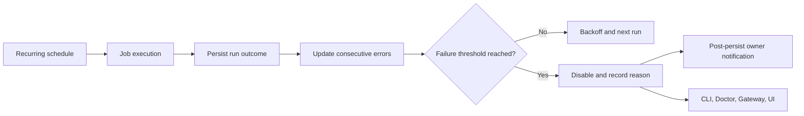

Codex review: needs real behavior proof before merge. _Reviewed August 2, 2026, 2:29 PM ET / 18:29 UTC._

# ClawSweeper review

## What this changes

The PR automatically disables repeatedly failing `cron` and `every` jobs after ten execution failures, records a durable reason, notifies the owning agent after persistence, and exposes that state through CLI, Doctor, Gateway, and UI types.

## Merge readiness

⛔ **Blocked until stronger real behavior proof is added - 5 items remain**

This PR remains necessary: current main can accumulate recurring-job execution errors and only surfaces chronic enabled jobs through Doctor; it does not durably auto-disable a time-based recurring job after a run-failure threshold. The patch follows the scheduler’s existing auto-disable pattern and has no discrete correctness finding, but its new default stop condition and persisted/public state contract need maintainer product confirmation and terminal real-behavior proof before merge. Likely related people: `steipete` (high confidence), based on the current cron implementation history and this PR.

**Priority:** P1
**Reviewed head:** `a1bbdbd7800aa8d9656c72329d8701a086514540`
**Owner decision:** Required. See [Decision needed](#decision-needed).

## Review scores

| Measure | Result | What it means |
|---|---|---|
| **Overall readiness** | 🦐 gold shrimp **(3/6)** | The patch has a coherent owner-boundary design and focused coverage, but its real runtime proof stops before the new terminal transition and recovery behavior. |
| **Proof confidence** | 🦐 gold shrimp **(3/6)** | Needs stronger real behavior proof before merge: The PR body reports focused tests, checks, a build, and a source-blind built CLI/Gateway probe for one error, but it does not show the newly added terminal threshold disable and recovery behavior in a real setup. Add a redacted CLI/Gateway transcript or recording showing the persisted disabled state, owner notification, and re-enable reset. After adding proof, update the PR body; ClawSweeper should re-review automatically. If it does not, the PR author or someone with repository write access can comment `@clawsweeper re-review`. |
| **Patch quality** | 🐚 platinum hermit **(4/6)** | No actionable review findings were identified. |

## Verification

| Check | Result | Evidence |
|---|---|---|
| **Real behavior** | Needs proof | Needs stronger real behavior proof before merge: The PR body reports focused tests, checks, a build, and a source-blind built CLI/Gateway probe for one error, but it does not show the newly added terminal threshold disable and recovery behavior in a real setup. Add a redacted CLI/Gateway transcript or recording showing the persisted disabled state, owner notification, and re-enable reset. After adding proof, update the PR body; ClawSweeper should re-review automatically. If it does not, the PR author or someone with repository write access can comment `@clawsweeper re-review`. |
| **Evidence reviewed** | 6 items | Current-main behavior: Current main increments `state.consecutiveErrors` for error results and resets it after a successful result, but its recurring-error path proceeds to retry/backoff rather than recording a terminal auto-disable state.<br>Existing sibling policy: Current main already auto-disables jobs after three schedule-computation errors, including a deferred notification path; the PR consolidates this with the new run-failure transition instead of adding an unrelated scheduler mechanism.<br>PR owner-boundary implementation: The branch introduces one shared auto-disable owner, applies it only after schedule-ownership and force-preserve gates, and queues notifications until the relevant persistence paths complete. |
| **Findings** | None | None. |
| **Security** | None | None. |

## How this fits together

Cron schedules run agent, command, and system-event jobs, then persist completion state and schedule the next occurrence. This change turns the existing consecutive-error counter into a scheduler-owned terminal state, which is then shown to the operator and delivered to the owning agent as a recovery event.



## Decision needed

| Question | Recommendation |
|---|---|
| Should OpenClaw’s default recurring-job policy stop an existing `cron` or `every` automation after ten consecutive execution failures, with manual re-enable as the recovery path? | **Adopt the fixed safety backstop:** Accept ten consecutive execution failures as the default terminal condition, provided the PR adds terminal-path runtime proof and keeps the documented manual recovery command. |

Why: The patch is technically coherent, but choosing a fixed terminal default changes whether existing operator workflows continue retrying or intentionally stop after persistent failures.

## Before merge

- [ ] **Add real behavior proof** - Needs stronger real behavior proof before merge: The PR body reports focused tests, checks, a build, and a source-blind built CLI/Gateway probe for one error, but it does not show the newly added terminal threshold disable and recovery behavior in a real setup. Add a redacted CLI/Gateway transcript or recording showing the persisted disabled state, owner notification, and re-enable reset. After adding proof, update the PR body; ClawSweeper should re-review automatically. If it does not, the PR author or someone with repository write access can comment `@clawsweeper re-review`.
- [ ] **Resolve merge risk (P1)** - Existing recurring jobs that currently retry indefinitely will stop after ten consecutive execution failures; that is an intentional availability and upgrade behavior change, so the fixed threshold and recovery contract need maintainer acceptance.
- [ ] **Resolve merge risk (P1)** - `state.autoDisabled` is persisted in job state and added to the closed Gateway response schema, so its report-only client contract should be treated as a compatibility commitment once released.
- [ ] **Resolve merge risk (P1)** - The supplied real probe demonstrates one failing scheduled command and durable error counting, but not the new threshold disable, owner notification, and manual recovery flow in a built runtime.


<details>
<summary><strong>Agent review details</strong></summary>

### Security

None.

### PR surface

Source +293, Tests +558, Docs +2. Total +853 across 23 files.

<details>
<summary>View PR surface stats</summary>

| Area | Files | Added | Removed | Net |
|---|---:|---:|---:|---:|
| Source | 13 | 339 | 46 | +293 |
| Tests | 9 | 558 | 0 | +558 |
| Docs | 1 | 2 | 0 | +2 |
| Config | 0 | 0 | 0 | 0 |
| Generated | 0 | 0 | 0 | 0 |
| Other | 0 | 0 | 0 | 0 |
| **Total** | **23** | **899** | **46** | **+853** |

</details>

### Review metrics

| Metric | Value | Why it matters |
|---|---|---|
| **Persisted public cron state** | 1 report-only state field added | `autoDisabled` is persisted in cron state and returned through a closed Gateway response schema, making the new operator-visible contract relevant to upgrade review. |

### Stored data model

Persistent data-model change detected: `migration/backfill/repair: src/commands/doctor/cron/index.test.ts`, `migration/backfill/repair: src/commands/doctor/cron/index.ts`, `migration/backfill/repair: src/cron/service/startup-run-repair.auto-disable.test.ts`, `migration/backfill/repair: src/cron/service/startup-run-repair.ts`, `serialized state: src/cron/service/ops-lifecycle.ts`, `serialized state: src/cron/service/ops.test.ts`, and 3 more. Confirm migration or upgrade compatibility proof before merge.

### Root-cause cluster

Relationship: `fixed_by_candidate`
Canonical: https://github.com/openclaw/openclaw/issues/118089
Summary: This PR is the linked candidate implementation for the recurring-job silent-failure report.

Members:
- `canonical`: https://github.com/openclaw/openclaw/issues/118089 - The PR implements the issue’s requested recurring run-failure threshold, durable reason, and owner notification.

Proposal only: this assessment does not dispatch repair, suppress jobs, mutate sibling items, close, or merge anything.

### Merge-risk options

**Maintainer options:**
1. **Prove and retain the safety backstop (recommended)**  
   Before merge, attach redacted built CLI/Gateway evidence for threshold disable, post-persist notification, and re-enable reset, then merge with the fixed default threshold as an intentional contract.
2. **Accept the operator stop condition**  
   Maintainers may merge with the existing focused tests if they explicitly accept that existing recurring jobs will stop rather than retry after the fixed threshold.
3. **Pause the default behavior change**  
   Keep the current backoff-only behavior if maintainers do not want an unconditional scheduler stop policy for existing recurring jobs.

<details>
<summary>Copy recommended automerge instruction</summary>

```text
@clawsweeper automerge

Special instructions:
Add redacted built CLI/Gateway proof for the tenth failure disabling a recurring job, post-persist owner notification, and `automations enable` resetting the recorded state.
```

</details>

### Technical review

Best possible solution:

Keep one scheduler-owned, post-persist auto-disable transition; explicitly accept the fixed default threshold for existing recurring jobs and add redacted built CLI/Gateway proof that a threshold breach disables the persisted job, sends the recovery event, and cleanly resets on `automations enable`.

Do we have a high-confidence way to reproduce the issue?

Yes, source reproducible: current main persists a recurring job’s consecutive execution-error streak yet does not use it to terminate the recurring schedule. The PR body also reports a real built CLI/Gateway probe for the first failure, while focused tests cover the threshold transition.

Is this the best way to solve the issue?

Yes, conditionally: the branch places the transition at the authoritative outcome and startup-repair owners, preserves stale/forced-run boundaries, and shares the existing schedule-error auto-disable mechanism. The remaining choice is whether the fixed default threshold is the desired product policy for existing jobs.

AGENTS.md: found and applied where relevant.

Codex review notes: model internal, reasoning high; reviewed against [d02101d7ceb6](https://github.com/openclaw/openclaw/commit/d02101d7ceb6a8e9d34c5674479c1abaa467f7ed).

### Labels

Label changes:

- add `P1`: The patch addresses a default recurring automation workflow that can repeatedly fail without an operator-visible terminal outcome.
- add `merge-risk: 🚨 compatibility`: The branch adds a durable, closed-schema cron state field consumed through Gateway, CLI, Doctor, and UI types.
- add `merge-risk: 🚨 availability`: After merge, existing recurring jobs that reach ten consecutive execution failures stop running until an operator re-enables them.
- add `rating: 🦐 gold shrimp`: Overall readiness is 🦐 gold shrimp; proof is 🦐 gold shrimp and patch quality is 🐚 platinum hermit.
- add `status: 📣 needs proof`: The PR needs real behavior proof before ClawSweeper can clear the contributor ask. Needs stronger real behavior proof before merge: The PR body reports focused tests, checks, a build, and a source-blind built CLI/Gateway probe for one error, but it does not show the newly added terminal threshold disable and recovery behavior in a real setup. Add a redacted CLI/Gateway transcript or recording showing the persisted disabled state, owner notification, and re-enable reset. After adding proof, update the PR body; ClawSweeper should re-review automatically. If it does not, the PR author or someone with repository write access can comment `@clawsweeper re-review`.

Label justifications:

- `P1`: The patch addresses a default recurring automation workflow that can repeatedly fail without an operator-visible terminal outcome.
- `merge-risk: 🚨 compatibility`: The branch adds a durable, closed-schema cron state field consumed through Gateway, CLI, Doctor, and UI types.
- `merge-risk: 🚨 availability`: After merge, existing recurring jobs that reach ten consecutive execution failures stop running until an operator re-enables them.
- `rating: 🦐 gold shrimp`: Overall readiness is 🦐 gold shrimp; proof is 🦐 gold shrimp and patch quality is 🐚 platinum hermit.
- `status: 📣 needs proof`: The PR needs real behavior proof before ClawSweeper can clear the contributor ask. Needs stronger real behavior proof before merge: The PR body reports focused tests, checks, a build, and a source-blind built CLI/Gateway probe for one error, but it does not show the newly added terminal threshold disable and recovery behavior in a real setup. Add a redacted CLI/Gateway transcript or recording showing the persisted disabled state, owner notification, and re-enable reset. After adding proof, update the PR body; ClawSweeper should re-review automatically. If it does not, the PR author or someone with repository write access can comment `@clawsweeper re-review`.

### Evidence

What I checked:

- **Current-main behavior:** Current main increments `state.consecutiveErrors` for error results and resets it after a successful result, but its recurring-error path proceeds to retry/backoff rather than recording a terminal auto-disable state. ([`src/cron/service/timer-outcomes.ts:130`](https://github.com/openclaw/openclaw/blob/d02101d7ceb6/src/cron/service/timer-outcomes.ts#L130), [d02101d7ceb6](https://github.com/openclaw/openclaw/commit/d02101d7ceb6))
- **Existing sibling policy:** Current main already auto-disables jobs after three schedule-computation errors, including a deferred notification path; the PR consolidates this with the new run-failure transition instead of adding an unrelated scheduler mechanism. ([`src/cron/service/jobs-scheduling.ts:355`](https://github.com/openclaw/openclaw/blob/d02101d7ceb6/src/cron/service/jobs-scheduling.ts#L355), [d02101d7ceb6](https://github.com/openclaw/openclaw/commit/d02101d7ceb6))
- **PR owner-boundary implementation:** The branch introduces one shared auto-disable owner, applies it only after schedule-ownership and force-preserve gates, and queues notifications until the relevant persistence paths complete. ([`src/cron/service/auto-disable.ts:1`](https://github.com/openclaw/openclaw/blob/a1bbdbd7800a/src/cron/service/auto-disable.ts#L1), [a1bbdbd7800a](https://github.com/openclaw/openclaw/commit/a1bbdbd7800a))
- **Persisted and public state contract:** The branch adds one report-only `autoDisabled` state field to the closed Gateway cron response schema while excluding it from writable runtime state patches; re-enabling clears the record and both error streaks. ([`packages/gateway-protocol/src/schema/cron.ts:430`](https://github.com/openclaw/openclaw/blob/a1bbdbd7800a/packages/gateway-protocol/src/schema/cron.ts#L430), [a1bbdbd7800a](https://github.com/openclaw/openclaw/commit/a1bbdbd7800a))
- **History and current-main provenance:** The current cron service files and the immediately preceding current-main implementation commit are attributed to Peter Steinberger, corresponding to `steipete`; the PR is a direct child of its own base and current main does not contain the new helper or state field. ([`src/cron/service/timer-outcomes.ts:1`](https://github.com/openclaw/openclaw/blob/19aad4ac2a40/src/cron/service/timer-outcomes.ts#L1), [19aad4ac2a40](https://github.com/openclaw/openclaw/commit/19aad4ac2a40))
- **Repository policy:** Full root policy and the applicable UI guide were read. The branch uses the repository’s canonical record guard in Doctor, adds no config option or SQLite schema bump, and its UI change is a type declaration rather than a live bundle or localization change. ([`AGENTS.md:1`](https://github.com/openclaw/openclaw/blob/d02101d7ceb6/AGENTS.md#L1), [d02101d7ceb6](https://github.com/openclaw/openclaw/commit/d02101d7ceb6))

Likely related people:

- **steipete:** Peter Steinberger authored the current-main commit that introduced the cron scheduling, outcome, and state surfaces involved here, and authored this follow-up branch. (role: current cron feature owner and recent area contributor; confidence: high; commits: [19aad4ac2a40](https://github.com/openclaw/openclaw/commit/19aad4ac2a40203fa84b144fa987c9738c05fe43), [a1bbdbd7800a](https://github.com/openclaw/openclaw/commit/a1bbdbd7800aa8d9656c72329d8701a086514540); files: `src/cron/service/timer-outcomes.ts`, `src/cron/service/jobs-scheduling.ts`, `src/cron/service/startup-run-repair.ts`)

### Rank-up moves

Optional improvements that raise the rating; they are not merge blockers.

- Attach redacted built CLI/Gateway evidence for threshold disable, post-persist owner notification, and manual re-enable reset.
- Confirm maintainer acceptance of stopping existing recurring jobs after the fixed failure threshold.

### Rating scale

| Score | Internal tier | Crab rank | Meaning |
|---:|:---:|---|---|
| **6/6** | S | 🦀 challenger crab | Exceptional readiness |
| **5/6** | A | 🦞 diamond lobster | Very strong readiness |
| **4/6** | B | 🐚 platinum hermit | Good normal PR; ordinary maintainer review |
| **3/6** | C | 🦐 gold shrimp | Useful, but confidence is limited |
| **2/6** | D | 🦪 silver shellfish | Proof or implementation needs work |
| **1/6** | F | 🧂 unranked krab | Not merge-ready |
| N/A | NA | 🌊 off-meta tidepool | Rating does not apply |

Overall follows the weaker of proof and patch quality.
Shiny media proof means a screenshot, video, or linked artifact directly shows the changed behavior. Runtime, network, CSP, and security claims still need visible diagnostics.

### Workflow

- ClawSweeper keeps one durable marker-backed review comment per issue or PR.
- Re-runs edit this comment so the latest verdict, findings, and automation markers stay together instead of adding duplicate bot comments.
- A fresh review can be triggered by eligible `@clawsweeper re-review` comments, exact-item GitHub events, scheduled/background review runs, or manual workflow dispatch.
- PR/issue authors and users with repository write access can comment `@clawsweeper re-review` or `@clawsweeper re-run` on an open PR or issue to request a fresh review only.
- Maintainers can also comment `@clawsweeper review` to request a fresh review only.
- Fresh-review commands do not start repair, autofix, rebase, CI repair, or automerge.
- Maintainer-only repair and merge flows require explicit commands such as `@clawsweeper autofix`, `@clawsweeper automerge`, `@clawsweeper fix ci`, or `@clawsweeper address review`.
- Maintainers can comment `@clawsweeper explain` to ask for more context, or `@clawsweeper stop` to stop active automation.

</details>

<!-- clawsweeper-verdict:needs-human item=118113 sha=a1bbdbd7800aa8d9656c72329d8701a086514540 confidence=high updated_at=2026-08-02T18:26:55Z reviewed_at=2026-08-02T18:29:58.315Z lease_owner=github-run-30761095583-1 lease_comment_id=5159739333 source_revision=3057dbb8ca4573053432d4802492ec634ec7f09d3991c0a761ff05139a2d7d57 -->

<!-- clawsweeper-review-version item=118113 reviewed_at=2026-08-02T18:29:58.315Z sha=a1bbdbd7800aa8d9656c72329d8701a086514540 source_revision=3057dbb8ca4573053432d4802492ec634ec7f09d3991c0a761ff05139a2d7d57 lease_owner=github-run-30761095583-1 lease_comment_id=5159739333 v=1 -->

<!-- clawsweeper-review item=118113 -->