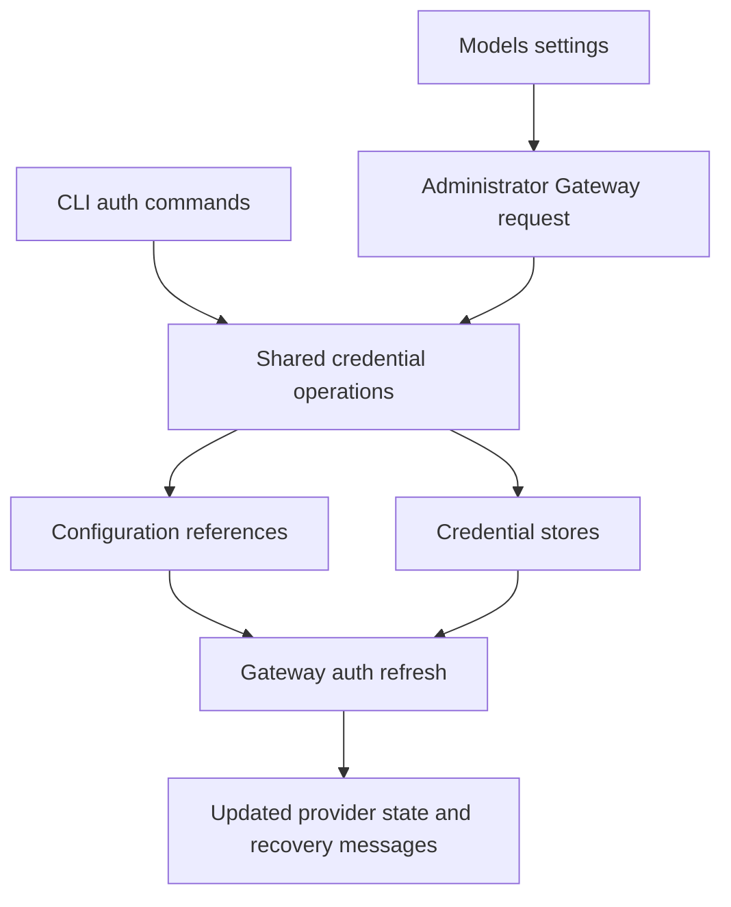

Codex review: blocked before merge. _Reviewed September 10, 2026, 7:28 PM ET / 23:28 UTC (Revision 7)._

# ClawSweeper review

## What this changes

Makes Models settings and CLI commands share API-key selection, storage, removal, and refresh reporting while preserving unrelated credentials and settings.

## Regression provenance

Possible regression — suspected (reviewed change). No predecessor PR is attributed.

## Merge readiness

⛔ **Blocked before merge - 3 items remain**

This PR remains necessary, and the earlier findings are addressed. One remaining inline-key removal race can discard a concurrent credential update.

**Priority:** P2
**Reviewed head:** `ac6e3a16e87931af600b81a67e56bb67dbcc6603`

## Review scores

| Measure | Result | What it means |
|---|---|---|
| **Overall readiness** | 🦐 gold shrimp **(3/6)** | Useful shared-owner repair with substantial recorded proof, held back by one concrete concurrent-removal defect. |
| **Proof confidence** | 🐚 platinum hermit **(4/6)** | Sufficient (live_output): Recorded real Gateway/browser and public CLI runs exercise the shared save/remove owner with durable-state parity, preserved settings, administrator denial, and stored-profile races. That proof remains valid; it does not cover the newly identified inline-key race or live internal-refresh exceptions. |
| **Patch quality** | 🦐 gold shrimp **(3/6)** | 1 actionable review finding remain. |

## Verification

| Check | Result | Evidence |
|---|---|---|
| **Real behavior** | Verified | Sufficient (live_output): Recorded real Gateway/browser and public CLI runs exercise the shared save/remove owner with durable-state parity, preserved settings, administrator denial, and stored-profile races. That proof remains valid; it does not cover the newly identified inline-key race or live internal-refresh exceptions. |
| **Evidence reviewed** | 9 items | Current main still needs the change: Fetched main retains the configured-profile logout refusal and the UI builder that stores API keys directly in provider configuration. The shared editing/removal cutover is therefore still distinct work. Latest release retains the separate UI path: The supplied latest release contains buildProviderApiKeyPatch, which writes the key directly into provider configuration. Inline removal lacks a captured-value guard: API-key-only cleanup classifies and removes literal keys from the config writer’s current snapshot without comparing them with the request’s captured configuration. An empty profile selection bypasses all credential-generation checks, so a newer inline key can be deleted successfully. |
| **Findings** | 1 actionable finding | [P1] Preserve a concurrently replaced inline key during removal |
| **Security** | None | None. |

## How this fits together

Models settings and CLI authentication commands manage credentials used by model providers. Their shared mutation owner updates configuration and credential stores, then refreshes the Gateway’s prepared authentication state.

## Before merge

- [ ] **Preserve a concurrently replaced inline key during removal (P1)** - When `models.authLogout` starts with `credentialType: "api_key"`, an inline provider key, and no stored profiles, another config writer can replace that key before `beforeRemove` acquires the config writer. This loop deletes the **current** literal without comparing it with the captured binding, and the empty profile set lets removal report success. The previous UI `config.patch` path carried a base hash. Capture the inline binding and reject a changed value before cleanup, with a concurrent-replacement regression. This is a late finding: the file is byte-identical to the preceding reviewed revision.
- [ ] **Resolve merge risk (P1)** - The recorded live scenarios do not cover a config-only inline-key replacement while API-key removal waits for the writer; that newer credential can currently be lost.
- [ ] **Complete next step (P2)** - Guard inline-key removal against concurrent config replacement and verify that the newer key survives.

## Findings

- [P1] Preserve a concurrently replaced inline key during removal — `src/commands/models/auth-logout.ts:133-140`

<strong>Agent review details</strong>

### Security

None.

### PR surface

Source +529, Tests +1272, Docs 0, Config +1, Other +5. Total +1807 across 39 files.

View PR surface stats

| Area | Files | Added | Removed | Net |
|---|---:|---:|---:|---:|
| Source | 19 | 857 | 328 | +529 |
| Tests | 16 | 1478 | 206 | +1272 |
| Docs | 1 | 2 | 2 | 0 |
| Config | 1 | 1 | 0 | +1 |
| Generated | 0 | 0 | 0 | 0 |
| Other | 2 | 5 | 0 | +5 |
| **Total** | **39** | **2343** | **536** | **+1807** |

### Review metrics

| Metric | Value | Why it matters |
|---|---|---|
| **Production versus test growth** | production/generated +534 lines; tests/support +1,272 lines | Production growth supports shared credential selection, conditional writes, recovery, and UI cutover. |
| **Gateway contract additions** | 1 administrator RPC and 1 optional logout selector | These route existing Models actions through the shared credential owner without adding a user configuration option. |

### Root-cause cluster

Relationship: `canonical`
Canonical: https://github.com/openclaw/openclaw/pull/144420
Summary: This is the active focused extraction for shared API-key editing and removal.

Members:
- `superseded`: https://github.com/openclaw/openclaw/pull/142851 - The author explicitly replaced this closed-unmerged predecessor with the current PR.
- `adjacent_distinct`: https://github.com/openclaw/openclaw/pull/144181 - Merged login/configuration preservation and auth-refresh groundwork does not implement shared API-key editing and removal.
- `partial_overlap`: https://github.com/openclaw/openclaw/pull/136257 - The broader staging PR contains related model/auth work but is not a viable replacement for this focused extraction.

Proposal only: this assessment does not dispatch repair, suppress jobs, mutate sibling items, close, or merge anything.

### Merge-risk options

**Maintainer options:**
1. **Guard inline-key removal (recommended)**  
   Capture the selected inline binding and reject a changed value under the config writer, with a regression covering concurrent replacement.

### Technical review

Best possible solution:

Keep the shared mutation owner and condition inline-key deletion on the captured binding still matching under the configuration writer.

Do we have a high-confidence way to reproduce the issue?

Yes, from source: start API-key-only removal with an inline key and no stored profiles, replace that literal before the config mutator runs, and cleanup deletes the replacement. This review did not execute the scenario.

Is this the best way to solve the issue?

The shared owner is the right direction, but the repair is incomplete: literal configuration keys need the same captured-generation protection as stored profiles.

Full review comments:

- [P1] Preserve a concurrently replaced inline key during removal — `src/commands/models/auth-logout.ts:133-140`
  When `models.authLogout` starts with `credentialType: "api_key"`, an inline provider key, and no stored profiles, another config writer can replace that key before `beforeRemove` acquires the config writer. This loop deletes the **current** literal without comparing it with the captured binding, and the empty profile set lets removal report success. The previous UI `config.patch` path carried a base hash. Capture the inline binding and reject a changed value before cleanup, with a concurrent-replacement regression. This is a late finding: the file is byte-identical to the preceding reviewed revision.
  Confidence: 0.94
  Late finding: first raised on code an earlier review cycle already covered.

Overall correctness: patch is incorrect
Overall confidence: 0.91

AGENTS.md: found and applied where relevant.

Codex review notes: model internal, reasoning medium; reviewed against [0434aa633824](https://github.com/openclaw/openclaw/commit/0434aa633824bec1dc66c59db56bbf64343ac89d).

### Labels

Label justifications:

- `P2`: This is a bounded Models/CLI credential-management repair rather than an established widespread outage.
- `merge-risk: 🚨 auth-provider`: The introduced removal path can delete a concurrently replaced inline provider key.
- `rating: 🦐 gold shrimp`: Overall readiness is 🦐 gold shrimp; proof is 🐚 platinum hermit and patch quality is 🦐 gold shrimp.
- `status: ⏳ waiting on author`: ClawSweeper has contributor-facing work open and is waiting for author action. Sufficient (live_output): Recorded real Gateway/browser and public CLI runs exercise the shared save/remove owner with durable-state parity, preserved settings, administrator denial, and stored-profile races. That proof remains valid; it does not cover the newly identified inline-key race or live internal-refresh exceptions.
- `proof: sufficient`: Contributor real behavior proof is sufficient. Recorded real Gateway/browser and public CLI runs exercise the shared save/remove owner with durable-state parity, preserved settings, administrator denial, and stored-profile races. That proof remains valid; it does not cover the newly identified inline-key race or live internal-refresh exceptions.

### Evidence

What I checked:

- **Current main still needs the change:** Fetched main retains the configured-profile logout refusal and the UI builder that stores API keys directly in provider configuration. The shared editing/removal cutover is therefore still distinct work. ([`src/commands/models/auth-logout.ts:78`](https://github.com/openclaw/openclaw/blob/0434aa633824bec1dc66c59db56bbf64343ac89d/src/commands/models/auth-logout.ts#L78), [0434aa633824](https://github.com/openclaw/openclaw/commit/0434aa633824bec1dc66c59db56bbf64343ac89d))
- **Latest release retains the separate UI path:** The supplied latest release contains buildProviderApiKeyPatch, which writes the key directly into provider configuration. ([`ui/src/pages/model-providers/mutations.ts:3`](https://github.com/openclaw/openclaw/blob/1391f7cd2d40ab5bbcf2f5f831d3a64f520e72d7/ui/src/pages/model-providers/mutations.ts#L3), [1391f7cd2d40](https://github.com/openclaw/openclaw/commit/1391f7cd2d40ab5bbcf2f5f831d3a64f520e72d7))
- **Inline removal lacks a captured-value guard:** API-key-only cleanup classifies and removes literal keys from the config writer’s current snapshot without comparing them with the request’s captured configuration. An empty profile selection bypasses all credential-generation checks, so a newer inline key can be deleted successfully. ([`src/commands/models/auth-logout.ts:137`](https://github.com/openclaw/openclaw/blob/ac6e3a16e87931af600b81a67e56bb67dbcc6603/src/commands/models/auth-logout.ts#L137), [ac6e3a16e879](https://github.com/openclaw/openclaw/commit/ac6e3a16e87931af600b81a67e56bb67dbcc6603))
- **The UI cutover removes the previous conflict protection:** The old config.patch path sends baseHash. The new external mutation sends models.authLogout with credentialType and no captured binding; its dispatch guard checks connection and permissions, not concurrent configuration values. ([`ui/src/pages/model-providers/config-mutation.ts:133`](https://github.com/openclaw/openclaw/blob/ac6e3a16e87931af600b81a67e56bb67dbcc6603/ui/src/pages/model-providers/config-mutation.ts#L133), [ac6e3a16e879](https://github.com/openclaw/openclaw/commit/ac6e3a16e87931af600b81a67e56bb67dbcc6603))
- **Re-review continuity:** Read the exact earlier auth-logout.ts through GitHub’s contents API and compared its decoded bytes with the checkout: byte-identical, blob 11003fff43f83b31b324fa995c9ddee6fe9997da. The inline-removal concern was already visible in the preceding completed review and is marked late. ([`src/commands/models/auth-logout.ts:137`](https://github.com/openclaw/openclaw/blob/9d134d89bfa41c4654d07ad37acf88e45e6fe897/src/commands/models/auth-logout.ts#L137), [9d134d89bfa4](https://github.com/openclaw/openclaw/commit/9d134d89bfa41c4654d07ad37acf88e45e6fe897))
- **Earlier blockers are repaired:** Current code rejects reference-backed replacement under the write lock, checks concurrent save bindings, rereads surviving credentials after incomplete removal, and restores only cleanup-owned references. Tests cover replacement generations, partial deletion, retained token bindings, and retry. ([`src/commands/models/auth-api-key.test.ts:399`](https://github.com/openclaw/openclaw/blob/ac6e3a16e87931af600b81a67e56bb67dbcc6603/src/commands/models/auth-api-key.test.ts#L399), [ac6e3a16e879](https://github.com/openclaw/openclaw/commit/ac6e3a16e87931af600b81a67e56bb67dbcc6603))

Likely related people:

- **obviyus:** Suggested for follow-up; no historical authorship or introduction is verified. (role: unverified routing candidate; confidence: low)
- **vincentkoc:** Suggested for follow-up; no historical authorship or introduction is verified. (role: unverified routing candidate; confidence: low)
- **jesse-merhi:** Suggested for follow-up; no historical authorship or introduction is verified. (role: unverified routing candidate; confidence: low)

### Rank-up moves

Optional improvements that raise the rating; they are not merge blockers.

- Protect a newer inline provider key from pending removal and add a regression through the shared removal owner.

### Rating scale

| Score | Internal tier | Crab rank | Meaning |
|---:|:---:|---|---|
| **6/6** | S | 🦀 challenger crab | Exceptional readiness |
| **5/6** | A | 🦞 diamond lobster | Very strong readiness |
| **4/6** | B | 🐚 platinum hermit | Good normal PR; ordinary maintainer review |
| **3/6** | C | 🦐 gold shrimp | Useful, but confidence is limited |
| **2/6** | D | 🦪 silver shellfish | Proof or implementation needs work |
| **1/6** | F | 🧂 unranked krab | Not merge-ready |
| N/A | NA | 🌊 off-meta tidepool | Rating does not apply |

Overall follows the weaker of proof and patch quality.
Shiny media proof means a screenshot, video, or linked artifact directly shows the changed behavior. Runtime, network, CSP, and security claims still need visible diagnostics.

### Workflow

- ClawSweeper keeps one durable marker-backed review comment per issue or PR.
- Re-runs edit this comment so the latest verdict, findings, and automation markers stay together instead of adding duplicate bot comments.
- A fresh review can be triggered by eligible `@clawsweeper re-review` comments, exact-item GitHub events, scheduled/background review runs, or manual workflow dispatch.
- PR/issue authors and users with repository write access can comment `@clawsweeper re-review` or `@clawsweeper re-run` on an open PR or issue to request a fresh review only.
- Maintainers can also comment `@clawsweeper review` to request a fresh review only.
- Fresh-review commands do not start repair, autofix, rebase, CI repair, or automerge.
- Maintainer-only repair and merge flows require explicit commands such as `@clawsweeper autofix`, `@clawsweeper automerge`, `@clawsweeper fix ci`, or `@clawsweeper address review`.
- Maintainers can comment `@clawsweeper explain` to ask for more context, or `@clawsweeper stop` to stop active automation.

### History

Review history (6 earlier review cycles)

<!-- clawsweeper-review-history v=1 total=6 -->
- reviewed 2026-09-10T21:18:51.556Z sha 235236960d8c12cf6687943b69c36c9d20dcbd10 :: blocked before merge. :: [P1] [P1] Protect reference-backed profiles in every replacement path | [P1] [P1] Reject a changed provider binding before restoring the old profile | [P1] [P1] Preserve config references when a removal generation changes
- reviewed 2026-09-10T21:46:21.561Z sha 6b8f7d00b91850e99cec8bf5fc30131783c8d6a5 :: blocked before merge. :: [P1] [P1] Protect reference-backed profiles in every replacement path | [P1] [P1] Preserve config references when a removal generation changes
- reviewed 2026-09-10T22:10:25.824Z sha 70dbdc4443be3f3b42e0f2d58ecf881d786087fe :: blocked before merge. :: [P2] [P2] Restore surviving references when store removal throws | [P2] [P2] Exclude committed deletions from configuration rollback
- reviewed 2026-09-10T22:32:06.481Z sha dfaf4e423dd39de69bec47a2fbd707e6d55f7303 :: blocked before merge. :: [P2] [P2] Restore surviving references when store removal throws | [P2] [P2] Exclude committed deletions from configuration rollback
- reviewed 2026-09-10T22:46:04.249Z sha 7c55efc076eb2a779ddd0616caeac3d6691e6bee :: blocked before merge. :: [P1] [P1] Preserve untargeted profile bindings during removal recovery
- reviewed 2026-09-10T23:13:47.031Z sha 9d134d89bfa41c4654d07ad37acf88e45e6fe897 :: needs maintainer review before merge. :: none

<!-- clawsweeper-verdict:needs-human item=144420 sha=ac6e3a16e87931af600b81a67e56bb67dbcc6603 confidence=high updated_at=2026-09-10T23:24:28Z reviewed_at=2026-09-10T23:28:36.019Z lease_owner=github-run-34541828493-1 lease_comment_id=5626790058 source_revision=f6725062109c5dfc281aaf3621539dd96b88f902ddb3a70455cb4cc447d00c0a live_verification=absent -->
<!-- clawsweeper-review-state:blocked item=144420 sha=ac6e3a16e87931af600b81a67e56bb67dbcc6603 v=1 -->

<!-- clawsweeper-review-version item=144420 reviewed_at=2026-09-10T23:28:36.019Z sha=ac6e3a16e87931af600b81a67e56bb67dbcc6603 source_revision=f6725062109c5dfc281aaf3621539dd96b88f902ddb3a70455cb4cc447d00c0a lease_owner=github-run-34541828493-1 lease_comment_id=5626790058 v=1 -->

<!-- clawsweeper-review item=144420 -->