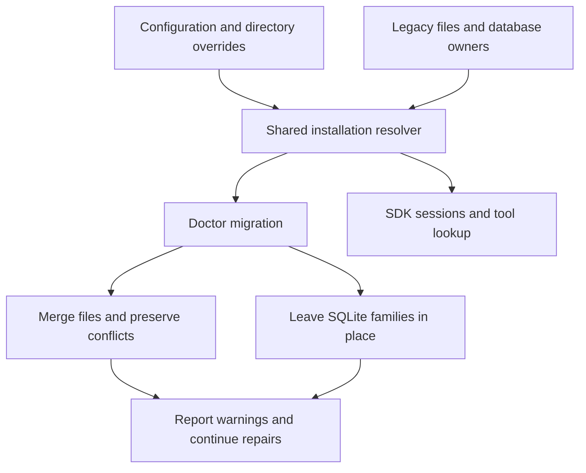

Codex review: needs maintainer review before merge. _Reviewed September 13, 2026, 3:14 AM ET / 07:14 UTC (Revision 26)._

# ClawSweeper review

## What this changes

Doctor preserves legacy directory conflicts, defers SQLite relocation, continues independent repairs, and keeps standalone SDK sessions and tools using the appropriate directory.

## Merge readiness

✅ **Ready for maintainer review**

This remains a useful fix absent from current main. Earlier code findings are resolved, and the matching captured PR body explicitly records acceptance of the updater qualification exception. No actionable patch defects remain.

**Priority:** P1
**Reviewed head:** `1d88ebf8fe3c8c1a3d8567136df43b8c0d959ac6`

## Review scores

| Measure | Result | What it means |
|---|---|---|
| **Overall readiness** | 🐚 platinum hermit **(4/6)** | A useful, bounded repair with meaningful preservation coverage, resolved prior findings, and an explicitly accepted qualification limit. |
| **Proof confidence** | 🌊 off-meta tidepool | Not applicable: The maintainer-authored PR is exempt from ordinary external-contributor proof. Documented SDK/Doctor and real-SQLite regressions cover the changed owners; the matching body explicitly accepts the unrerun published-updater scenario without claiming it passed. |
| **Patch quality** | 🐚 platinum hermit **(4/6)** | No actionable review findings were identified. |

## Verification

| Check | Result | Evidence |
|---|---|---|
| **Real behavior** | Not applicable | Not applicable: The maintainer-authored PR is exempt from ordinary external-contributor proof. Documented SDK/Doctor and real-SQLite regressions cover the changed owners; the matching body explicitly accepts the unrerun published-updater scenario without claiming it passed. |
| **Evidence reviewed** | 9 items | Current main still contains the reported mechanism: The fetched main implementation skips existing destination entries, quarantines the remaining directory, and returns unclassified warnings. The branch's recursive, recoverable migration is still necessary. Released SDK directory contract: The latest supplied release selects the explicit environment directory or the OS-home .openclaw/agent directory. This supports retaining that legacy source independently of state-directory overrides. SQLite preservation and recoverable outcomes: The migration inventories database families before ordinary entries, leaves those families at source, preserves ancillary files for deferred sources, and reports recoverable or deferred outcomes. Ownership mismatches do not transfer stores, and copied-source boundaries are checked before mutation. |
| **Findings** | None | None. |
| **Security** | None | None. |

## How this fits together

Doctor repairs older OpenClaw installation state during maintenance and updates. Its directory decisions also affect where standalone SDK sessions find databases, settings, models, and managed tools.

## Before merge

None.

<strong>Agent review details</strong>

### Security

None.

### PR surface

Source +632, Tests +1391, Docs +12. Total +2035 across 31 files.

View PR surface stats

| Area | Files | Added | Removed | Net |
|---|---:|---:|---:|---:|
| Source | 21 | 823 | 191 | +632 |
| Tests | 9 | 1443 | 52 | +1391 |
| Docs | 1 | 12 | 0 | +12 |
| Config | 0 | 0 | 0 | 0 |
| Generated | 0 | 0 | 0 | 0 |
| Other | 0 | 0 | 0 | 0 |
| **Total** | **31** | **2278** | **243** | **+2035** |

### Review metrics

| Metric | Value | Why it matters |
|---|---|---|
| **Production versus regression coverage** | Production +822/-190; tests and test support +1444/-53 | Production growth implements shared directory selection and preservation planning; the larger test delta covers migration failures, retained sessions, and repeated repairs. |

### Stored data model

Persistent data-model change detected: `migration/backfill/repair: src/commands/doctor.e2e-harness.ts`, `migration/backfill/repair: src/infra/state-migrations.agent-dir-receipt.ts`, `migration/backfill/repair: src/infra/state-migrations.doctor.ts`, `serialized state: src/infra/state-migrations.agent-dir-receipt.ts`, `unknown-data-model-change: src/infra/state-migrations.agent-dir-receipt.ts`, `unknown-data-model-change: src/infra/state-migrations.doctor.ts`. Migration or upgrade compatibility proof is recorded; maintainers should verify it before merge.

### Root-cause cluster

Relationship: `fixed_by_candidate`
Canonical: https://github.com/openclaw/openclaw/issues/146043
Summary: This PR is the implementation candidate for the concrete legacy-directory collision report.

Members:
- `canonical`: https://github.com/openclaw/openclaw/issues/146043 - The report supplies the collision mechanism and expected preservation behavior explicitly addressed by this PR.
- `partial_overlap`: https://github.com/openclaw/openclaw/issues/145252 - The broader upgrade-reliability tracker includes this repair without replacing its individual report.

Proposal only: this assessment does not dispatch repair, suppress jobs, mutate sibling items, close, or merge anything.

### Technical review

Best possible solution:

Doctor should complete independent repairs while keeping existing SDK state usable; database relocation and ownership transfer should remain separately approved work.

Do we have a high-confidence way to reproduce the issue?

Yes, from source: a legacy entry colliding with its destination produces an unclassified warning on current main, which the migration runner treats as a refusal. This read-only review did not execute the reproduction.

Is this the best way to solve the issue?

Yes. The patch repairs the existing migration owner, shares directory resolution, and avoids unsafe SQLite movement; the remaining published-updater qualification limit has an explicit recorded acceptance.

AGENTS.md: found and applied where relevant.

Codex review notes: model internal, reasoning medium; reviewed against [3f849337ee97](https://github.com/openclaw/openclaw/commit/3f849337ee978fcf8b23072de1ca203d3f23656f).

### Labels

Label changes:

- remove `merge-risk: 🚨 compatibility`: Current PR review selected no merge-risk labels.

Label justifications:

- `P1`: The linked report establishes that legacy-directory collisions block later Doctor repairs during real upgrade recovery.
- `rating: 🐚 platinum hermit`: Overall readiness is 🐚 platinum hermit; proof is 🌊 off-meta tidepool and patch quality is 🐚 platinum hermit.
- `status: 👀 ready for maintainer look`: ClawSweeper has no concrete contributor-facing blocker left for this PR. Not applicable: The maintainer-authored PR is exempt from ordinary external-contributor proof. Documented SDK/Doctor and real-SQLite regressions cover the changed owners; the matching body explicitly accepts the unrerun published-updater scenario without claiming it passed.

### Evidence

What I checked:

- **Current main still contains the reported mechanism:** The fetched main implementation skips existing destination entries, quarantines the remaining directory, and returns unclassified warnings. The branch's recursive, recoverable migration is still necessary. ([`src/infra/state-migrations.legacy-sessions.ts:391`](https://github.com/openclaw/openclaw/blob/3f849337ee978fcf8b23072de1ca203d3f23656f/src/infra/state-migrations.legacy-sessions.ts#L391), [3f849337ee97](https://github.com/openclaw/openclaw/commit/3f849337ee978fcf8b23072de1ca203d3f23656f))
- **Released SDK directory contract:** The latest supplied release selects the explicit environment directory or the OS-home .openclaw/agent directory. This supports retaining that legacy source independently of state-directory overrides. ([`src/agents/config.ts:127`](https://github.com/openclaw/openclaw/blob/3a9d69db306cd7f081e06254cb89c4bcc14a7107/src/agents/config.ts#L127), [3a9d69db306c](https://github.com/openclaw/openclaw/commit/3a9d69db306cd7f081e06254cb89c4bcc14a7107))
- **SQLite preservation and recoverable outcomes:** The migration inventories database families before ordinary entries, leaves those families at source, preserves ancillary files for deferred sources, and reports recoverable or deferred outcomes. Ownership mismatches do not transfer stores, and copied-source boundaries are checked before mutation. ([`src/infra/state-migrations.legacy-sessions.ts:485`](https://github.com/openclaw/openclaw/blob/1d88ebf8fe3c8c1a3d8567136df43b8c0d959ac6/src/infra/state-migrations.legacy-sessions.ts#L485), [1d88ebf8fe3c](https://github.com/openclaw/openclaw/commit/1d88ebf8fe3c8c1a3d8567136df43b8c0d959ac6))
- **Earlier system-tool finding resolved:** Managed-bin resolution is optional, system fd/rg remain available without an ambient owner, and shell PATH is preserved. The added cases also verify that missing tools do not initiate downloads or modify installation files. ([`src/agents/utils/tools-manager.test.ts:82`](https://github.com/openclaw/openclaw/blob/1d88ebf8fe3c8c1a3d8567136df43b8c0d959ac6/src/agents/utils/tools-manager.test.ts#L82), [1d88ebf8fe3c](https://github.com/openclaw/openclaw/commit/1d88ebf8fe3c8c1a3d8567136df43b8c0d959ac6))
- **Database and session regression coverage:** Reviewed regression cases retain WAL-only rows through ordinary-file failures, preserve both database families on repeated runs, and reopen original SDK sessions with their recorded owner after Doctor. These address the prior SQLite rollback, external-transcript, and owner-cutover concerns without moving databases. ([`src/infra/state-migrations.recoverable-legacy-state.test.ts:217`](https://github.com/openclaw/openclaw/blob/1d88ebf8fe3c8c1a3d8567136df43b8c0d959ac6/src/infra/state-migrations.recoverable-legacy-state.test.ts#L217), [1d88ebf8fe3c](https://github.com/openclaw/openclaw/commit/1d88ebf8fe3c8c1a3d8567136df43b8c0d959ac6))
- **Captured-body identity and explicit exception:** The retrieved body hashes to f209f08dd5225783195a2db13546c37d687d4a676c99851eb6e64394d7631990, matching the supplied snapshot. Its previously omitted closing section records maintainer approval for this exact head using the documented regression, SDK/Doctor, build, and CI evidence, explicitly accepting that published-updater × candidate installation was not rerun. This satisfies the previous review's alternative of recording an explicit exception; it does not establish that the updater scenario passed. ([1d88ebf8fe3c](https://github.com/openclaw/openclaw/commit/1d88ebf8fe3c8c1a3d8567136df43b8c0d959ac6))

Likely related people:

- **unknown:** The claimed source-line change could not be verified from bounded local history. (role: source history unknown; confidence: low)
- **steipete:** Suggested for follow-up; no historical authorship or introduction is verified. (role: unverified routing candidate; confidence: low)

### Rating scale

| Score | Internal tier | Crab rank | Meaning |
|---:|:---:|---|---|
| **6/6** | S | 🦀 challenger crab | Exceptional readiness |
| **5/6** | A | 🦞 diamond lobster | Very strong readiness |
| **4/6** | B | 🐚 platinum hermit | Good normal PR; ordinary maintainer review |
| **3/6** | C | 🦐 gold shrimp | Useful, but confidence is limited |
| **2/6** | D | 🦪 silver shellfish | Proof or implementation needs work |
| **1/6** | F | 🧂 unranked krab | Not merge-ready |
| N/A | NA | 🌊 off-meta tidepool | Rating does not apply |

Overall follows the weaker of proof and patch quality.
Shiny media proof means a screenshot, video, or linked artifact directly shows the changed behavior. Runtime, network, CSP, and security claims still need visible diagnostics.

### Workflow

- ClawSweeper keeps one durable marker-backed review comment per issue or PR.
- Re-runs edit this comment so the latest verdict, findings, and automation markers stay together instead of adding duplicate bot comments.
- A fresh review can be triggered by eligible `@clawsweeper re-review` comments, exact-item GitHub events, scheduled/background review runs, or manual workflow dispatch.
- PR/issue authors and users with repository write access can comment `@clawsweeper re-review` or `@clawsweeper re-run` on an open PR or issue to request a fresh review only.
- Maintainers can also comment `@clawsweeper review` to request a fresh review only.
- Fresh-review commands do not start repair, autofix, rebase, CI repair, or automerge.
- Maintainer-only repair and merge flows require explicit commands such as `@clawsweeper autofix`, `@clawsweeper automerge`, `@clawsweeper fix ci`, or `@clawsweeper address review`.
- Maintainers can comment `@clawsweeper explain` to ask for more context, or `@clawsweeper stop` to stop active automation.

### History

Review history (25 earlier review cycles; latest 8 shown)

<!-- clawsweeper-review-history v=1 total=25 -->
- reviewed 2026-09-13T00:55:13.246Z sha a0a542720f38455da6262ffe828a8086e6aadf1c :: blocked before merge. :: [P1] [P1] Preserve the existing SDK store owner through cutover | [P1] [P1] Keep system search binaries usable without an ambient owner | [P1] [P1] Preserve cold transcript archives when moving SDK databases
- reviewed 2026-09-13T01:24:54.122Z sha 2a041c771c043f7a7a52ec25ed98e8598ad45901 :: blocked before merge. :: [P1] Keep system search binaries usable without an ambient owner | [P1] Preserve external cold transcripts before moving SDK databases
- reviewed 2026-09-13T01:50:26.476Z sha c69b43ae31048b4d65f7f02675b726d33403668c :: blocked before merge. :: [P1] Keep system search binaries usable without an ambient owner | [P1] Preserve external cold transcripts before moving SDK databases
- reviewed 2026-09-13T02:09:25.706Z sha c69b43ae31048b4d65f7f02675b726d33403668c :: blocked before merge. :: [P1] Keep system search binaries usable without an ambient owner | [P1] Preserve external cold transcripts before moving SDK databases
- reviewed 2026-09-13T04:22:47.609Z sha f9b91e0aa49bb4e9d5dc05455903a52a067e4b51 :: blocked before merge. :: [P1] Keep system search binaries usable without an ambient owner | [P1] Preserve external cold transcripts before moving SDK databases
- reviewed 2026-09-13T05:03:54.425Z sha f9b91e0aa49bb4e9d5dc05455903a52a067e4b51 :: blocked before merge. :: [P1] Preserve complete SQLite families when rollback itself fails | [P1] Keep system search binaries usable without an ambient owner | [P1] Preserve external cold transcripts before certifying SDK cutover
- reviewed 2026-09-13T06:01:24.878Z sha b21a10567f9beecb5069458a4c12365166dabadb :: blocked before merge. :: [P1] [P1] Keep system binaries usable without an ambient owner
- reviewed 2026-09-13T06:24:54.808Z sha 1d88ebf8fe3c8c1a3d8567136df43b8c0d959ac6 :: blocked before merge. :: none

<!-- clawsweeper-verdict:needs-human item=146092 sha=1d88ebf8fe3c8c1a3d8567136df43b8c0d959ac6 confidence=high updated_at=2026-09-13T07:11:39Z reviewed_at=2026-09-13T07:14:52.598Z lease_owner=github-run-34744550882-1 lease_comment_id=5651867104 source_revision=d6b56aebcb3cedae2875a31d2cfea2a6d3ccad2e58f82902ddb2e4f37ab1f86e live_verification=absent -->
<!-- clawsweeper-review-state:ready item=146092 sha=1d88ebf8fe3c8c1a3d8567136df43b8c0d959ac6 v=1 -->

<!-- clawsweeper-review-version item=146092 reviewed_at=2026-09-13T07:14:52.598Z sha=1d88ebf8fe3c8c1a3d8567136df43b8c0d959ac6 source_revision=d6b56aebcb3cedae2875a31d2cfea2a6d3ccad2e58f82902ddb2e4f37ab1f86e lease_owner=github-run-34744550882-1 lease_comment_id=5651867104 v=1 -->

<!-- clawsweeper-review item=146092 -->