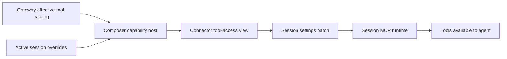

Codex review: needs real behavior proof before merge. _Reviewed July 29, 2026, 11:13 AM ET / 15:13 UTC._

# ClawSweeper review

## What this changes

This PR adds a Control UI composer view where operators can inspect each MCP connector’s effective tools and toggle individual tool denials for the active session.

## Merge readiness

⛔ **Blocked until real behavior proof from a real setup is added - 3 items remain**

Keep this PR open for normal maintainer review and real Control UI behavior proof. The branch appears to build on the already merged session-override, composer-menu, and effective-tool catalog work; no discrete patch defect is established from the supplied diff, but mocked tests and delegated checks do not show an after-fix operator flow that loads a connector catalog and persists a per-tool session change.

**Priority:** P3
**Reviewed head:** `6d964e155a1d501f78298530da5dbb342711e8f8`

## Review scores

| Measure | Result | What it means |
|---|---|---|
| **Overall readiness** | 🦪 silver shellfish **(2/6)** | The patch has focused implementation and supplemental validation, but merge readiness is capped by missing real behavior proof for the operator-visible session control. |
| **Proof confidence** | 🧂 unranked krab **(1/6)** | Needs real behavior proof before merge: The PR reports focused tests, mocked-browser tests, i18n verification, and delegated checks, but it contains no redacted after-fix real Control UI proof of catalog loading and persisted per-tool session state. Add a screenshot, recording, terminal/live output, or redacted logs; redact private endpoints, IP addresses, tokens, and other sensitive details. After adding proof, update the PR body; ClawSweeper should re-review automatically. If it does not, the PR author or someone with repository write access can comment `@clawsweeper re-review`. |
| **Patch quality** | 🐚 platinum hermit **(4/6)** | No actionable review findings were identified. |

## Verification

| Check | Result | Evidence |
|---|---|---|
| **Real behavior** | Needs proof | Needs real behavior proof before merge: The PR reports focused tests, mocked-browser tests, i18n verification, and delegated checks, but it contains no redacted after-fix real Control UI proof of catalog loading and persisted per-tool session state. Add a screenshot, recording, terminal/live output, or redacted logs; redact private endpoints, IP addresses, tokens, and other sensitive details. After adding proof, update the PR body; ClawSweeper should re-review automatically. If it does not, the PR author or someone with repository write access can comment `@clawsweeper re-review`. |
| **Evidence reviewed** | 5 items | Merged prerequisite contracts: The related pull requests for session-level tool overrides, the composer capability menu, and MCP tool identity in the effective-tools catalog are all merged, providing the session patch and catalog data this UI consumes.<br>Composer host integration: The proposed host adds advertised-method gating, catalog loading and invalidation, and session override patching for the tool-access subview.<br>Raw MCP identity preservation: The proposed menu derives per-tool state from the effective catalog and writes raw MCP tool names through sparse mcpToolsDeny overrides, avoiding sanitized-label collisions. |
| **Findings** | None | None. |
| **Security** | None | None. |

## How this fits together

The Control UI composer obtains the Gateway’s effective-tool catalog for the active agent and exposes it by MCP connector. A selected tool is written as a sparse per-session denial, which the agent runtime applies when it constructs that session’s MCP tools.



## Before merge

- [ ] **Add real behavior proof** - Needs real behavior proof before merge: The PR reports focused tests, mocked-browser tests, i18n verification, and delegated checks, but it contains no redacted after-fix real Control UI proof of catalog loading and persisted per-tool session state. Add a screenshot, recording, terminal/live output, or redacted logs; redact private endpoints, IP addresses, tokens, and other sensitive details. After adding proof, update the PR body; ClawSweeper should re-review automatically. If it does not, the PR author or someone with repository write access can comment `@clawsweeper re-review`.
- [ ] **Resolve merge risk (P1)** - This UI writes persistent per-session `mcpToolsDeny` state; before merge, proof should show that toggling a raw MCP tool name affects only the active session and remains correctly reconciled after the session row refreshes.
- [ ] **Resolve merge risk (P1)** - The PR carries the protected `maintainer` label, so it requires explicit maintainer handling even if implementation review remains positive.


<details>
<summary><strong>Agent review details</strong></summary>

### Security

None.

### PR surface

Source +339, Tests +367. Total +706 across 8 files.

<details>
<summary>View PR surface stats</summary>

| Area | Files | Added | Removed | Net |
|---|---:|---:|---:|---:|
| Source | 5 | 356 | 17 | +339 |
| Tests | 3 | 373 | 6 | +367 |
| Docs | 0 | 0 | 0 | 0 |
| Config | 0 | 0 | 0 | 0 |
| Generated | 0 | 0 | 0 | 0 |
| Other | 0 | 0 | 0 | 0 |
| **Total** | **8** | **729** | **23** | **+706** |

</details>

### Review metrics

None.

### Stored data model

Persistent data-model change detected: `serialized state: ui/src/lib/sessions/tool-overrides.test.ts`, `serialized state: ui/src/lib/sessions/tool-overrides.ts`, `unknown-data-model-change: ui/src/lib/sessions/tool-overrides.test.ts`, `unknown-data-model-change: ui/src/lib/sessions/tool-overrides.ts`. Confirm migration or upgrade compatibility proof before merge.

### Mantis proof suggestion

A Mantis web UI chat pass could independently capture the composer interaction that the current mocked tests cannot show in a real Control UI setup. A maintainer can ask Mantis to capture proof by posting this exact PR comment:

```text
@openclaw-mantis web UI chat proof: verify and capture opening a connector’s Tool access, toggling one MCP tool for the active session, and showing the persisted state after refresh.
```

### Merge-risk options

**Maintainer options:**
1. **Prove session-scoped persistence before merge (recommended)**  
   Attach redacted real Control UI evidence that a per-tool change loads from the Gateway and persists for the active session without affecting unrelated session state.
2. **Pause for a focused session-state review**  
   Keep the PR open if maintainers want to inspect the replacement-patch and reconciliation behavior before accepting this new composer control.

### Technical review

Best possible solution:

Capture redacted after-fix Control UI evidence of opening one connector, loading its effective tools, toggling a tool, and showing the persisted active-session state after reconciliation or reload; then complete maintainer review of the session-state behavior.

Do we have a high-confidence way to reproduce the issue?

Not applicable: this PR proposes a new composer capability rather than reporting a failing existing behavior. The supplied mocked-browser tests exercise the intended path but do not constitute a current-user bug reproduction.

Is this the best way to solve the issue?

Yes, provisionally: extending the existing composer capability menu over the merged effective-tool and session-override contracts is the narrowest coherent boundary. A real after-fix UI run is still needed to confirm the proposed caching, loading, and persisted-session behavior together.

AGENTS.md: unclear because the file could not be read completely.

Codex review notes: model internal, reasoning high; reviewed against [383f8947c1da](https://github.com/openclaw/openclaw/commit/383f8947c1daa9deacec4dc9cf312ffd254ecbf6).

### Labels

Label justifications:

- `P3`: This is a useful but non-urgent Control UI capability addition rather than a reported default-path regression.
- `merge-risk: 🚨 session-state`: The new control modifies sparse persisted session tool overrides, so an incorrect patch or reconciliation could leave a session with unintended tool access.
- `rating: 🦪 silver shellfish`: Overall readiness is 🦪 silver shellfish; proof is 🧂 unranked krab and patch quality is 🐚 platinum hermit.
- `status: 📣 needs proof`: The PR needs real behavior proof before ClawSweeper can clear the contributor ask. Needs real behavior proof before merge: The PR reports focused tests, mocked-browser tests, i18n verification, and delegated checks, but it contains no redacted after-fix real Control UI proof of catalog loading and persisted per-tool session state. Add a screenshot, recording, terminal/live output, or redacted logs; redact private endpoints, IP addresses, tokens, and other sensitive details. After adding proof, update the PR body; ClawSweeper should re-review automatically. If it does not, the PR author or someone with repository write access can comment `@clawsweeper re-review`.

### Evidence

What I checked:

- **Merged prerequisite contracts:** The related pull requests for session-level tool overrides, the composer capability menu, and MCP tool identity in the effective-tools catalog are all merged, providing the session patch and catalog data this UI consumes. ([a37a5a657531](https://github.com/openclaw/openclaw/commit/a37a5a657531))
- **Composer host integration:** The proposed host adds advertised-method gating, catalog loading and invalidation, and session override patching for the tool-access subview. ([`ui/src/pages/chat/chat-composer-capability-host.ts`](https://github.com/openclaw/openclaw/blob/6d964e155a1d/ui/src/pages/chat/chat-composer-capability-host.ts), [6d964e155a1d](https://github.com/openclaw/openclaw/commit/6d964e155a1d))
- **Raw MCP identity preservation:** The proposed menu derives per-tool state from the effective catalog and writes raw MCP tool names through sparse mcpToolsDeny overrides, avoiding sanitized-label collisions. ([`ui/src/pages/chat/components/chat-composer-plus-menu.ts`](https://github.com/openclaw/openclaw/blob/6d964e155a1d/ui/src/pages/chat/components/chat-composer-plus-menu.ts), [6d964e155a1d](https://github.com/openclaw/openclaw/commit/6d964e155a1d))
- **Focused supplemental validation:** The PR body reports unit/component coverage for sparse overrides and mocked-browser coverage for denied startup state, collisions, count summaries, toggles, navigation, and readiness gating; these support the implementation but are not real after-fix UI proof. ([`ui/src/e2e/chat-composer-capability-menu.e2e.test.ts`](https://github.com/openclaw/openclaw/blob/6d964e155a1d/ui/src/e2e/chat-composer-capability-menu.e2e.test.ts), [6d964e155a1d](https://github.com/openclaw/openclaw/commit/6d964e155a1d))
- **Area provenance:** The same contributor previously landed the merged composer capability menu and adjacent session/catalog seams, making the current work a continuation of that feature history rather than an isolated parallel implementation. ([`ui/src/pages/chat/components/chat-composer-plus-menu.ts`](https://github.com/openclaw/openclaw/blob/f27899181ed0/ui/src/pages/chat/components/chat-composer-plus-menu.ts), [f27899181ed0](https://github.com/openclaw/openclaw/commit/f27899181ed0))

Likely related people:

- **steipete:** Authored the merged session override, composer capability menu, and effective-tool identity changes that establish this PR’s runtime and UI boundary. (role: feature owner and recent area contributor; confidence: high; commits: [a37a5a657531](https://github.com/openclaw/openclaw/commit/a37a5a65753117f7df1ba79e665395761e14ff74), [f27899181ed0](https://github.com/openclaw/openclaw/commit/f27899181ed06088281b1d129ace05dc443f0799), [adf3178ae6c4](https://github.com/openclaw/openclaw/commit/adf3178ae6c42a153f126313414c2083949a1c2d); files: `ui/src/pages/chat/chat-composer-capability-host.ts`, `ui/src/pages/chat/components/chat-composer-plus-menu.ts`, `ui/src/lib/sessions/tool-overrides.ts`)

### Rank-up moves

Optional improvements that raise the rating; they are not merge blockers.

- Add redacted real Control UI evidence for connector catalog loading, a per-tool toggle, and the resulting persisted active-session state.

### Rating scale

| Score | Internal tier | Crab rank | Meaning |
|---:|:---:|---|---|
| **6/6** | S | 🦀 challenger crab | Exceptional readiness |
| **5/6** | A | 🦞 diamond lobster | Very strong readiness |
| **4/6** | B | 🐚 platinum hermit | Good normal PR; ordinary maintainer review |
| **3/6** | C | 🦐 gold shrimp | Useful, but confidence is limited |
| **2/6** | D | 🦪 silver shellfish | Proof or implementation needs work |
| **1/6** | F | 🧂 unranked krab | Not merge-ready |
| N/A | NA | 🌊 off-meta tidepool | Rating does not apply |

Overall follows the weaker of proof and patch quality.
Shiny media proof means a screenshot, video, or linked artifact directly shows the changed behavior. Runtime, network, CSP, and security claims still need visible diagnostics.

### Workflow

- ClawSweeper keeps one durable marker-backed review comment per issue or PR.
- Re-runs edit this comment so the latest verdict, findings, and automation markers stay together instead of adding duplicate bot comments.
- A fresh review can be triggered by eligible `@clawsweeper re-review` comments, exact-item GitHub events, scheduled/background review runs, or manual workflow dispatch.
- PR/issue authors and users with repository write access can comment `@clawsweeper re-review` or `@clawsweeper re-run` on an open PR or issue to request a fresh review only.
- Maintainers can also comment `@clawsweeper review` to request a fresh review only.
- Fresh-review commands do not start repair, autofix, rebase, CI repair, or automerge.
- Maintainer-only repair and merge flows require explicit commands such as `@clawsweeper autofix`, `@clawsweeper automerge`, `@clawsweeper fix ci`, or `@clawsweeper address review`.
- Maintainers can comment `@clawsweeper explain` to ask for more context, or `@clawsweeper stop` to stop active automation.

### History

<details>
<summary>Review history (4 earlier review cycles)</summary>

<!-- clawsweeper-review-history v=1 total=4 -->
- reviewed 2026-07-29T13:28:44.091Z sha 124d9b30e03b11df1142cbdd193c619ce1233814 :: needs real behavior proof before merge. :: none
- reviewed 2026-07-29T14:04:35.838Z sha 126f54e5994afae6e731d8686780adfafb384a72 :: needs real behavior proof before merge. :: none
- reviewed 2026-07-29T14:38:39.516Z sha 10558cc3aa60c01406908cc51e38f0578fb4b283 :: needs real behavior proof before merge. :: none
- reviewed 2026-07-29T14:48:50.675Z sha 1a5d7cd32f2f412fb9b7edf6d05f22fc3471f73d :: needs real behavior proof before merge. :: none

</details>

</details>

<!-- clawsweeper-verdict:needs-human item=115907 sha=6d964e155a1d501f78298530da5dbb342711e8f8 confidence=medium updated_at=2026-07-29T15:11:20Z reviewed_at=2026-07-29T15:13:04.079Z lease_owner=github-run-30464525279-1 lease_comment_id=5119747343 source_revision=fb86aa0895eb7c5a82f7c5ec5a898c1b1793f669074c61d107c0fd8e9827065c -->

<!-- clawsweeper-review-version item=115907 reviewed_at=2026-07-29T15:13:04.079Z sha=6d964e155a1d501f78298530da5dbb342711e8f8 source_revision=fb86aa0895eb7c5a82f7c5ec5a898c1b1793f669074c61d107c0fd8e9827065c lease_owner=github-run-30464525279-1 lease_comment_id=5119747343 v=1 -->

<!-- clawsweeper-review item=115907 -->