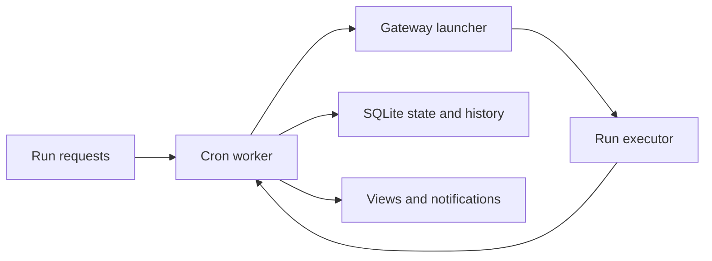

Codex review: blocked before merge.

## What this changes

This PR consolidates cron results and restart recovery in the worker while preserving opt-in execution identity audit links.

**Example:** A one-shot scheduled for 12:00 becomes active, then the Gateway crashes before recording its result.
- **Before:** Recovery could replay the payload when delivery was recorded as not started.
- **After:** Recovery records an interruption with delivery Unknown and disables the uncertain one-shot.

## Review scores

| Measure | Result | What it means |
|---|---|---|
| **Overall readiness** | 🦐 gold shrimp **(3/6)** | The consolidation is coherent and supported by inspected boundary coverage; upgrade acceptance and failed-check attribution remain incomplete. |
| **Proof confidence** | 🦐 gold shrimp **(3/6)** | This maintainer-authored PR is outside the ordinary contributor proof gate; copied released-database recovery supports compatibility, but the body explicitly excludes the installed-updater acceptance required by the staged design. |
| **Patch quality** | 🐚 platinum hermit **(4/6)** | No actionable review findings were identified. |

## Product

**Kind:** Refactor · **Worth it:** Yes · **Fix scope:** Complete
**User problem:** Operators need durable execution and delivery outcomes across restart without replaying uncertain external effects.
**Reason:** The maintainer-directed design accepts the crash-loss tradeoff, and the patch removes competing machinery without adding public configuration or changing permission ownership.

## Merge readiness

⛔ **Blocked before merge - 2 items remain**

Keep open: this maintainer-directed PR completes a useful worker ownership cutover, and no definite introduced correctness defect was found.

**Priority:** P2
**Reviewed head:** `ca1b2fe6e8ff35290ffb5e4267f67f5005459b97`

## Before merge

- [ ] **Complete next step** - Inspect the failed changed-lint and docs-formatting diagnostics, classify their cause, and repair only failures introduced by this PR.
- [ ] **Add data-model compatibility proof** - The review found that existing stored data may not work after upgrade. Show that existing data still loads and works with this change.

## Findings

None.

### Tests

- Missing end-to-end proof: The required published-updater-to-candidate run with preserved settings/data, restart, and backup rollback remains unproven.

<strong>Agent review details</strong>

### How this fits together

Cron receives scheduled, manual, and event requests; the Gateway executes committed requests, and the worker records job state, history, and terminal receipts before publishing results.

### Technical review

Best possible solution:

Complete the single worker owner for results and recovery while preserving permission checks and the accepted no-replay policy.

Do we have a high-confidence way to reproduce the issue?

This is an ownership refactor; current-main source retains the paths being replaced, and inspected tests cover terminal idempotency, restart recovery, and public run lookup without being executed during this review.

Is this the best way to solve the issue?

The implementation follows the approved staged design by removing competing accounting paths and retaining live permissions with their existing owners.

AGENTS.md: found and applied where relevant.

Codex review notes: model internal, reasoning medium; reviewed against [4ba65fccf9bc](https://github.com/openclaw/openclaw/commit/4ba65fccf9bc76faab30e7ebb7ba003ee1da9cac).

### Provenance checked

- `Worker finalization and receipt settlement` changes intended behavior with a stated reason (52618fc09b8affbc8b1d7a478c1e573d72132757: Move finalization off the Gateway thread while preserving atomic receipt/job updates and settlement ownership.)
- `Interrupted one-shot replay` changes intended behavior with a stated reason (187594c66309a878436434668c85b2f1fb85d6e9: Prevent duplicate delivery after ambiguous acceptance while allowing proven not-started delivery to recover; the new accepted policy also avoids uncertain payload replay.)
- `Exact lifecycle audit bindings` keeps the original intent (2e9c8f8d3f21bc91e44ac102e68191cf09cc339a: Associate admitted execution identities with native lifecycle receipts without treating operational correlation as authorization.)
- `Acknowledged cadence edits during recovery` keeps the original intent (bd9ed86c268cd6f3db761753cb8e699989626f3e: Prevent completed-run recovery from overwriting newer acknowledged scheduling edits.)

### Testing

Proof path: in-process harness.

### Security

None.

### Evidence

What I checked:

- **Verified introduced scope:** Reviewed the pinned merge-base-to-head changes independently of base movement; final checkout status remained clean. ([ca1b2fe6e8ff](https://github.com/openclaw/openclaw/commit/ca1b2fe6e8ff35290ffb5e4267f67f5005459b97))
- **Current main retains competing paths:** Fetched main still contains host recovery proposals, foreign-receipt reconciliation, and separate receipt finalization machinery. ([`src/cron/service/ops-lifecycle.ts:1`](https://github.com/openclaw/openclaw/blob/4ba65fccf9bc76faab30e7ebb7ba003ee1da9cac/src/cron/service/ops-lifecycle.ts#L1), [4ba65fccf9bc](https://github.com/openclaw/openclaw/commit/4ba65fccf9bc76faab30e7ebb7ba003ee1da9cac))
- **Atomic terminal accounting:** The worker checks terminal idempotency and records history, receipt completion, and authoritative job changes in one synchronous transaction. ([`src/cron/store/run-finalization.worker.ts:26`](https://github.com/openclaw/openclaw/blob/ca1b2fe6e8ff35290ffb5e4267f67f5005459b97/src/cron/store/run-finalization.worker.ts#L26), [ca1b2fe6e8ff](https://github.com/openclaw/openclaw/commit/ca1b2fe6e8ff35290ffb5e4267f67f5005459b97))
- **Audit coverage restored:** The launcher retains the first admitted diagnostic identity through the worker; inspected coverage checks terminal inspection and absent optional storage for disabled/default collection. ([`src/cron/service.execution-identity.test.ts:39`](https://github.com/openclaw/openclaw/blob/ca1b2fe6e8ff35290ffb5e4267f67f5005459b97/src/cron/service.execution-identity.test.ts#L39), [ca1b2fe6e8ff](https://github.com/openclaw/openclaw/commit/ca1b2fe6e8ff35290ffb5e4267f67f5005459b97))
- **Accepted crash-loss tradeoff:** The maintainer-authored body and [worker design](https://docs.openclaw.ai/refactor/cron-worker-owned) explicitly accept interrupting uncertain active runs without replay and retain separate permission owners. ([`docs/refactor/cron-worker-owned.md:155`](https://docs.openclaw.ai/refactor/cron-worker-owned), [ca1b2fe6e8ff](https://github.com/openclaw/openclaw/commit/ca1b2fe6e8ff35290ffb5e4267f67f5005459b97))
- **Remaining compatibility acceptance:** The staged design requires published-updater-to-candidate, restart, and backup rollback proof; the current body reports copied 2026.10.1 database recovery and rollback but explicitly excludes a full installed-updater campaign. Public docs: [`docs/refactor/cron-worker-owned.md`](https://docs.openclaw.ai/refactor/cron-worker-owned). ([`docs/refactor/cron-worker-owned.md:266`](https://docs.openclaw.ai/refactor/cron-worker-owned), [ca1b2fe6e8ff](https://github.com/openclaw/openclaw/commit/ca1b2fe6e8ff35290ffb5e4267f67f5005459b97))

Likely related people:

- **Peter Steinberger:** Raw commit b94394543d88d349d793823a2f278aa2bcc161ee adds src/cron/store/run-finalization.worker.ts:22 relative to its recorded parents. This identifies author metadata, not feature responsibility or a PR merger. (role: source-line author; confidence: high; commits: [b94394543d88](https://github.com/openclaw/openclaw/commit/b94394543d88d349d793823a2f278aa2bcc161ee); files: `src/cron/store/run-finalization.worker.ts`)
- **Shakker:** Raw commit bd9ed86c268cd6f3db761753cb8e699989626f3e adds src/cron/service/startup-run-repair.ts:156 relative to its recorded parents. This identifies author metadata, not feature responsibility or a PR merger. (role: source-line author; confidence: high; commits: [bd9ed86c268c](https://github.com/openclaw/openclaw/commit/bd9ed86c268cd6f3db761753cb8e699989626f3e); files: `src/cron/service/startup-run-repair.ts`)
- **Josh Avant:** Raw commit 2e9c8f8d3f21bc91e44ac102e68191cf09cc339a adds src/audit/execution-owner-lifecycle-binding-store.ts:117 relative to its recorded parents. This identifies author metadata, not feature responsibility or a PR merger. (role: source-line author; confidence: high; commits: [2e9c8f8d3f21](https://github.com/openclaw/openclaw/commit/2e9c8f8d3f21bc91e44ac102e68191cf09cc339a); files: `src/audit/execution-owner-lifecycle-binding-store.ts`)

### PR surface

PR surface statistics unavailable: the file list is incomplete.

### Review metrics

| Metric | Value | Why it matters |
|---|---|---|
| **Production versus tests and support** | Production +904/-2,980; tests/support +1,425/-5,886 | Verified from the introduced diff; the reduction removes superseded coordination while retaining worker and Gateway boundary coverage. |

### Labels

Label changes:

- add `status: ⏳ waiting on author`: ClawSweeper has contributor-facing work open and is waiting for author action.

Label justifications:

- `P2`: This is a normal-priority cron reliability and ownership improvement without an established urgent introduced regression.
- `merge-risk: 🚨 compatibility`: Interrupted one-shots deliberately stop conditional replay and remain disabled with Unknown delivery; this tradeoff is explicitly accepted.
- `rating: 🦐 gold shrimp`: Overall readiness is 🦐 gold shrimp; proof is 🦐 gold shrimp and patch quality is 🐚 platinum hermit.
- `status: ⏳ waiting on author`: ClawSweeper has contributor-facing work open and is waiting for author action.

### Rating scale

6/6 🦀 challenger crab · 5/6 🦞 diamond lobster · 4/6 🐚 platinum hermit · 3/6 🦐 gold shrimp · 2/6 🦪 silver shellfish · 1/6 🧂 unranked krab. Overall follows the weaker of proof and patch quality; ✨ marks media proof (a screenshot, video, or linked artifact) that directly shows the changed behavior.

### Workflow

ClawSweeper edits this one comment on every review. Comment `@clawsweeper re-review` for a fresh review only. Repair and merge execution lanes are retired.

### History

Review history (1 earlier review cycle)

<!-- clawsweeper-review-history v=1 total=1 -->
- reviewed 2026-10-12T14:26:57.158Z sha a68699361f254fff52d48825197f8ff6dd6a725d :: blocked before merge. :: none

_Reviewed October 12, 2026, 10:57 AM ET / 14:57 UTC (Revision 2)._

<!-- clawsweeper-verdict:needs-human item=169946 sha=ca1b2fe6e8ff35290ffb5e4267f67f5005459b97 confidence=high updated_at=2026-10-12T14:52:13Z reviewed_at=2026-10-12T14:57:18.428Z lease_owner=github-run-38265903341-1 lease_comment_id=6126699723 source_revision=bef3d2c69f9ec726a1569696415c119f36b0faaffe3a1dfba9d322efcde3c4ac hold=blocked findings=0 -->
<!-- clawsweeper-review-state:blocked item=169946 sha=ca1b2fe6e8ff35290ffb5e4267f67f5005459b97 v=1 -->

<!-- clawsweeper-review-version item=169946 reviewed_at=2026-10-12T14:57:18.428Z sha=ca1b2fe6e8ff35290ffb5e4267f67f5005459b97 source_revision=bef3d2c69f9ec726a1569696415c119f36b0faaffe3a1dfba9d322efcde3c4ac lease_owner=github-run-38265903341-1 lease_comment_id=6126699723 v=1 -->

<!-- clawsweeper-review item=169946 -->