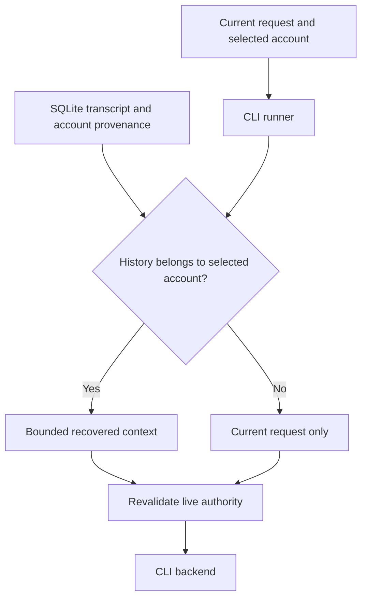

Codex review: needs maintainer review before merge. _Reviewed September 6, 2026, 4:16 PM ET / 20:16 UTC._

# ClawSweeper review

## What this changes

Restores bounded conversation history and saved tool results when CLI sessions start fresh, using independent account provenance to prevent cross-account replay.

## Merge readiness

✅ **Ready for maintainer review**

The PR remains useful and has no remaining actionable findings. The earlier account-switch defect is addressed, and the documented, accepted legacy-history tradeoff does not require another approval or contributor action.

**Priority:** P1
**Reviewed head:** `1084b250e2ef736c616960613f7edb6f0fdc4ed5`

## Review scores

| Measure | Result | What it means |
|---|---|---|
| **Overall readiness** | 🐚 platinum hermit **(4/6)** | A sound owner-level repair with focused production-boundary evidence and no remaining actionable findings. |
| **Proof confidence** | 🐚 platinum hermit **(4/6)** | Sufficient (terminal): The captured Crabbox report and inspected production-path regression cover real CLI orchestration and SQLite persistence through account replacement, binding clear, and backend-input recovery: same-account history arrives and other-account history does not. Revocation and detached-write coverage supplement that boundary proof; the backend is synthetic and no vendor inference or live Gateway restart is claimed. |
| **Patch quality** | 🐚 platinum hermit **(4/6)** | No actionable review findings were identified. |

## Verification

| Check | Result | Evidence |
|---|---|---|
| **Real behavior** | Verified | Sufficient (terminal): The captured Crabbox report and inspected production-path regression cover real CLI orchestration and SQLite persistence through account replacement, binding clear, and backend-input recovery: same-account history arrives and other-account history does not. Revocation and detached-write coverage supplement that boundary proof; the backend is synthetic and no vendor inference or live Gateway restart is claimed. |
| **Evidence reviewed** | 9 items | Independent history ownership: History admission compares the selected credential fingerprint, transcript generation, contiguous sequence coverage, and active writer. Unknown or mixed history cannot acquire ownership from a replacement native binding; only proven-empty context can establish a fresh boundary. Execution boundary and revocation: Fresh recovered prompts replace the execution assertion with the history owner's live read assertion. The production execution path propagates that assertion to plugin execution and process spawning. Closed admission invalidates retained history capabilities, and detached persistence drops the parent capability. Prior finding covered at the backend input: The captured PR body reports a secretless Crabbox regression that failed at the original head and passed after repair. The inspected test runs the real CLI runner, canonical user recording, assistant persistence, binding settlement, and SQLite storage through account A → replacement → binding clear → recovery. The synthetic backend receives A's canary for the same-account control and does not receive it after switching accounts. |
| **Findings** | None | None. |
| **Security** | None | None. |

## How this fits together

OpenClaw's CLI runner sends agent requests to external CLI backends. When native session resume fails, it can reconstruct prior context from the canonical SQLite transcript before sending the current request.

## Before merge

None.

<strong>Agent review details</strong>

### Security

None.

### PR surface

Source +405, Tests +668, Docs +10. Total +1083 across 23 files.

View PR surface stats

| Area | Files | Added | Removed | Net |
|---|---:|---:|---:|---:|
| Source | 16 | 417 | 12 | +405 |
| Tests | 6 | 937 | 269 | +668 |
| Docs | 1 | 11 | 1 | +10 |
| Config | 0 | 0 | 0 | 0 |
| Generated | 0 | 0 | 0 | 0 |
| Other | 0 | 0 | 0 | 0 |
| **Total** | **23** | **1365** | **282** | **+1083** |

### Review metrics

| Metric | Value | Why it matters |
|---|---|---|
| **Production versus regression coverage** | production net +405 lines; tests net +668 lines | Production growth implements independently owned provenance and canonical-write fencing; regression coverage exercises account transitions, persistence, and SDK privacy. |
| **Persistence surface** | 1 private session metadata field; 0 SQL schema or configuration changes | The upgrade contract changes recovery eligibility without migrating or deleting transcript rows. |

### Root-cause cluster

Relationship: `fixed_by_candidate`
Canonical: https://github.com/openclaw/openclaw/issues/124991
Summary: This PR is a candidate for the eligible binding-clear recovery portion of the reported problem; the older PR overlaps but remains unresolved.

Members:
- `canonical`: https://github.com/openclaw/openclaw/issues/124991 - The report explicitly identifies recovery failure after native binding removal.
- `partial_overlap`: https://github.com/openclaw/openclaw/pull/125002 - It addresses the same recovery problem through different provenance handling and also contains the earlier SQLite-loader repair.

Proposal only: this assessment does not dispatch repair, suppress jobs, mutate sibling items, close, or merge anything.

### Technical review

Best possible solution:

Preserve the independent account boundary and canonical transcript recovery, including the accepted refusal to replay unverifiable legacy history.

Do we have a high-confidence way to reproduce the issue?

Yes, source establishes the current-main binding-clear path: an uncompacted transcript has no eligible recovery reason after its native binding disappears. This review did not execute a current-main reproduction.

Is this the best way to solve the issue?

Yes. Independent transcript provenance fixes the replacement-and-clear failure at its owner, while canonical writes maintain coverage and execution revalidates authority; the stricter legacy behavior is explicitly accepted.

AGENTS.md: found and applied where relevant.

Codex review notes: model internal, reasoning medium; reviewed against [f3b41e04f92e](https://github.com/openclaw/openclaw/commit/f3b41e04f92e3d376b27af31d48a5fa1bed55bb9).

### Labels

Label changes:

- remove `merge-risk: 🚨 compatibility`: Current PR review selected no merge-risk labels.

Label justifications:

- `P1`: The repair addresses loss of conversation continuity after CLI resume failure while preserving account isolation.
- `rating: 🐚 platinum hermit`: Overall readiness is 🐚 platinum hermit; proof is 🐚 platinum hermit and patch quality is 🐚 platinum hermit.
- `status: 👀 ready for maintainer look`: ClawSweeper has no concrete contributor-facing blocker left for this PR. Sufficient (terminal): The captured Crabbox report and inspected production-path regression cover real CLI orchestration and SQLite persistence through account replacement, binding clear, and backend-input recovery: same-account history arrives and other-account history does not. Revocation and detached-write coverage supplement that boundary proof; the backend is synthetic and no vendor inference or live Gateway restart is claimed.
- `proof: sufficient`: Contributor real behavior proof is sufficient. The captured Crabbox report and inspected production-path regression cover real CLI orchestration and SQLite persistence through account replacement, binding clear, and backend-input recovery: same-account history arrives and other-account history does not. Revocation and detached-write coverage supplement that boundary proof; the backend is synthetic and no vendor inference or live Gateway restart is claimed.

### Evidence

What I checked:

- **Independent history ownership:** History admission compares the selected credential fingerprint, transcript generation, contiguous sequence coverage, and active writer. Unknown or mixed history cannot acquire ownership from a replacement native binding; only proven-empty context can establish a fresh boundary. ([`src/agents/cli-runner/history-boundary.ts:87`](https://github.com/openclaw/openclaw/blob/1084b250e2ef736c616960613f7edb6f0fdc4ed5/src/agents/cli-runner/history-boundary.ts#L87), [1084b250e2ef](https://github.com/openclaw/openclaw/commit/1084b250e2ef736c616960613f7edb6f0fdc4ed5))
- **Execution boundary and revocation:** Fresh recovered prompts replace the execution assertion with the history owner's live read assertion. The production execution path propagates that assertion to plugin execution and process spawning. Closed admission invalidates retained history capabilities, and detached persistence drops the parent capability. ([`src/agents/cli-runner/execute.ts:138`](https://github.com/openclaw/openclaw/blob/1084b250e2ef736c616960613f7edb6f0fdc4ed5/src/agents/cli-runner/execute.ts#L138), [1084b250e2ef](https://github.com/openclaw/openclaw/commit/1084b250e2ef736c616960613f7edb6f0fdc4ed5))
- **Prior finding covered at the backend input:** The captured PR body reports a secretless Crabbox regression that failed at the original head and passed after repair. The inspected test runs the real CLI runner, canonical user recording, assistant persistence, binding settlement, and SQLite storage through account A → replacement → binding clear → recovery. The synthetic backend receives A's canary for the same-account control and does not receive it after switching accounts. ([`src/agents/cli-runner/prepare.test.ts:5134`](https://github.com/openclaw/openclaw/blob/1084b250e2ef736c616960613f7edb6f0fdc4ed5/src/agents/cli-runner/prepare.test.ts#L5134), [1084b250e2ef](https://github.com/openclaw/openclaw/commit/1084b250e2ef736c616960613f7edb6f0fdc4ed5))
- **Accepted persistence and upgrade contract:** The supplied PR body records VACInc's direction to exclude other-account and unverifiable legacy history. Documentation explains that opaque logins and legacy conversations lose automatic recovery when native resume fails, transcripts remain intact, and downgrade writes invalidate coverage after re-upgrade. Fresh starts, legacy metadata, unaccounted writes, retained resets, and empty resets have focused coverage. These are recorded design choices, not outstanding approval requests. Public docs: [`docs/gateway/cli-backends.md`](https://docs.openclaw.ai/gateway/cli-backends). ([`docs/gateway/cli-backends.md:204`](https://docs.openclaw.ai/gateway/cli-backends), [1084b250e2ef](https://github.com/openclaw/openclaw/commit/1084b250e2ef736c616960613f7edb6f0fdc4ed5))
- **Canonical persistence and SDK privacy:** Transcript appends advance coverage within their transaction, and turn settlement rereads append-owned metadata before writing the session entry. Public SDK reads omit provenance; upsert, patch, and whole-store round trips preserve existing private provenance while refusing injected ownership. No parallel public SDK method or SQL schema change is introduced. ([`src/config/sessions/session-accessor.sqlite-transcript-turn.ts:256`](https://github.com/openclaw/openclaw/blob/1084b250e2ef736c616960613f7edb6f0fdc4ed5/src/config/sessions/session-accessor.sqlite-transcript-turn.ts#L256), [1084b250e2ef](https://github.com/openclaw/openclaw/commit/1084b250e2ef736c616960613f7edb6f0fdc4ed5))
- **Current main and release still leave useful work:** Inspected fetched main already loads canonical SQLite history, but its preparation still derives raw recovery eligibility only from a reusable session or invalidation reason, and its renderer omits tool results. The v2026.9.2 history source also retains the prior eligibility logic. The related SQLite-loader repair therefore does not make this PR redundant. ([`src/agents/cli-runner/session-history.ts:403`](https://github.com/openclaw/openclaw/blob/f3b41e04f92e3d376b27af31d48a5fa1bed55bb9/src/agents/cli-runner/session-history.ts#L403), [f3b41e04f92e](https://github.com/openclaw/openclaw/commit/f3b41e04f92e3d376b27af31d48a5fa1bed55bb9))

Likely related people:

- **Peter Steinberger:** Suggested for follow-up; no historical authorship or introduction is verified. (role: unverified routing candidate; confidence: low)
- **ruel225:** Suggested for follow-up; no historical authorship or introduction is verified. (role: unverified routing candidate; confidence: low)

### Rating scale

| Score | Internal tier | Crab rank | Meaning |
|---:|:---:|---|---|
| **6/6** | S | 🦀 challenger crab | Exceptional readiness |
| **5/6** | A | 🦞 diamond lobster | Very strong readiness |
| **4/6** | B | 🐚 platinum hermit | Good normal PR; ordinary maintainer review |
| **3/6** | C | 🦐 gold shrimp | Useful, but confidence is limited |
| **2/6** | D | 🦪 silver shellfish | Proof or implementation needs work |
| **1/6** | F | 🧂 unranked krab | Not merge-ready |
| N/A | NA | 🌊 off-meta tidepool | Rating does not apply |

Overall follows the weaker of proof and patch quality.
Shiny media proof means a screenshot, video, or linked artifact directly shows the changed behavior. Runtime, network, CSP, and security claims still need visible diagnostics.

### Workflow

- ClawSweeper keeps one durable marker-backed review comment per issue or PR.
- Re-runs edit this comment so the latest verdict, findings, and automation markers stay together instead of adding duplicate bot comments.
- A fresh review can be triggered by eligible `@clawsweeper re-review` comments, exact-item GitHub events, scheduled/background review runs, or manual workflow dispatch.
- PR/issue authors and users with repository write access can comment `@clawsweeper re-review` or `@clawsweeper re-run` on an open PR or issue to request a fresh review only.
- Maintainers can also comment `@clawsweeper review` to request a fresh review only.
- Fresh-review commands do not start repair, autofix, rebase, CI repair, or automerge.
- Maintainer-only repair and merge flows require explicit commands such as `@clawsweeper autofix`, `@clawsweeper automerge`, `@clawsweeper fix ci`, or `@clawsweeper address review`.
- Maintainers can comment `@clawsweeper explain` to ask for more context, or `@clawsweeper stop` to stop active automation.

### History

Review history (3 earlier review cycles)

<!-- clawsweeper-review-history v=1 total=3 -->
- reviewed 2026-09-06T16:56:08.324Z sha 7b5ac5510cc5baa2e28003a36266837a093a0e0c :: needs real behavior proof before merge. :: [P1] Preserve the history auth boundary across replacement sessions
- reviewed 2026-09-06T19:55:35.517Z sha 25fe66132b966fef5b417a3b39c7f69246491d26 :: blocked before merge. :: none
- reviewed 2026-09-06T20:02:16.194Z sha 25fe66132b966fef5b417a3b39c7f69246491d26 :: blocked before merge. :: none

<!-- clawsweeper-verdict:needs-human item=140294 sha=1084b250e2ef736c616960613f7edb6f0fdc4ed5 confidence=high updated_at=2026-09-06T20:13:47Z reviewed_at=2026-09-06T20:16:47.933Z lease_owner=github-run-34057226435-1 lease_comment_id=5561876850 source_revision=59073e53604ae61cdc421db9f5ac7bfb3bac99bcea69232d3f50f3b0a754f87f live_verification=absent -->
<!-- clawsweeper-review-state:ready item=140294 sha=1084b250e2ef736c616960613f7edb6f0fdc4ed5 v=1 -->

<!-- clawsweeper-review-version item=140294 reviewed_at=2026-09-06T20:16:47.933Z sha=1084b250e2ef736c616960613f7edb6f0fdc4ed5 source_revision=59073e53604ae61cdc421db9f5ac7bfb3bac99bcea69232d3f50f3b0a754f87f lease_owner=github-run-34057226435-1 lease_comment_id=5561876850 v=1 -->

<!-- clawsweeper-review item=140294 -->