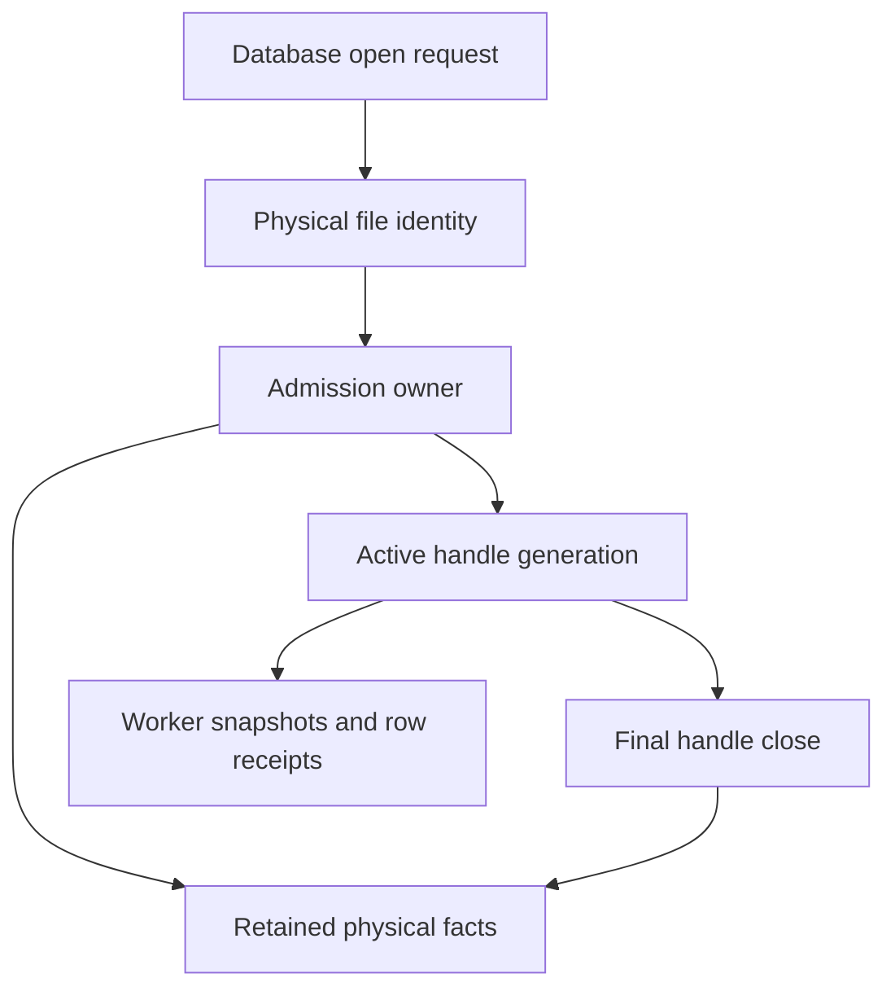

Codex review: needs changes before merge.

## What this changes

This PR retains selected SQLite validation facts across final handle closure while retiring active generations and row caches.

**Example:** Close the last handle to proof.sqlite, then reopen the same physical file containing value 42.
- **Before:** An unsealed reopen repeats schema and integrity admission.
- **After:** The reopen reuses retained physical validation while creating fresh row-cache receipts.

## Review scores

| Measure | Result | What it means |
|---|---|---|
| **Overall readiness** | 🧂 unranked krab **(1/6)** | The direction is worthwhile, but confirmed reader-freshness and worker-publication defects prevent a correctness pass. |
| **Proof confidence** | 🦐 gold shrimp **(3/6)** | This maintainer-authored PR is outside the ordinary contributor proof gate; CI exercises real SQLite owners and child readers, but the body still describes workload verification as pending. |
| **Patch quality** | 🧂 unranked krab **(1/6)** | 4 actionable review findings remain. |

## Product

**Kind:** Performance · **Worth it:** Yes · **Fix scope:** Complete
**User problem:** Short-lived database handles repeat expensive validation during startup and session work.
**Reason:** The maintainer-authored direction follows the documented once-per-physical-database contract and explicitly addresses the earlier retention revert.

## Merge readiness

⛔ **Needs changes before merge - 4 items remain**

Keep this PR open: the optimization has clear value and owner direction, but isolated-reader schema freshness, worker payload retirement, and regression assertions need correction.

**Priority:** P2
**Reviewed head:** `3554be6d9a33b3a7be6cc515bbc039f5c2ba639c`

## Before merge

- [ ] **Limit retained schema facts to owners receiving write invalidation (P1)** - Marking every schema admission process-lived also affects the long-lived read-only child process. That process does not share the parent's admission registry or DDL revocation cells. After a cold auth read closes an empty database, parent initialization leaves the child's retained empty catalog valid; its next plugin-catalog operation returns [] despite the inserted catalog. Exact-head CI reproduces this at sqlite-readonly-worker.auth.test.ts:262, and the snapshot auth case also misclassifies a dropped table at line 318. Preserve final-close invalidation for these isolated readers or carry authoritative schema invalidation through their existing transport.
- [ ] **Keep dormant physical facts outside worker bootstrap snapshots (P1)** - Restoring retained facts directly into a newly published admission exposes full closed-store catalogs again. During a worker's final-close exchange, the host retires its old record, then the relay's location lookup creates a successor with no references; retainDescriptor now fills and publishes that successor's catalog. Both new reopen/close cases fail at retention.test.ts:505 with full schema facts and an empty references map. Those snapshots enter setEnvironmentData and are cloned into subsequent workers, restoring the payload amplification that the earlier OOM fix removed. Keep dormant facts in descriptor custody until an actual borrower retains the generation.
- [ ] **Check revocation before invoking the schema-loading getter (P2)** - The new regression expects getAdmittedSqliteSchemaFacts to return undefined after reopen, but this database's schema owner remains admitted and that getter captures fresh catalog facts on a miss. CI therefore fails at this assertion even when revocation correctly forces a new capture. Inspect the admission fact directly before loading, then assert that loading produces a different admission ID and preserves the row value.
- [ ] **Update remaining tests that require final-close revalidation (P2)** - The lifetime change invalidates existing assertions left outside this patch: worker tests at lines 584 and 697 require repeated catalog SQL, while the shared-state schema-policy canonical-close case requires a second integrity scan. Exact-head CI instead observes [] and one scan, respectively, matching the intended optimization. Update those expectations to prove reuse while retaining the separate physical-replacement and corruption assertions.

## Findings

- [P1] Limit retained schema facts to owners receiving write invalidation — `src/infra/sqlite-schema-admission.ts:26-29`
- [P1] Keep dormant physical facts outside worker bootstrap snapshots — `src/infra/sqlite-database-admission-record.ts:377-380`
- [P2] Check revocation before invoking the schema-loading getter — `src/infra/sqlite-database-admission.retention.test.ts:154-157`

### Tests

- Missing end-to-end proof: The supplied evidence contains no completed Gateway first-turn/restart workload or demonstrated base-failing/head-passing regression run.

<strong>Agent review details</strong>

### How this fits together

The SQLite admission owner turns physical-file identity and completed validation into shared facts consumed by native handles, workers, and database guards.

### Technical review

Best possible solution:

Retain physical proof only where its owner can invalidate it, keep dormant payloads outside worker snapshots, and preserve replacement and explicit-verification checks.

Do we have a high-confidence way to reproduce the issue?

Current main clears physical admission facts at final close, making repeated validation on an unsealed reopen source-reproducible; no target code was executed during this review.

Is this the best way to solve the issue?

Separating physical proof from active generations is appropriate, but retention must respect subprocess invalidation and exclude dormant payloads from worker publication.

Full review comments:

- [P1] Limit retained schema facts to owners receiving write invalidation — `src/infra/sqlite-schema-admission.ts:26-29`
  Marking every schema admission process-lived also affects the long-lived read-only child process. That process does not share the parent's admission registry or DDL revocation cells. After a cold auth read closes an empty database, parent initialization leaves the child's retained empty catalog valid; its next plugin-catalog operation returns [] despite the inserted catalog. Exact-head CI reproduces this at sqlite-readonly-worker.auth.test.ts:262, and the snapshot auth case also misclassifies a dropped table at line 318. Preserve final-close invalidation for these isolated readers or carry authoritative schema invalidation through their existing transport.
  Confidence: 0.99
- [P1] Keep dormant physical facts outside worker bootstrap snapshots — `src/infra/sqlite-database-admission-record.ts:377-380`
  Restoring retained facts directly into a newly published admission exposes full closed-store catalogs again. During a worker's final-close exchange, the host retires its old record, then the relay's location lookup creates a successor with no references; retainDescriptor now fills and publishes that successor's catalog. Both new reopen/close cases fail at retention.test.ts:505 with full schema facts and an empty references map. Those snapshots enter setEnvironmentData and are cloned into subsequent workers, restoring the payload amplification that the earlier OOM fix removed. Keep dormant facts in descriptor custody until an actual borrower retains the generation.
  Confidence: 0.98
- [P2] Check revocation before invoking the schema-loading getter — `src/infra/sqlite-database-admission.retention.test.ts:154-157`
  The new regression expects getAdmittedSqliteSchemaFacts to return undefined after reopen, but this database's schema owner remains admitted and that getter captures fresh catalog facts on a miss. CI therefore fails at this assertion even when revocation correctly forces a new capture. Inspect the admission fact directly before loading, then assert that loading produces a different admission ID and preserves the row value.
  Confidence: 0.99
- [P2] Update remaining tests that require final-close revalidation — `src/infra/sqlite-database-admission.worker.test.ts:584`
  The lifetime change invalidates existing assertions left outside this patch: worker tests at lines 584 and 697 require repeated catalog SQL, while the shared-state schema-policy canonical-close case requires a second integrity scan. Exact-head CI instead observes [] and one scan, respectively, matching the intended optimization. Update those expectations to prove reuse while retaining the separate physical-replacement and corruption assertions.
  Confidence: 0.99

Overall correctness: patch is incorrect
Overall confidence: 0.96

AGENTS.md: found and applied where relevant.

Codex review notes: model internal, reasoning medium; reviewed against [1a314b89ea9f](https://github.com/openclaw/openclaw/commit/1a314b89ea9f090917310bb6c35913e093f831d2).

### Provenance checked

- `Final-close admission retirement` changes intended behavior with a stated reason (19eddcf75194e9fca33b146b3b820a0a00831576: Retire closed databases' schema and receipt payloads so new Code Mode workers do not inherit enough metadata to exhaust their heap.)
- `Restored retirement and replacement detection` changes intended behavior with a stated reason (9f8c71e9ccd340890c1ad088aac2ed1d3a3d0405: Broad retention bypassed physical replacement detection and allowed Doctor inspection to alter preserved SQLite artifacts.)
- `Admission reader transaction ownership` keeps the original intent (ff2380669e2cf5e7bb1989e6e5650ad210ec3684: Keep PostgreSQL publication transaction-local while sharing the existing admission owner and SQLite anchor.)
- `Clean-close seals` keeps the original intent (f787a896894d52b7351b841416b194711315ac28: Reuse completed validation across clean process restarts while rejecting stale or nonmatching seals.)

### Testing

Proof path: in-process harness.

### Security

None.

### Evidence

Acceptance criteria:

- pnpm test src/infra/sqlite-readonly-worker.auth.test.ts src/infra/sqlite-database-admission.retention.test.ts src/infra/sqlite-database-admission.worker.test.ts src/state/openclaw-state-db-schema-policy.test.ts --maxWorkers=1
- pnpm test src/state/openclaw-quarantine-store.test.ts src/config/sessions/session-accessor.sqlite-branches.test.ts src/gateway/session-row-projection.worker-read.test.ts src/commands/doctor-lint.sqlite-preservation.test.ts --maxWorkers=1
- git diff --check

What I checked:

- **Pinned introduced change:** The introduced diff adds explicit process-lived facts and preserves separate generation retirement; current main still clears facts at final close. ([`src/infra/sqlite-database-admission-record.ts:299`](https://github.com/openclaw/openclaw/blob/3554be6d9a33b3a7be6cc515bbc039f5c2ba639c/src/infra/sqlite-database-admission-record.ts#L299), [3554be6d9a33](https://github.com/openclaw/openclaw/commit/3554be6d9a33b3a7be6cc515bbc039f5c2ba639c))
- **Isolated-reader failures:** Exact-head CI returns an empty plugin catalog after agent initialization and reports a dropped auth table as unreadable rather than missing. The child process retains its own schema facts without receiving parent DDL invalidation. ([`src/infra/sqlite-readonly-worker.auth.test.ts:262`](https://github.com/openclaw/openclaw/blob/3554be6d9a33b3a7be6cc515bbc039f5c2ba639c/src/infra/sqlite-readonly-worker.auth.test.ts#L262), [3554be6d9a33](https://github.com/openclaw/openclaw/commit/3554be6d9a33b3a7be6cc515bbc039f5c2ba639c))
- **Closed worker publishes retained catalogs:** Both new worker reopen/close cases fail at line 505: the published snapshot contains full schema facts with an empty references map after final close. ([`src/infra/sqlite-database-admission.retention.test.ts:505`](https://github.com/openclaw/openclaw/blob/3554be6d9a33b3a7be6cc515bbc039f5c2ba639c/src/infra/sqlite-database-admission.retention.test.ts#L505), [3554be6d9a33](https://github.com/openclaw/openclaw/commit/3554be6d9a33b3a7be6cc515bbc039f5c2ba639c))
- **Incorrect revocation assertion:** The new late-corruption test fails because getAdmittedSqliteSchemaFacts reloads an admitted connection's invalidated catalog; returning facts does not establish that revoked proof was reused. ([`src/infra/sqlite-database-admission.retention.test.ts:155`](https://github.com/openclaw/openclaw/blob/3554be6d9a33b3a7be6cc515bbc039f5c2ba639c/src/infra/sqlite-database-admission.retention.test.ts#L155), [3554be6d9a33](https://github.com/openclaw/openclaw/commit/3554be6d9a33b3a7be6cc515bbc039f5c2ba639c))
- **Remaining obsolete admission expectations:** Worker tests at lines 584 and 697 still expect repeated catalog SQL, and the shared-state canonical-close case still expects a second integrity scan; exact-head CI observes the intended reuse instead. ([`src/infra/sqlite-database-admission.worker.test.ts:584`](https://github.com/openclaw/openclaw/blob/3554be6d9a33b3a7be6cc515bbc039f5c2ba639c/src/infra/sqlite-database-admission.worker.test.ts#L584), [3554be6d9a33](https://github.com/openclaw/openclaw/commit/3554be6d9a33b3a7be6cc515bbc039f5c2ba639c))
- **Earlier retention correction:** Steipete's explanation on https://github.com/openclaw/openclaw/pull/172676 identifies replacement detection and Doctor artifact preservation as the reason for reverting broad retention; this PR explicitly separates physical facts from pathname and row-cache validity. ([`src/infra/sqlite-database-admission-record.ts:308`](https://github.com/openclaw/openclaw/blob/9f8c71e9ccd340890c1ad088aac2ed1d3a3d0405/src/infra/sqlite-database-admission-record.ts#L308), [9f8c71e9ccd3](https://github.com/openclaw/openclaw/commit/9f8c71e9ccd340890c1ad088aac2ed1d3a3d0405))

### PR surface

Source +112, Tests +17, Docs +6. Total +135 across 19 files. Added test files: 0.

View PR surface stats

| Area | Files | Added | Removed | Net |
|---|---:|---:|---:|---:|
| Source | 11 | 182 | 70 | +112 |
| Tests | 5 | 134 | 117 | +17 |
| Docs | 3 | 20 | 14 | +6 |
| Config | 0 | 0 | 0 | 0 |
| Generated | 0 | 0 | 0 | 0 |
| Other | 0 | 0 | 0 | 0 |
| **Total** | **19** | **336** | **201** | **+135** |

### Labels

Label changes:

- add `P2`: This is a normal-priority admission optimization with concrete repairs needed before merging.
- add `merge-risk: 🚨 auth-provider`: An isolated reader can retain an empty or outdated catalog after the parent initializes or changes the agent database.
- add `merge-risk: 🚨 availability`: Republishing full catalogs for closed databases restores the worker bootstrap payload amplification previously associated with Code Mode OOM.
- add `rating: 🧂 unranked krab`: Overall readiness is 🧂 unranked krab; proof is 🦐 gold shrimp and patch quality is 🧂 unranked krab.
- add `status: ⏳ waiting on author`: ClawSweeper has contributor-facing work open and is waiting for author action.

Label justifications:

- `P2`: This is a normal-priority admission optimization with concrete repairs needed before merging.
- `merge-risk: 🚨 auth-provider`: An isolated reader can retain an empty or outdated catalog after the parent initializes or changes the agent database.
- `merge-risk: 🚨 availability`: Republishing full catalogs for closed databases restores the worker bootstrap payload amplification previously associated with Code Mode OOM.
- `rating: 🧂 unranked krab`: Overall readiness is 🧂 unranked krab; proof is 🦐 gold shrimp and patch quality is 🧂 unranked krab.
- `status: ⏳ waiting on author`: ClawSweeper has contributor-facing work open and is waiting for author action.

### Rating scale

6/6 🦀 challenger crab · 5/6 🦞 diamond lobster · 4/6 🐚 platinum hermit · 3/6 🦐 gold shrimp · 2/6 🦪 silver shellfish · 1/6 🧂 unranked krab. Overall follows the weaker of proof and patch quality; ✨ marks media proof (a screenshot, video, or linked artifact) that directly shows the changed behavior.

### Workflow

ClawSweeper edits this one comment on every review. Comment `@clawsweeper re-review` for a fresh review only. Repair and merge execution lanes are retired.

_Reviewed October 16, 2026, 5:06 PM ET / 21:06 UTC._

<!-- clawsweeper-verdict:needs-changes item=174660 sha=3554be6d9a33b3a7be6cc515bbc039f5c2ba639c confidence=high updated_at=2026-10-16T21:00:26Z reviewed_at=2026-10-16T21:06:32.537Z lease_owner=github-run-38966173520-1 lease_comment_id=6224593038 source_revision=7628697f3de78f9340bad57574699ace09c5304d29f47af825e008e96a0cd0da -->
<!-- clawsweeper-review-state:needs-changes item=174660 sha=3554be6d9a33b3a7be6cc515bbc039f5c2ba639c v=1 -->

<!-- clawsweeper-review-version item=174660 reviewed_at=2026-10-16T21:06:32.537Z sha=3554be6d9a33b3a7be6cc515bbc039f5c2ba639c source_revision=7628697f3de78f9340bad57574699ace09c5304d29f47af825e008e96a0cd0da lease_owner=github-run-38966173520-1 lease_comment_id=6224593038 v=1 -->

<!-- clawsweeper-review item=174660 -->