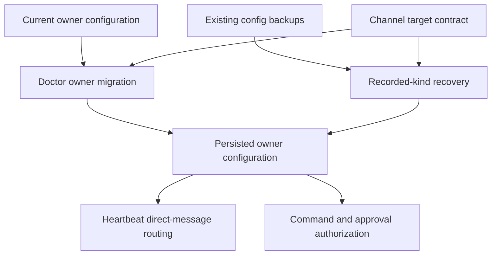

Codex review: blocked before merge. _Reviewed October 8, 2026, 4:37 AM ET / 08:37 UTC._

# ClawSweeper review

## What this changes

Doctor preserves plugin-required direct-user target kinds and restores previously stripped kinds from matching config backups.

**Example:** Run Doctor with owner discord:user:100000000000000001.
- **Before:** Doctor rewrites the owner to discord:100000000000000001, causing owner-targeted heartbeats to skip with no-route.
- **After:** Doctor preserves discord:user:100000000000000001 so heartbeat routing identifies a direct-message destination.

## Review scores

| Measure | Result | What it means |
|---|---|---|
| **Overall readiness** | 🧂 unranked krab **(1/6)** | Useful regression coverage supports the direction, but the incomplete persisted-owner cutover breaks established Discord workflows. |
| **Proof confidence** | 🦐 gold shrimp **(3/6)** | Not applicable: The supplied repository state identifies a member-authored area repair, outside the ordinary external-contributor proof gate. Reported validation exercises production routing and disk-backed Doctor through an in-process harness, not the installed updater. Persisted owner compatibility remains insufficient because Discord consumers reject the restored form and the required published-driver upgrade/rollback cell is absent. |
| **Patch quality** | 🧂 unranked krab **(1/6)** | 1 actionable review finding remain. |

## Product

**Kind:** Bug fix · **Worth it:** Yes · **Fix scope:** Complete
**User problem:** Discord heartbeat alerts silently stop after an update rewrites the configured owner's direct-message target.
**Reason:** The linked report establishes broken shipped behavior with a clear routing mechanism. Prior area ownership and the author's explanation support the direction without introducing settings or a new plugin API.

## Regression provenance

Possible regression — suspected (reviewed change). No predecessor PR is attributed.

## Merge readiness

⛔ **Blocked before merge - 6 items remain**

This PR addresses a current shipped regression, but its owner-format cutover is incomplete: preserved or recovered Discord owners still lose voice access and owner-derived exec approvals.

**Priority:** P1
**Reviewed head:** `08427b5c2e7dbb8b3d4fb66f73426aad44ffb964`

## Before merge

- [ ] **Update Discord owner consumers for the preserved target kind (P1)** - Keeping `discord:user:100000000000000001` here, or restoring it from a backup, now makes that form canonical. However, `resolveDiscordCommandOwnerEntries()` still filters out every `discord:user:` entry at `extensions/discord/src/command-owners.ts:10`. Consequently, Doctor's recovery changes a working bare owner into an empty voice admission list and removes owner-derived exec approvers. Existing voice-command and exec-approval tests explicitly assert these rejections. Update the shared Discord selector and its consumers/tests together so repairing heartbeat routing preserves these existing owner workflows.
- [ ] **Resolve merge risk (P1)** - Published-driver × candidate upgrade and rollback compatibility remains unproven; the supplied disk-backed harness does not exercise the installed updater required by repository policy.
- [ ] **Complete next step (P2)** - Provide the repository-required published-driver × candidate upgrade/rollback evidence after the owner-consumer repair.
- [ ] **Improve patch quality** - Repair the shared Discord owner selector and verify voice access and owner-derived exec approvals after Doctor preservation and recovery.
- [ ] **Improve patch quality** - Record a supported published-updater upgrade and rollback against the repaired candidate.
- [ ] **Add data-model compatibility proof** - Confirm migration or upgrade compatibility proof before merge.

## Findings

- [P1] Update Discord owner consumers for the preserved target kind — `src/commands/doctor-command-owner.ts:57-60`

### Tests

- Missing end-to-end proof: The supplied tests cover routing, core authorization, and Doctor persistence, but omit Discord voice and owner-derived approval consumers after migration. No shipped published-updater upgrade/rollback scenario is supplied; reported baseline failures were not independently executed in this read-only review.

<strong>Agent review details</strong>

### How this fits together

Doctor repairs persisted OpenClaw configuration during maintenance and updates. Configured channel owners feed both heartbeat destinations and privileged command authorization.

### Technical review

Best possible solution:

Complete the typed-owner cutover in Discord's shared selector while retaining native sender matching, direct-only heartbeat admission, and conservative backup recovery.

Do we have a high-confidence way to reproduce the issue?

Yes, from source: main strips the Discord user kind before direct-only heartbeat admission, and the proposed preserved form is rejected by existing Discord owner-consumer tests. No runtime execution was performed during this read-only review.

Is this the best way to solve the issue?

No, the current patch leaves competing interpretations of the owner format; updating the existing shared Discord selector completes the otherwise appropriate plugin-owned repair.

Full review comments:

- [P1] Update Discord owner consumers for the preserved target kind — `src/commands/doctor-command-owner.ts:57-60`
  Keeping `discord:user:100000000000000001` here, or restoring it from a backup, now makes that form canonical. However, `resolveDiscordCommandOwnerEntries()` still filters out every `discord:user:` entry at `extensions/discord/src/command-owners.ts:10`. Consequently, Doctor's recovery changes a working bare owner into an empty voice admission list and removes owner-derived exec approvers. Existing voice-command and exec-approval tests explicitly assert these rejections. Update the shared Discord selector and its consumers/tests together so repairing heartbeat routing preserves these existing owner workflows.
  Confidence: 0.99

Overall correctness: patch is incorrect
Overall confidence: 0.98

AGENTS.md: found and applied where relevant.

Codex review notes: model internal, reasoning medium; reviewed against [4dc47557f10d](https://github.com/openclaw/openclaw/commit/4dc47557f10d6a04c7e21edd295341db4ebc285e).

### Merge-risk options

**Maintainer options:**
1. **Complete and verify the owner-format cutover (recommended)**  
   Repair the shared Discord owner selector and record a supported published updater upgrading to the candidate, including owner preservation and rollback.

### Provenance checked

- `src/commands/doctor-command-owner.ts` changes intended behavior with a stated reason (https://github.com/openclaw/openclaw/pull/137780: Persist legacy owner identities as native sender identities to restore owner-only commands and retire alternate runtime authorization envelopes.)
- `src/auto-reply/command-auth.ts` changes intended behavior with a stated reason (https://github.com/openclaw/openclaw/pull/140637: Normalize existing Discord sender aliases while retaining Doctor-only migration of retired bundled-channel owner entries.)
- `extensions/discord/src/channel.ts and extensions/discord/src/shared.ts` keeps the original intent (https://github.com/openclaw/openclaw/pull/107953: Declare channel-specific direct-target grammar on the messaging adapter instead of maintaining channel literals in core.)
- `docs/tools/slash-commands.md and src/commands/doctor-config-flow.workspace-persistence.test.ts` changes intended behavior with a stated reason (https://github.com/openclaw/openclaw/pull/137780: Document and verify canonical owner persistence and an idempotent Doctor repair.)

### Testing

Proof path: in-process harness. Added test files: 2.

### Security

None.

### Evidence

Acceptance criteria:

- [P1] pnpm test src/commands/doctor-command-owner-route.test.ts src/commands/doctor-config-flow.workspace-persistence.test.ts --maxWorkers=1.
- [P1] pnpm test extensions/discord/src/voice/command.test.ts extensions/discord/src/voice/speaker-context.test.ts extensions/discord/src/exec-approvals.test.ts --maxWorkers=1.
- [P1] node scripts/check-changed.mjs.
- [P1] git diff --check.

What I checked:

- **Current main still strips the required kind:** Fetched main retains unconditional channel:user:id normalization. Comparing the merge base with fetched main produced no changes in the central migration or Discord owner selector. ([`src/commands/doctor-command-owner.ts:12`](https://github.com/openclaw/openclaw/blob/4dc47557f10d6a04c7e21edd295341db4ebc285e/src/commands/doctor-command-owner.ts#L12), [4dc47557f10d](https://github.com/openclaw/openclaw/commit/4dc47557f10d6a04c7e21edd295341db4ebc285e))
- **Introduced owner-format change:** The introduced migration now keeps user-prefixed owners, and backup recovery writes the same typed form. Shared core command authorization was updated to accept it. ([`src/commands/doctor-command-owner.ts:59`](https://github.com/openclaw/openclaw/blob/08427b5c2e7dbb8b3d4fb66f73426aad44ffb964/src/commands/doctor-command-owner.ts#L59), [08427b5c2e7d](https://github.com/openclaw/openclaw/commit/08427b5c2e7dbb8b3d4fb66f73426aad44ffb964))
- **Discord consumers still reject the new canonical form:** The unchanged shared Discord selector removes every discord:user: entry. Voice access and owner-derived exec approvals consume this selector, so restoring a previously working bare owner makes both lists empty. ([`extensions/discord/src/command-owners.ts:10`](https://github.com/openclaw/openclaw/blob/08427b5c2e7dbb8b3d4fb66f73426aad44ffb964/extensions/discord/src/command-owners.ts#L10), [08427b5c2e7d](https://github.com/openclaw/openclaw/commit/08427b5c2e7dbb8b3d4fb66f73426aad44ffb964))
- **Existing voice behavior confirms the incompatibility:** The existing voice-command case accepts discord:100000000000000001 but rejects discord:user:100000000000000001 with 'You are not authorized to use this command.'. ([`extensions/discord/src/voice/command.test.ts:122`](https://github.com/openclaw/openclaw/blob/08427b5c2e7dbb8b3d4fb66f73426aad44ffb964/extensions/discord/src/voice/command.test.ts#L122), [08427b5c2e7d](https://github.com/openclaw/openclaw/commit/08427b5c2e7dbb8b3d4fb66f73426aad44ffb964))
- **Existing approval behavior confirms the incompatibility:** The existing test explicitly expects zero owner-derived approvers for commands.ownerAllowFrom=['discord:user:123'], while explicit approval targets retain support. ([`extensions/discord/src/exec-approvals.test.ts:104`](https://github.com/openclaw/openclaw/blob/08427b5c2e7dbb8b3d4fb66f73426aad44ffb964/extensions/discord/src/exec-approvals.test.ts#L104), [08427b5c2e7d](https://github.com/openclaw/openclaw/commit/08427b5c2e7dbb8b3d4fb66f73426aad44ffb964))
- **Original migration intent and area history:** The merged https://github.com/openclaw/openclaw/pull/137780 deliberately retired channel:user:id runtime ownership while restoring owner-only commands. Its raw commit records a parent, and its patch introduces both the migration and Discord selector; this PR explains the routing reason for revising that contract. ([`extensions/discord/src/command-owners.ts:10`](https://github.com/openclaw/openclaw/blob/8b8fb1ff3b9f6ba3dd9194d23a655ff4a0e92400/extensions/discord/src/command-owners.ts#L10), [8b8fb1ff3b9f](https://github.com/openclaw/openclaw/commit/8b8fb1ff3b9f6ba3dd9194d23a655ff4a0e92400))

Likely related people:

- **Peter Steinberger:** Raw commit 8b8fb1ff3b9f6ba3dd9194d23a655ff4a0e92400 adds extensions/discord/src/command-owners.ts:10 relative to its recorded parents. This identifies author metadata, not feature responsibility or a PR merger. (role: source-line author; confidence: high; commits: [8b8fb1ff3b9f](https://github.com/openclaw/openclaw/commit/8b8fb1ff3b9f6ba3dd9194d23a655ff4a0e92400); files: `extensions/discord/src/command-owners.ts`)

### PR surface

Source +177, Tests +225, Docs +21. Total +423 across 10 files.

View PR surface stats

| Area | Files | Added | Removed | Net |
|---|---:|---:|---:|---:|
| Source | 6 | 195 | 18 | +177 |
| Tests | 2 | 231 | 6 | +225 |
| Docs | 2 | 25 | 4 | +21 |
| Config | 0 | 0 | 0 | 0 |
| Generated | 0 | 0 | 0 | 0 |
| Other | 0 | 0 | 0 | 0 |
| **Total** | **10** | **451** | **28** | **+423** |

### Stored data model

Persistent data-model change detected: `migration/backfill/repair: src/commands/doctor-command-owner-recovery.ts`, `migration/backfill/repair: src/commands/doctor-command-owner.ts`, `migration/backfill/repair: src/commands/doctor-config-flow.ts`, `unknown-data-model-change: src/commands/doctor-command-owner-recovery.ts`, `unknown-data-model-change: src/commands/doctor-command-owner.ts`. Confirm migration or upgrade compatibility proof before merge.

### Root-cause cluster

Relationship: `fixed_by_candidate`
Canonical: https://github.com/openclaw/openclaw/issues/166724
Summary: This PR is the explicitly linked candidate repair for the reported Doctor-induced heartbeat routing failure.

Members:
- `canonical`: https://github.com/openclaw/openclaw/issues/166724 - The report identifies the exact prefix-stripping mechanism repaired by this branch.

Proposal only: this assessment does not dispatch repair, suppress jobs, mutate sibling items, close, or merge anything.

### Labels

Label changes:

- add `P1`: An official shipped update repeatedly suppresses Discord owner heartbeats, and the proposed repair introduces another owner-workflow failure.
- add `merge-risk: 🚨 compatibility`: Recovered owner configuration becomes a form that existing Discord voice and exec-approval consumers explicitly reject.
- add `rating: 🧂 unranked krab`: Overall readiness is 🧂 unranked krab; proof is 🦐 gold shrimp and patch quality is 🧂 unranked krab.
- add `status: ⏳ waiting on author`: ClawSweeper has contributor-facing work open and is waiting for author action.

Label justifications:

- `P1`: An official shipped update repeatedly suppresses Discord owner heartbeats, and the proposed repair introduces another owner-workflow failure.
- `merge-risk: 🚨 compatibility`: Recovered owner configuration becomes a form that existing Discord voice and exec-approval consumers explicitly reject.
- `rating: 🧂 unranked krab`: Overall readiness is 🧂 unranked krab; proof is 🦐 gold shrimp and patch quality is 🧂 unranked krab.
- `status: ⏳ waiting on author`: ClawSweeper has contributor-facing work open and is waiting for author action.

### Rating scale

6/6 🦀 challenger crab · 5/6 🦞 diamond lobster · 4/6 🐚 platinum hermit · 3/6 🦐 gold shrimp · 2/6 🦪 silver shellfish · 1/6 🧂 unranked krab. Overall follows the weaker of proof and patch quality; ✨ marks media proof (a screenshot, video, or linked artifact) that directly shows the changed behavior.

### Workflow

ClawSweeper edits this one comment on every review. Comment `@clawsweeper re-review` for a fresh review only; repair and merge need explicit maintainer commands such as `@clawsweeper autofix` or `@clawsweeper automerge`.

<!-- clawsweeper-verdict:needs-human item=167059 sha=08427b5c2e7dbb8b3d4fb66f73426aad44ffb964 confidence=high updated_at=2026-10-08T08:32:56Z reviewed_at=2026-10-08T08:37:05.798Z lease_owner=github-run-37750465625-1 lease_comment_id=6055973381 source_revision=c92476c72020b0581c7f7fe620e2684de0641ff9515234ff6a18061a2977071b live_verification=absent -->
<!-- clawsweeper-review-state:blocked item=167059 sha=08427b5c2e7dbb8b3d4fb66f73426aad44ffb964 v=1 -->

<!-- clawsweeper-review-version item=167059 reviewed_at=2026-10-08T08:37:05.798Z sha=08427b5c2e7dbb8b3d4fb66f73426aad44ffb964 source_revision=c92476c72020b0581c7f7fe620e2684de0641ff9515234ff6a18061a2977071b lease_owner=github-run-37750465625-1 lease_comment_id=6055973381 v=1 -->

<!-- clawsweeper-review item=167059 -->