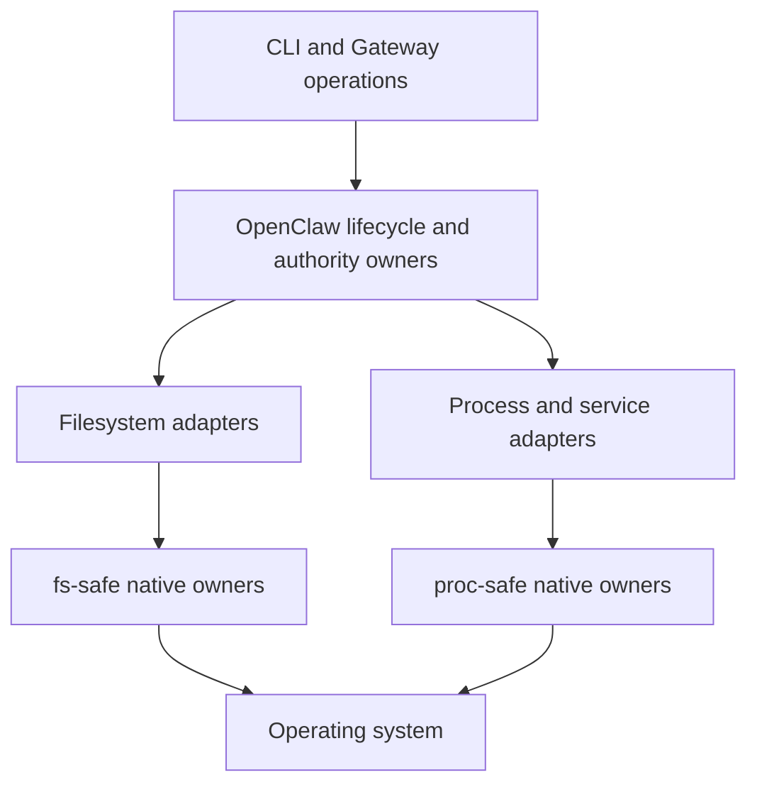

Codex review: needs maintainer review before merge.

## What this changes

This PR replaces OpenClaw’s direct Koffi bindings with typed fs-safe and proc-safe native APIs.

**Example:** Create private.sqlite under a 220-character Windows parent directory.
- **Before:** The previous adapter passed the 235-character target without a namespace prefix, and fs-safe’s longer internal staging path failed with ENOENT.
- **After:** The adapter always namespaces the path, and the supplied native before/after observations report successful creation in the main thread and a Worker.

## Review scores

| Measure | Result | What it means |
|---|---|---|
| **Overall readiness** | 🐚 platinum hermit **(4/6)** | Strong native behavior evidence supports a useful cutover with the prior blocker repaired and no new definite finding; this does not certify current CI for landing. |
| **Proof confidence** | 🦞 diamond lobster **(5/6)** | Sufficient (live_output): Supplied native Windows observations exercise the repaired private-creation adapters in main and Worker contexts, including ACLs and replacement rejection; recorded real systemd controls demonstrate rejection after revocation and successful authorized activation, and published-updater comparisons cover the changed allocation path with explicitly accepted inherited failures. |
| **Patch quality** | 🐚 platinum hermit **(4/6)** | No actionable review findings were identified. |

## Product

**Kind:** Refactor · **Worth it:** Yes · **Fix scope:** Complete
**User problem:** Native FFI operations can crash translated macOS runtimes and require OpenClaw to maintain handwritten ABI and handle code.
**Reason:** The maintainer-authored direction has concrete crash evidence and reduces native implementation duplication without adding user configuration.

## Merge readiness

✅ **Ready for maintainer review**

Keep this PR open: the maintainer-directed native cutover addresses documented crashes, and the previous Windows path finding is resolved; current-head CI still needs qualification.

**Priority:** P2
**Reviewed head:** `b316ea0b31c1ad504dc94744c57fea5cd56ebf10`

## Before merge

None.

## Findings

None.

<strong>Agent review details</strong>

### How this fits together

OpenClaw’s process, filesystem, service, and update owners consume native OS facts and resource handles while retaining application authority, deadlines, cleanup, and recovery policy.

### Technical review

Best possible solution:

Complete the typed native cutover while preserving existing authority, recovery, and persisted identity contracts.

Do we have a high-confidence way to reproduce the issue?

This is primarily a refactor; the linked Rosetta report establishes the original crash path, and supplied Windows observations reproduce the repaired staging-path defect without a new reviewer-run test.

Is this the best way to solve the issue?

Delegating ABI layouts and native handles to focused packages removes duplicated FFI machinery while leaving application policy in the existing owners.

AGENTS.md: found and applied where relevant.

Codex review notes: model internal, reasoning medium; reviewed against [ebdc7d54c084](https://github.com/openclaw/openclaw/commit/ebdc7d54c0842d96c4bb2fb2bb4be4758f07f255).

### Provenance checked

- `Windows private creation` keeps the original intent (https://github.com/openclaw/openclaw/pull/140593: Avoid antivirus-sensitive compiler subprocesses while atomically preserving protected private ACLs and ARM64 support.)
- `Authenticated systemd peers` keeps the original intent (https://github.com/openclaw/openclaw/pull/145597: Retain inspection of the authenticated original manager after broker loss without adopting another manager or granting mutation authority.)
- `Windows Job ownership` keeps the original intent (https://github.com/openclaw/openclaw/pull/127652: Contain descendants atomically and retain cleanup authority after the shell leader exits.)
- `APFS Rosetta exclusion` changes intended behavior with a stated reason (https://github.com/openclaw/openclaw/pull/165088: Avoid Koffi’s translated-stack crash; this PR explains restoring acceleration through the replacement native package and supplied platform observations.)
- `FreeBSD package recovery` keeps the original intent (https://github.com/openclaw/openclaw/pull/168775: Load process identity only from recorded package trees while preserving the sealed helper and boot-relative lease identity.)

### Testing

Proof path: shipped entry point.

### Security

None.

### Evidence

What I checked:

- **Previous finding resolved:** The final commit removes the target-length cutoff, namespaces both creation paths unconditionally, and extends the Windows regression to exact 220- and 280-character parents while retaining ACL, exclusive-create, and replacement coverage. ([`src/infra/windows-private-directory.ts:31`](https://github.com/openclaw/openclaw/blob/b316ea0b31c1ad504dc94744c57fea5cd56ebf10/src/infra/windows-private-directory.ts#L31), [b316ea0b31c1](https://github.com/openclaw/openclaw/commit/b316ea0b31c1ad504dc94744c57fea5cd56ebf10))
- **Current main still needs the cutover:** Fetched main still directly depends on Koffi. The secret-pipe migration removes the crashing FFI producer documented in https://github.com/openclaw/openclaw/issues/167663; the earlier Rosetta protection’s rationale was also checked in https://github.com/openclaw/openclaw/pull/165088. ([`src/process/spawn-secret-input.ts:35`](https://github.com/openclaw/openclaw/blob/ebdc7d54c0842d96c4bb2fb2bb4be4758f07f255/src/process/spawn-secret-input.ts#L35), [ebdc7d54c084](https://github.com/openclaw/openclaw/commit/ebdc7d54c0842d96c4bb2fb2bb4be4758f07f255))
- **Authority and accepted upgrade evidence:** The complete PR body contains real service-owner output showing revoked StartUnit rejected with no activation or marker, followed by successful activation under valid authority. It records published Windows updater A/B comparisons and maintainer acceptance of independently reproduced inherited failures without claiming a fully successful Windows update. The fetched body matches source SHA-256 122592e2a71b9a7cd0aa96bc465751be3337a801a74991a3c1d336bbd64567df. ([`src/daemon/systemd-peer-native.ts:165`](https://github.com/openclaw/openclaw/blob/b316ea0b31c1ad504dc94744c57fea5cd56ebf10/src/daemon/systemd-peer-native.ts#L165), [b316ea0b31c1](https://github.com/openclaw/openclaw/commit/b316ea0b31c1ad504dc94744c57fea5cd56ebf10))
- **Persisted compatibility preserved:** Source retains Darwin lock seconds, Windows epoch milliseconds, and FreeBSD boot-relative microseconds. Comparing the compatibility inventories preserves schema version, all 12 release identities, integrity values, and chunk paths; the legacy Windows retention callable also remains. ([`src/shared/freebsd-process-identity.ts:12`](https://github.com/openclaw/openclaw/blob/b316ea0b31c1ad504dc94744c57fea5cd56ebf10/src/shared/freebsd-process-identity.ts#L12), [b316ea0b31c1](https://github.com/openclaw/openclaw/commit/b316ea0b31c1ad504dc94744c57fea5cd56ebf10))
- **Applicable dependency contract inspected:** The patch imports proc-safe identity, systemd, reaper, inspection, and Windows Job APIs, making this dependency’s contracts applicable. Its pinned policy and public implementations were read; native resources own disposal, authenticated systemd peers expose checked credentials, and Windows lifetime binding uses retained process owners. Linked native and registry-verification jobs successfully ran at this exact release commit. ([`src/windows-job.ts`](https://github.com/openclaw/proc-safe/blob/ee754eabe3b3420489f67b3731ddff781d2be3d1/src/windows-job.ts), [ee754eabe3b3](https://github.com/openclaw/proc-safe/commit/ee754eabe3b3420489f67b3731ddff781d2be3d1))
- **Applicable filesystem contract inspected:** The patch invokes fs-safe private creation and anonymous pipes, so its pinned policy and APIs apply. Version 0.26.0 exposes native-owned close-on-exec pipe ends and private creation APIs. https://github.com/openclaw/fs-safe/pull/924 independently documents the internal-stage Windows path failure addressed by the adapter. ([`src/pipe.ts`](https://github.com/openclaw/fs-safe/blob/8c9dc979b91cdd4013e15b31b7772f9dbedb196d/src/pipe.ts), [8c9dc979b91c](https://github.com/openclaw/fs-safe/commit/8c9dc979b91cdd4013e15b31b7772f9dbedb196d))

### PR surface

PR surface statistics unavailable: the file list is incomplete.

### Labels

Label changes:

- add `rating: 🐚 platinum hermit`: Overall readiness is 🐚 platinum hermit; proof is 🦞 diamond lobster and patch quality is 🐚 platinum hermit.
- add `status: 👀 ready for maintainer look`: ClawSweeper has no concrete contributor-facing blocker left for this PR.
- remove `rating: 🧂 unranked krab`: Current PR rating is `rating: 🐚 platinum hermit`, so this older rating label is no longer current.
- remove `status: ⏳ waiting on author`: Current PR status label is `status: 👀 ready for maintainer look`.

Label justifications:

- `P2`: This is a useful native implementation replacement with documented crash fixes, rather than an established urgent regression introduced by this PR.
- `merge-risk: 🚨 compatibility`: The cutover changes native loading and resource ownership used by installed updaters; persisted formats and retained callables are preserved, and the maintainer explicitly accepted the recorded Windows A/B limitations.
- `rating: 🐚 platinum hermit`: Overall readiness is 🐚 platinum hermit; proof is 🦞 diamond lobster and patch quality is 🐚 platinum hermit.
- `status: 👀 ready for maintainer look`: ClawSweeper has no concrete contributor-facing blocker left for this PR.
- `proof: sufficient`: Contributor real behavior proof is sufficient.

### Rating scale

6/6 🦀 challenger crab · 5/6 🦞 diamond lobster · 4/6 🐚 platinum hermit · 3/6 🦐 gold shrimp · 2/6 🦪 silver shellfish · 1/6 🧂 unranked krab. Overall follows the weaker of proof and patch quality; ✨ marks media proof (a screenshot, video, or linked artifact) that directly shows the changed behavior.

### Workflow

ClawSweeper edits this one comment on every review. Comment `@clawsweeper re-review` for a fresh review only; repair and merge need explicit maintainer commands such as `@clawsweeper autofix` or `@clawsweeper automerge`.

### History

Review history (10 earlier review cycles; latest 8 shown)

<!-- clawsweeper-review-history v=1 total=10 -->
- reviewed 2026-10-11T09:05:38.272Z sha 505673809db7320f12aa7b014e24282fdb72d8a0 :: needs real behavior proof before merge. :: none
- reviewed 2026-10-11T09:35:10.252Z sha 505673809db7320f12aa7b014e24282fdb72d8a0 :: blocked before merge. :: none
- reviewed 2026-10-11T09:43:38.676Z sha 505673809db7320f12aa7b014e24282fdb72d8a0 :: blocked before merge. :: none
- reviewed 2026-10-11T10:21:17.209Z sha 505673809db7320f12aa7b014e24282fdb72d8a0 :: blocked before merge. :: [P1] Preserve extended-length Windows paths during private creation
- reviewed 2026-10-11T11:38:07.155Z sha e5586c2f92d56ddc155000ce11787769d7a1889c :: blocked before merge. :: [P1] Preserve extended-length Windows paths during private creation
- reviewed 2026-10-11T12:11:58.626Z sha e5586c2f92d56ddc155000ce11787769d7a1889c :: blocked before merge. :: [P1] Preserve extended-length Windows paths during private creation
- reviewed 2026-10-11T14:05:13.122Z sha e7ce9269d130ef233725b8d46605e7315d36add5 :: needs changes before merge. :: [P1] Namespace private file paths before their internal stage exceeds Win32 limits
- reviewed 2026-10-11T14:28:21.561Z sha 63e0ea36925cbb0afd31cca5e4832d90150cf5dc :: needs changes before merge. :: [P1] Namespace private-file paths before their internal stage exceeds Win32 limits

_Reviewed October 11, 2026, 10:44 AM ET / 14:44 UTC (Revision 11)._

<!-- clawsweeper-verdict:needs-human item=168942 sha=b316ea0b31c1ad504dc94744c57fea5cd56ebf10 confidence=high updated_at=2026-10-11T14:37:16Z reviewed_at=2026-10-11T14:44:35.792Z lease_owner=github-run-38147842096-1 lease_comment_id=6110121082 source_revision=4f35d83984b0dfb800a24a28d63c2f709ec6ac4b214ba78554dd64cd309e68de live_verification=absent hold=not_opted_in findings=0 -->
<!-- clawsweeper-review-state:ready item=168942 sha=b316ea0b31c1ad504dc94744c57fea5cd56ebf10 v=1 -->

<!-- clawsweeper-review-version item=168942 reviewed_at=2026-10-11T14:44:35.792Z sha=b316ea0b31c1ad504dc94744c57fea5cd56ebf10 source_revision=4f35d83984b0dfb800a24a28d63c2f709ec6ac4b214ba78554dd64cd309e68de lease_owner=github-run-38147842096-1 lease_comment_id=6110121082 v=1 -->

<!-- clawsweeper-review item=168942 -->