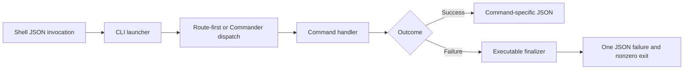

Codex review: found issues before merge. _Reviewed August 16, 2026, 5:39 PM ET / 21:39 UTC._

# ClawSweeper review

## What this changes

The branch standardizes nonzero CLI JSON failures on `{ok:false,error:{type,message}}`, redirects selected handlers to the executable boundary, and documents the new output contract.

## Merge readiness

⛔ **Blocked by patch quality or review findings - 10 items remain**

Keep open: the shared CLI boundary is the right owner, but terminal and locally handled JSON failures still bypass the claimed contract, and the new error shape can break existing script consumers.

**Priority:** P1
**Reviewed head:** `9d269a300d08dc1f0a5c08558a8cd67e41175167`
**Owner decision:** Required. See [Decision needed](#decision-needed).

## Review scores

| Measure | Result | What it means |
|---|---|---|
| **Overall readiness** | 🧂 unranked krab **(1/6)** | The shared-contract approach is useful, but P1 coverage and compatibility gaps make this head not quality-ready. |
| **Proof confidence** | 🌊 off-meta tidepool | Not applicable: The author is a repository member, so contributor real-behavior proof is not a merge gate; the PR body nevertheless records built-distribution before/after checks. |
| **Patch quality** | 🧂 unranked krab **(1/6)** | 4 actionable review findings remain. |

## Verification

| Check | Result | Evidence |
|---|---|---|
| **Real behavior** | Not applicable | Not applicable: The author is a repository member, so contributor real-behavior proof is not a merge gate; the PR body nevertheless records built-distribution before/after checks. |
| **Evidence reviewed** | 5 items | Public contract added by this branch: The documentation promises one JSON failure document for any failing command in JSON output mode. A JSON command still consumes an incompatible failure: Current sessions compact emits a string-valued error on an RPC throw and forwards failed Gateway payloads unchanged, so neither path guarantees error.type. New fatal writer bypasses output draining: The new uncaught-exception JSON write is followed by direct process exit, bypassing the existing one-shot drain owner that has a piped-output regression test. |
| **Findings** | 4 actionable findings | [P1] Drain fatal JSON writes before exiting [P1] Cover unhandled rejections in JSON mode [P1] Exercise real JSON command failure owners |
| **Security** | None | None. |

## How this fits together

The CLI launcher selects route-first or Commander command execution, while handlers return command-specific output or errors. The executable boundary is responsible for turning uncaught failures into shell-visible stdout, stderr, and exit status.

## Decision needed

| Question | Recommendation |
|---|---|
| Should existing JSON error consumers receive a compatibility transition, or should the typed error-object schema be an explicitly accepted breaking contract? | **Version or preserve the old failure shape:** Keep existing consumers working during a documented transition while adding the typed contract through an explicit compatible surface. |

Why: Current commands expose string-valued error fields to scripts, while this branch changes that field’s type across multiple commands.

## Before merge

- [ ] **Drain fatal JSON writes before exiting (P1)** - This newly writes the JSON payload and then the handler directly calls `process.exit(1)`, bypassing the one-shot stream drain. Piped JSON can therefore be empty or truncated; route all launcher-owned fatal writers through one drain-aware exit path, including the legacy and early-entry variants.
- [ ] **Cover unhandled rejections in JSON mode (P1)** - The new writer only runs for `uncaughtException`; the installed rejection handler logs and exits directly in `src/infra/unhandled-rejections.ts:378-428`. A nonzero unhandled rejection with `--json` still has no stdout envelope, so register an executable-boundary reporter before that handler exits.
- [ ] **Exercise real JSON command failure owners (P1)** - Replacing each action and formatting the rejection in this test’s own finalizer bypasses real local error owners. For example, `sessions compact &lt;key> --json` still emits a string `error` on an RPC throw and forwards failed Gateway shapes unchanged. Add process or owner-boundary coverage and convert that command’s failure paths to the documented envelope.
- [ ] **Preserve or version existing JSON error consumers (P1)** - Changing `error` from a string to an object breaks scripts that parse the current command-level JSON payloads. Keep a compatible transition or obtain an explicit breaking-contract decision with a documented upgrade path before changing the public field type.
- [ ] **Resolve merge risk (P1)** - Existing automation that parses a string-valued JSON error will fail after the nested error-object change unless maintainers explicitly accept or version that compatibility break.
- [ ] **Resolve merge risk (P1)** - The branch is behind current main, so process-level proof must be refreshed on the rebased exact head after the failure-path repairs.
- [ ] **Improve patch quality** - Route all terminal JSON failures through a drain-aware executable owner, including unhandled rejections.
- [ ] **Improve patch quality** - Convert and prove real locally handled failures such as sessions compact.
- [ ] **Improve patch quality** - Resolve the error-field compatibility decision and rerun exact-head process proof after rebase.

## Findings

- [P1] Drain fatal JSON writes before exiting — `src/cli/run-main.ts:1559-1561`
- [P1] Cover unhandled rejections in JSON mode — `src/cli/run-main.ts:1559-1561`
- [P1] Exercise real JSON command failure owners — `src/cli/program/root-command-descriptions.test.ts:443-463`

<strong>Agent review details</strong>

### Security

None.

### PR surface

Source +123, Tests +284, Docs +20. Total +427 across 47 files.

View PR surface stats

| Area | Files | Added | Removed | Net |
|---|---:|---:|---:|---:|
| Source | 25 | 182 | 59 | +123 |
| Tests | 21 | 358 | 74 | +284 |
| Docs | 1 | 20 | 0 | +20 |
| Config | 0 | 0 | 0 | 0 |
| Generated | 0 | 0 | 0 | 0 |
| Other | 0 | 0 | 0 | 0 |
| **Total** | **47** | **560** | **133** | **+427** |

### Review metrics

| Metric | Value | Why it matters |
|---|---|---|
| **Production versus test LOC** | production +182/-59 (net +123); tests +358/-74; docs +20/-0 | The public CLI contract warrants shared-boundary code, but the positive bug-fix growth has not yet covered all relevant failure owners. |

### Stored data model

Persistent data-model change detected: `migration/backfill/repair: src/commands/agents.delete.test.ts`, `serialized state: src/cli/directory-cli.test.ts`, `serialized state: src/cli/node-cli/daemon.test.ts`, `serialized state: src/cli/skills-cli.commands.test.ts`, `serialized state: src/cli/skills-cli.test.ts`, `serialized state: src/cli/system-cli.test.ts`, and 4 more. Confirm migration or upgrade compatibility proof before merge.

### Merge-risk options

**Maintainer options:**
1. **Complete and transition the contract safely (recommended)**  
   Repair every terminal and local failure owner, add executable proof for both launchers, and preserve or version existing error consumers before merge.
2. **Accept a breaking JSON schema**  
   Maintain the typed envelope but record explicit ownership of the incompatible error-field change and its operator upgrade path.

### Technical review

Best possible solution:

Use one drain-aware executable failure emitter for every terminal CLI path, make local JSON error owners either preserve their domain payload beside the canonical envelope or rethrow, and adopt the new schema only through an explicit compatibility transition.

Do we have a high-confidence way to reproduce the issue?

Yes, from source: `sessions compact --json` has concrete nonzero paths with no typed error, and the launcher/rejection paths either exit before draining JSON or never emit it.

Is this the best way to solve the issue?

No; centralizing failure emission is the best direction, but it must cover unhandled rejections, direct exits, and local terminal handlers before documentation promises a universal contract.

Full review comments:

- [P1] Drain fatal JSON writes before exiting — `src/cli/run-main.ts:1559-1561`
  This newly writes the JSON payload and then the handler directly calls `process.exit(1)`, bypassing the one-shot stream drain. Piped JSON can therefore be empty or truncated; route all launcher-owned fatal writers through one drain-aware exit path, including the legacy and early-entry variants.
  Confidence: 0.96
- [P1] Cover unhandled rejections in JSON mode — `src/cli/run-main.ts:1559-1561`
  The new writer only runs for `uncaughtException`; the installed rejection handler logs and exits directly in `src/infra/unhandled-rejections.ts:378-428`. A nonzero unhandled rejection with `--json` still has no stdout envelope, so register an executable-boundary reporter before that handler exits.
  Confidence: 0.94
- [P1] Exercise real JSON command failure owners — `src/cli/program/root-command-descriptions.test.ts:443-463`
  Replacing each action and formatting the rejection in this test’s own finalizer bypasses real local error owners. For example, `sessions compact &lt;key> --json` still emits a string `error` on an RPC throw and forwards failed Gateway shapes unchanged. Add process or owner-boundary coverage and convert that command’s failure paths to the documented envelope.
  Confidence: 0.97
- [P1] Preserve or version existing JSON error consumers — `src/cli/failure-output.ts:14-30`
  Changing `error` from a string to an object breaks scripts that parse the current command-level JSON payloads. Keep a compatible transition or obtain an explicit breaking-contract decision with a documented upgrade path before changing the public field type.
  Confidence: 0.93

Overall correctness: patch is incorrect
Overall confidence: 0.95

AGENTS.md: found and applied where relevant.

Codex review notes: model internal, reasoning high; reviewed against [9b17b9341453](https://github.com/openclaw/openclaw/commit/9b17b9341453b62d717ed7bc0ecd1a365294262e).

### Labels

Label changes:

- add `P1`: Automation using JSON output can still receive no parseable failure document on concrete nonzero paths.
- add `merge-risk: 🚨 compatibility`: The branch changes established JSON error fields from strings to objects for existing CLI consumers.
- add `rating: 🧂 unranked krab`: Overall readiness is 🧂 unranked krab; proof is 🌊 off-meta tidepool and patch quality is 🧂 unranked krab.
- add `status: ⏳ waiting on author`: ClawSweeper has contributor-facing work open and is waiting for author action. Not applicable: The author is a repository member, so contributor real-behavior proof is not a merge gate; the PR body nevertheless records built-distribution before/after checks.

Label justifications:

- `P1`: Automation using JSON output can still receive no parseable failure document on concrete nonzero paths.
- `merge-risk: 🚨 compatibility`: The branch changes established JSON error fields from strings to objects for existing CLI consumers.
- `rating: 🧂 unranked krab`: Overall readiness is 🧂 unranked krab; proof is 🌊 off-meta tidepool and patch quality is 🧂 unranked krab.
- `status: ⏳ waiting on author`: ClawSweeper has contributor-facing work open and is waiting for author action. Not applicable: The author is a repository member, so contributor real-behavior proof is not a merge gate; the PR body nevertheless records built-distribution before/after checks.

### Evidence

What I checked:

- **Public contract added by this branch:** The documentation promises one JSON failure document for any failing command in JSON output mode. Public docs: [`docs/cli/index.md`](https://docs.openclaw.ai/cli). ([`docs/cli/index.md:70`](https://docs.openclaw.ai/cli), [9d269a300d08](https://github.com/openclaw/openclaw/commit/9d269a300d08))
- **A JSON command still consumes an incompatible failure:** Current sessions compact emits a string-valued error on an RPC throw and forwards failed Gateway payloads unchanged, so neither path guarantees error.type. ([`src/commands/sessions-compact.ts:96`](https://github.com/openclaw/openclaw/blob/5d68a8e1db3e/src/commands/sessions-compact.ts#L96), [5d68a8e1db3e](https://github.com/openclaw/openclaw/commit/5d68a8e1db3e))
- **New fatal writer bypasses output draining:** The new uncaught-exception JSON write is followed by direct process exit, bypassing the existing one-shot drain owner that has a piped-output regression test. ([`src/cli/run-main.ts:1560`](https://github.com/openclaw/openclaw/blob/9d269a300d08/src/cli/run-main.ts#L1560), [9d269a300d08](https://github.com/openclaw/openclaw/commit/9d269a300d08))
- **Unhandled rejections remain outside the new JSON path:** The shared rejection handler logs and exits directly, rather than reaching either launcher finalizer or the new uncaught-exception JSON writer. ([`src/infra/unhandled-rejections.ts:378`](https://github.com/openclaw/openclaw/blob/9b17b9341453/src/infra/unhandled-rejections.ts#L378), [9b17b9341453](https://github.com/openclaw/openclaw/commit/9b17b9341453))
- **Current failure payload compatibility:** The branch deliberately changes error from a string to a typed object; current main still contains the prior string shape in command-level JSON failures. ([`src/cli/failure-output.ts:14`](https://github.com/openclaw/openclaw/blob/9d269a300d08/src/cli/failure-output.ts#L14), [9d269a300d08](https://github.com/openclaw/openclaw/commit/9d269a300d08))

Likely related people:

- **steipete:** Current handler ownership and the proposed canonical formatter both trace to Peter Steinberger, whose GitHub handle is the PR author. (role: recent CLI contributor; confidence: high; commits: [5d68a8e1db3e](https://github.com/openclaw/openclaw/commit/5d68a8e1db3e3c78085030f9910b10554c982f21), [9d269a300d08](https://github.com/openclaw/openclaw/commit/9d269a300d08dc1f0a5c08558a8cd67e41175167); files: `src/cli/run-main.ts`, `src/commands/sessions-compact.ts`, `src/cli/failure-output.ts`)

### Rating scale

| Score | Internal tier | Crab rank | Meaning |
|---:|:---:|---|---|
| **6/6** | S | 🦀 challenger crab | Exceptional readiness |
| **5/6** | A | 🦞 diamond lobster | Very strong readiness |
| **4/6** | B | 🐚 platinum hermit | Good normal PR; ordinary maintainer review |
| **3/6** | C | 🦐 gold shrimp | Useful, but confidence is limited |
| **2/6** | D | 🦪 silver shellfish | Proof or implementation needs work |
| **1/6** | F | 🧂 unranked krab | Not merge-ready |
| N/A | NA | 🌊 off-meta tidepool | Rating does not apply |

Overall follows the weaker of proof and patch quality.
Shiny media proof means a screenshot, video, or linked artifact directly shows the changed behavior. Runtime, network, CSP, and security claims still need visible diagnostics.

### Workflow

- ClawSweeper keeps one durable marker-backed review comment per issue or PR.
- Re-runs edit this comment so the latest verdict, findings, and automation markers stay together instead of adding duplicate bot comments.
- A fresh review can be triggered by eligible `@clawsweeper re-review` comments, exact-item GitHub events, scheduled/background review runs, or manual workflow dispatch.
- PR/issue authors and users with repository write access can comment `@clawsweeper re-review` or `@clawsweeper re-run` on an open PR or issue to request a fresh review only.
- Maintainers can also comment `@clawsweeper review` to request a fresh review only.
- Fresh-review commands do not start repair, autofix, rebase, CI repair, or automerge.
- Maintainer-only repair and merge flows require explicit commands such as `@clawsweeper autofix`, `@clawsweeper automerge`, `@clawsweeper fix ci`, or `@clawsweeper address review`.
- Maintainers can comment `@clawsweeper explain` to ask for more context, or `@clawsweeper stop` to stop active automation.

<!-- clawsweeper-verdict:needs-human item=124849 sha=9d269a300d08dc1f0a5c08558a8cd67e41175167 confidence=high updated_at=2026-08-16T21:35:17Z reviewed_at=2026-08-16T21:39:47.123Z lease_owner=github-run-31973830234-1 lease_comment_id=5309789662 source_revision=88763dff926b3c020b8b23c5be1d41cce4bc64c16d8ce91c3f84b6a58d22b904 -->

<!-- clawsweeper-review-version item=124849 reviewed_at=2026-08-16T21:39:47.123Z sha=9d269a300d08dc1f0a5c08558a8cd67e41175167 source_revision=88763dff926b3c020b8b23c5be1d41cce4bc64c16d8ce91c3f84b6a58d22b904 lease_owner=github-run-31973830234-1 lease_comment_id=5309789662 v=1 -->

<!-- clawsweeper-review item=124849 -->