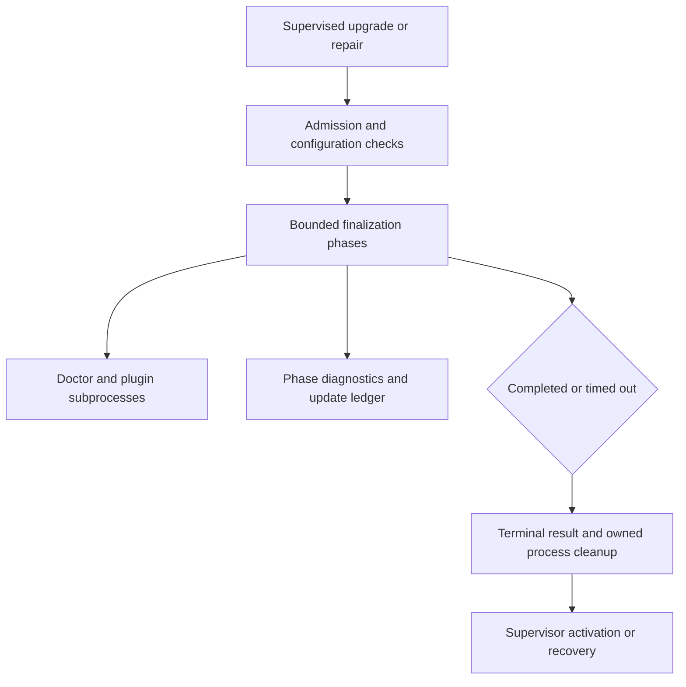

Codex review: blocked before merge. _Reviewed September 7, 2026, 2:15 AM ET / 06:15 UTC._

# ClawSweeper review

## What this changes

Bounds update finalization and CLI cleanup, reports stalled phases, and terminates owned subprocesses so supervised upgrades receive a terminal result.

## Merge readiness

⛔ **Blocked before merge - 3 items remain**

The containment fix remains useful: current main still lacks these finalization deadlines. The prior findings are addressed, and no additional blocking defect was identified. The related macOS incident remains unresolved independently.

**Priority:** P1
**Reviewed head:** `72be047a9a57c074f75e9b85f6ab068509dc387c`

## Review scores

| Measure | Result | What it means |
|---|---|---|
| **Overall readiness** | 🐚 platinum hermit **(4/6)** | A useful owner-level repair with substantial runtime evidence and resolved prior findings; the shorter-budget compatibility tradeoff is explicit. |
| **Proof confidence** | 🦞 diamond lobster **(5/6)** | Sufficient (terminal): The captured terminal transcript exercises built finalization through a supervisor stand-in, showing healthy fresh/upgrade results, bounded snapshot failure, resistant-child termination, and retained-resource exit diagnostics. Wider live proof is pinned to e117a823; later PID and borrowed-lifetime repairs have reported process coverage on f0d57bfe. The omitted body tail and unavailable historical comparison are reviewer limitations, not missing contributor proof. |
| **Patch quality** | 🐚 platinum hermit **(4/6)** | No actionable review findings were identified. |

## Verification

| Check | Result | Evidence |
|---|---|---|
| **Real behavior** | Verified | Sufficient (terminal): The captured terminal transcript exercises built finalization through a supervisor stand-in, showing healthy fresh/upgrade results, bounded snapshot failure, resistant-child termination, and retained-resource exit diagnostics. Wider live proof is pinned to e117a823; later PID and borrowed-lifetime repairs have reported process coverage on f0d57bfe. The omitted body tail and unavailable historical comparison are reviewer limitations, not missing contributor proof. |
| **Evidence reviewed** | 12 items | Pinned introduction and current-main necessity: Reviewed the merge-base-to-head production diff. The fetched main finalizer still directly awaits phases and records timings afterward; the new lifecycle file is absent from that main tree. No merged replacement is established by the supplied context. Latest supplied release retains the unbounded phase await: The v2026.9.2 finalizer uses the 30-minute subprocess default and awaits runTimedFinalizePhase callbacks without an enclosing phase deadline. Deadline and borrowed-process boundary: Phase deadlines require executable CLI ownership; borrowed invocations continue awaiting their phase. On deadline, the executable stops owned children, records failure, writes terminal JSON synchronously, and exits. |
| **Findings** | None | None. |
| **Security** | None | None. |

## How this fits together

Update finalization repairs configuration and plugins after a core upgrade. A supervising updater waits for its JSON result and process exit before proceeding with activation or recovery.

## Before merge

- [ ] **Resolve merge risk (P2)** - Legitimate migrations or plugin installations exceeding the shorter defaults will now fail finalization and may require the existing --timeout override; successful upgrade proof covers synthetic Linux state.
- [ ] **Resolve merge risk (P1)** - The affected macOS environment's actual stalled operation remains unidentified, so this patch does not establish that the related incident is fully fixed.
- [ ] **Add data-model compatibility proof** - Confirm migration or upgrade compatibility proof before merge.

<strong>Agent review details</strong>

### Security

None.

### PR surface

Source +343, Tests +493, Docs +21, Config 0, Other -1. Total +856 across 28 files.

View PR surface stats

| Area | Files | Added | Removed | Net |
|---|---:|---:|---:|---:|
| Source | 13 | 600 | 257 | +343 |
| Tests | 12 | 581 | 88 | +493 |
| Docs | 1 | 22 | 1 | +21 |
| Config | 1 | 1 | 1 | 0 |
| Generated | 0 | 0 | 0 | 0 |
| Other | 1 | 0 | 1 | -1 |
| **Total** | **28** | **1204** | **348** | **+856** |

### Review metrics

| Metric | Value | Why it matters |
|---|---|---|
| **Production versus test growth** | Production +600/-257; tests and support +580/-88 | The body explicitly justifies production growth with phase deadlines, process custody, and exit diagnostics. |
| **Deadline behavior** | 7 bounded phases; 0 new options | The existing --timeout now overrides phase-specific defaults, making the changed upgrade behavior visible. |

### Stored data model

Persistent data-model change detected: `migration/backfill/repair: extensions/codex/src/doctor.ts`, `migration/backfill/repair: src/cli/update-cli.ts`, `migration/backfill/repair: src/cli/update-cli/update-command-finalize.ts`, `migration/backfill/repair: src/cli/update-cli/update-finalization-lifecycle.ts`. Confirm migration or upgrade compatibility proof before merge.

### Merge-risk options

**Maintainer options:**
1. **Retain the documented phase budgets (recommended)**  
   Accept the maintainer's explicit deadline tradeoff, supported by fresh-state and upgrade proof, with --timeout available for legitimately longer operations.
2. **Recalibrate from a slow real installation**  
   If an existing installation demonstrates legitimate work exceeding these budgets, adjust the affected default using that measured evidence before landing.

### Technical review

Best possible solution:

Retain bounded finalization with the documented timeout override and demonstrated fresh-state/upgrade behavior, while preserving the separate investigation into the affected macOS stall.

Do we have a high-confidence way to reproduce the issue?

Yes for the unbounded-wait mechanism: current main awaits phase callbacks without an enclosing deadline, and the supplied before/after transcript exercises an injected stalled operation. The reporter's exact macOS trigger remains unknown; this review executed no tests.

Is this the best way to solve the issue?

Yes for bounded-outcome containment: deadlines belong to finalization, child cleanup follows process ownership, and borrowed callers retain their lifetime. This does not establish a root-cause fix for the separate macOS incident.

AGENTS.md: found and applied where relevant.

Codex review notes: model internal, reasoning medium; reviewed against [d8b597be60c4](https://github.com/openclaw/openclaw/commit/d8b597be60c4b3c0d00958ecca807eeb2eac4c8c).

### Labels

Label justifications:

- `P1`: A nonterminal finalizer can leave a supervised upgrade waiting with the Gateway stopped.
- `merge-risk: 🚨 compatibility`: Shorter default phase budgets can fail legitimate existing upgrades that previously had longer subprocess allowances.
- `rating: 🐚 platinum hermit`: Overall readiness is 🐚 platinum hermit; proof is 🦞 diamond lobster and patch quality is 🐚 platinum hermit.
- `status: 👀 ready for maintainer look`: ClawSweeper has no concrete contributor-facing blocker left for this PR. Sufficient (terminal): The captured terminal transcript exercises built finalization through a supervisor stand-in, showing healthy fresh/upgrade results, bounded snapshot failure, resistant-child termination, and retained-resource exit diagnostics. Wider live proof is pinned to e117a823; later PID and borrowed-lifetime repairs have reported process coverage on f0d57bfe. The omitted body tail and unavailable historical comparison are reviewer limitations, not missing contributor proof.
- `proof: sufficient`: Contributor real behavior proof is sufficient. The captured terminal transcript exercises built finalization through a supervisor stand-in, showing healthy fresh/upgrade results, bounded snapshot failure, resistant-child termination, and retained-resource exit diagnostics. Wider live proof is pinned to e117a823; later PID and borrowed-lifetime repairs have reported process coverage on f0d57bfe. The omitted body tail and unavailable historical comparison are reviewer limitations, not missing contributor proof.

### Evidence

What I checked:

- **Pinned introduction and current-main necessity:** Reviewed the merge-base-to-head production diff. The fetched main finalizer still directly awaits phases and records timings afterward; the new lifecycle file is absent from that main tree. No merged replacement is established by the supplied context. ([`src/cli/update-cli/update-command-finalize.ts:72`](https://github.com/openclaw/openclaw/blob/d8b597be60c4b3c0d00958ecca807eeb2eac4c8c/src/cli/update-cli/update-command-finalize.ts#L72), [d8b597be60c4](https://github.com/openclaw/openclaw/commit/d8b597be60c4b3c0d00958ecca807eeb2eac4c8c))
- **Latest supplied release retains the unbounded phase await:** The v2026.9.2 finalizer uses the 30-minute subprocess default and awaits runTimedFinalizePhase callbacks without an enclosing phase deadline. ([`src/cli/update-cli/update-command-finalize.ts:49`](https://github.com/openclaw/openclaw/blob/3928bad9badfcb6c7d140530435e806fb8092190/src/cli/update-cli/update-command-finalize.ts#L49), [3928bad9badf](https://github.com/openclaw/openclaw/commit/3928bad9badfcb6c7d140530435e806fb8092190))
- **Deadline and borrowed-process boundary:** Phase deadlines require executable CLI ownership; borrowed invocations continue awaiting their phase. On deadline, the executable stops owned children, records failure, writes terminal JSON synchronously, and exits. ([`src/cli/update-cli/update-finalization-lifecycle.ts:108`](https://github.com/openclaw/openclaw/blob/72be047a9a57c074f75e9b85f6ab068509dc387c/src/cli/update-cli/update-finalization-lifecycle.ts#L108), [72be047a9a57](https://github.com/openclaw/openclaw/commit/72be047a9a57c074f75e9b85f6ab068509dc387c))
- **Prior findings resolved in current source:** Human recovery finishes before its deferred exit watchdog starts; completion reserves shutdown time inside its phase budget and retains best-effort failure handling; live children retain custody when the initial timestamp probe fails. Current process tests cover these cases and borrowed callers. ([`src/cli/update-cli/update-command-finalize.ts:107`](https://github.com/openclaw/openclaw/blob/72be047a9a57c074f75e9b85f6ab068509dc387c/src/cli/update-cli/update-command-finalize.ts#L107), [72be047a9a57](https://github.com/openclaw/openclaw/commit/72be047a9a57c074f75e9b85f6ab068509dc387c))
- **Real finalizer proof:** The supplied body excerpt links https://github.com/openclaw/openclaw/actions/runs/34082821509 and records built-candidate execution through a synchronous supervisor stand-in: fresh state and 9.1 upgrades succeed, an injected snapshot stall exits 1 with stuckPhase=configSnapshot, a resistant completion child stops while finalization succeeds, and retained cleanup owners produce diagnostics and bounded exit. This wider runtime proof is pinned to e117a823f370e75c7bc4cb4eaf17071b4f92ad59, not the final head. ([e117a823f370](https://github.com/openclaw/openclaw/commit/e117a823f370e75c7bc4cb4eaf17071b4f92ad59))
- **Later repair evidence and source coverage:** Captured body SHA-256 4881014f2511126c38da0f55e45fa5451ea65ac41eeb3eae48db7ea07be4ad86 reports 14 output-process cases, eight PID cases, and 411 update CLI tests passing on f0d57bfee36511951c21fc6984add3ab9124477c in https://github.com/openclaw/openclaw/actions/runs/34087729930. It describes the final commit as a test-only lint correction. The remaining 3,939 body units were unavailable; the web fallback exposed an older body and was not substituted for the captured evidence. ([f0d57bfee365](https://github.com/openclaw/openclaw/commit/f0d57bfee36511951c21fc6984add3ab9124477c))

Likely related people:

- **steipete:** Suggested for follow-up; no historical authorship or introduction is verified. (role: unverified routing candidate; confidence: low)
- **Josh Lehman:** Suggested for follow-up; no historical authorship or introduction is verified. (role: unverified routing candidate; confidence: low)

### Rating scale

| Score | Internal tier | Crab rank | Meaning |
|---:|:---:|---|---|
| **6/6** | S | 🦀 challenger crab | Exceptional readiness |
| **5/6** | A | 🦞 diamond lobster | Very strong readiness |
| **4/6** | B | 🐚 platinum hermit | Good normal PR; ordinary maintainer review |
| **3/6** | C | 🦐 gold shrimp | Useful, but confidence is limited |
| **2/6** | D | 🦪 silver shellfish | Proof or implementation needs work |
| **1/6** | F | 🧂 unranked krab | Not merge-ready |
| N/A | NA | 🌊 off-meta tidepool | Rating does not apply |

Overall follows the weaker of proof and patch quality.
Shiny media proof means a screenshot, video, or linked artifact directly shows the changed behavior. Runtime, network, CSP, and security claims still need visible diagnostics.

### Workflow

- ClawSweeper keeps one durable marker-backed review comment per issue or PR.
- Re-runs edit this comment so the latest verdict, findings, and automation markers stay together instead of adding duplicate bot comments.
- A fresh review can be triggered by eligible `@clawsweeper re-review` comments, exact-item GitHub events, scheduled/background review runs, or manual workflow dispatch.
- PR/issue authors and users with repository write access can comment `@clawsweeper re-review` or `@clawsweeper re-run` on an open PR or issue to request a fresh review only.
- Maintainers can also comment `@clawsweeper review` to request a fresh review only.
- Fresh-review commands do not start repair, autofix, rebase, CI repair, or automerge.
- Maintainer-only repair and merge flows require explicit commands such as `@clawsweeper autofix`, `@clawsweeper automerge`, `@clawsweeper fix ci`, or `@clawsweeper address review`.
- Maintainers can comment `@clawsweeper explain` to ask for more context, or `@clawsweeper stop` to stop active automation.

### History

Review history (9 earlier review cycles; latest 8 shown)

<!-- clawsweeper-review-history v=1 total=9 -->
- reviewed 2026-09-07T02:54:32.156Z sha 13e4abc0eba68fad957000a4c6056df38c6e0570 :: blocked before merge. :: [P1] Arm the exit watchdog after failure recovery finishes | [P2] Preserve best-effort completion-cache timeout handling
- reviewed 2026-09-07T03:13:44.811Z sha 948ed2eee5073577b03aaa41c4a85b0ffb591b60 :: blocked before merge. :: none
- reviewed 2026-09-07T03:37:35.408Z sha f48bcd706e3665377e647cc5de8c5b41613352f2 :: blocked before merge. :: none
- reviewed 2026-09-07T03:46:10.491Z sha dc78b37a094272461dc9c01a6e83d7cee360ec03 :: blocked before merge. :: none
- reviewed 2026-09-07T04:26:32.255Z sha e117a823f370e75c7bc4cb4eaf17071b4f92ad59 :: blocked before merge. :: none
- reviewed 2026-09-07T04:47:51.318Z sha e117a823f370e75c7bc4cb4eaf17071b4f92ad59 :: blocked before merge. :: [P1] [P1] Preserve child custody when the initial timestamp read fails
- reviewed 2026-09-07T05:49:35.280Z sha f0d57bfee36511951c21fc6984add3ab9124477c :: blocked before merge. :: none
- reviewed 2026-09-07T06:01:24.608Z sha 72be047a9a57c074f75e9b85f6ab068509dc387c :: blocked before merge. :: none

<!-- clawsweeper-verdict:needs-human item=140648 sha=72be047a9a57c074f75e9b85f6ab068509dc387c confidence=high updated_at=2026-09-07T06:13:11Z reviewed_at=2026-09-07T06:15:42.593Z lease_owner=github-run-34089724436-1 lease_comment_id=5565882159 source_revision=7b0653ba7ac14dadac7696a582a8be8e31948727d08c38d86cf98c36b2aa72a4 live_verification=absent -->
<!-- clawsweeper-review-state:blocked item=140648 sha=72be047a9a57c074f75e9b85f6ab068509dc387c v=1 -->

<!-- clawsweeper-review-version item=140648 reviewed_at=2026-09-07T06:15:42.593Z sha=72be047a9a57c074f75e9b85f6ab068509dc387c source_revision=7b0653ba7ac14dadac7696a582a8be8e31948727d08c38d86cf98c36b2aa72a4 lease_owner=github-run-34089724436-1 lease_comment_id=5565882159 v=1 -->

<!-- clawsweeper-review item=140648 -->