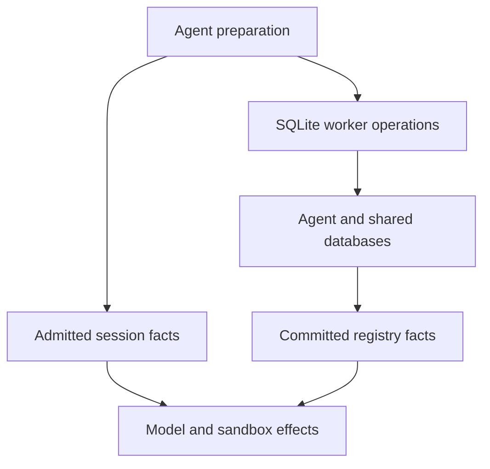

Codex review: needs real behavior proof before merge.

## What this changes

This PR batches auth reads, moves outbox SQL into its worker, and reuses prepared session, sandbox, and worktree facts.

**Example:** Agent preparation reads both persisted auth rows.
- **Before:** Credential and runtime-state cells require two statements.
- **After:** Both cells are read in one statement.

## Review scores

| Measure | Result | What it means |
|---|---|---|
| **Overall readiness** | 🧂 unranked krab **(1/6)** | Useful direction, but the reservation regression is confirmed and the changed authority boundary lacks successful final-effect evidence; no schema or serialized-format migration is introduced. |
| **Proof confidence** | 🧂 unranked krab **(1/6)** | Real behavior proof is necessary before merge. See [Before merge](#before-merge). |
| **Patch quality** | 🦪 silver shellfish **(2/6)** | Security review found an item that needs attention. |

## Product

**Kind:** Performance · **Worth it:** Yes · **Fix scope:** Complete
**User problem:** Agent preparation performs redundant database work and retains avoidable host-thread SQL.
**Reason:** The maintainer-authored direction has clear value and uses existing owners; the recorded replay and renewal tradeoffs do not require another product decision.

## Merge readiness

⛔ **Blocked before merge - 6 items remain**

Keep this PR open for its useful performance work, but block merge on the remaining reservation regression. Exact-head CI confirms the previously reported hydration defect; the relay test-ratchet finding is fixed.

**Priority:** P2
**Reviewed head:** `0aedb5671c69b2ab1a755784e210ae42fa73cd07`

## Before merge

- [ ] **Add real behavior proof** - Authority-chain proof required: Exercise the changed sandbox facts owner through final command launch or workspace I/O with a valid persisted generation after restart, then removed or reassigned generations, supported native mutations, and unknown settlement. The complete body and discussion provide a relay unit-test result and pending validation, without this after-fix trace. Supply redacted logs, live output, or a recording, removing IPs, API keys, phone numbers, and non-public endpoints. After adding proof, update the PR body; ClawSweeper should re-review automatically. If it does not, the PR author or someone with repository write access can comment `@clawsweeper re-review`.
- [ ] **Preserve hydration on empty reservation settlement receipts (P1)** - This previous finding remains unresolved. After restart or database reopen, reserving an existing pending or ready runtime can return its row without writing anything. The worker publishes an empty successful settlement receipt, but this subscriber still increments facts.revision. The installer captured before reserveSandboxRegistryEntry then skips the returned row because the revision changed, leaving no cached generation. createSandboxBackend rejects the valid reservation as removed before calling its provider. Exact-head CI confirms both retained-ID reopen cases fail through this path. Do not advance the revision for empty successful receipts, or publish the returned authoritative reservation fact while preserving replacement and unknown-settlement invalidation.
- [ ] **Resolve security concern: Establish complete final-effect invalidation coverage** - The new guard consumes process-local facts instead of reading the authoritative row. Typed mutation publications are present, but the prior boundary explicitly retained native reads for incomplete receipt coverage. Establish rejection of a removed or reassigned generation before provider launch or workspace I/O, including supported native mutations and unknown settlement.
- [ ] **Resolve merge risk** - Before merge, establish that supported native and worker registry mutations invalidate removed or reassigned sandbox authority before command launch or workspace I/O; the replaced guard explicitly retained a native read for incomplete receipt coverage.
- [ ] **Complete next step** - Resolve GitHub's reported merge conflict and investigate the built-CLI lifecycle failure, fixing any patch-caused defect or establishing its external cause.
- [ ] **Improve patch quality** - Prove valid-generation execution and rejection of removed or reassigned generations before final I/O, including supported native mutations and unknown settlement.

## Findings

- [P1] Preserve hydration on empty reservation settlement receipts — `src/agents/sandbox/registry-currentness.ts:38-39`
- [high] Establish complete final-effect invalidation coverage — `src/agents/sandbox/registry-currentness.ts:79`

### Tests

- Missing end-to-end proof: Show successful sandbox reuse after restart and rejection of removed or reassigned generations before final command launch or workspace I/O through the changed owner.

<strong>Agent review details</strong>

### How this fits together

Agent preparation consumes admitted session and database state, uses SQLite workers for persistence, and supplies model ownership and sandbox authority to execution.

### Technical review

Best possible solution:

Keep the worker cutover while allowing unchanged persisted reservations to hydrate without weakening replacement or unknown-settlement rejection.

Do we have a high-confidence way to reproduce the issue?

Current-main source shows repeated preparation reads, and exact-head CI independently confirms the introduced reservation hydration failure; no target code was run during this review.

Is this the best way to solve the issue?

The existing workers and publication owners are appropriate places for these reductions, but the facts guard must preserve cold reservation hydration and current authority at final effects.

Full review comments:

- [P1] Preserve hydration on empty reservation settlement receipts — `src/agents/sandbox/registry-currentness.ts:38-39`
  This previous finding remains unresolved. After restart or database reopen, reserving an existing pending or ready runtime can return its row without writing anything. The worker publishes an empty successful settlement receipt, but this subscriber still increments facts.revision. The installer captured before reserveSandboxRegistryEntry then skips the returned row because the revision changed, leaving no cached generation. createSandboxBackend rejects the valid reservation as removed before calling its provider. Exact-head CI confirms both retained-ID reopen cases fail through this path. Do not advance the revision for empty successful receipts, or publish the returned authoritative reservation fact while preserving replacement and unknown-settlement invalidation.
  Confidence: 1

Overall correctness: patch is incorrect
Overall confidence: 0.97

AGENTS.md: found and applied where relevant.

Codex review notes: model internal, reasoning medium; reviewed against [1598547552d6](https://github.com/openclaw/openclaw/commit/1598547552d6fa9f7955c9de3ab785f40c8cf679).

### Merge-risk options

**Maintainer options:**
1. **Complete the receipt guard cutover (recommended)**  
   Repair empty-receipt hydration and demonstrate that valid persisted generations work while removed or reassigned generations cannot reach final effects.
2. **Retain the existing final guard**  
   Keep the native final registry read temporarily and land the independent auth, relay, outbox, and preparation reductions.

### Provenance checked

- `Sandbox effect guards` changes intended behavior with a stated reason (83ce1401d658f4c723063a9900ba5af9bcbb5adb: Final native generation reads protected retained sandbox callbacks while receipt coverage remained incomplete; https://github.com/openclaw/openclaw/pull/168025 subsequently added typed publications without retiring those guards.)
- `Outbox worker placement and recovery` keeps the original intent (https://github.com/openclaw/openclaw/pull/158209: Worker execution avoided a host-thread SQLite busy wait that stalled replies; this PR retains that owner and the existing idempotent logical-turn contract.)
- `Relay ownership mutations` changes intended behavior with a stated reason (https://github.com/openclaw/openclaw/pull/149397: Publication and renewal validated the live registration, while pruning compared complete snapshots; guarded SQL retains ownership checks and the body accepts same-owner timestamp supersession.)
- `Auth-row reader` keeps the original intent (d3d2d2ea3b47eae541232eb5528d23d3276e2518: Runtime auth rows used admitted read ownership and cache invalidation; batching preserves independent cell classification and existing malformed-legacy handling.)
- `Native model preparation` changes intended behavior with a stated reason (00daeebaf390ac9144c567ca399dd8a3707dc1ee: Preparation and dispatch were bound to current session ownership; the admitted entry replaces the initial reread while dispatch still refreshes ownership.)
- `Subagent cancellation preparation` keeps the original intent (https://github.com/openclaw/openclaw/pull/163485: Cancellation reused ready session generations to avoid unrelated writer stalls; this PR retains the session-generation owner and removes an additional preparation writer.)
- `Worktree lease census` keeps the original intent (06cbb349bae43dc23afe949270e03fb86e67a663: Cleanup read leases without the state write lock; the complete worker census now supplies the lookup while destructive removal keeps its authoritative lock checks.)

### Testing

Proof path: in-process harness.

### Security

Needs attention: The sandbox authority cutover needs final-effect validation; inspection found no concrete authorization bypass or supply-chain regression.

### Evidence

Security concerns:

- [high] Establish complete final-effect invalidation coverage — `src/agents/sandbox/registry-currentness.ts:79`
  The new guard consumes process-local facts instead of reading the authoritative row. Typed mutation publications are present, but the prior boundary explicitly retained native reads for incomplete receipt coverage. Establish rejection of a removed or reassigned generation before provider launch or workspace I/O, including supported native mutations and unknown settlement.
  Confidence: 0.93

What I checked:

- **Pinned introduction:** Reviewed the introduced changes from 6e06137f85ef3262f47dae63626d97f14c2f1ca1 to 0aedb5671c69b2ab1a755784e210ae42fa73cd07; current main still retains the native sandbox generation read and the older outbox preparation path. ([`src/agents/sandbox/registry.ts:182`](https://github.com/openclaw/openclaw/blob/0aedb5671c69b2ab1a755784e210ae42fa73cd07/src/agents/sandbox/registry.ts#L182), [0aedb5671c69](https://github.com/openclaw/openclaw/commit/0aedb5671c69b2ab1a755784e210ae42fa73cd07))
- **Confirmed reservation failure:** The exact-head CI annotations show both database-reopen reservation cases failing at runtime-reservation.test.ts:430 through registry-currentness.ts:86. An empty successful reservation receipt increments the revision without installing the returned entry, so hydration is skipped. ([`src/agents/sandbox/registry-currentness.ts:39`](https://github.com/openclaw/openclaw/blob/0aedb5671c69b2ab1a755784e210ae42fa73cd07/src/agents/sandbox/registry-currentness.ts#L39), [0aedb5671c69](https://github.com/openclaw/openclaw/commit/0aedb5671c69b2ab1a755784e210ae42fa73cd07))
- **Prior finding resolution:** Comparison with the previous reviewed head shows the sandbox hydration code unchanged, while the permission fixture now lives in native-hook-relay.test-support.ts alongside cleanup. ([`src/agents/harness/native-hook-relay.test-support.ts:4`](https://github.com/openclaw/openclaw/blob/0aedb5671c69b2ab1a755784e210ae42fa73cd07/src/agents/harness/native-hook-relay.test-support.ts#L4), [0aedb5671c69](https://github.com/openclaw/openclaw/commit/0aedb5671c69b2ab1a755784e210ae42fa73cd07))
- **Original receipt boundary:** https://github.com/openclaw/openclaw/pull/168025 established typed registry receipts but expressly retained final guards because arbitrary raw SQL and trigger effects were not certified; this PR replaces those guards with cached facts. ([`src/agents/sandbox/registry-publication.ts:92`](https://github.com/openclaw/openclaw/blob/cbff5bd234562169ba024efb9a1371ac6a7126b5/src/agents/sandbox/registry-publication.ts#L92), [cbff5bd23456](https://github.com/openclaw/openclaw/commit/cbff5bd234562169ba024efb9a1371ac6a7126b5))
- **Recorded direction and evidence:** The complete current body records the accepted idempotent outbox replay and same-owner renewal tradeoffs, a relay unit-test result, and pending validation; it supplies no sandbox final-effect authority trace. The security comment verifies the author has repository admin access. Captured body source identity: a6a83f3f55201e93408720d0903477fc06bb57c7ec7c475079da06a0d7297eed. ([0aedb5671c69](https://github.com/openclaw/openclaw/commit/0aedb5671c69b2ab1a755784e210ae42fa73cd07))
- **Live conflict:** A fresh REST read confirms the reviewed head remains open and unmerged with mergeable=false and mergeable_state=dirty. ([0aedb5671c69](https://github.com/openclaw/openclaw/commit/0aedb5671c69b2ab1a755784e210ae42fa73cd07))

Likely related people:

- **Peter Steinberger:** Raw commit cbff5bd234562169ba024efb9a1371ac6a7126b5 adds src/agents/sandbox/registry-publication.ts:39 relative to its recorded parents. This identifies author metadata, not feature responsibility or a PR merger. (role: source-line author; confidence: high; commits: [cbff5bd23456](https://github.com/openclaw/openclaw/commit/cbff5bd234562169ba024efb9a1371ac6a7126b5); files: `src/agents/sandbox/registry-publication.ts`)
- **Shakker:** Raw commit 08f5fb80f301d8236cadb8acc853d95566fd7f10 adds src/agents/sandbox/registry.kernel.ts:40 relative to its recorded parents. This identifies author metadata, not feature responsibility or a PR merger. (role: source-line author; confidence: high; commits: [08f5fb80f301](https://github.com/openclaw/openclaw/commit/08f5fb80f301d8236cadb8acc853d95566fd7f10); files: `src/agents/sandbox/registry.kernel.ts`)
- **Yuval Dinodia:** Raw commit 7cd2e482d16bdaa7c93c3f6c26b74a2b48990c4c adds src/agents/worktrees/run-lease.ts:104 relative to its recorded parents. This identifies author metadata, not feature responsibility or a PR merger. (role: source-line author; confidence: high; commits: [7cd2e482d16b](https://github.com/openclaw/openclaw/commit/7cd2e482d16bdaa7c93c3f6c26b74a2b48990c4c); files: `src/agents/worktrees/run-lease.ts`)

### PR surface

Source -42, Tests +164, Docs +15, Other +44. Total +181 across 41 files. Added test files: 2.

View PR surface stats

| Area | Files | Added | Removed | Net |
|---|---:|---:|---:|---:|
| Source | 16 | 742 | 784 | -42 |
| Tests | 20 | 314 | 150 | +164 |
| Docs | 2 | 143 | 128 | +15 |
| Config | 0 | 0 | 0 | 0 |
| Generated | 0 | 0 | 0 | 0 |
| Other | 3 | 49 | 5 | +44 |
| **Total** | **41** | **1248** | **1067** | **+181** |

### Review metrics

| Metric | Value | Why it matters |
|---|---|---|
| **Auth-row read statements** | 2 → 1 | The combined query reads credential and runtime-state cells in one SQLite snapshot; this is a source-level operation reduction, not a measured latency claim. |

### Labels

Label changes:

No label changes.

Label justifications:

- `P2`: This is a normal-priority internal performance improvement; the introduced reservation defect blocks merging.
- `merge-risk: 🚨 compatibility`: Existing persisted sandbox reservations fail after database reopen under the new facts guard.
- `merge-risk: 🚨 security-boundary`: Cached registry facts replace the final native authority read before sandbox effects.
- `rating: 🧂 unranked krab`: Overall readiness is 🧂 unranked krab; proof is 🧂 unranked krab and patch quality is 🦪 silver shellfish.
- `status: 📣 needs proof`: The PR needs real behavior proof before ClawSweeper can clear the contributor ask.

### Rating scale

6/6 🦀 challenger crab · 5/6 🦞 diamond lobster · 4/6 🐚 platinum hermit · 3/6 🦐 gold shrimp · 2/6 🦪 silver shellfish · 1/6 🧂 unranked krab. Overall follows the weaker of proof and patch quality; ✨ marks media proof (a screenshot, video, or linked artifact) that directly shows the changed behavior.

### Workflow

ClawSweeper edits this one comment on every review. Comment `@clawsweeper re-review` for a fresh review only; repair and merge need explicit maintainer commands such as `@clawsweeper autofix` or `@clawsweeper automerge`.

### History

Review history (5 earlier review cycles)

<!-- clawsweeper-review-history v=1 total=5 -->
- reviewed 2026-10-11T08:03:35.664Z sha 81f2d839f0e17c14b7747ece4e9cf6726ddcdc09 :: needs real behavior proof before merge. :: [P1] Preserve hydration on empty reservation settlement receipts
- reviewed 2026-10-11T08:28:07.823Z sha e56e04c1f09c620933a29012e7dcd2af51a5964f :: needs real behavior proof before merge. :: [P1] Preserve hydration on empty reservation settlement receipts | [P2] Update the outbox queue regression for deferred admission | [P2] Keep the relay cleanup migration within the test ratchet
- reviewed 2026-10-11T09:04:43.727Z sha 1e94f14a611019ccced1c9e72535e6cbba4d2ef8 :: needs real behavior proof before merge. :: [P1] Preserve hydration on empty reservation settlement receipts | [P2] Keep the relay cleanup migration within the test ratchet
- reviewed 2026-10-11T09:43:02.147Z sha d764212f9e27952c82a9e2dd0f64180ee8dd4801 :: needs real behavior proof before merge. :: [P1] Preserve hydration on empty reservation settlement receipts | [P2] Keep the relay cleanup migration within the test ratchet
- reviewed 2026-10-11T10:16:01.188Z sha 7903f60246b23ad0593337802bdfd3b7e8fa8615 :: needs real behavior proof before merge. :: [P1] Preserve hydration on empty reservation settlement receipts | [P2] Keep the relay cleanup migration within the test ratchet

_Reviewed October 11, 2026, 6:48 AM ET / 10:48 UTC (Revision 6)._

<!-- clawsweeper-security:security-sensitive item=168992 sha=0aedb5671c69b2ab1a755784e210ae42fa73cd07 confidence=high updated_at=2026-10-11T10:43:10Z reviewed_at=2026-10-11T10:48:08.767Z lease_owner=github-run-38132898380-1 lease_comment_id=6108189193 source_revision=a6a83f3f55201e93408720d0903477fc06bb57c7ec7c475079da06a0d7297eed live_verification=absent -->
<!-- clawsweeper-verdict:needs-human item=168992 sha=0aedb5671c69b2ab1a755784e210ae42fa73cd07 confidence=high updated_at=2026-10-11T10:43:10Z reviewed_at=2026-10-11T10:48:08.767Z lease_owner=github-run-38132898380-1 lease_comment_id=6108189193 source_revision=a6a83f3f55201e93408720d0903477fc06bb57c7ec7c475079da06a0d7297eed live_verification=absent hold=security findings=1 -->
<!-- clawsweeper-review-state:blocked item=168992 sha=0aedb5671c69b2ab1a755784e210ae42fa73cd07 v=1 -->

<!-- clawsweeper-review-version item=168992 reviewed_at=2026-10-11T10:48:08.767Z sha=0aedb5671c69b2ab1a755784e210ae42fa73cd07 source_revision=a6a83f3f55201e93408720d0903477fc06bb57c7ec7c475079da06a0d7297eed lease_owner=github-run-38132898380-1 lease_comment_id=6108189193 v=1 -->

<!-- clawsweeper-review item=168992 -->