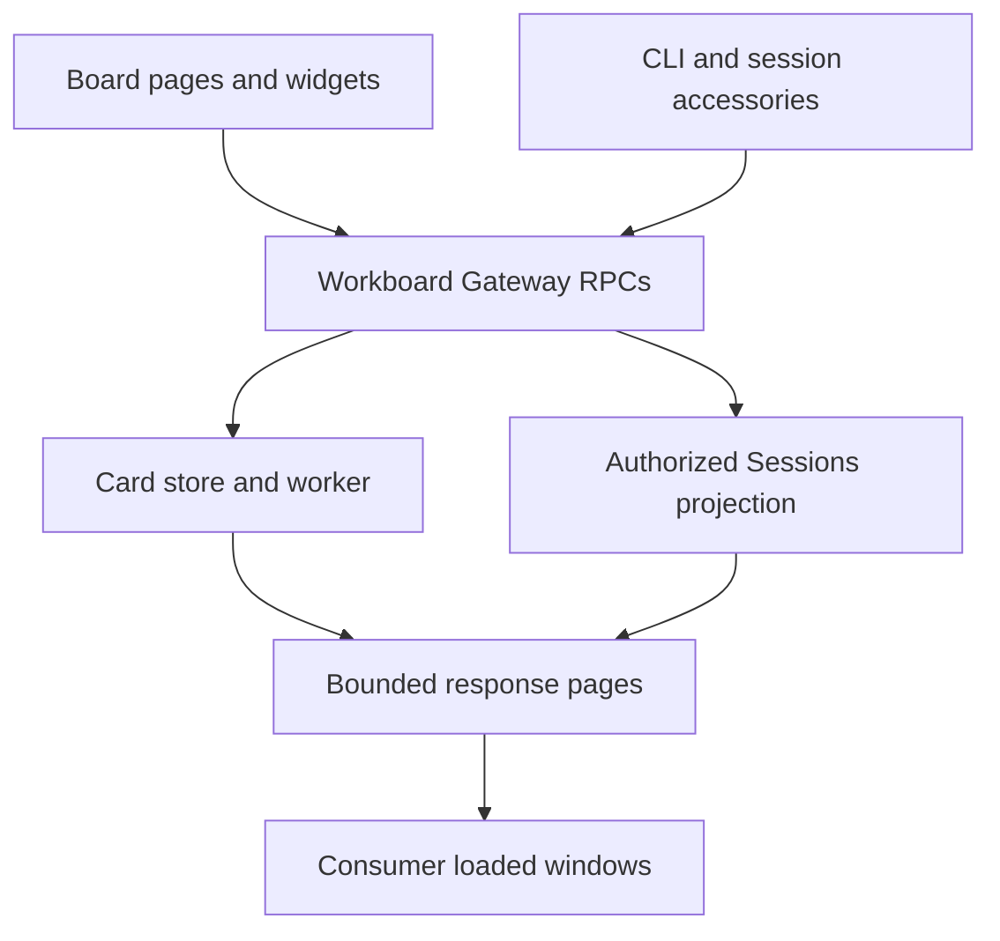

Codex review: needs changes before merge.

## What this changes

This PR paginates card and Sessions board responses in batches of 100 and adds loading controls to bundled consumers.

**Example:** Open a Workboard containing 205 cards.
- **Before:** The initial response contains all 205 complete cards.
- **After:** The initial response contains 100 cards and a cursor; Load more retrieves subsequent pages.

## Review scores

| Measure | Result | What it means |
|---|---|---|
| **Overall readiness** | 🧂 unranked krab **(1/6)** | The direction is useful and owner-approved, but two confirmed consumer regressions block correctness and required visual/runtime evidence remains pending. |
| **Proof confidence** | 🧂 unranked krab **(1/6)** | Real behavior proof is not required for maintainer- or bot-authored pull requests. |
| **Patch quality** | 🦪 silver shellfish **(2/6)** | 2 actionable review findings remain. |

## Product

**Kind:** Performance · **Worth it:** Yes · **Fix scope:** Complete
**User problem:** Large retained boards require expensive complete-population responses whenever their data changes.
**Reason:** The feature-history owner explicitly chose pagination and its compatibility tradeoff, and existing user reports establish practical value.

## Merge readiness

⛔ **Needs changes before merge - 2 items remain**

Keep open: bounded Workboard responses address a real performance problem, but two paging regressions remain in this PR.

**Priority:** P2
**Reviewed head:** `13d2c71c7b1d6d5e57ab543dfc2472ac9bd970a3`

## Before merge

- [ ] **Deduplicate continuation pages when refreshing the held window (P2)** - With more than 100 cards loaded, a refresh fetches multiple live pages. If another client moves a card from the first page beyond its cursor before the continuation read, that card appears again. This push preserves both copies, unlike the deduplicating Load more path, so keyed card lists and loaded counts receive duplicate IDs. Accumulate refresh pages by card ID and use the unique count when restoring the held window. This confirms the existing connector review concern.
- [ ] **Preserve the loaded card window after dispatch (P2)** - After a user loads 200 cards and selects Start agents, dispatch still requests the default list once and replaces state.cards with its now-bounded 100-card response. Previously loaded later cards disappear, and setWorkboardCards also removes their selections. Retaining nextCursor does not restore that window. Reconcile dispatch through the window-preserving loader or follow continuation pages to the previous unique-card count. This confirms the existing connector review concern.

## Findings

- [P2] Deduplicate continuation pages when refreshing the held window — `extensions/workboard/browser/lib/workboard/loading.ts:89-90`
- [P2] Preserve the loaded card window after dispatch — `extensions/workboard/browser/lib/workboard/mutations.ts:368-371`

### Tests

- Missing end-to-end proof: Supplied evidence does not show the changed board/widget flow through a shipped entry point, inspected before/after screenshots, a stable-release upgrade with existing cards intact, or base-fail/head-pass execution of the added regressions.

<strong>Agent review details</strong>

### How this fits together

The Workboard plugin serves persisted cards and caller-authorized Sessions projections through Gateway RPCs to board pages, dashboard widgets, session accessories, and the CLI.

### Technical review

Best possible solution:

Keep the plugin-owned pagination design and use one deduplicating loaded-window reconciliation path for refresh and dispatch.

Do we have a high-confidence way to reproduce the issue?

Source establishes both the unbounded current-main response path and the introduced refresh/dispatch failures; no target code or tests were executed during this read-only review.

Is this the best way to solve the issue?

Bounding selection and transport at the existing plugin owners is appropriate, while duplicated reconciliation logic leaves two consumer regressions.

Full review comments:

- [P2] Deduplicate continuation pages when refreshing the held window — `extensions/workboard/browser/lib/workboard/loading.ts:89-90`
  With more than 100 cards loaded, a refresh fetches multiple live pages. If another client moves a card from the first page beyond its cursor before the continuation read, that card appears again. This push preserves both copies, unlike the deduplicating Load more path, so keyed card lists and loaded counts receive duplicate IDs. Accumulate refresh pages by card ID and use the unique count when restoring the held window. This confirms the existing connector review concern.
  Confidence: 0.98
  Late finding: first raised on code an earlier review cycle already covered.
- [P2] Preserve the loaded card window after dispatch — `extensions/workboard/browser/lib/workboard/mutations.ts:368-371`
  After a user loads 200 cards and selects Start agents, dispatch still requests the default list once and replaces state.cards with its now-bounded 100-card response. Previously loaded later cards disappear, and setWorkboardCards also removes their selections. Retaining nextCursor does not restore that window. Reconcile dispatch through the window-preserving loader or follow continuation pages to the previous unique-card count. This confirms the existing connector review concern.
  Confidence: 0.99
  Late finding: first raised on code an earlier review cycle already covered.

Overall correctness: patch is incorrect
Overall confidence: 0.97

AGENTS.md: found and applied where relevant.

Codex review notes: model internal, reasoning medium; reviewed against [da64d6bdc3e6](https://github.com/openclaw/openclaw/commit/da64d6bdc3e636167b092f0b435fd7358a973c96).

### Provenance checked

- `Card-list selection, caching, and revision replies` changes intended behavior with a stated reason (c28042dade02951be3648174b7b23066ae0c4ff5: Share complete claim-redacted responses across callers without changing card contents; later revision receipts avoid unchanged downloads.)
- `Session-linked selection and accessory reads` keeps the original intent (f125842fe77691e619755a97d47706cf1991704b: Keep chat catalog reads out of unrelated card history while preserving complete session-linked results.)
- `Sessions board projection and refresh controller` keeps the original intent (df37101311ab410fe0253acce002324be8652de3: Share prepared projections while preserving caller-bound authorization and avoiding unchanged responses.)
- `CLI list ownership and complete output` keeps the original intent (c4e70bc82a5f70dd817540b72b139d37975dcb64: Use the running Gateway's store or exclusive offline ownership so CLI results remain current.)
- `Board summaries and browser normalization` keeps the original intent (66def08d83293b5a6a1fd1fc9e8b048fd51c992c: Use persisted board records for filter identity and preserve empty-board selection.)
- `Card details, dependencies, and dashboard rendering` changes intended behavior with a stated reason (0d4a332ea0c01e668e06ff2d87fdb0a4e6524959: Preserve Workboard behavior and host identities while moving browser rendering to Solid.)

### Testing

Proof path: in-process harness.

### Security

None.

### Evidence

Acceptance criteria:

- pnpm --dir ui test --project unit ../extensions/workboard/browser/lib/workboard/index.test.ts
- pnpm --dir ui test --project unit ../extensions/workboard/browser/widgets/runtime.test.ts ../extensions/workboard/browser/pages/workboard/workboard-page-sessions.test.ts
- pnpm tsgo:extensions
- pnpm tsgo:extensions:test
- git diff --check

What I checked:

- **Pinned introduction and accepted direction:** Reviewed the introduced diff from 9154d0c20af050ffc021f0cded3fd461f1b4fd1a to 13d2c71c7b1d6d5e57ab543dfc2472ac9bd970a3. The maintainer-authored PR explicitly accepts bounded default RPC responses, loaded-only filters, and recoverable live-pagination drift. ([13d2c71c7b1d](https://github.com/openclaw/openclaw/commit/13d2c71c7b1d6d5e57ab543dfc2472ac9bd970a3))
- **Current main retains unbounded reads:** Current main builds listCards from the complete list or complete session-linked selection; revision caching does not bound cold responses. ([`extensions/workboard/src/store-boards.ts:90`](https://github.com/openclaw/openclaw/blob/da64d6bdc3e636167b092f0b435fd7358a973c96/extensions/workboard/src/store-boards.ts#L90), [da64d6bdc3e6](https://github.com/openclaw/openclaw/commit/da64d6bdc3e636167b092f0b435fd7358a973c96))
- **Existing review concerns independently confirmed:** The earlier connector discussion identified refresh duplication and dispatch window collapse; both remain in the pinned head, and both were verified against their production callers. ([`extensions/workboard/browser/lib/workboard/loading.ts:89`](https://github.com/openclaw/openclaw/blob/13d2c71c7b1d6d5e57ab543dfc2472ac9bd970a3/extensions/workboard/browser/lib/workboard/loading.ts#L89), [13d2c71c7b1d](https://github.com/openclaw/openclaw/commit/13d2c71c7b1d6d5e57ab543dfc2472ac9bd970a3))
- **Related user reports establish value:** https://github.com/openclaw/openclaw/issues/154660 reports oversized complete-card responses; https://github.com/openclaw/openclaw/issues/151059 reports full-universe hydration costs; https://github.com/openclaw/openclaw/issues/167805 documents large-response reconnect loops.
- **Proof and merge state:** The full PR body and discussion contain no runtime artifacts or screenshots and explicitly leave runtime proof pending. GitHub reports the reviewed head mergeable; remaining observed checks were in progress, without an observed failed check. ([13d2c71c7b1d](https://github.com/openclaw/openclaw/commit/13d2c71c7b1d6d5e57ab543dfc2472ac9bd970a3))
- **Policy and inspection limits:** Applied the root, extensions, and docs AGENTS files and Solid review guidance; no maintainer-notes directory exists. Some older historical blobs and the installed Solid cheatsheet were unavailable; pinned source, relevant base blobs, and current-main history remained inspectable. The checkout remained clean. ([`AGENTS.md`](https://github.com/openclaw/openclaw/blob/13d2c71c7b1d6d5e57ab543dfc2472ac9bd970a3/AGENTS.md), [13d2c71c7b1d](https://github.com/openclaw/openclaw/commit/13d2c71c7b1d6d5e57ab543dfc2472ac9bd970a3))

Likely related people:

- **Peter Steinberger:** Raw commit c28042dade02951be3648174b7b23066ae0c4ff5 adds extensions/workboard/src/store-boards.ts:69 relative to its recorded parents. This identifies author metadata, not feature responsibility or a PR merger. (role: source-line author; confidence: high; commits: [c28042dade02](https://github.com/openclaw/openclaw/commit/c28042dade02951be3648174b7b23066ae0c4ff5); files: `extensions/workboard/src/store-boards.ts`)
- **tzy-17:** Raw commit 66def08d83293b5a6a1fd1fc9e8b048fd51c992c adds ui/src/lib/workboard/normalization.ts:101 relative to its recorded parents. This identifies author metadata, not feature responsibility or a PR merger. (role: source-line author; confidence: medium; commits: [66def08d8329](https://github.com/openclaw/openclaw/commit/66def08d83293b5a6a1fd1fc9e8b048fd51c992c); files: `ui/src/lib/workboard/normalization.ts`)

### PR surface

Source +353, Tests +231, Docs +35. Total +619 across 31 files. Added test files: 1.

View PR surface stats

| Area | Files | Added | Removed | Net |
|---|---:|---:|---:|---:|
| Source | 24 | 407 | 54 | +353 |
| Tests | 5 | 231 | 0 | +231 |
| Docs | 2 | 51 | 16 | +35 |
| Config | 0 | 0 | 0 | 0 |
| Generated | 0 | 0 | 0 | 0 |
| Other | 0 | 0 | 0 | 0 |
| **Total** | **31** | **689** | **70** | **+619** |

### Labels

Label changes:

- add `P2`: Useful performance work with localized, recoverable loaded-window regressions.
- add `merge-risk: 🚨 compatibility`: The default card-list and Sessions RPC contracts become paginated; existing complete-list clients must follow cursors, an intentional tradeoff explicitly recorded by the feature-history owner.
- add `rating: 🧂 unranked krab`: Overall readiness is 🧂 unranked krab; proof is 🧂 unranked krab and patch quality is 🦪 silver shellfish.
- add `status: ⏳ waiting on author`: ClawSweeper has contributor-facing work open and is waiting for author action.

Label justifications:

- `P2`: Useful performance work with localized, recoverable loaded-window regressions.
- `merge-risk: 🚨 compatibility`: The default card-list and Sessions RPC contracts become paginated; existing complete-list clients must follow cursors, an intentional tradeoff explicitly recorded by the feature-history owner.
- `rating: 🧂 unranked krab`: Overall readiness is 🧂 unranked krab; proof is 🧂 unranked krab and patch quality is 🦪 silver shellfish.
- `status: ⏳ waiting on author`: ClawSweeper has contributor-facing work open and is waiting for author action.

### Rating scale

6/6 🦀 challenger crab · 5/6 🦞 diamond lobster · 4/6 🐚 platinum hermit · 3/6 🦐 gold shrimp · 2/6 🦪 silver shellfish · 1/6 🧂 unranked krab. Overall follows the weaker of proof and patch quality; ✨ marks media proof (a screenshot, video, or linked artifact) that directly shows the changed behavior.

### Workflow

ClawSweeper edits this one comment on every review. Comment `@clawsweeper re-review` for a fresh review only. Repair and merge execution lanes are retired.

_Reviewed October 17, 2026, 5:06 AM ET / 09:06 UTC._

<!-- clawsweeper-verdict:needs-changes item=175349 sha=13d2c71c7b1d6d5e57ab543dfc2472ac9bd970a3 confidence=high updated_at=2026-10-17T09:03:17Z reviewed_at=2026-10-17T09:06:59.201Z lease_owner=github-run-39019602458-1 lease_comment_id=6232062635 source_revision=83d21918e7481be0944a22aea1f181bd82f8ccd651284ae787c5c6f35def80b5 -->
<!-- clawsweeper-review-state:needs-changes item=175349 sha=13d2c71c7b1d6d5e57ab543dfc2472ac9bd970a3 v=1 -->

<!-- clawsweeper-review-version item=175349 reviewed_at=2026-10-17T09:06:59.201Z sha=13d2c71c7b1d6d5e57ab543dfc2472ac9bd970a3 source_revision=83d21918e7481be0944a22aea1f181bd82f8ccd651284ae787c5c6f35def80b5 lease_owner=github-run-39019602458-1 lease_comment_id=6232062635 v=1 -->

<!-- clawsweeper-review item=175349 -->