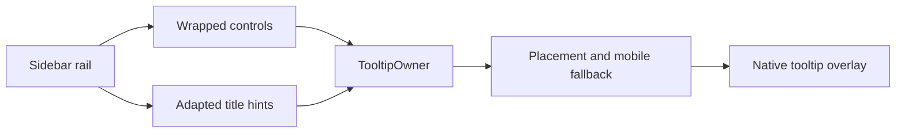

Codex review: needs changes before merge.

## What this changes

Rail tooltips inherit right-side placement while retaining explicit overrides and the existing narrow-screen fallback.

**Example:** Hover Pages in the desktop sidebar rail.
- **Before:** The hint opens above the icon and covers neighboring rail controls.
- **After:** The hint opens beside the icon, vertically centered.

## Review scores

| Measure | Result | What it means |
|---|---|---|
| **Overall readiness** | 🦐 gold shrimp **(3/6)** | Direct visual proof supports the production change, but the introduced viewport-dependent assertions fail WebKit CI. |
| **Proof confidence** | 🦞 diamond lobster **(5/6)** ✨ media proof bonus | Sufficient (screenshot): Inspected before/after screenshots exercise Pages hover in the browser-rendered Control UI with synthetic Gateway data and visibly show the corrected placement; the reported browser run additionally covers wrapped and title-adapted rail controls. |
| **Patch quality** | 🦐 gold shrimp **(3/6)** | 1 actionable review finding remain. |

## Product

**Kind:** Bug fix · **Worth it:** Yes · **Fix scope:** Complete
**User problem:** Rail hints overlap neighboring controls because their top placement clamps against the window edge.
**Reason:** The maintainer-authored direction has clear visual value and uses the existing shared tooltip implementation.

## Merge readiness

⛔ **Needs changes before merge - 2 items remain**

Keep open: this maintainer-authored PR addresses a visible navigation problem that remains on current main.

**Priority:** P2
**Reviewed head:** `ef7658d1f7693556257ede00e4e6df9989ebb5a8`

## Before merge

- [ ] **Control the viewport assumption in both inherited-placement tests (P2)** - Both new test groups assume an unspecified placement resolves to right, but TooltipOwner intentionally returns bottom-start when the narrow-screen media query matches. Exact-head WebKit CI fails here and at line 678 with that result. Explicitly establish a desktop media-query condition for these inheritance assertions and restore it afterward, following the existing scoped matchMedia setup; preserve the production mobile fallback.
- [ ] **Complete next step** - Have the CI owner inspect and attribute the separate check-test-types-core-1 failure before merge; its diagnostic log was unavailable through the allowed network.

## Findings

- [P2] Control the viewport assumption in both inherited-placement tests — `ui/src/components/tooltip.test.ts:129`

<strong>Agent review details</strong>

### How this fits together

The Control UI feeds wrapped controls and adapted title hints through TooltipOwner, which selects placement for the shared native overlay renderer.

### Technical review

Best possible solution:

Keep placement resolution in TooltipOwner and make both new test groups explicitly control their viewport assumptions.

Do we have a high-confidence way to reproduce the issue?

Current-main source establishes the top-placement path, and the supplied before screenshot shows its visible effect; no target code was executed during this review.

Is this the best way to solve the issue?

The shared-owner inheritance is a small, coherent fix covering both title-adapted and wrapped rail controls while preserving explicit placement and responsive behavior.

Full review comments:

- [P2] Control the viewport assumption in both inherited-placement tests — `ui/src/components/tooltip.test.ts:129`
  Both new test groups assume an unspecified placement resolves to right, but TooltipOwner intentionally returns bottom-start when the narrow-screen media query matches. Exact-head WebKit CI fails here and at line 678 with that result. Explicitly establish a desktop media-query condition for these inheritance assertions and restore it afterward, following the existing scoped matchMedia setup; preserve the production mobile fallback.
  Confidence: 1

Overall correctness: patch is incorrect
Overall confidence: 0.98

AGENTS.md: found and applied where relevant.

Codex review notes: model internal, reasoning medium; reviewed against [d97b12486899](https://github.com/openclaw/openclaw/commit/d97b12486899e964e39593db8055682010f5bd83).

### Provenance checked

- `Shared tooltip placement defaults` changes intended behavior with a stated reason (b68c44ca8f3ca9d0d4bccb7b620f867547e4cd55: The native-overlay migration preserved callers and appearance, including the generic top default; the PR explains its narrow rail-specific exception.)
- `Narrow-screen side-placement fallback` keeps the original intent (b9050029efe97266108667536e25b1a806e6dafd: Side cards cannot fit beside menus on narrow viewports, so they fall back below the anchor; history across TooltipController and TooltipOwner confirms this policy was retained.)
- `Existing browser hover assertions` keeps the original intent (ed50f59ccebc43716bc5954ecafe63fc8f002caa: Chat-action work established shared tooltip interaction coverage; this PR extends the existing rail checks with placement geometry.)

### Testing

Proof path: shipped entry point.

### Security

None.

### Evidence

Acceptance criteria:

- OPENCLAW_UI_WEBKIT=1 pnpm --dir ui test src/components/tooltip.test.ts
- pnpm check:changed

What I checked:

- **Introduced change:** The pinned diff places the rail declaration and inherited-placement decision in existing owners, without adding a parallel renderer or state store. ([`ui/src/components/tooltip-owner.ts:135`](https://github.com/openclaw/openclaw/blob/ef7658d1f7693556257ede00e4e6df9989ebb5a8/ui/src/components/tooltip-owner.ts#L135), [ef7658d1f769](https://github.com/openclaw/openclaw/commit/ef7658d1f7693556257ede00e4e6df9989ebb5a8))
- **Current main remains affected:** Current main defaults unspecified placement to top and has no rail placement declaration. ([`ui/src/components/tooltip-owner.ts:135`](https://github.com/openclaw/openclaw/blob/d97b12486899e964e39593db8055682010f5bd83/ui/src/components/tooltip-owner.ts#L135), [d97b12486899](https://github.com/openclaw/openclaw/commit/d97b12486899e964e39593db8055682010f5bd83))
- **Inspected visual proof:** Both downloaded PR screenshots were inspected: the before image shows Pages above the rail button; the after image shows it centered to the right in the same synthetic Control UI fixture. ([ef7658d1f769](https://github.com/openclaw/openclaw/commit/ef7658d1f7693556257ede00e4e6df9989ebb5a8))
- **Diff-caused WebKit failures:** Exact-head CI reports two new tooltip assertions failing with expected right, received bottom-start: https://github.com/openclaw/openclaw/actions/runs/39374012044/job/118468382286. ([`ui/src/components/tooltip.test.ts:129`](https://github.com/openclaw/openclaw/blob/ef7658d1f7693556257ede00e4e6df9989ebb5a8/ui/src/components/tooltip.test.ts#L129), [ef7658d1f769](https://github.com/openclaw/openclaw/commit/ef7658d1f7693556257ede00e4e6df9989ebb5a8))
- **Preserved responsive contract:** The historical environment-picker change deliberately sends right-side cards below their anchor on narrow viewports; this PR retains that policy. ([`ui/src/components/tooltip.ts:652`](https://github.com/openclaw/openclaw/blob/b9050029efe97266108667536e25b1a806e6dafd/ui/src/components/tooltip.ts#L652), [b9050029efe9](https://github.com/openclaw/openclaw/commit/b9050029efe97266108667536e25b1a806e6dafd))
- **Unattributed core CI failure:** The core test-types stripe failed, but its annotation contains only exit code 2; job-log retrieval was blocked at the Azure storage redirect, so its cause remains unverified: https://github.com/openclaw/openclaw/actions/runs/39374012044/job/118468925714. ([ef7658d1f769](https://github.com/openclaw/openclaw/commit/ef7658d1f7693556257ede00e4e6df9989ebb5a8))

Likely related people:

- **Patrick Erichsen:** Raw commit b9050029efe97266108667536e25b1a806e6dafd adds ui/src/components/tooltip.test.ts:102 relative to its recorded parents. This identifies author metadata, not feature responsibility or a PR merger. (role: source-line author; confidence: high; commits: [b9050029efe9](https://github.com/openclaw/openclaw/commit/b9050029efe97266108667536e25b1a806e6dafd); files: `ui/src/components/tooltip.test.ts`)

### PR surface

Source +11, Tests +50. Total +61 across 6 files. Added test files: 0.

View PR surface stats

| Area | Files | Added | Removed | Net |
|---|---:|---:|---:|---:|
| Source | 4 | 14 | 3 | +11 |
| Tests | 2 | 51 | 1 | +50 |
| Docs | 0 | 0 | 0 | 0 |
| Config | 0 | 0 | 0 | 0 |
| Generated | 0 | 0 | 0 | 0 |
| Other | 0 | 0 | 0 | 0 |
| **Total** | **6** | **65** | **4** | **+61** |

### Labels

Label changes:

- add `P2`: Tooltip placement obscures neighboring navigation controls but does not prevent using the application.
- add `proof: sufficient`: Contributor real behavior proof is sufficient.
- add `proof: 📸 screenshot`: Contributor real behavior proof includes screenshot evidence.
- add `rating: 🦐 gold shrimp`: Overall readiness is 🦐 gold shrimp; proof is 🦞 diamond lobster and patch quality is 🦐 gold shrimp.
- add `status: ⏳ waiting on author`: ClawSweeper has contributor-facing work open and is waiting for author action.

Label justifications:

- `P2`: Tooltip placement obscures neighboring navigation controls but does not prevent using the application.
- `rating: 🦐 gold shrimp`: Overall readiness is 🦐 gold shrimp; proof is 🦞 diamond lobster and patch quality is 🦐 gold shrimp.
- `status: ⏳ waiting on author`: ClawSweeper has contributor-facing work open and is waiting for author action.
- `proof: sufficient`: Contributor real behavior proof is sufficient.
- `proof: 📸 screenshot`: Contributor real behavior proof includes screenshot evidence.

### Rating scale

6/6 🦀 challenger crab · 5/6 🦞 diamond lobster · 4/6 🐚 platinum hermit · 3/6 🦐 gold shrimp · 2/6 🦪 silver shellfish · 1/6 🧂 unranked krab. Overall follows the weaker of proof and patch quality; ✨ marks media proof (a screenshot, video, or linked artifact) that directly shows the changed behavior.

### Workflow

ClawSweeper edits this one comment on every review. Comment `@clawsweeper re-review` for a fresh review only. Repair and merge execution lanes are retired.

_Reviewed October 20, 2026, 1:32 AM ET / 05:32 UTC._

<!-- clawsweeper-verdict:needs-changes item=178089 sha=ef7658d1f7693556257ede00e4e6df9989ebb5a8 confidence=high updated_at=2026-10-20T05:29:16Z reviewed_at=2026-10-20T05:32:31.776Z lease_owner=github-run-39375051007-1 lease_comment_id=6284109180 source_revision=7ecf4da5579cb850ee15436232a6f527c72c6a39a1c060df9eb644e958557c6b -->
<!-- clawsweeper-review-state:needs-changes item=178089 sha=ef7658d1f7693556257ede00e4e6df9989ebb5a8 v=1 -->

<!-- clawsweeper-review-version item=178089 reviewed_at=2026-10-20T05:32:31.776Z sha=ef7658d1f7693556257ede00e4e6df9989ebb5a8 source_revision=7ecf4da5579cb850ee15436232a6f527c72c6a39a1c060df9eb644e958557c6b lease_owner=github-run-39375051007-1 lease_comment_id=6284109180 v=1 -->

<!-- clawsweeper-review item=178089 -->