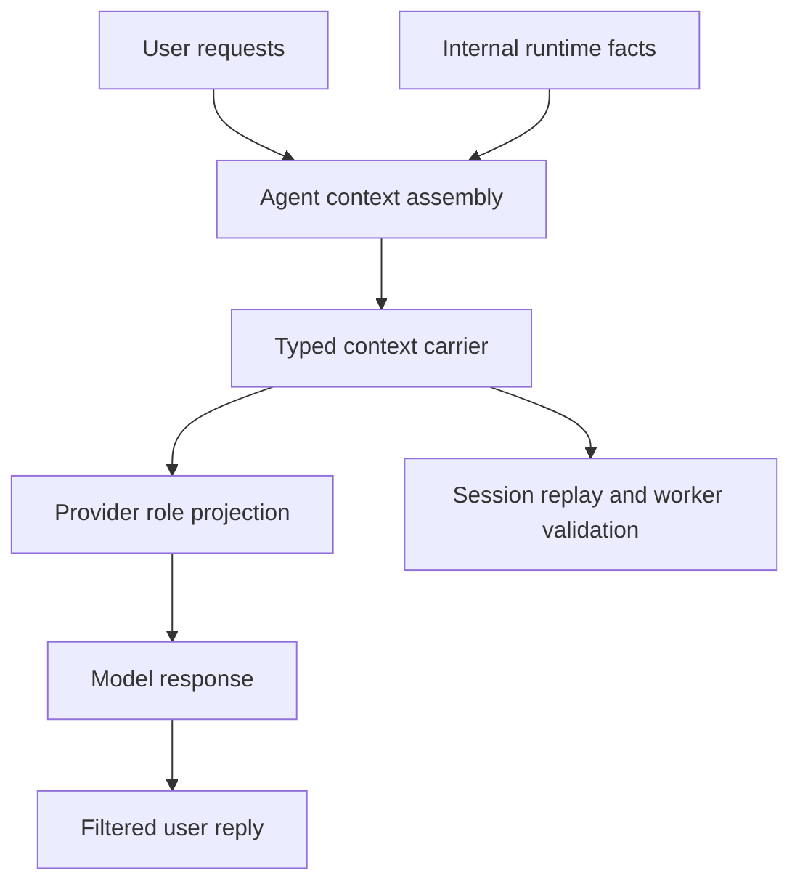

Codex review: blocked before merge. _Reviewed October 3, 2026, 3:57 PM ET / 19:57 UTC (Revision 26)._

# ClawSweeper review

## What this changes

The PR separates internal runtime context from user text across model requests, session replay, CLI backends, and workers, and filters context echoes from replies.

## Merge readiness

⛔ **Blocked before merge - 1 item remains**

This remains useful, maintainer-authored work. No blocking introduced defect was identified, and the previous generic config/default compatibility blocker is unsupported by the pinned diff.

**Priority:** P1
**Reviewed head:** `031b446d6d95ec9c70e487a0bb3e71c1631d3e36`

## Review scores

| Measure | Result | What it means |
|---|---|---|
| **Overall readiness** | 🐚 platinum hermit **(4/6)** | The patch has coherent owner-level repairs and focused compatibility coverage, with no supported blocking finding. |
| **Proof confidence** | 🌊 off-meta tidepool | Not applicable: The MEMBER-authored PR is exempt from the external-contributor proof gate. Its body reports provider-boundary and mock-Gateway after-fix checks; inspected v3/v4 replay and persistence/reopen coverage supports existing-state compatibility. No unresolved authority-chain violation was identified, and this review ran no target code. |
| **Patch quality** | 🐚 platinum hermit **(4/6)** | No actionable review findings were identified. |

## Verification

| Check | Result | Evidence |
|---|---|---|
| **Real behavior** | Not applicable | Not applicable: The MEMBER-authored PR is exempt from the external-contributor proof gate. Its body reports provider-boundary and mock-Gateway after-fix checks; inspected v3/v4 replay and persistence/reopen coverage supports existing-state compatibility. No unresolved authority-chain violation was identified, and this review ran no target code. |
| **Evidence reviewed** | 10 items | Pinned ownership and clean checkout: The introduced delta was inspected from the pinned merge base to the original PR head. Raw test-merge parents match the supplied base followed by that head; targeted merge-result inspection preserves the CLI context changes. The checkout remained clean. Current main still lacks the complete repair: Current main retains the older carrier fields and delimiter-based output activation. Its direct-Claude system-update work overlaps this PR, but does not supply the cross-provider typed carrier and new streaming-label protection. The latest published release is v2026.9.8; no merged replacement fixing the complete request was established. Compatibility contract is transcript metadata, not config: The new metadata is optional, and the shipped carrier fields remain supported with an explicit removal condition. The introduced production changes add no user config key or default. Revision 25's generic config/default next step therefore does not establish a current blocker. |
| **Findings** | None | None. |
| **Security** | None | None. |

## How this fits together

OpenClaw's agent runtime combines user requests with internal facts before sending them to model providers. Provider adapters project that context, while transcript and output owners preserve replay compatibility and control what users see.

## Before merge

- [ ] **Review config compatibility** - Confirm compatibility and upgrade impact for the changed config or default surface before merge.

<strong>Agent review details</strong>

### Security

None.

### PR surface

PR surface statistics unavailable: the file list is incomplete.

### Review metrics

| Metric | Value | Why it matters |
|---|---|---|
| **Production growth justification** | PR-body accounting: production net +523; tests and QA support net +1421 | The stated growth funds a shared discriminant, provider projections, output defense, and shipped-transcript compatibility across existing owners. |

### Stored data model

Persistent data-model change detected: `unknown-truncated-pull-files`. Migration or upgrade compatibility proof is recorded; maintainers should verify it before merge.

### Technical review

Best possible solution:

Use one typed runtime-context contract with provider-specific projection, byte-compatible stored replay, and bounded streaming and final-output filtering.

Do we have a high-confidence way to reproduce the issue?

Yes, source inspection identifies the existing carrier-to-user conversion and delimiter-based streaming boundary; linked reports provide concrete request captures. This read-only review did not execute a current-main reproduction.

Is this the best way to solve the issue?

Yes, the shared semantic marker and provider-owned projections address the existing ownership gap while preserving shipped replay contracts; no new configuration knob is needed.

AGENTS.md: found and applied where relevant.

Codex review notes: model internal, reasoning medium; reviewed against [e7090f6d88be](https://github.com/openclaw/openclaw/commit/e7090f6d88be1c9e4bc7fe22e1f4825d040c1137).

### Labels

Label changes:

No label changes.

Label justifications:

- `P1`: The linked reports describe runtime context disrupting ordinary agent replies and tool workflows across channels and local models.
- `merge-risk: 🚨 compatibility`: Provider and transcript contracts change; shipped fields remain supported, replay regressions cover legacy bytes, and the maintainer explicitly accepts rejecting unsupported worker media carriers.
- `rating: 🐚 platinum hermit`: Overall readiness is 🐚 platinum hermit; proof is 🌊 off-meta tidepool and patch quality is 🐚 platinum hermit.
- `status: 👀 ready for maintainer look`: ClawSweeper has no concrete contributor-facing blocker left for this PR. Not applicable: The MEMBER-authored PR is exempt from the external-contributor proof gate. Its body reports provider-boundary and mock-Gateway after-fix checks; inspected v3/v4 replay and persistence/reopen coverage supports existing-state compatibility. No unresolved authority-chain violation was identified, and this review ran no target code.
- `proof: telegram-e2e`: This PR needs Telegram Test Server proof with the repository E2E skill. The output filter changes context text visible in Telegram replies, so the existing Telegram-visible proof classification applies.

### Evidence

What I checked:

- **Pinned ownership and clean checkout:** The introduced delta was inspected from the pinned merge base to the original PR head. Raw test-merge parents match the supplied base followed by that head; targeted merge-result inspection preserves the CLI context changes. The checkout remained clean. ([031b446d6d95](https://github.com/openclaw/openclaw/commit/031b446d6d95ec9c70e487a0bb3e71c1631d3e36))
- **Current main still lacks the complete repair:** Current main retains the older carrier fields and delimiter-based output activation. Its direct-Claude system-update work overlaps this PR, but does not supply the cross-provider typed carrier and new streaming-label protection. The latest published release is v2026.9.8; no merged replacement fixing the complete request was established. ([`src/agents/embedded-agent-helpers/sanitize-user-facing-text.ts:253`](https://github.com/openclaw/openclaw/blob/e7090f6d88be1c9e4bc7fe22e1f4825d040c1137/src/agents/embedded-agent-helpers/sanitize-user-facing-text.ts#L253), [e7090f6d88be](https://github.com/openclaw/openclaw/commit/e7090f6d88be1c9e4bc7fe22e1f4825d040c1137))
- **Compatibility contract is transcript metadata, not config:** The new metadata is optional, and the shipped carrier fields remain supported with an explicit removal condition. The introduced production changes add no user config key or default. Revision 25's generic config/default next step therefore does not establish a current blocker. ([`packages/llm-core/src/types.ts:373`](https://github.com/openclaw/openclaw/blob/031b446d6d95ec9c70e487a0bb3e71c1631d3e36/packages/llm-core/src/types.ts#L373), [031b446d6d95](https://github.com/openclaw/openclaw/commit/031b446d6d95ec9c70e487a0bb3e71c1631d3e36))
- **Prior replay and steering findings addressed:** The inspected version-3/version-4 session-boundary tests independently specify historical Anthropic request bytes ahead of retained signatures. Steering coverage exercises persistence/reopen and every admitted batch pair; the Responses boundary regression asserts each carrier follows its own user. The body records failing-before and passing-after results for these repairs; this review did not execute tests. ([`src/agents/embedded-agent-runner/run/attempt-session-runtime-context.test.ts:43`](https://github.com/openclaw/openclaw/blob/031b446d6d95ec9c70e487a0bb3e71c1631d3e36/src/agents/embedded-agent-runner/run/attempt-session-runtime-context.test.ts#L43), [031b446d6d95](https://github.com/openclaw/openclaw/commit/031b446d6d95ec9c70e487a0bb3e71c1631d3e36))
- **Explicit worker compatibility tradeoff:** The maintainer-authored body explicitly chooses rejection of unsupported mixed-media runtime carriers rather than silently converting them into ordinary user input. The worker throws an actionable local-retry error, and focused cases cover both canonical and shipped markers. Applicable Gateway policy requires the exact prepared worker dialect; this accepted limitation does not require another acceptance request. ([`src/worker/embedded-agent-transcript.runtime.ts:29`](https://github.com/openclaw/openclaw/blob/031b446d6d95ec9c70e487a0bb3e71c1631d3e36/src/worker/embedded-agent-transcript.runtime.ts#L29), [031b446d6d95](https://github.com/openclaw/openclaw/commit/031b446d6d95ec9c70e487a0bb3e71c1631d3e36))
- **Security and SDK boundary:** Carrier recognition checks structured provenance instead of delimiter text; extension-owned near matches remain ordinary input, conversation fragments remain quoted data, and footer text is escaped. The SDK additions expose the shared classifier to bundled providers while retaining existing fields. The security-flagged transcript change is a text-block iteration rewrite and introduces no execution grant, dependency, secret access, or sandbox change. ([`packages/agent-core/src/harness/messages.ts:125`](https://github.com/openclaw/openclaw/blob/031b446d6d95ec9c70e487a0bb3e71c1631d3e36/packages/agent-core/src/harness/messages.ts#L125), [031b446d6d95](https://github.com/openclaw/openclaw/commit/031b446d6d95ec9c70e487a0bb3e71c1631d3e36))

Likely related people:

- **steipete:** Suggested for follow-up; no historical authorship or introduction is verified. (role: unverified routing candidate; confidence: low)
- **jjjhenriksen:** Suggested for follow-up; no historical authorship or introduction is verified. (role: unverified routing candidate; confidence: low)

### Rating scale

| Score | Internal tier | Crab rank | Meaning |
|---:|:---:|---|---|
| **6/6** | S | 🦀 challenger crab | Exceptional readiness |
| **5/6** | A | 🦞 diamond lobster | Very strong readiness |
| **4/6** | B | 🐚 platinum hermit | Good normal PR; ordinary maintainer review |
| **3/6** | C | 🦐 gold shrimp | Useful, but confidence is limited |
| **2/6** | D | 🦪 silver shellfish | Proof or implementation needs work |
| **1/6** | F | 🧂 unranked krab | Not merge-ready |
| N/A | NA | 🌊 off-meta tidepool | Rating does not apply |

Overall follows the weaker of proof and patch quality.
Shiny media proof means a screenshot, video, or linked artifact directly shows the changed behavior. Runtime, network, CSP, and security claims still need visible diagnostics.

### Workflow

- ClawSweeper keeps one durable marker-backed review comment per issue or PR.
- Re-runs edit this comment so the latest verdict, findings, and automation markers stay together instead of adding duplicate bot comments.
- A fresh review can be triggered by eligible `@clawsweeper re-review` comments, exact-item GitHub events, scheduled/background review runs, or manual workflow dispatch.
- PR/issue authors and users with repository write access can comment `@clawsweeper re-review` or `@clawsweeper re-run` on an open PR or issue to request a fresh review only.
- Maintainers can also comment `@clawsweeper review` to request a fresh review only.
- Fresh-review commands do not start repair, autofix, rebase, CI repair, or automerge.
- Maintainer-only repair and merge flows require explicit commands such as `@clawsweeper autofix`, `@clawsweeper automerge`, `@clawsweeper fix ci`, or `@clawsweeper address review`.
- Maintainers can comment `@clawsweeper explain` to ask for more context, or `@clawsweeper stop` to stop active automation.

### History

Review history (25 earlier review cycles; latest 8 shown)

<!-- clawsweeper-review-history v=1 total=25 -->
- reviewed 2026-10-03T11:33:22.183Z sha 3d1dfcbb6a297c45708dd25ca4af6cafb0468707 :: blocked before merge. :: [P1] [P1] Preserve legacy text-array carriers in version-4 projection
- reviewed 2026-10-03T11:42:19.892Z sha 030fa97db3804f17d6668cc7ea23f7b843afee75 :: blocked before merge. :: [P1] [P1] Preserve the shipped version-4 fragment projection on replay
- reviewed 2026-10-03T11:57:30.695Z sha 89585fc33f159c0c48a02b466802a493b168701d :: blocked before merge. :: [P1] [P1] Preserve shipped fragment rendering for version-4 replay
- reviewed 2026-10-03T12:12:45.523Z sha 6bbe0358f5305f44de1f9f4007a6bd347cfb196f :: blocked before merge. :: [P1] [P1] Persist retained steering carriers before signed replay | [P2] [P2] Retain every context in an admitted steering batch
- reviewed 2026-10-03T12:49:02.903Z sha 9c84f9cb41b85c2db7a4ee8bd851f8a6badfac38 :: blocked before merge. :: [P2] [P2] Keep steering carriers with their owning users during relocation
- reviewed 2026-10-03T13:01:57.667Z sha c3cf2a0ef10b505fbe15a8eca361a8325cb72dbf :: blocked before merge. :: [P2] [P2] Keep steering carriers with their owning users during relocation
- reviewed 2026-10-03T19:09:25.279Z sha 12002ceb21592bef3583130cf10d89bd8237f20c :: blocked before merge. :: none
- reviewed 2026-10-03T19:43:25.601Z sha 031b446d6d95ec9c70e487a0bb3e71c1631d3e36 :: blocked before merge. :: none

<!-- clawsweeper-verdict:needs-human item=163471 sha=031b446d6d95ec9c70e487a0bb3e71c1631d3e36 confidence=high updated_at=2026-10-03T19:53:44Z reviewed_at=2026-10-03T19:57:52.812Z lease_owner=github-run-37149442717-1 lease_comment_id=5972902734 source_revision=9602d9ed7b418d6baaf05f7a314900b53e7c5e0f1c7b50520966fa9927b92d70 live_verification=absent -->
<!-- clawsweeper-review-state:blocked item=163471 sha=031b446d6d95ec9c70e487a0bb3e71c1631d3e36 v=1 -->

<!-- clawsweeper-review-version item=163471 reviewed_at=2026-10-03T19:57:52.812Z sha=031b446d6d95ec9c70e487a0bb3e71c1631d3e36 source_revision=9602d9ed7b418d6baaf05f7a314900b53e7c5e0f1c7b50520966fa9927b92d70 lease_owner=github-run-37149442717-1 lease_comment_id=5972902734 v=1 -->

<!-- clawsweeper-review item=163471 -->