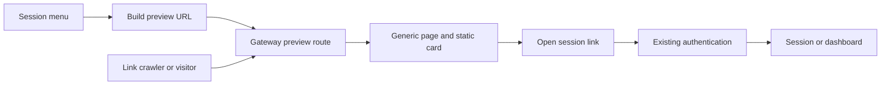

Codex review: needs maintainer review before merge. _Reviewed September 5, 2026, 1:52 PM ET / 17:52 UTC._

# ClawSweeper review

## What this changes

Adds a session-menu action that copies public preview links, generic social-card pages and build-generated artwork, with deployment guidance for login proxies.

## Merge readiness

✅ **Ready for maintainer review**

Keep open: this adds a distinct capability absent from inspected main. No blocking correctness findings were identified, and the maintainer label independently excludes automated closure.

**Priority:** P3
**Reviewed head:** `8f4a434014e56c5ee06e875b6343c4fda2cf766c`

## Review scores

| Measure | Result | What it means |
|---|---|---|
| **Overall readiness** | 🐚 platinum hermit **(4/6)** | A focused implementation with useful boundary coverage and no identified blocking defect; runtime results are contributor-reported. |
| **Proof confidence** | 🌊 off-meta tidepool | Not applicable: The maintainer-author exemption applies. The captured body reports browser copy/open behavior and HTTP isolation checks; linked images were inaccessible here, and no screenshot-based security claim is accepted. |
| **Patch quality** | 🐚 platinum hermit **(4/6)** | No actionable review findings were identified. |

## Verification

| Check | Result | Evidence |
|---|---|---|
| **Real behavior** | Not applicable | Not applicable: The maintainer-author exemption applies. The captured body reports browser copy/open behavior and HTTP isolation checks; linked images were inaccessible here, and no screenshot-based security claim is accepted. |
| **Evidence reviewed** | 11 items | Verified review scope: Origin identifies openclaw/openclaw. Raw test-merge parents match the pinned main followed by the exact PR head; its main-relative changes match the introduced files. Unrelated model-selection and outbound-delivery changes are base drift. Public document boundary: The preview owner parses the existing session URL grammar, preserves encoded paths, retains only catalog routing parameters, escapes interpolated values, and performs no session lookup. Its response disables scripts and uses no-store and no-referrer policies. HTTP routing and sibling isolation: The standalone handler terminates share requests before ordinary plugin dispatch, including when the UI is disabled. The card maps to one static file through existing containment checks; bootstrap authorization remains separate. Approval, focus, media, and plugin routing were inspected. |
| **Findings** | None | None. |
| **Security** | None | None. |

## How this fits together

The Control UI turns session-menu selections into Gateway URLs. The Gateway serves generic preview metadata and artwork, then directs visitors to the existing authenticated session view.

## Before merge

None.

<strong>Agent review details</strong>

### Security

None.

### PR surface

Source +156, Tests +146, Docs +42. Total +344 across 19 files.

View PR surface stats

| Area | Files | Added | Removed | Net |
|---|---:|---:|---:|---:|
| Source | 12 | 180 | 24 | +156 |
| Tests | 6 | 151 | 5 | +146 |
| Docs | 1 | 42 | 0 | +42 |
| Config | 0 | 0 | 0 | 0 |
| Generated | 0 | 0 | 0 | 0 |
| Other | 0 | 0 | 0 | 0 |
| **Total** | **19** | **373** | **29** | **+344** |

### Review metrics

| Metric | Value | Why it matters |
|---|---|---|
| **Production versus test growth** | Production/build net +156 lines; tests net +146; docs +42 | Growth implements a new public document and card capability while reusing navigation, static serving, and HTML escaping. |
| **Public surface** | 1 preview namespace added; 0 configuration keys or dependencies added | The feature uses existing public-origin configuration and keeps image generation at build time. |

### Technical review

Best possible solution:

Keep previews generic and state-free, reuse canonical session URLs, and leave proxy exposure explicitly operator-controlled.

Do we have a high-confidence way to reproduce the issue?

Not applicable: this adds a preview capability; it does not report a broken existing contract.

Is this the best way to solve the issue?

Yes: a separate state-free document addresses crawler access without exposing authenticated session content; adding metadata only inside the app would leave the login-proxy problem unresolved.

AGENTS.md: found and applied where relevant.

Codex review notes: model internal, reasoning high; reviewed against [3e4becea5e2c](https://github.com/openclaw/openclaw/commit/3e4becea5e2ce38ede69e8ecf5302805ecbfc09c).

### Labels

Label changes:

- add `P3`: Social preview links improve sharing ergonomics without repairing an urgent broken workflow.
- add `rating: 🐚 platinum hermit`: Overall readiness is 🐚 platinum hermit; proof is 🌊 off-meta tidepool and patch quality is 🐚 platinum hermit.
- add `status: 👀 ready for maintainer look`: ClawSweeper has no concrete contributor-facing blocker left for this PR. Not applicable: The maintainer-author exemption applies. The captured body reports browser copy/open behavior and HTTP isolation checks; linked images were inaccessible here, and no screenshot-based security claim is accepted.

Label justifications:

- `P3`: Social preview links improve sharing ergonomics without repairing an urgent broken workflow.
- `rating: 🐚 platinum hermit`: Overall readiness is 🐚 platinum hermit; proof is 🌊 off-meta tidepool and patch quality is 🐚 platinum hermit.
- `status: 👀 ready for maintainer look`: ClawSweeper has no concrete contributor-facing blocker left for this PR. Not applicable: The maintainer-author exemption applies. The captured body reports browser copy/open behavior and HTTP isolation checks; linked images were inaccessible here, and no screenshot-based security claim is accepted.

### Evidence

What I checked:

- **Verified review scope:** Origin identifies openclaw/openclaw. Raw test-merge parents match the pinned main followed by the exact PR head; its main-relative changes match the introduced files. Unrelated model-selection and outbound-delivery changes are base drift. ([c5a1ef516a97](https://github.com/openclaw/openclaw/commit/c5a1ef516a97451bd7ff084beedeb3eaf9c39c10))
- **Public document boundary:** The preview owner parses the existing session URL grammar, preserves encoded paths, retains only catalog routing parameters, escapes interpolated values, and performs no session lookup. Its response disables scripts and uses no-store and no-referrer policies. ([`src/gateway/control-ui-share.ts:19`](https://github.com/openclaw/openclaw/blob/8f4a434014e56c5ee06e875b6343c4fda2cf766c/src/gateway/control-ui-share.ts#L19), [8f4a434014e5](https://github.com/openclaw/openclaw/commit/8f4a434014e56c5ee06e875b6343c4fda2cf766c))
- **HTTP routing and sibling isolation:** The standalone handler terminates share requests before ordinary plugin dispatch, including when the UI is disabled. The card maps to one static file through existing containment checks; bootstrap authorization remains separate. Approval, focus, media, and plugin routing were inspected. ([`src/gateway/server-http.ts:560`](https://github.com/openclaw/openclaw/blob/8f4a434014e56c5ee06e875b6343c4fda2cf766c/src/gateway/server-http.ts#L560), [8f4a434014e5](https://github.com/openclaw/openclaw/commit/8f4a434014e56c5ee06e875b6343c4fda2cf766c))
- **Shared navigation owner:** Sidebar, session-list, and chat-header callers reach the same navigation function. Preview links reuse the existing Gateway address and session-path builder; direct links and new-window navigation retain their previous destinations. Catalog identifiers are ordinary OpenClaw routing data and do not establish a Codex runtime dependency. ([`ui/src/lib/sessions/session-menu-navigation.ts:187`](https://github.com/openclaw/openclaw/blob/8f4a434014e56c5ee06e875b6343c4fda2cf766c/ui/src/lib/sessions/session-menu-navigation.ts#L187), [8f4a434014e5](https://github.com/openclaw/openclaw/commit/8f4a434014e56c5ee06e875b6343c4fda2cf766c))
- **Boundary coverage:** Read HTTP and navigation tests covering root/nested mounts, GET/HEAD, malformed routes, credential stripping, escaped keys, catalog routing, bootstrap rejection, disabled UI, and plugin precedence. Tests were not executed during this read-only review. ([`src/gateway/control-ui-share.http.test.ts:10`](https://github.com/openclaw/openclaw/blob/8f4a434014e56c5ee06e875b6343c4fda2cf766c/src/gateway/control-ui-share.http.test.ts#L10), [8f4a434014e5](https://github.com/openclaw/openclaw/commit/8f4a434014e56c5ee06e875b6343c4fda2cf766c))
- **Current-main and release necessity:** Current main has direct-link copying but no social-preview owner or corresponding metadata in the searched Gateway/UI surfaces. The new handler is also absent from v2026.9.1. No verified replacement PR was supplied; the attempted GitHub search could not connect. ([`ui/src/lib/sessions/session-menu-navigation.ts:185`](https://github.com/openclaw/openclaw/blob/3e4becea5e2ce38ede69e8ecf5302805ecbfc09c/ui/src/lib/sessions/session-menu-navigation.ts#L185), [3e4becea5e2c](https://github.com/openclaw/openclaw/commit/3e4becea5e2ce38ede69e8ecf5302805ecbfc09c))

Likely related people:

- **Peter Steinberger:** Suggested for follow-up; no historical authorship or introduction is verified. (role: unverified routing candidate; confidence: low)

### Rating scale

| Score | Internal tier | Crab rank | Meaning |
|---:|:---:|---|---|
| **6/6** | S | 🦀 challenger crab | Exceptional readiness |
| **5/6** | A | 🦞 diamond lobster | Very strong readiness |
| **4/6** | B | 🐚 platinum hermit | Good normal PR; ordinary maintainer review |
| **3/6** | C | 🦐 gold shrimp | Useful, but confidence is limited |
| **2/6** | D | 🦪 silver shellfish | Proof or implementation needs work |
| **1/6** | F | 🧂 unranked krab | Not merge-ready |
| N/A | NA | 🌊 off-meta tidepool | Rating does not apply |

Overall follows the weaker of proof and patch quality.
Shiny media proof means a screenshot, video, or linked artifact directly shows the changed behavior. Runtime, network, CSP, and security claims still need visible diagnostics.

### Workflow

- ClawSweeper keeps one durable marker-backed review comment per issue or PR.
- Re-runs edit this comment so the latest verdict, findings, and automation markers stay together instead of adding duplicate bot comments.
- A fresh review can be triggered by eligible `@clawsweeper re-review` comments, exact-item GitHub events, scheduled/background review runs, or manual workflow dispatch.
- PR/issue authors and users with repository write access can comment `@clawsweeper re-review` or `@clawsweeper re-run` on an open PR or issue to request a fresh review only.
- Maintainers can also comment `@clawsweeper review` to request a fresh review only.
- Fresh-review commands do not start repair, autofix, rebase, CI repair, or automerge.
- Maintainer-only repair and merge flows require explicit commands such as `@clawsweeper autofix`, `@clawsweeper automerge`, `@clawsweeper fix ci`, or `@clawsweeper address review`.
- Maintainers can comment `@clawsweeper explain` to ask for more context, or `@clawsweeper stop` to stop active automation.

<!-- clawsweeper-verdict:needs-human item=139250 sha=8f4a434014e56c5ee06e875b6343c4fda2cf766c confidence=high updated_at=2026-09-05T17:48:28Z reviewed_at=2026-09-05T17:52:17.682Z lease_owner=github-run-33982025974-1 lease_comment_id=5553657141 source_revision=fa2f7ef85cd735f87fa587cb6b652ba2da5b2fe588c9ee3a65f3d5a8dd7226b7 live_verification=absent -->
<!-- clawsweeper-review-state:ready item=139250 sha=8f4a434014e56c5ee06e875b6343c4fda2cf766c v=1 -->

<!-- clawsweeper-review-version item=139250 reviewed_at=2026-09-05T17:52:17.682Z sha=8f4a434014e56c5ee06e875b6343c4fda2cf766c source_revision=fa2f7ef85cd735f87fa587cb6b652ba2da5b2fe588c9ee3a65f3d5a8dd7226b7 lease_owner=github-run-33982025974-1 lease_comment_id=5553657141 v=1 -->

<!-- clawsweeper-review item=139250 -->