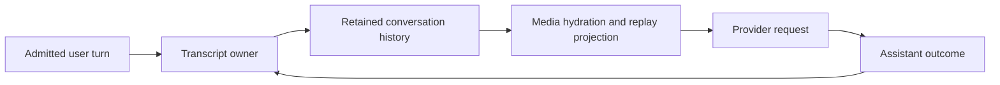

Codex review: needs changes before merge.

## What this changes

This PR preserves historical images, captures unchanged user prompts, and retains failed assistant attempts across retries and replay.

**Example:** A conversation contains an image in turn 1 and reaches turn 5.
- **Before:** Image cleanup replaces the earlier image with a text marker, changing the previously sent prompt prefix.
- **After:** The image remains unchanged until ordinary history truncation or compaction removes its turn.

## Review scores

| Measure | Result | What it means |
|---|---|---|
| **Overall readiness** | 🦪 silver shellfish **(2/6)** | Useful behavior has real-provider evidence and focused replay coverage, but the unresolved released-SDK break prevents readiness. |
| **Proof confidence** | 🐚 platinum hermit **(4/6)** | Sufficient (live_output): The supplied isolated Responses run exercises image turns, an injected stream failure, its retry, and a correction through real provider requests, with recorded cache usage; owner-boundary regressions separately cover signed thinking and cold replay. |
| **Patch quality** | 🦪 silver shellfish **(2/6)** | 1 actionable review finding remain. |

## Product

**Kind:** Performance · **Worth it:** Yes · **Fix scope:** Complete
**User problem:** Continuing image conversations and retrying interrupted turns can discard reusable provider prompt prefixes.
**Reason:** The maintainer-authored direction removes evidenced history rewrites at their existing owners and explicitly accepts retaining images until normal history boundaries.

## Merge readiness

⛔ **Needs changes before merge - 3 items remain**

Keep open: this PR addresses remaining prompt-prefix rewrites, but removing a released SDK type member still blocks merge.

**Priority:** P2
**Reviewed head:** `b43a1dd70af0f560f6c9e4be4e8f65c4a9ee8cc7`

## Before merge

- [ ] **Retain the shipped imageCleanup observation-code literal (P1)** - This earlier finding remains unresolved. v2026.10.1 exposes this union through the public HarnessContextEngine contract. Existing plugins that compare an observation code with "imageCleanup" or include that key in a typed handler map can fail compilation after this removal. Restore the literal for source compatibility while removing its runtime producer; retiring image cleanup does not require breaking the SDK type.
- [ ] **Complete next step** - Resolve the reported merge conflict and have the CI owner attribute the widget-hover failure before landing.
- [ ] **Explain or restore the original intent of Public observation-code type** - cee0906f3877c436725a079d4e41537fc204f75c: Declared legitimate history rewrites through context-engine observations; retiring image cleanup does not require removing its released SDK type member.

## Findings

- [P1] Retain the shipped imageCleanup observation-code literal — `src/context-engine/types.ts:250-251`

### Provenance

- `Public observation-code type` changes intended behavior without addressing why it exists (cee0906f3877c436725a079d4e41537fc204f75c: Declared legitimate history rewrites through context-engine observations; retiring image cleanup does not require removing its released SDK type member.)

<strong>Agent review details</strong>

### How this fits together

The agent runner converts persisted conversation history into provider requests and records prompt projections and assistant outcomes for subsequent retries and replay.

### Technical review

Best possible solution:

Keep the append-only prompt-history implementation and restore the released observation-code literal without reviving image cleanup.

Do we have a high-confidence way to reproduce the issue?

Current-main cleanup and unchanged-prompt bypass establish the rewrite paths, supported by the supplied before/after provider measurements; no target code was executed during this review.

Is this the best way to solve the issue?

Fixing the existing history and transcript owners is coherent and reduces competing rewrites, provided the released SDK type remains source-compatible.

Full review comments:

- [P1] Retain the shipped imageCleanup observation-code literal — `src/context-engine/types.ts:250-251`
  This earlier finding remains unresolved. v2026.10.1 exposes this union through the public HarnessContextEngine contract. Existing plugins that compare an observation code with "imageCleanup" or include that key in a typed handler map can fail compilation after this removal. Restore the literal for source compatibility while removing its runtime producer; retiring image cleanup does not require breaking the SDK type.
  Confidence: 0.99

Overall correctness: patch is incorrect
Overall confidence: 0.97

AGENTS.md: found and applied where relevant.

Codex review notes: model internal, reasoning medium; reviewed against [dc1b8e35710b](https://github.com/openclaw/openclaw/commit/dc1b8e35710b08f84e94b56829b30a816104c8c1).

### Provenance checked

- `Image replay cleanup` changes intended behavior with a stated reason (a134038ad7fbf939038ada4dde61c0fa7eb02e33: Batched cleanup reduced cache invalidations while bounding retained images; this PR explicitly chooses stable retained history until compaction or truncation.)
- `Failed assistant persistence` changes intended behavior with a stated reason (b6ca24cb0928a225ff2dda1654823e60e6abfa96: Deferred failed prose and diagnostics prevented recovered attempts from leaving stray transcript rows; this PR retains complete records while preserving live display replacement.)
- `User projection capture` changes intended behavior with a stated reason (6461c186e5180cbdfdbbfea1d5b9e85e1d6fe3fb: Captured enriched model prompts while avoiding writes for unchanged prompts; this PR explains why unchanged prompts also need immutable capture.)
- `SDK retry history` changes intended behavior with a stated reason (b99ccac1be8564a3219057909bec217d3fc72bbc: Continuation retained completed asynchronous work while removing the failed assistant from runtime history; this PR allows continuation directly from the retained failed record.)

### Testing

Proof path: in-process harness.

### Security

None.

### Evidence

What I checked:

- **Pinned introduction reviewed:** The review used the verified merge-base-to-head introduction; the live PR still points to the pinned head. ([b43a1dd70af0](https://github.com/openclaw/openclaw/commit/b43a1dd70af0f560f6c9e4be4e8f65c4a9ee8cc7))
- **Current main still contains the central rewrite:** Fetched main retains age-based image replacement and bypasses projection installation for unchanged ordinary prompts, so the central work remains necessary. ([`src/agents/embedded-agent-runner/run/history-image-prune.ts:42`](https://github.com/openclaw/openclaw/blob/dc1b8e35710b08f84e94b56829b30a816104c8c1/src/agents/embedded-agent-runner/run/history-image-prune.ts#L42), [dc1b8e35710b](https://github.com/openclaw/openclaw/commit/dc1b8e35710b08f84e94b56829b30a816104c8c1))
- **Released observation-code contract:** v2026.10.1 includes imageCleanup in the observation-code union consumed through ContextEngine runtime context. ([`src/context-engine/types.ts:251`](https://github.com/openclaw/openclaw/blob/e178c39e9aae3fa440735217f9aef9574f286677/src/context-engine/types.ts#L251), [e178c39e9aae](https://github.com/openclaw/openclaw/commit/e178c39e9aae3fa440735217f9aef9574f286677))
- **Public SDK exposure verified:** The stable agent-harness-runtime entrypoint exports ContextEngine as HarnessContextEngine, and the stable package exports that entrypoint; its observation-code union is therefore reachable by third-party plugin source. ([`src/plugin-sdk/agent-harness-runtime.ts:185`](https://github.com/openclaw/openclaw/blob/e178c39e9aae3fa440735217f9aef9574f286677/src/plugin-sdk/agent-harness-runtime.ts#L185), [e178c39e9aae](https://github.com/openclaw/openclaw/commit/e178c39e9aae3fa440735217f9aef9574f286677))
- **Earlier compatibility finding remains:** The introduced diff removes the shipped literal rather than only retiring its runtime producer; the previously reviewed head is identical to this review's head. ([`src/context-engine/types.ts:250`](https://github.com/openclaw/openclaw/blob/b43a1dd70af0f560f6c9e4be4e8f65c4a9ee8cc7/src/context-engine/types.ts#L250), [b43a1dd70af0](https://github.com/openclaw/openclaw/commit/b43a1dd70af0f560f6c9e4be4e8f65c4a9ee8cc7))
- **Earlier test findings resolved:** The obsolete image-cleanup allowance is removed, replay fixtures provide captured projection metadata, and the completed-tool retry assertion includes the retained error record. ([`src/agents/sessions/agent-session-responses-eof.test.ts:434`](https://github.com/openclaw/openclaw/blob/b43a1dd70af0f560f6c9e4be4e8f65c4a9ee8cc7/src/agents/sessions/agent-session-responses-eof.test.ts#L434), [b43a1dd70af0](https://github.com/openclaw/openclaw/commit/b43a1dd70af0f560f6c9e4be4e8f65c4a9ee8cc7))

Likely related people:

- **Peter Steinberger:** Raw commit 6461c186e5180cbdfdbbfea1d5b9e85e1d6fe3fb adds src/agents/embedded-agent-runner/run/attempt-llm-boundary.ts:452 relative to its recorded parents. This identifies author metadata, not feature responsibility or a PR merger. (role: source-line author; confidence: high; commits: [6461c186e518](https://github.com/openclaw/openclaw/commit/6461c186e5180cbdfdbbfea1d5b9e85e1d6fe3fb); files: `src/agents/embedded-agent-runner/run/attempt-llm-boundary.ts`)
- **Dallin Romney:** Raw commit 0b9d0496f79b094c79aa22faf102293f4f7b4e70 adds src/agents/embedded-agent-runner/run/attempt-llm-boundary.ts:474 relative to its recorded parents. This identifies author metadata, not feature responsibility or a PR merger. (role: source-line author; confidence: medium; commits: [0b9d0496f79b](https://github.com/openclaw/openclaw/commit/0b9d0496f79b094c79aa22faf102293f4f7b4e70); files: `src/agents/embedded-agent-runner/run/attempt-llm-boundary.ts`)
- **Ayaan Zaidi:** Raw commit 08c998f90b264156c3e30ac77aa37d17af3eec82 adds src/agents/assistant-error-transcript.ts:44 relative to its recorded parents. This identifies author metadata, not feature responsibility or a PR merger. (role: source-line author; confidence: medium; commits: [08c998f90b26](https://github.com/openclaw/openclaw/commit/08c998f90b264156c3e30ac77aa37d17af3eec82); files: `src/agents/assistant-error-transcript.ts`)

### PR surface

Source -420, Tests -693, Docs +1, Other -41. Total -1153 across 62 files. Added test files: 0.

View PR surface stats

| Area | Files | Added | Removed | Net |
|---|---:|---:|---:|---:|
| Source | 16 | 75 | 495 | -420 |
| Tests | 40 | 600 | 1293 | -693 |
| Docs | 3 | 14 | 13 | +1 |
| Config | 0 | 0 | 0 | 0 |
| Generated | 0 | 0 | 0 | 0 |
| Other | 3 | 2 | 43 | -41 |
| **Total** | **62** | **691** | **1844** | **-1153** |

### Review metrics

| Metric | Value | Why it matters |
|---|---|---|
| **Projection persistence** | One additional capture write per ordinary native user turn | The existing recorder now captures unchanged prompts before first dispatch; retries reuse the captured projection. |

### Labels

Label changes:

- add `proof: sufficient`: Contributor real behavior proof is sufficient.

Label justifications:

- `P2`: This improves cache efficiency and retry consistency with a focused SDK compatibility repair remaining.
- `merge-risk: 🚨 compatibility`: Removing the released imageCleanup union member can break compilation of existing context-engine plugins.
- `rating: 🦪 silver shellfish`: Overall readiness is 🦪 silver shellfish; proof is 🐚 platinum hermit and patch quality is 🦪 silver shellfish.
- `status: ⏳ waiting on author`: ClawSweeper has contributor-facing work open and is waiting for author action.
- `proof: sufficient`: Contributor real behavior proof is sufficient.

### Rating scale

6/6 🦀 challenger crab · 5/6 🦞 diamond lobster · 4/6 🐚 platinum hermit · 3/6 🦐 gold shrimp · 2/6 🦪 silver shellfish · 1/6 🧂 unranked krab. Overall follows the weaker of proof and patch quality; ✨ marks media proof (a screenshot, video, or linked artifact) that directly shows the changed behavior.

### Workflow

ClawSweeper edits this one comment on every review. Comment `@clawsweeper re-review` for a fresh review only. Repair and merge execution lanes are retired.

### History

Review history (2 earlier review cycles)

<!-- clawsweeper-review-history v=1 total=2 -->
- reviewed 2026-10-11T17:37:11.882Z sha 7ddb124e09772ce459e15684900822e388956907 :: needs changes before merge. :: [P1] Retain the shipped imageCleanup observation-code literal | [P2] Update the prefix-oracle test for removal of image cleanup | [P2] Give existing replay fixtures a valid projection admission | [P2] Update the completed-tool retry assertion for retained errors
- reviewed 2026-10-11T19:00:02.792Z sha b43a1dd70af0f560f6c9e4be4e8f65c4a9ee8cc7 :: needs changes before merge. :: [P1] Retain the shipped imageCleanup observation-code literal

_Reviewed October 11, 2026, 4:21 PM ET / 20:21 UTC (Revision 3)._

<!-- clawsweeper-verdict:needs-changes item=169237 sha=b43a1dd70af0f560f6c9e4be4e8f65c4a9ee8cc7 confidence=high updated_at=2026-10-11T20:15:23Z reviewed_at=2026-10-11T20:21:14.260Z lease_owner=github-run-38171368749-1 lease_comment_id=6113271118 source_revision=a1507c216cea97e6a9b2763a2dc1fd2c1cdd0a149fe8ebb102bb7467d0ac8921 -->
<!-- clawsweeper-review-state:needs-changes item=169237 sha=b43a1dd70af0f560f6c9e4be4e8f65c4a9ee8cc7 v=1 -->

<!-- clawsweeper-review-version item=169237 reviewed_at=2026-10-11T20:21:14.260Z sha=b43a1dd70af0f560f6c9e4be4e8f65c4a9ee8cc7 source_revision=a1507c216cea97e6a9b2763a2dc1fd2c1cdd0a149fe8ebb102bb7467d0ac8921 lease_owner=github-run-38171368749-1 lease_comment_id=6113271118 v=1 -->

<!-- clawsweeper-review item=169237 -->