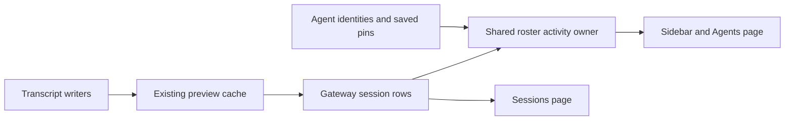

Codex review: needs maintainer review before merge.

## What this changes

This PR adds pinned-agent navigation and assistant previews, simplifies Sessions, shares page headers, and exposes all named Claw workspace files.

**Example:** Harbor has an assistant reply, “The summary is ready for review,” followed by a newer user question.
- **Before:** The sidebar shows expandable session trees without an agent-level assistant preview.
- **After:** Harbor shows the assistant reply beneath its name and can be pinned above the roster.

## Review scores

| Measure | Result | What it means |
|---|---|---|
| **Overall readiness** | 🐚 platinum hermit **(4/6)** | Strong visual and upgrade evidence supports a useful redesign with no identified blocking finding; broad exact-head CI is still underway. |
| **Proof confidence** | 🦞 diamond lobster **(5/6)** ✨ media proof bonus | Sufficient (screenshot): Inspected synthetic-Gateway browser captures show compact agent navigation, pinned hover previews, complete workspace-file listings, Sessions controls, and corrected desktop/mobile headers; reported published-stable upgrade results cover preserved state, and the relevant preview implementation remains unchanged. |
| **Patch quality** | 🐚 platinum hermit **(4/6)** | No actionable review findings were identified. |

## Product

**Kind:** Feature · **Worth it:** Yes · **Fix scope:** Complete
**User problem:** Agent navigation exposes session internals, page headers differ, and named workspace files are hidden behind a generic preview action.
**Reason:** The supplied maintainer-authored designation establishes direction; the implementation makes agents easier to reach while moving conversation management into Sessions.

## Merge readiness

✅ **Ready for maintainer review**

Keep this PR open: the maintainer-directed navigation redesign provides useful improvements, and no blocking defect was identified in the reviewed paths; exact-head CI remains pending.

**Priority:** P2
**Reviewed head:** `494671ff0ba86847b853ff35bb26c66600c52952`

## Before merge

None.

## Findings

None.

<strong>Agent review details</strong>

### How this fits together

The Gateway derives bounded transcript previews and publishes session rows; the Control UI combines those rows with agent identities and existing browser preferences to render navigation and session management.

### Technical review

Best possible solution:

Land the reviewed redesign once the existing exact-head CI gates pass.

Do we have a high-confidence way to reproduce the issue?

This is a navigation redesign; supplied before/after browser captures demonstrate the existing clutter and resulting presentation.

Is this the best way to solve the issue?

The change reuses the navigation-preference owner, shared roster activity, bounded Gateway preview cache, and native header and overlay components.

AGENTS.md: found and applied where relevant.

Codex review notes: model internal, reasoning medium; reviewed against [3aace27eec9e](https://github.com/openclaw/openclaw/commit/3aace27eec9e231765addd4158dc964b2b0206f7).

### Provenance checked

- `Agent-first sidebar and shared roster` changes intended behavior with a stated reason (https://github.com/openclaw/openclaw/pull/141476: Show the configured team and its work together through expandable agent groups; this PR explicitly moves session management to Sessions to simplify that navigation.)
- `Sessions telemetry and table hierarchy` changes intended behavior with a stated reason (https://github.com/openclaw/openclaw/pull/102523: Make fleet status and context pressure scannable; this PR deliberately keeps essential table columns and compact controls while retaining row details.)
- `Agent-switcher search` changes intended behavior with a stated reason (https://github.com/openclaw/openclaw/pull/165641: Search above six agents helped large menus; its removal belongs to the current maintainer-directed navigation simplification.)
- `Durable transcript preview cache` keeps the original intent (https://github.com/openclaw/openclaw/pull/171449: Avoid repeated transcript reads by persisting bounded derived facts through the existing writer; assistant enrichment extends that owner and preserves foreground publication.)
- `Verified Claw workspace previews` keeps the original intent (81662c56b67a08e663333cf4a2f8222f4f54cf60: Expose verified Claw content; the added bootstrap preview retains the existing bounded filesystem and digest checks.)

### Testing

Proof path: shipped entry point.

### Security

None.

### Evidence

What I checked:

- **Pinned introduction reviewed:** The verified base-to-head diff contains the navigation, preview, header, workspace-file, and associated test changes; CI workflow and Matrix timeout files have no introduced diff. ([494671ff0ba8](https://github.com/openclaw/openclaw/commit/494671ff0ba86847b853ff35bb26c66600c52952))
- **Current main retains the earlier navigation:** Fetched main still renders collapsible agent session groups and their earlier actions, establishing that this PR's central redesign remains distinct work. ([`ui/src/components/sidebar-agent-roster.tsx:253`](https://github.com/openclaw/openclaw/blob/3aace27eec9e231765addd4158dc964b2b0206f7/ui/src/components/sidebar-agent-roster.tsx#L253), [3aace27eec9e](https://github.com/openclaw/openclaw/commit/3aace27eec9e231765addd4158dc964b2b0206f7))
- **Visual evidence inspected:** Inspected downloaded before/after screenshots for agent menus, Agents cards, workspace files, and Sessions, plus linked pinned-hover and desktop/mobile Worktrees captures from https://github.com/openclaw/openclaw/pull/174984#issuecomment-6228706572 and https://github.com/openclaw/openclaw/pull/174984#issuecomment-6229169689. ([7ebf016ce30b](https://github.com/openclaw/openclaw/commit/7ebf016ce30b2fd46ada6034e80e5a09da5ab23d))
- **Existing-state upgrade evidence:** The author reports a published v2026.10.4-to-candidate upgrade passing all survivor phases, including configuration and transcript preservation, Doctor, Gateway startup, health, and readiness: https://github.com/openclaw/openclaw/pull/174984#issuecomment-6230530721. ([9b08aa2f5f66](https://github.com/openclaw/openclaw/commit/9b08aa2f5f66db3136f17a9a802c806b7c9a54d6))
- **Legacy preview compatibility:** The regression seeds a cache without lastAssistantMessage, verifies enrichment without changing settings or transcript rows, and reopens the persisted result without another backfill; the relevant preview implementation is unchanged from the upgrade-proven candidate. ([`src/gateway/session-row-projection.backfill.test.ts:166`](https://github.com/openclaw/openclaw/blob/494671ff0ba86847b853ff35bb26c66600c52952/src/gateway/session-row-projection.backfill.test.ts#L166), [494671ff0ba8](https://github.com/openclaw/openclaw/commit/494671ff0ba86847b853ff35bb26c66600c52952))
- **Prior repair preserved:** Known previews publish before optional assistant enrichment, pinned agents retain provisional creation feedback, the wrapper inventory includes the preview validator's module, and the warm-read test awaits initial enrichment. ([`src/gateway/session-row-projection-backfill.ts:130`](https://github.com/openclaw/openclaw/blob/494671ff0ba86847b853ff35bb26c66600c52952/src/gateway/session-row-projection-backfill.ts#L130), [494671ff0ba8](https://github.com/openclaw/openclaw/commit/494671ff0ba86847b853ff35bb26c66600c52952))

### PR surface

PR surface statistics unavailable: the file list is incomplete.

### Labels

Label changes:

No label changes.

Label justifications:

- `P2`: Useful navigation and discoverability improvements with limited urgency and no demonstrated core-runtime outage.
- `rating: 🐚 platinum hermit`: Overall readiness is 🐚 platinum hermit; proof is 🦞 diamond lobster and patch quality is 🐚 platinum hermit.
- `status: 👀 ready for maintainer look`: ClawSweeper has no concrete contributor-facing blocker left for this PR.
- `proof: sufficient`: Contributor real behavior proof is sufficient.
- `proof: 📸 screenshot`: Contributor real behavior proof includes screenshot evidence.

### Rating scale

6/6 🦀 challenger crab · 5/6 🦞 diamond lobster · 4/6 🐚 platinum hermit · 3/6 🦐 gold shrimp · 2/6 🦪 silver shellfish · 1/6 🧂 unranked krab. Overall follows the weaker of proof and patch quality; ✨ marks media proof (a screenshot, video, or linked artifact) that directly shows the changed behavior.

### Workflow

ClawSweeper edits this one comment on every review. Comment `@clawsweeper re-review` for a fresh review only. Repair and merge execution lanes are retired.

### History

Review history (6 earlier review cycles)

<!-- clawsweeper-review-history v=1 total=6 -->
- reviewed 2026-10-17T02:37:38.931Z sha 795654595681651d952f2ae150e2f3bf23376682 :: blocked before merge. :: [P1] Keep the validator inside the extracted wrapper's import closure | [P2] Publish known previews while assistant enrichment is pending | [P2] Preserve creation feedback for pinned agents | [P2] Complete the navigation test cutover | [P2] Initialize settings in the shared chat-pane fixture | [P3] Update the sidebar guide to describe the final navigation
- reviewed 2026-10-17T03:10:01.550Z sha cc41cc82e91f946b7eb16e6ac6f11eb8a5e077de :: blocked before merge. :: [P2] Wait for completed enrichment before measuring warm reads
- reviewed 2026-10-17T04:43:36.696Z sha bdd94e3021654fe2eeeeb07638270eb2a87bdf4c :: blocked before merge. :: none
- reviewed 2026-10-17T05:31:57.647Z sha 3393004fd2fcbe324bbd2a81038e067a50afd756 :: needs maintainer review before merge. :: none
- reviewed 2026-10-17T06:00:18.584Z sha 9b08aa2f5f66db3136f17a9a802c806b7c9a54d6 :: needs maintainer review before merge. :: none
- reviewed 2026-10-17T06:40:52.692Z sha a0e7cbf076ca8138ee02d8a672501556aceba107 :: needs maintainer review before merge. :: none

_Reviewed October 17, 2026, 3:11 AM ET / 07:11 UTC (Revision 7)._

<!-- clawsweeper-verdict:needs-human item=174984 sha=494671ff0ba86847b853ff35bb26c66600c52952 confidence=high updated_at=2026-10-17T07:05:33Z reviewed_at=2026-10-17T07:11:57.646Z lease_owner=github-run-39012287695-1 lease_comment_id=6231003613 source_revision=46a81887d69ccc7c2733fabc99186704859434a7175d5495a387da0cc3e04934 hold=not_opted_in findings=0 -->
<!-- clawsweeper-review-state:ready item=174984 sha=494671ff0ba86847b853ff35bb26c66600c52952 v=1 -->

<!-- clawsweeper-review-version item=174984 reviewed_at=2026-10-17T07:11:57.646Z sha=494671ff0ba86847b853ff35bb26c66600c52952 source_revision=46a81887d69ccc7c2733fabc99186704859434a7175d5495a387da0cc3e04934 lease_owner=github-run-39012287695-1 lease_comment_id=6231003613 v=1 -->

<!-- clawsweeper-review item=174984 -->