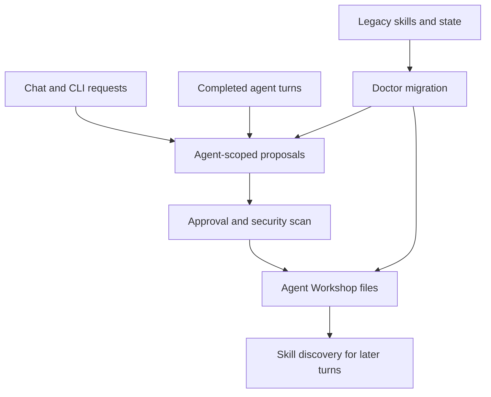

Codex review: blocked before merge. _Reviewed September 5, 2026, 8:58 AM ET / 12:58 UTC._

# ClawSweeper review

## What this changes

Give each agent its own generated-skill directory, migrate existing Workshop state, and anchor background learning to the completed conversation turn.

> [!WARNING]
> **SQLite table change**
>
> This PR modifies persisted SQLite tables in `src/skills/workshop/store-sqlite-schema.ts`, `src/state/openclaw-state-schema.sql`. Prefer a design that avoids changing persisted SQLite tables. If the change is necessary, verify migration and upgrade compatibility against an existing database before merge.

## Merge readiness

⛔ **Blocked before merge - 4 items remain**

Keep open: the agent-owned Workshop remains distinct from current main and the latest release. Prior actionable findings are addressed, and the recorded migration decisions should not be reopened as new blockers.

**Priority:** P2
**Reviewed head:** `c19749909bf73109fe6f532705378101c8d8ff2e`

## Review scores

| Measure | Result | What it means |
|---|---|---|
| **Overall readiness** | 🐚 platinum hermit **(4/6)** | A coherent ownership refactor with substantial regression coverage and retained runtime evidence; compatibility tradeoffs are explicitly accepted. |
| **Proof confidence** | 🦞 diamond lobster **(5/6)** ✨ media proof bonus | Sufficient (linked_artifact): Retained real Doctor runs demonstrate recovery with a competing SQLite writer, and supplied CLI/Gateway observations cover grouped audit and agent isolation; matching recovery and audit sources remain unchanged. Historical learning proof is not relabeled as a current-head run, and remote artifacts could not be reopened. |
| **Patch quality** | 🐚 platinum hermit **(4/6)** | No actionable review findings were identified. |

## Verification

| Check | Result | Evidence |
|---|---|---|
| **Real behavior** | Verified | Sufficient (linked_artifact): Retained real Doctor runs demonstrate recovery with a competing SQLite writer, and supplied CLI/Gateway observations cover grouped audit and agent isolation; matching recovery and audit sources remain unchanged. Historical learning proof is not relabeled as a current-head run, and remote artifacts could not be reopened. |
| **Evidence reviewed** | 13 items | Pinned introduction and continuity: The complete local base-to-head comparison contains 202 introduced paths. Tree comparison confirms 193 are unchanged since the previous reviewed head, including recovery, audit, discovery, and Codex finalization. The supplied test merge is stale and was not used to infer removal of main-branch behavior. Still necessary on current main: Current main still resolves proposal targets under the session workspace's skills directory and retains state schema 15. Latest release behavior: The supplied v2026.9.1 release revision also resolves generated targets under workspace/skills; it does not provide this PR's per-agent directory ownership. |
| **Findings** | None | None. |
| **Security** | None | None. |

## How this fits together

Skill Workshop turns chat requests and completed agent work into reviewed skill proposals. Its storage, approval, recovery, and discovery paths determine which generated instructions later agent runs receive.

## Before merge

- [ ] **Resolve merge risk (P1)** - The accepted upgrade retires workspace symlink-target writes and automatic restore pointers with ambiguous ownership; some operators will need the documented manual recovery path.
- [ ] **Resolve merge risk (P1)** - Reviewer-side gaps remain in linked artifact access, fs-safe implementation inspection, and comparison of intervening changes since the historical live-learning run.
- [ ] **Review config compatibility** - Confirm compatibility and upgrade impact for the changed config or default surface before merge.
- [ ] **Add data-model compatibility proof** - Confirm migration or upgrade compatibility proof before merge.

<strong>Agent review details</strong>

### Security

None.

### PR surface

PR surface statistics unavailable: the file list is incomplete.

### Review metrics

| Metric | Value | Why it matters |
|---|---|---|
| **Production versus test growth** | Production net +1,390 lines; tests/support net +5,262 lines | Excluding documentation and generated baselines, growth supports agent ownership and migration recovery; moved code cancels in the net. |
| **Upgrade contract** | Schema 15→16; 2 proposal columns removed; 1 history table rekeyed; 1 setting retired | These accepted changes affect existing installations and their recovery behavior. |

### Stored data model

Persistent data-model change detected: `database schema: src/skills/workshop/store-sqlite-schema.ts`, `database schema: src/state/openclaw-state-schema.sql`, `migration/backfill/repair: config/assertion-safety-baseline.txt`, `migration/backfill/repair: src/state/openclaw-state-db-schema-repair.ts`, `migration/backfill/repair: src/state/openclaw-state-db.ts`, `serialized state: src/skills/workshop/skills-root.ts`, and 4 more. Confirm migration or upgrade compatibility proof before merge.

### Merge-risk options

**Maintainer options:**
1. **Retain the accepted upgrade contract (recommended)**  
   Proceed under the recorded migration decision while preserving stale-proposal diagnostics, retained files, and documented manual backup recovery.

### Technical review

Best possible solution:

Retain one agent-owned proposal, apply, and recovery pipeline with the accepted migration safeguards; keep the weekly review-turn redesign in its separate follow-up.

Do we have a high-confidence way to reproduce the issue?

Not applicable to the overall feature proposal; its component repairs have recorded before/after CLI evidence, but this read-only review did not execute them.

Is this the best way to solve the issue?

Yes: agent-owned storage fixes ownership at its producer while reusing the existing proposal service and discovery machinery; workspace-only adjustments or profile-owned libraries would not provide the same boundary.

AGENTS.md: found and applied where relevant.

Codex review notes: model internal, reasoning high; reviewed against [177a1e3b054e](https://github.com/openclaw/openclaw/commit/177a1e3b054e75a4a24af75a75a09519cf8cf5dd).

### Labels

Label justifications:

- `P2`: This is a useful, actively maintained ownership improvement without an established urgent production outage.
- `merge-risk: 🚨 compatibility`: Schema migration and setting retirement intentionally change existing Workshop workflows and automatic recovery eligibility.
- `rating: 🐚 platinum hermit`: Overall readiness is 🐚 platinum hermit; proof is 🦞 diamond lobster and patch quality is 🐚 platinum hermit.
- `status: 👀 ready for maintainer look`: ClawSweeper has no concrete contributor-facing blocker left for this PR. Sufficient (linked_artifact): Retained real Doctor runs demonstrate recovery with a competing SQLite writer, and supplied CLI/Gateway observations cover grouped audit and agent isolation; matching recovery and audit sources remain unchanged. Historical learning proof is not relabeled as a current-head run, and remote artifacts could not be reopened.
- `proof: sufficient`: Contributor real behavior proof is sufficient. Retained real Doctor runs demonstrate recovery with a competing SQLite writer, and supplied CLI/Gateway observations cover grouped audit and agent isolation; matching recovery and audit sources remain unchanged. Historical learning proof is not relabeled as a current-head run, and remote artifacts could not be reopened.

### Evidence

What I checked:

- **Pinned introduction and continuity:** The complete local base-to-head comparison contains 202 introduced paths. Tree comparison confirms 193 are unchanged since the previous reviewed head, including recovery, audit, discovery, and Codex finalization. The supplied test merge is stale and was not used to infer removal of main-branch behavior. ([c19749909bf7](https://github.com/openclaw/openclaw/commit/c19749909bf73109fe6f532705378101c8d8ff2e))
- **Still necessary on current main:** Current main still resolves proposal targets under the session workspace's skills directory and retains state schema 15. ([`src/skills/workshop/store.ts:146`](https://github.com/openclaw/openclaw/blob/177a1e3b054e75a4a24af75a75a09519cf8cf5dd/src/skills/workshop/store.ts#L146), [177a1e3b054e](https://github.com/openclaw/openclaw/commit/177a1e3b054e75a4a24af75a75a09519cf8cf5dd))
- **Latest release behavior:** The supplied v2026.9.1 release revision also resolves generated targets under workspace/skills; it does not provide this PR's per-agent directory ownership. ([`src/skills/workshop/store.ts:146`](https://github.com/openclaw/openclaw/blob/ad6fe23aecb9b833d68139b0ddc9f239b894d2f1/src/skills/workshop/store.ts#L146), [ad6fe23aecb9](https://github.com/openclaw/openclaw/commit/ad6fe23aecb9b833d68139b0ddc9f239b894d2f1))
- **Canonical ownership boundary:** The shared service resolves the agent's Workshop root, checks proposal ownership before reconciliation, and confines live targets to that root. Gateway callers pass the resolved agent and configuration; discovery adds Workshop below managed and workspace sources. ([`src/skills/workshop/store.ts:159`](https://github.com/openclaw/openclaw/blob/c19749909bf73109fe6f532705378101c8d8ff2e/src/skills/workshop/store.ts#L159), [c19749909bf7](https://github.com/openclaw/openclaw/commit/c19749909bf73109fe6f532705378101c8d8ff2e))
- **Migration decision already recorded:** The discussion explicitly accepts schema 16, removal of ambiguously owned review-history pointers, and retirement of the symlink-write setting: https://github.com/openclaw/openclaw/pull/135528#issuecomment-5534894258 and https://github.com/openclaw/openclaw/pull/135528#issuecomment-5505561674. Source stales released claims before dropping their marker and rekeys attributable review history. ([`src/state/openclaw-state-db-maintenance.ts:399`](https://github.com/openclaw/openclaw/blob/c19749909bf73109fe6f532705378101c8d8ff2e/src/state/openclaw-state-db-maintenance.ts#L399), [c19749909bf7](https://github.com/openclaw/openclaw/commit/c19749909bf73109fe6f532705378101c8d8ff2e))
- **Interrupted-write and no-op repairs:** Doctor checks legacy eligibility before opening rollback state, reconciles interrupted writes before moving files, reserves unresolved sources, and commits each move's proposal updates together. This addresses the retained rollback finding through recovery ordering rather than relocating inconsistent recovery records. ([`src/commands/doctor-skill-workshop-sqlite.ts:162`](https://github.com/openclaw/openclaw/blob/c19749909bf73109fe6f532705378101c8d8ff2e/src/commands/doctor-skill-workshop-sqlite.ts#L162), [c19749909bf7](https://github.com/openclaw/openclaw/commit/c19749909bf73109fe6f532705378101c8d8ff2e))

Likely related people:

- **obviyus:** Suggested for follow-up; no historical authorship or introduction is verified. (role: unverified routing candidate; confidence: low)
- **steipete:** Suggested for follow-up; no historical authorship or introduction is verified. (role: unverified routing candidate; confidence: low)
- **Josh Lehman:** Suggested for follow-up; no historical authorship or introduction is verified. (role: unverified routing candidate; confidence: low)

### Rating scale

| Score | Internal tier | Crab rank | Meaning |
|---:|:---:|---|---|
| **6/6** | S | 🦀 challenger crab | Exceptional readiness |
| **5/6** | A | 🦞 diamond lobster | Very strong readiness |
| **4/6** | B | 🐚 platinum hermit | Good normal PR; ordinary maintainer review |
| **3/6** | C | 🦐 gold shrimp | Useful, but confidence is limited |
| **2/6** | D | 🦪 silver shellfish | Proof or implementation needs work |
| **1/6** | F | 🧂 unranked krab | Not merge-ready |
| N/A | NA | 🌊 off-meta tidepool | Rating does not apply |

Overall follows the weaker of proof and patch quality.
Shiny media proof means a screenshot, video, or linked artifact directly shows the changed behavior. Runtime, network, CSP, and security claims still need visible diagnostics.

### Workflow

- ClawSweeper keeps one durable marker-backed review comment per issue or PR.
- Re-runs edit this comment so the latest verdict, findings, and automation markers stay together instead of adding duplicate bot comments.
- A fresh review can be triggered by eligible `@clawsweeper re-review` comments, exact-item GitHub events, scheduled/background review runs, or manual workflow dispatch.
- PR/issue authors and users with repository write access can comment `@clawsweeper re-review` or `@clawsweeper re-run` on an open PR or issue to request a fresh review only.
- Maintainers can also comment `@clawsweeper review` to request a fresh review only.
- Fresh-review commands do not start repair, autofix, rebase, CI repair, or automerge.
- Maintainer-only repair and merge flows require explicit commands such as `@clawsweeper autofix`, `@clawsweeper automerge`, `@clawsweeper fix ci`, or `@clawsweeper address review`.
- Maintainers can comment `@clawsweeper explain` to ask for more context, or `@clawsweeper stop` to stop active automation.

### History

Review history (58 earlier review cycles; latest 8 shown)

<!-- clawsweeper-review-history v=1 total=58 -->
- reviewed 2026-09-04T20:04:45.103Z sha b205308c74541ecc88d2ebee3f9e60117b10bcf2 :: blocked before merge. :: none
- reviewed 2026-09-04T20:43:39.349Z sha 136541e5c40902600d89ad2c69b4b018dfcb8deb :: blocked before merge. :: none
- reviewed 2026-09-04T21:16:00.146Z sha 136541e5c40902600d89ad2c69b4b018dfcb8deb :: blocked before merge. :: none
- reviewed 2026-09-05T02:57:46.869Z sha 2e059cb189e417c02017a75efda1104e7d9b210e :: blocked before merge. :: none
- reviewed 2026-09-05T03:15:44.893Z sha 2e059cb189e417c02017a75efda1104e7d9b210e :: blocked before merge. :: [P2] Scan grouped Workshop directories during deep audit | [P3] Describe Workshop precedence separately from file preservation
- reviewed 2026-09-05T06:44:30.264Z sha ea5ecc83a2294e7622bb1b6b7ce978d47bd43d66 :: blocked before merge. :: [P1] Retarget rollback records with relocated pending updates
- reviewed 2026-09-05T09:43:42.201Z sha 6ff5953b41bd3ff9e79de5d1a1766ec0a5f3d48a :: blocked before merge. :: none
- reviewed 2026-09-05T10:43:00.492Z sha e55e2cb42a82733716c877715ea8eb05b0836a9a :: blocked before merge. :: none

<!-- clawsweeper-verdict:needs-human item=135528 sha=c19749909bf73109fe6f532705378101c8d8ff2e confidence=high updated_at=2026-09-05T12:52:24Z reviewed_at=2026-09-05T12:58:10.730Z lease_owner=github-run-33967198248-1 lease_comment_id=5551946219 source_revision=f60123c66cc358b28e001189d46297b61279a2385c55dac1811f396be3721e35 live_verification=absent -->
<!-- clawsweeper-review-state:blocked item=135528 sha=c19749909bf73109fe6f532705378101c8d8ff2e v=1 -->

<!-- clawsweeper-review-version item=135528 reviewed_at=2026-09-05T12:58:10.730Z sha=c19749909bf73109fe6f532705378101c8d8ff2e source_revision=f60123c66cc358b28e001189d46297b61279a2385c55dac1811f396be3721e35 lease_owner=github-run-33967198248-1 lease_comment_id=5551946219 v=1 -->

<!-- clawsweeper-review item=135528 -->