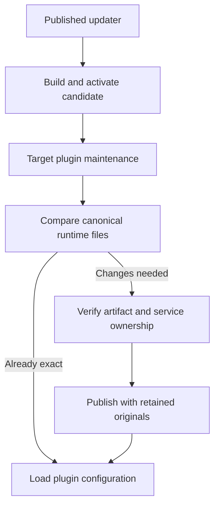

Codex review: blocked before merge. _Reviewed September 12, 2026, 10:18 AM ET / 14:18 UTC (Revision 9)._

# ClawSweeper review

## What this changes

Git updates and repair complete missing or stale bundled plugin runtime files before loading plugin configuration, with coordinated artifact publication, service inspection, and build-consumer fixes.

## Merge readiness

⛔ **Blocked before merge - 3 items remain**

This repair remains necessary on current main. No introduced correctness defect was found, and the final type-test adjustment preserves the runtime source used for the successful published-updater proof.

**Priority:** P2
**Reviewed head:** `5c85ddc0ec9bfffa82c7beb5a2b9f40de448204b`

## Review scores

| Measure | Result | What it means |
|---|---|---|
| **Overall readiness** | 🐚 platinum hermit **(4/6)** | A useful, coherent repair with strong published-driver observations, focused lifecycle coverage, and no blocking correctness finding. |
| **Proof confidence** | 🦞 diamond lobster **(5/6)** | Sufficient (live_output): The captured macOS run exercised the unchanged 2026.9.4 updater through actual Git activation and target-owned completion, then verified canonical artifacts and installed consumers. The final head changes only type-test partition configuration, preserving the qualified runtime bytes; Linux live and native Windows coverage remain explicitly limited. |
| **Patch quality** | 🐚 platinum hermit **(4/6)** | No actionable review findings were identified. |

## Verification

| Check | Result | Evidence |
|---|---|---|
| **Real behavior** | Verified | Sufficient (live_output): The captured macOS run exercised the unchanged 2026.9.4 updater through actual Git activation and target-owned completion, then verified canonical artifacts and installed consumers. The final head changes only type-test partition configuration, preserving the qualified runtime bytes; Linux live and native Windows coverage remain explicitly limited. |
| **Evidence reviewed** | 9 items | Current main still lacks the repair: The fetched main runtime inventory enumerates dist and node_modules but omits root and nested dist-runtime. Its plugin convergence proceeds directly from the lifecycle lease to configuration preparation. Target-owned completion and publication: Completion loads the installed target's generator, preserves legacy target contracts, skips publication for exact artifacts, and checks plugin lease and service publication authority before each changed-root swap. Publication rejection and rollback coverage: Inspected tests cover running or unknown services, shared physical outputs, changed manager and launcher identity, revoked caller authority, redirected parents, lifecycle exclusion, and assertions used after ownership closes. Generator tests preserve originals when restoration cannot proceed. |
| **Findings** | None | None. |
| **Security** | None | None. |

## How this fits together

Git updates build a candidate runtime and activate it before target-owned plugin maintenance runs. Bundled plugin overlays and SDK aliases connect those built files to plugin consumers, so incomplete artifacts can leave an apparently successful update unusable.

## Before merge

- [ ] **Resolve merge risk (P1)** - Existing Git installations needing artifact replacement can stop update or repair when the affected runtime is active or cannot be verified offline; recovery may require intervention through the service owner.
- [ ] **Resolve merge risk (P1)** - Successful published-driver qualification covers macOS. Final-candidate Linux live qualification is not claimed, and Windows copy behavior has simulated coverage.
- [ ] **Add data-model compatibility proof** - Confirm migration or upgrade compatibility proof before merge.

<strong>Agent review details</strong>

### Security

None.

### PR surface

Source +467, Tests +1360, Docs +3, Other +331. Total +2161 across 38 files.

View PR surface stats

| Area | Files | Added | Removed | Net |
|---|---:|---:|---:|---:|
| Source | 12 | 556 | 89 | +467 |
| Tests | 17 | 1430 | 70 | +1360 |
| Docs | 1 | 4 | 1 | +3 |
| Config | 0 | 0 | 0 | 0 |
| Generated | 0 | 0 | 0 | 0 |
| Other | 8 | 749 | 418 | +331 |
| **Total** | **38** | **2739** | **578** | **+2161** |

### Review metrics

| Metric | Value | Why it matters |
|---|---|---|
| **Production versus validation growth** | production/tooling net +724; tests/support/config net +1,434 | Production growth is explained by first-hop completion and guarded publication; validation growth covers lifecycle, rollback, exclusion, and compatibility behavior. |

### Stored data model

Persistent data-model change detected: `migration/backfill/repair: extensions/qa-lab/src/gateway-child-setup.ts`. Confirm migration or upgrade compatibility proof before merge.

### Merge-risk options

**Maintainer options:**
1. **Retain the documented publication boundary (recommended)**  
   Accept the intentional offline-verification refusal with the supplied macOS published-driver proof and explicitly bounded Linux and Windows coverage.
2. **Require Linux qualification for the landing window**  
   Pause landing if the intended deployment requires a successful native Linux first-hop update beyond the supplied diagnostic and regression coverage.

### Technical review

Best possible solution:

Retain target-owned completion with the demonstrated published-driver compatibility, exact no-op behavior, and service-owned recovery for unsafe publication.

Do we have a high-confidence way to reproduce the issue?

Yes. Current main omits runtime overlays from Git promotion, and the supplied unchanged-published-driver comparison demonstrates incomplete first-hop artifacts; this read-only review did not execute the reproduction.

Is this the best way to solve the issue?

Yes. Completing artifacts through the installed target addresses the old-updater first hop while reusing canonical generation and existing ownership boundaries, without introducing a competing plugin API or stored data model.

AGENTS.md: found and applied where relevant.

Codex review notes: model internal, reasoning medium; reviewed against [3818b8e91d3a](https://github.com/openclaw/openclaw/commit/3818b8e91d3a59b778ad4fb381a751cdba84c304).

### Labels

Label justifications:

- `P2`: This is a concrete Git-update reliability repair with a bounded installation and artifact scope.
- `merge-risk: 🚨 compatibility`: Changed artifacts now require verified offline publication, so some existing update or repair workflows can stop with service-owner recovery guidance.
- `rating: 🐚 platinum hermit`: Overall readiness is 🐚 platinum hermit; proof is 🦞 diamond lobster and patch quality is 🐚 platinum hermit.
- `status: 👀 ready for maintainer look`: ClawSweeper has no concrete contributor-facing blocker left for this PR. Sufficient (live_output): The captured macOS run exercised the unchanged 2026.9.4 updater through actual Git activation and target-owned completion, then verified canonical artifacts and installed consumers. The final head changes only type-test partition configuration, preserving the qualified runtime bytes; Linux live and native Windows coverage remain explicitly limited.
- `proof: sufficient`: Contributor real behavior proof is sufficient. The captured macOS run exercised the unchanged 2026.9.4 updater through actual Git activation and target-owned completion, then verified canonical artifacts and installed consumers. The final head changes only type-test partition configuration, preserving the qualified runtime bytes; Linux live and native Windows coverage remain explicitly limited.

### Evidence

What I checked:

- **Current main still lacks the repair:** The fetched main runtime inventory enumerates dist and node_modules but omits root and nested dist-runtime. Its plugin convergence proceeds directly from the lifecycle lease to configuration preparation. ([`src/infra/update-runner-git-runtime.ts:29`](https://github.com/openclaw/openclaw/blob/3818b8e91d3a59b778ad4fb381a751cdba84c304/src/infra/update-runner-git-runtime.ts#L29), [3818b8e91d3a](https://github.com/openclaw/openclaw/commit/3818b8e91d3a59b778ad4fb381a751cdba84c304))
- **Target-owned completion and publication:** Completion loads the installed target's generator, preserves legacy target contracts, skips publication for exact artifacts, and checks plugin lease and service publication authority before each changed-root swap. ([`src/cli/update-cli/update-command-runtime.ts:77`](https://github.com/openclaw/openclaw/blob/5c85ddc0ec9bfffa82c7beb5a2b9f40de448204b/src/cli/update-cli/update-command-runtime.ts#L77), [5c85ddc0ec9b](https://github.com/openclaw/openclaw/commit/5c85ddc0ec9bfffa82c7beb5a2b9f40de448204b))
- **Publication rejection and rollback coverage:** Inspected tests cover running or unknown services, shared physical outputs, changed manager and launcher identity, revoked caller authority, redirected parents, lifecycle exclusion, and assertions used after ownership closes. Generator tests preserve originals when restoration cannot proceed. ([`src/cli/update-cli/update-command-service-publication.test.ts:104`](https://github.com/openclaw/openclaw/blob/5c85ddc0ec9bfffa82c7beb5a2b9f40de448204b/src/cli/update-cli/update-command-service-publication.test.ts#L104), [5c85ddc0ec9b](https://github.com/openclaw/openclaw/commit/5c85ddc0ec9bfffa82c7beb5a2b9f40de448204b))
- **Published-driver after-fix observations:** The captured PR body reports an unchanged 2026.9.4 updater, with 9,244 published dist files verified byte-identical, completing the actual dev update on an isolated macOS installation. Independent regeneration agreed on all 3,236 overlay and SDK alias paths, with zero missing, extra, or differing paths; all 328 required core outputs and installed-target consumers passed. The tested runtime revision was 290bd2e7f11fb6d627c76448d070f738d94f84fe. These are supplied observations, not execution performed by this review. Captured context sourceRevision: 570fe1a9f1b98b29606ed6cffd868c6cbf6e8335ee91b24153b0ead19d488b2a. ([290bd2e7f11f](https://github.com/openclaw/openclaw/commit/290bd2e7f11fb6d627c76448d070f738d94f84fe))
- **Re-review continuity:** The complete comparison with the previous reviewed and locally qualified revision changes only two type-test configurations, transferring the existing plugin-state globs between partitions. Runtime, updater, build, and QA implementation bytes are unchanged. The previous completed review contained no findings. ([`test/tsconfig/tsconfig.core.test.state-logging.json:9`](https://github.com/openclaw/openclaw/blob/5c85ddc0ec9bfffa82c7beb5a2b9f40de448204b/test/tsconfig/tsconfig.core.test.state-logging.json#L9), [5c85ddc0ec9b](https://github.com/openclaw/openclaw/commit/5c85ddc0ec9bfffa82c7beb5a2b9f40de448204b))
- **Linux absence semantics:** The native reader recognizes FileNotFound only for GetUnitFileState, after rechecking its authenticated connection. The service owner retains binding and deadline checks and separately excludes system-scope ownership before projecting absence. The body explicitly does not claim a successful final-candidate Linux live run. ([`src/daemon/systemd-peer-native.ts:311`](https://github.com/openclaw/openclaw/blob/5c85ddc0ec9bfffa82c7beb5a2b9f40de448204b/src/daemon/systemd-peer-native.ts#L311), [5c85ddc0ec9b](https://github.com/openclaw/openclaw/commit/5c85ddc0ec9bfffa82c7beb5a2b9f40de448204b))

Likely related people:

- **steipete:** Suggested for follow-up; no historical authorship or introduction is verified. (role: unverified routing candidate; confidence: low)
- **fuller-stack-dev:** Suggested for follow-up; no historical authorship or introduction is verified. (role: unverified routing candidate; confidence: low)

### Rating scale

| Score | Internal tier | Crab rank | Meaning |
|---:|:---:|---|---|
| **6/6** | S | 🦀 challenger crab | Exceptional readiness |
| **5/6** | A | 🦞 diamond lobster | Very strong readiness |
| **4/6** | B | 🐚 platinum hermit | Good normal PR; ordinary maintainer review |
| **3/6** | C | 🦐 gold shrimp | Useful, but confidence is limited |
| **2/6** | D | 🦪 silver shellfish | Proof or implementation needs work |
| **1/6** | F | 🧂 unranked krab | Not merge-ready |
| N/A | NA | 🌊 off-meta tidepool | Rating does not apply |

Overall follows the weaker of proof and patch quality.
Shiny media proof means a screenshot, video, or linked artifact directly shows the changed behavior. Runtime, network, CSP, and security claims still need visible diagnostics.

### Workflow

- ClawSweeper keeps one durable marker-backed review comment per issue or PR.
- Re-runs edit this comment so the latest verdict, findings, and automation markers stay together instead of adding duplicate bot comments.
- A fresh review can be triggered by eligible `@clawsweeper re-review` comments, exact-item GitHub events, scheduled/background review runs, or manual workflow dispatch.
- PR/issue authors and users with repository write access can comment `@clawsweeper re-review` or `@clawsweeper re-run` on an open PR or issue to request a fresh review only.
- Maintainers can also comment `@clawsweeper review` to request a fresh review only.
- Fresh-review commands do not start repair, autofix, rebase, CI repair, or automerge.
- Maintainer-only repair and merge flows require explicit commands such as `@clawsweeper autofix`, `@clawsweeper automerge`, `@clawsweeper fix ci`, or `@clawsweeper address review`.
- Maintainers can comment `@clawsweeper explain` to ask for more context, or `@clawsweeper stop` to stop active automation.

### History

Review history (8 earlier review cycles)

<!-- clawsweeper-review-history v=1 total=8 -->
- reviewed 2026-09-12T05:57:56.260Z sha 42cc9e63d60331f4ed4b4b21d797b3f1056b1696 :: blocked before merge. :: none
- reviewed 2026-09-12T06:54:22.496Z sha 42cc9e63d60331f4ed4b4b21d797b3f1056b1696 :: blocked before merge. :: none
- reviewed 2026-09-12T08:42:08.153Z sha f331ff6639622c27870bda821b5892fc988ad8a8 :: blocked before merge. :: none
- reviewed 2026-09-12T09:28:24.906Z sha 56e6e4a14f5ceec3f8824973305d8f1916b62d6b :: blocked before merge. :: none
- reviewed 2026-09-12T09:58:40.240Z sha 1cd94b9c638db634486e8660536ac1ed9c244a3f :: blocked before merge. :: none
- reviewed 2026-09-12T11:10:51.342Z sha 1cd94b9c638db634486e8660536ac1ed9c244a3f :: blocked before merge. :: none
- reviewed 2026-09-12T13:50:42.883Z sha 290bd2e7f11fb6d627c76448d070f738d94f84fe :: blocked before merge. :: none
- reviewed 2026-09-12T14:04:17.449Z sha 290bd2e7f11fb6d627c76448d070f738d94f84fe :: blocked before merge. :: none

<!-- clawsweeper-verdict:needs-human item=145664 sha=5c85ddc0ec9bfffa82c7beb5a2b9f40de448204b confidence=high updated_at=2026-09-12T14:14:42Z reviewed_at=2026-09-12T14:18:16.438Z lease_owner=github-run-34698622704-1 lease_comment_id=5646416940 source_revision=570fe1a9f1b98b29606ed6cffd868c6cbf6e8335ee91b24153b0ead19d488b2a live_verification=absent -->
<!-- clawsweeper-review-state:blocked item=145664 sha=5c85ddc0ec9bfffa82c7beb5a2b9f40de448204b v=1 -->

<!-- clawsweeper-review-version item=145664 reviewed_at=2026-09-12T14:18:16.438Z sha=5c85ddc0ec9bfffa82c7beb5a2b9f40de448204b source_revision=570fe1a9f1b98b29606ed6cffd868c6cbf6e8335ee91b24153b0ead19d488b2a lease_owner=github-run-34698622704-1 lease_comment_id=5646416940 v=1 -->

<!-- clawsweeper-review item=145664 -->