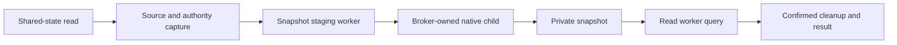

Codex review: blocked before merge. _Reviewed September 29, 2026, 10:36 AM ET / 14:36 UTC (Revision 15)._

# ClawSweeper review

## What this changes

The branch retains shared-state SQLite snapshot preparation, queries, and native cleanup across Worker failures, with fault tests, recovery documentation, and worker packaging entries.

## Merge readiness

⛔ **Blocked before merge - 6 items remain**

Keep open. Current main lacks the retained read lifecycle, and the branch has credible real SQLite fault-injection proof with no discrete code finding. The documented outage behavior after loss of the broker process still needs an independent maintainer decision. The previous review’s generic config or default upgrade concern is not supported by the introduced paths.

**Priority:** P2
**Reviewed head:** `a3ff20cabb67987a4ef7719272aa1ccf187d62fe`
**Owner decision:** Required. See [Decision needed](#decision-needed).

## Review scores

| Measure | Result | What it means |
|---|---|---|
| **Overall readiness** | 🦐 gold shrimp **(3/6)** | Strong real-boundary fault proof supports a substantial repair, while the broad lifecycle surface and unresolved broker-loss tradeoff limit merge confidence. |
| **Proof confidence** | 🦞 diamond lobster **(5/6)** | Sufficient (terminal): The changed snapshot staging and broker owners are exercised through real Worker, broker, SQLite file, and native-child paths with injected supervisor loss. The PR reports after-fix runs that observe retained locks, confirmed child exit, and SQLite reuse; this review inspected the harness but did not rerun it. The introduced diff changes no stored-data format, so migration compatibility is not applicable. |
| **Patch quality** | 🦐 gold shrimp **(3/6)** | No actionable review findings were identified. |

## Verification

| Check | Result | Evidence |
|---|---|---|
| **Real behavior** | Verified | Sufficient (terminal): The changed snapshot staging and broker owners are exercised through real Worker, broker, SQLite file, and native-child paths with injected supervisor loss. The PR reports after-fix runs that observe retained locks, confirmed child exit, and SQLite reuse; this review inspected the harness but did not rerun it. The introduced diff changes no stored-data format, so migration compatibility is not applicable. |
| **Evidence reviewed** | 9 items | Current main still uses the earlier read path: The current-main reader awaits transport and cleanup separately; the new retained-operation, read-operation, and broker-resource modules are absent from its tree. Read authority remains tied to the selected source: The new read operation checks cancellation, admission, snapshot authority, and physical source identity before dispatch and release. Native custody requires a close receipt: The broker claim remains held after transport failure and is released only following the native resource closed response. |
| **Findings** | None | None. |
| **Security** | None | None. |

## How this fits together

OpenClaw serves shared-state SQLite reads through workers for Gateway and agent requests. Snapshot staging prepares private bytes, a broker retains the native child, and the read worker returns results before cleanup releases temporary files.

## Decision needed

| Question | Recommendation |
|---|---|
| Is conservative fencing after loss of the spawn broker process an acceptable availability boundary for this repair? | **Accept fenced recovery:** Land the repair with its documented broker-loss limit and use the existing service recovery owner when the broker itself is lost. |

Why: The patch deliberately treats broker loss as unknown native custody; choosing that outage behavior requires maintainer judgment beyond the contributor’s stated acceptance.

## Before merge

- [ ] **Resolve merge risk (P1)** - If the spawn broker process disappears while it owns a SQLite child, retained claims remain fenced and shared-state reads may stay unavailable until service recovery. The contributor documented this boundary, but independent maintainer acceptance is not recorded.
- [ ] **Complete next step (P2)** - Get independent maintainer acceptance of the documented broker-process-loss behavior before merge.
- [ ] **Resolve review confidence** - ClawSweeper must reach high confidence before merge readiness is known.
- [ ] **Resolve maintainer decision** - Resolve the maintainer decision shown above before merge.
- [ ] **Review config compatibility** - Confirm compatibility and upgrade impact for the changed config or default surface before merge.
- [ ] **Add data-model compatibility proof** - Confirm migration or upgrade compatibility proof before merge.

<strong>Agent review details</strong>

### Security

None.

### PR surface

PR surface statistics unavailable: the file list is incomplete.

### Review metrics

| Metric | Value | Why it matters |
|---|---|---|
| **Production and test LOC** | production +9,215/-1,699; tests +7,660/-560 | The PR body explains the lifecycle expansion, but the amount of new production code warrants focused ownership review. |

### Stored data model

Persistent data-model change detected: `unknown-truncated-pull-files`. Confirm migration or upgrade compatibility proof before merge.

### Merge-risk options

**Maintainer options:**
1. **Accept fenced broker loss (recommended)**  
   A maintainer can accept the documented outage boundary because it preserves native custody rather than reporting unconfirmed cleanup.
2. **Prove stronger recovery**  
   Keep the PR open for a broker-process-loss reconciliation design and production-boundary recovery proof.

### Technical review

Best possible solution:

Keep the original snapshot directory fenced until native closure is confirmed, with a documented service-recovery path for broker-process loss.

Do we have a high-confidence way to reproduce the issue?

Yes, from source and the reported negative controls: current main still separates worker transport from cleanup, while the PR exercises Worker-loss and native-close ordering. This read-only review did not execute a current-main reproduction.

Is this the best way to solve the issue?

Yes for the Worker-loss defect: retaining source, task, and native cleanup under their existing owners addresses the lifetime boundary. Broker-process-loss availability remains a maintainer choice.

AGENTS.md: found and applied where relevant.

Codex review notes: model internal, reasoning high; reviewed against [68b547f6c4dd](https://github.com/openclaw/openclaw/commit/68b547f6c4dd577851cf7be85623c7bded362068).

### Labels

Label changes:

No label changes.

Label justifications:

- `P2`: This is a bounded shared-state reliability repair without evidence of an ongoing core outage.
- `merge-risk: 🚨 availability`: The new broker-owned custody path can leave reads fenced after broker-process loss until service recovery.
- `rating: 🦐 gold shrimp`: Overall readiness is 🦐 gold shrimp; proof is 🦞 diamond lobster and patch quality is 🦐 gold shrimp.
- `status: 👀 ready for maintainer look`: ClawSweeper has no concrete contributor-facing blocker left for this PR. Sufficient (terminal): The changed snapshot staging and broker owners are exercised through real Worker, broker, SQLite file, and native-child paths with injected supervisor loss. The PR reports after-fix runs that observe retained locks, confirmed child exit, and SQLite reuse; this review inspected the harness but did not rerun it. The introduced diff changes no stored-data format, so migration compatibility is not applicable.
- `proof: sufficient`: Contributor real behavior proof is sufficient. The changed snapshot staging and broker owners are exercised through real Worker, broker, SQLite file, and native-child paths with injected supervisor loss. The PR reports after-fix runs that observe retained locks, confirmed child exit, and SQLite reuse; this review inspected the harness but did not rerun it. The introduced diff changes no stored-data format, so migration compatibility is not applicable.

### Evidence

What I checked:

- **Current main still uses the earlier read path:** The current-main reader awaits transport and cleanup separately; the new retained-operation, read-operation, and broker-resource modules are absent from its tree. ([`src/state/openclaw-state-db-readonly.ts:435`](https://github.com/openclaw/openclaw/blob/68b547f6c4dd577851cf7be85623c7bded362068/src/state/openclaw-state-db-readonly.ts#L435), [68b547f6c4dd](https://github.com/openclaw/openclaw/commit/68b547f6c4dd577851cf7be85623c7bded362068))
- **Read authority remains tied to the selected source:** The new read operation checks cancellation, admission, snapshot authority, and physical source identity before dispatch and release. ([`src/state/openclaw-state-read-operation.ts:107`](https://github.com/openclaw/openclaw/blob/a3ff20cabb67987a4ef7719272aa1ccf187d62fe/src/state/openclaw-state-read-operation.ts#L107), [a3ff20cabb67](https://github.com/openclaw/openclaw/commit/a3ff20cabb67987a4ef7719272aa1ccf187d62fe))
- **Native custody requires a close receipt:** The broker claim remains held after transport failure and is released only following the native resource closed response. ([`src/process/spawn-broker/resource-host.ts:297`](https://github.com/openclaw/openclaw/blob/a3ff20cabb67987a4ef7719272aa1ccf187d62fe/src/process/spawn-broker/resource-host.ts#L297), [a3ff20cabb67](https://github.com/openclaw/openclaw/commit/a3ff20cabb67987a4ef7719272aa1ccf187d62fe))
- **Production-path fault proof:** The test uses actual SQLite files, snapshot staging, a real Worker, and native custody. It terminates the supervisor, verifies that the original snapshot and lock remain, then checks native exit and successful reuse. ([`src/infra/sqlite-snapshot-staging-owner.supervisor-loss.test.ts:31`](https://github.com/openclaw/openclaw/blob/a3ff20cabb67987a4ef7719272aa1ccf187d62fe/src/infra/sqlite-snapshot-staging-owner.supervisor-loss.test.ts#L31), [a3ff20cabb67](https://github.com/openclaw/openclaw/commit/a3ff20cabb67987a4ef7719272aa1ccf187d62fe))
- **Real broker and child recovery observation:** The harness constructs the production broker and retained native worker, injects supervisor loss, observes child exit before handle exit, verifies the child PID is gone, and reuses SQLite. The PR body reports the corresponding Node and Bun runs passing; this review did not execute them. ([`src/infra/worker-native-lifecycle.runtime.test-support.ts:488`](https://github.com/openclaw/openclaw/blob/a3ff20cabb67987a4ef7719272aa1ccf187d62fe/src/infra/worker-native-lifecycle.runtime.test-support.ts#L488), [a3ff20cabb67](https://github.com/openclaw/openclaw/commit/a3ff20cabb67987a4ef7719272aa1ccf187d62fe))
- **No introduced stored-data or setting contract:** The introduced path list has no config, schema, migration, package, lockfile, plugin SDK, or workflow file. The changed recovery documentation expressly says schemas, stored bytes, retention, and update migrations remain unchanged. Public docs: [`docs/reference/database-schemas/integrity-and-recovery.md`](https://docs.openclaw.ai/reference/database-schemas/integrity-and-recovery). ([`docs/reference/database-schemas/integrity-and-recovery.md:184`](https://docs.openclaw.ai/reference/database-schemas/integrity-and-recovery), [a3ff20cabb67](https://github.com/openclaw/openclaw/commit/a3ff20cabb67987a4ef7719272aa1ccf187d62fe))

Likely related people:

- **Peter Steinberger:** Suggested for follow-up; no historical authorship or introduction is verified. (role: unverified routing candidate; confidence: low)

### Rating scale

| Score | Internal tier | Crab rank | Meaning |
|---:|:---:|---|---|
| **6/6** | S | 🦀 challenger crab | Exceptional readiness |
| **5/6** | A | 🦞 diamond lobster | Very strong readiness |
| **4/6** | B | 🐚 platinum hermit | Good normal PR; ordinary maintainer review |
| **3/6** | C | 🦐 gold shrimp | Useful, but confidence is limited |
| **2/6** | D | 🦪 silver shellfish | Proof or implementation needs work |
| **1/6** | F | 🧂 unranked krab | Not merge-ready |
| N/A | NA | 🌊 off-meta tidepool | Rating does not apply |

Overall follows the weaker of proof and patch quality.
Shiny media proof means a screenshot, video, or linked artifact directly shows the changed behavior. Runtime, network, CSP, and security claims still need visible diagnostics.

### Workflow

- ClawSweeper keeps one durable marker-backed review comment per issue or PR.
- Re-runs edit this comment so the latest verdict, findings, and automation markers stay together instead of adding duplicate bot comments.
- A fresh review can be triggered by eligible `@clawsweeper re-review` comments, exact-item GitHub events, scheduled/background review runs, or manual workflow dispatch.
- PR/issue authors and users with repository write access can comment `@clawsweeper re-review` or `@clawsweeper re-run` on an open PR or issue to request a fresh review only.
- Maintainers can also comment `@clawsweeper review` to request a fresh review only.
- Fresh-review commands do not start repair, autofix, rebase, CI repair, or automerge.
- Maintainer-only repair and merge flows require explicit commands such as `@clawsweeper autofix`, `@clawsweeper automerge`, `@clawsweeper fix ci`, or `@clawsweeper address review`.
- Maintainers can comment `@clawsweeper explain` to ask for more context, or `@clawsweeper stop` to stop active automation.

### History

Review history (14 earlier review cycles; latest 8 shown)

<!-- clawsweeper-review-history v=1 total=14 -->
- reviewed 2026-09-29T08:37:52.915Z sha c462806aeeb709d0c646451b9ab00a81ab1b2c47 :: blocked before merge. :: [P2] Replace timed polling with lifecycle signals
- reviewed 2026-09-29T08:53:53.380Z sha c462806aeeb709d0c646451b9ab00a81ab1b2c47 :: blocked before merge. :: [P2] Replace timed polling with lifecycle notification
- reviewed 2026-09-29T09:43:37.385Z sha af560a2720f075c657bd5483a3e582d2e5d6ff86 :: blocked before merge. :: [P2] Replace timed polling with a completion signal
- reviewed 2026-09-29T10:21:53.062Z sha 162700851840a44c8a856514bfd26182ed23e282 :: blocked before merge. :: [P2] Replace timed service polling with a lifecycle signal
- reviewed 2026-09-29T11:31:35.966Z sha 162700851840a44c8a856514bfd26182ed23e282 :: blocked before merge. :: none
- reviewed 2026-09-29T11:59:42.353Z sha 0146969b662bd8145466358d7ad515b57fa7e70b :: blocked before merge. :: none
- reviewed 2026-09-29T13:22:40.556Z sha 53923a3ddbc44c864cab9053247f7015c4563527 :: blocked before merge. :: none
- reviewed 2026-09-29T13:56:31.014Z sha a3ff20cabb67987a4ef7719272aa1ccf187d62fe :: blocked before merge. :: none

<!-- clawsweeper-verdict:needs-human item=160946 sha=a3ff20cabb67987a4ef7719272aa1ccf187d62fe confidence=medium updated_at=2026-09-29T14:32:50Z reviewed_at=2026-09-29T14:36:39.637Z lease_owner=github-run-36583127899-1 lease_comment_id=5892383777 source_revision=65f2dcedfeba5af8a28b7add77662c76573b9ad6f565e5873aadc1afccf53fcc live_verification=absent -->
<!-- clawsweeper-review-state:blocked item=160946 sha=a3ff20cabb67987a4ef7719272aa1ccf187d62fe v=1 -->

<!-- clawsweeper-review-version item=160946 reviewed_at=2026-09-29T14:36:39.637Z sha=a3ff20cabb67987a4ef7719272aa1ccf187d62fe source_revision=65f2dcedfeba5af8a28b7add77662c76573b9ad6f565e5873aadc1afccf53fcc lease_owner=github-run-36583127899-1 lease_comment_id=5892383777 v=1 -->

<!-- clawsweeper-review item=160946 -->