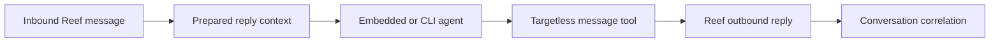

Codex review: needs maintainer review before merge. _Reviewed August 17, 2026, 9:21 AM ET / 13:21 UTC._

# ClawSweeper review

## What this changes

The PR preserves reply-mode context through embedded and CLI-backed message tools and makes Reef targetless direct replies reuse the inbound message thread.

## Regression provenance

Possible regression — probable (reproduction; reviewed change). No predecessor PR is attributed.

## Merge readiness

⚠️ **Ready for maintainer review - 4 items remain**

Keep open: current main drops the prepared reply policy before generic message tools, and this branch carries it through the embedded and CLI paths. No concrete patch defect was found, but merge readiness requires after-fix boundary proof and direct Codex-contract inspection for the PR’s Codex MCP claim.

**Priority:** P1
**Reviewed head:** `c9021a0d34ffddc0ec2aa8f66ef13d991beef80d`
**Owner decision:** Required. See [Decision needed](#decision-needed).

## Review scores

| Measure | Result | What it means |
|---|---|---|
| **Overall readiness** | 🐚 platinum hermit **(4/6)** | PR readiness rating was derived from proof quality, review findings, security review, and reviewer confidence. |
| **Proof confidence** | 🌊 off-meta tidepool | Not applicable: Real behavior proof is not required for maintainer- or bot-authored pull requests. |
| **Patch quality** | 🐚 platinum hermit **(4/6)** | No actionable review findings were identified. |

## Verification

| Check | Result | Evidence |
|---|---|---|
| **Real behavior** | Not applicable | Not applicable: Real behavior proof is not required for maintainer- or bot-authored pull requests. |
| **Evidence reviewed** | 6 items | Current-main defect path: Current main constructs generic threading context without replyToMode; the message-action sender defaults an absent mode to off, so a same-conversation targetless send cannot inherit the inbound message identifier. Owner-boundary repair: The branch supplies the prepared mode to embedded context, CLI grants, loopback request context, scoped tool resolution, and the cache key; Reef then supplies the matching inbound thread anchor only for its own transport. Existing delivery invariant: The message-action boundary only injects replyTo for the same conversation and an all/first policy, while Reef’s outbound adapter transmits both thread and reply identifiers. |
| **Findings** | None | None. |
| **Security** | None | None. |

## How this fits together

Inbound channel turns prepare a reply policy and message identity for agent tools. Message sending then uses that context to attach a transport reply identifier, which lets a waiting conversation turn recognize the response.

## Decision needed

| Question | Recommendation |
|---|---|
| Should this PR obtain exact-head Reef correlation proof before merge rather than defer the first after-fix two-agent verification until after merge? | **Require before-merge correlation proof:** Run the two-agent Reef flow on the PR head and record that the transport reply has replyToId and conversations_turn returns replied. |

Why: The repository requires boundary or live proof for delivery/session behavior, and the available evidence only demonstrates the pre-fix failure plus unit-level propagation.

## Before merge

- [ ] **Resolve merge risk (P1)** - After-fix evidence is limited to unit tests and build/check claims; it does not yet show a targetless Reef tool send carrying replyToId and yielding a correlated conversations_turn result.
- [ ] **Resolve merge risk (P1)** - The PR invokes a Codex MCP compatibility claim, but direct inspection of the required sibling Codex source was unavailable.
- [ ] **Resolve merge risk (P1)** - The bug fix has a net +46 production-line increase across context boundaries; that propagation appears necessary for explicit ownership, but it should be validated at the delivery boundary before merge.

<strong>Agent review details</strong>

### Security

None.

### PR surface

Source +46, Tests +98. Total +144 across 16 files.

View PR surface stats

| Area | Files | Added | Removed | Net |
|---|---:|---:|---:|---:|
| Source | 12 | 53 | 7 | +46 |
| Tests | 4 | 98 | 0 | +98 |
| Docs | 0 | 0 | 0 | 0 |
| Config | 0 | 0 | 0 | 0 |
| Generated | 0 | 0 | 0 | 0 |
| Other | 0 | 0 | 0 | 0 |
| **Total** | **16** | **151** | **7** | **+144** |

### Review metrics

| Metric | Value | Why it matters |
|---|---|---|
| **Production versus test delta** | production +53/-7 (net +46), tests +98/-0 | The added production lines carry one prepared policy through explicit embedded, CLI, Gateway, cache, and Reef ownership boundaries; the test growth is focused on those paths. |

### Stored data model

Persistent data-model change detected: `persistent cache schema: src/gateway/mcp-http.runtime.test.ts`. Confirm migration or upgrade compatibility proof before merge.

### Merge-risk options

**Maintainer options:**
1. **Capture end-to-end Reef proof before merge (recommended)**  
   Use the exact PR head to show a targetless same-target send receives the inbound reply and thread identifiers and the initiating conversation completes.
2. **Pause for proof**  
   Hold the branch until an authorized two-agent run or approved mock-gateway harness verifies the delivery and correlation boundary.

### Technical review

Best possible solution:

Keep reply policy explicit across the existing embedded, CLI, and loopback boundaries, then prove the exact PR head with two authorized Reef agents or the approved mock-gateway harness before merging.

Do we have a high-confidence way to reproduce the issue?

Yes, from source: current main omits replyToMode from tool context while the message-action boundary treats a missing mode as off. The supplied live pre-fix report is consistent with that path, but this review did not execute authorized Reef agents.

Is this the best way to solve the issue?

Yes, provisionally: carrying the admission-time policy through the existing context boundaries is more maintainable than inferring correlation downstream. Its real delivery and correlation effect still needs boundary proof.

AGENTS.md: found and applied where relevant.

Codex review notes: model internal, reasoning high; reviewed against [7068006c78a1](https://github.com/openclaw/openclaw/commit/7068006c78a18caaeda014c2b8d3b7c2548348e3).

### Labels

Label changes:

- add `P1`: A delivered direct-message answer can still make the synchronous conversation workflow time out, affecting agent-to-agent operation.
- add `merge-risk: 🚨 message-delivery`: The patch changes automatic reply and thread identifiers on targetless message sends.
- add `merge-risk: 🚨 session-state`: Conversation completion depends on the reply identifier propagated through the changed agent and Gateway context.
- add `rating: 🐚 platinum hermit`: Overall readiness is 🐚 platinum hermit; proof is 🌊 off-meta tidepool and patch quality is 🐚 platinum hermit.
- add `status: 👀 ready for maintainer look`: ClawSweeper has no concrete contributor-facing blocker left for this PR. Not applicable: Real behavior proof is not required for maintainer- or bot-authored pull requests.

Label justifications:

- `P1`: A delivered direct-message answer can still make the synchronous conversation workflow time out, affecting agent-to-agent operation.
- `merge-risk: 🚨 message-delivery`: The patch changes automatic reply and thread identifiers on targetless message sends.
- `merge-risk: 🚨 session-state`: Conversation completion depends on the reply identifier propagated through the changed agent and Gateway context.
- `rating: 🐚 platinum hermit`: Overall readiness is 🐚 platinum hermit; proof is 🌊 off-meta tidepool and patch quality is 🐚 platinum hermit.
- `status: 👀 ready for maintainer look`: ClawSweeper has no concrete contributor-facing blocker left for this PR. Not applicable: Real behavior proof is not required for maintainer- or bot-authored pull requests.

### Evidence

What I checked:

- **Current-main defect path:** Current main constructs generic threading context without replyToMode; the message-action sender defaults an absent mode to off, so a same-conversation targetless send cannot inherit the inbound message identifier. ([`src/auto-reply/reply/agent-runner-utils.ts:135`](https://github.com/openclaw/openclaw/blob/7068006c78a1/src/auto-reply/reply/agent-runner-utils.ts#L135), [7068006c78a1](https://github.com/openclaw/openclaw/commit/7068006c78a1))
- **Owner-boundary repair:** The branch supplies the prepared mode to embedded context, CLI grants, loopback request context, scoped tool resolution, and the cache key; Reef then supplies the matching inbound thread anchor only for its own transport. ([`src/auto-reply/reply/agent-runner-utils.ts:270`](https://github.com/openclaw/openclaw/blob/c9021a0d34ff/src/auto-reply/reply/agent-runner-utils.ts#L270), [c9021a0d34ff](https://github.com/openclaw/openclaw/commit/c9021a0d34ff))
- **Existing delivery invariant:** The message-action boundary only injects replyTo for the same conversation and an all/first policy, while Reef’s outbound adapter transmits both thread and reply identifiers. ([`src/infra/outbound/message-action-threading.ts:102`](https://github.com/openclaw/openclaw/blob/c9021a0d34ff/src/infra/outbound/message-action-threading.ts#L102), [c9021a0d34ff](https://github.com/openclaw/openclaw/commit/c9021a0d34ff))
- **Focused regression coverage:** New tests cover prepared embedded context, CLI grant propagation, cache separation, and Reef target matching; they are valuable unit-level checks but do not exercise the full send-and-correlate boundary. ([`src/auto-reply/reply/agent-runner-utils.test.ts:448`](https://github.com/openclaw/openclaw/blob/c9021a0d34ff/src/auto-reply/reply/agent-runner-utils.test.ts#L448), [c9021a0d34ff](https://github.com/openclaw/openclaw/commit/c9021a0d34ff))
- **History and likely owner:** Current-main blame attributes the surrounding threading-context construction and message-action boundary to Ayaan Zaidi’s recent runtime work; the available checkout has a grafted PR head, so deeper pre-PR history is incomplete. ([`src/auto-reply/reply/agent-runner-utils.ts:130`](https://github.com/openclaw/openclaw/blob/78b8f8cf6647/src/auto-reply/reply/agent-runner-utils.ts#L130), [78b8f8cf6647](https://github.com/openclaw/openclaw/commit/78b8f8cf6647))
- **Codex dependency-proof gap:** The PR body relies on a Codex MCP contract claim, but the required sibling ../codex checkout is absent and network resolution prevented fetching it; no direct Codex runtime verdict was made.

Likely related people:

- **Ayaan Zaidi:** Current-main blame attributes the threading-context and message-action behavior that this repair extends to Ayaan’s recent runtime work. (role: recent core runtime contributor; confidence: medium; commits: [78b8f8cf6647](https://github.com/openclaw/openclaw/commit/78b8f8cf66472690a0db84ab1add1ec392399abc); files: `src/auto-reply/reply/agent-runner-utils.ts`, `src/infra/outbound/message-action-send.ts`, `src/auto-reply/reply/reply-threading.ts`)

### Rank-up moves

Optional improvements that raise the rating; they are not merge blockers.

- Tighten the PR description with what changed, how it was validated, and any remaining risk.

### Rating scale

| Score | Internal tier | Crab rank | Meaning |
|---:|:---:|---|---|
| **6/6** | S | 🦀 challenger crab | Exceptional readiness |
| **5/6** | A | 🦞 diamond lobster | Very strong readiness |
| **4/6** | B | 🐚 platinum hermit | Good normal PR; ordinary maintainer review |
| **3/6** | C | 🦐 gold shrimp | Useful, but confidence is limited |
| **2/6** | D | 🦪 silver shellfish | Proof or implementation needs work |
| **1/6** | F | 🧂 unranked krab | Not merge-ready |
| N/A | NA | 🌊 off-meta tidepool | Rating does not apply |

Overall follows the weaker of proof and patch quality.
Shiny media proof means a screenshot, video, or linked artifact directly shows the changed behavior. Runtime, network, CSP, and security claims still need visible diagnostics.

### Workflow

- ClawSweeper keeps one durable marker-backed review comment per issue or PR.
- Re-runs edit this comment so the latest verdict, findings, and automation markers stay together instead of adding duplicate bot comments.
- A fresh review can be triggered by eligible `@clawsweeper re-review` comments, exact-item GitHub events, scheduled/background review runs, or manual workflow dispatch.
- PR/issue authors and users with repository write access can comment `@clawsweeper re-review` or `@clawsweeper re-run` on an open PR or issue to request a fresh review only.
- Maintainers can also comment `@clawsweeper review` to request a fresh review only.
- Fresh-review commands do not start repair, autofix, rebase, CI repair, or automerge.
- Maintainer-only repair and merge flows require explicit commands such as `@clawsweeper autofix`, `@clawsweeper automerge`, `@clawsweeper fix ci`, or `@clawsweeper address review`.
- Maintainers can comment `@clawsweeper explain` to ask for more context, or `@clawsweeper stop` to stop active automation.

<!-- clawsweeper-verdict:needs-human item=125283 sha=c9021a0d34ffddc0ec2aa8f66ef13d991beef80d confidence=medium updated_at=2026-08-17T13:17:56Z reviewed_at=2026-08-17T13:21:12.385Z lease_owner=github-run-32034179948-1 lease_comment_id=5316586661 source_revision=766d06b4d5a4d619c584aa95ef2983abfc3692ece7378b51f45c0618014a6e50 -->

<!-- clawsweeper-review-version item=125283 reviewed_at=2026-08-17T13:21:12.385Z sha=c9021a0d34ffddc0ec2aa8f66ef13d991beef80d source_revision=766d06b4d5a4d619c584aa95ef2983abfc3692ece7378b51f45c0618014a6e50 lease_owner=github-run-32034179948-1 lease_comment_id=5316586661 v=1 -->

<!-- clawsweeper-review item=125283 -->