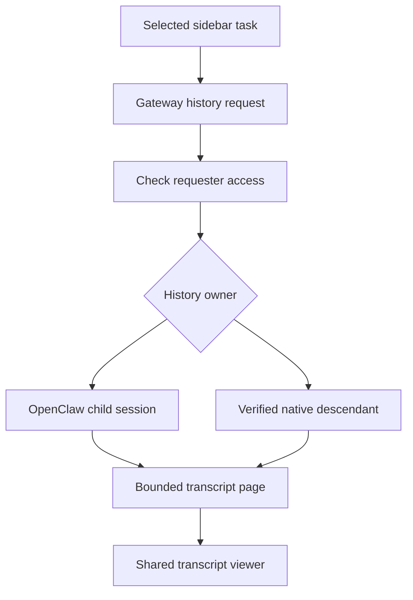

Codex review: blocked before merge. _Reviewed September 10, 2026, 2:46 AM ET / 06:46 UTC (Revision 4)._

# ClawSweeper review

## What this changes

Adds paginated subagent transcripts to the task sidebar through a shared Gateway endpoint and an optional plugin capability, with earlier-message loading, refreshes, and retries.

## Merge readiness

⛔ **Blocked before merge - 2 items remain**

The PR remains useful: current main still lacks native subagent transcript viewing. The previous message-identity finding is repaired, and this review found no remaining discrete code defect.

**Priority:** P2
**Reviewed head:** `a6fa40cf3e221a822a488a5d4dc46ef2fd63ba80`

## Review scores

| Measure | Result | What it means |
|---|---|---|
| **Overall readiness** | 🐚 platinum hermit **(4/6)** | A coherent implementation with useful visual evidence and focused regression coverage; installed native-runtime validation remains the material confidence gap. |
| **Proof confidence** | 🐚 platinum hermit **(4/6)** | Not applicable: The supplied maintainer classification exempts this PR from the ordinary external-contributor proof gate. Inspected screenshots demonstrate the changed sidebar presentation with synthetic Gateway data; they do not prove the installed Codex reader, whose live contract validation remains outstanding. |
| **Patch quality** | 🐚 platinum hermit **(4/6)** | No actionable review findings were identified. |

## Verification

| Check | Result | Evidence |
|---|---|---|
| **Real behavior** | Not applicable | Not applicable: The supplied maintainer classification exempts this PR from the ordinary external-contributor proof gate. Inspected screenshots demonstrate the changed sidebar presentation with synthetic Gateway data; they do not prove the installed Codex reader, whose live contract validation remains outstanding. |
| **Evidence reviewed** | 9 items | Current main and release still lack native viewing: Both inspected revisions require a child session key to render a subagent transcript; native children without one use the inspector. The latest release supplied in the review context is v2026.9.3. Previous finding repaired: Native projection rows now expose thread-scoped messageId values before size checks. Producer tests cover uniqueness, pagination identity, and stability across content updates. Comparison with the previous reviewed head shows only the file-link fixture changed subsequently. Authorization reaches the response boundary: Requester access is checked before dispatch and again before publication; task identity, cancellation, and registered harness replacement invalidate pending reads. Gateway tests cover foreign and incognito requesters and access changes during an awaited read. |
| **Findings** | None | None. |
| **Security** | None | None. |

## How this fits together

The Control UI task sidebar obtains history from the Gateway. The Gateway checks access and reads either an existing OpenClaw child session or the native runtime that owns the subagent.

## Before merge

- [ ] **Resolve merge risk (P1)** - Installed Codex runtime pagination through the new task endpoint remains unverified; synthetic browser evidence cannot establish that existing native bindings and both history modes work end to end.
- [ ] **Complete next step (P2)** - Complete the planned installed Codex history validation before merge and attach redacted pagination and refresh results.

<strong>Agent review details</strong>

### Security

None.

### PR surface

Source +755, Tests +1024, Docs +35, Other +45. Total +1859 across 42 files.

View PR surface stats

| Area | Files | Added | Removed | Net |
|---|---:|---:|---:|---:|
| Source | 23 | 996 | 241 | +755 |
| Tests | 15 | 1107 | 83 | +1024 |
| Docs | 2 | 35 | 0 | +35 |
| Config | 0 | 0 | 0 | 0 |
| Generated | 0 | 0 | 0 | 0 |
| Other | 2 | 45 | 0 | +45 |
| **Total** | **42** | **2183** | **324** | **+1859** |

### Review metrics

| Metric | Value | Why it matters |
|---|---|---|
| **Public contract additions** | 1 Gateway method and 1 optional harness capability | The PR body explicitly confirms the new plugin contract while preserving compatibility for plugins that omit it. |
| **Production and test growth** | Production net +800 lines; tests and test support net +1024 lines | Production growth supports bounded history routing, native projection, and sidebar pagination; tests cover access, identities, and refresh behavior. |

### Merge-risk options

**Maintainer options:**
1. **Verify the installed native path (recommended)**  
   Complete the planned native-runtime check before merge, covering existing parent bindings, older-history loading, and refreshes through tasks.history.

### Technical review

Best possible solution:

Keep the documented optional capability and shared renderer, with native-runtime compatibility verified before landing.

Do we have a high-confidence way to reproduce the issue?

Not applicable as a new native transcript capability; source inspection confirms that main currently falls back to the inspector for native children without an OpenClaw child session.

Is this the best way to solve the issue?

Yes. Reusing the existing history readers and transcript renderer avoids a second transcript store and preserves native lifecycle ownership.

AGENTS.md: found and applied where relevant.

Codex review notes: model internal, reasoning medium; reviewed against [5daa82241e14](https://github.com/openclaw/openclaw/commit/5daa82241e14ab7d651d6a9eed33c446907463b9).

### Labels

Label justifications:

- `P2`: This improves task inspection with a bounded blast radius and no demonstrated urgent runtime regression.
- `merge-risk: 🚨 compatibility`: The new plugin contract and native-history entrypoint need installed-runtime compatibility evidence beyond synthetic browser responses.
- `rating: 🐚 platinum hermit`: Overall readiness is 🐚 platinum hermit; proof is 🐚 platinum hermit and patch quality is 🐚 platinum hermit.
- `status: 👀 ready for maintainer look`: ClawSweeper has no concrete contributor-facing blocker left for this PR. Not applicable: The supplied maintainer classification exempts this PR from the ordinary external-contributor proof gate. Inspected screenshots demonstrate the changed sidebar presentation with synthetic Gateway data; they do not prove the installed Codex reader, whose live contract validation remains outstanding.
- `proof: 📸 screenshot`: Contributor real behavior proof includes screenshot evidence. The supplied maintainer classification exempts this PR from the ordinary external-contributor proof gate. Inspected screenshots demonstrate the changed sidebar presentation with synthetic Gateway data; they do not prove the installed Codex reader, whose live contract validation remains outstanding.

### Evidence

What I checked:

- **Current main and release still lack native viewing:** Both inspected revisions require a child session key to render a subagent transcript; native children without one use the inspector. The latest release supplied in the review context is v2026.9.3. ([`ui/src/pages/chat/components/chat-task-detail.ts:61`](https://github.com/openclaw/openclaw/blob/5daa82241e14ab7d651d6a9eed33c446907463b9/ui/src/pages/chat/components/chat-task-detail.ts#L61), [5daa82241e14](https://github.com/openclaw/openclaw/commit/5daa82241e14ab7d651d6a9eed33c446907463b9))
- **Previous finding repaired:** Native projection rows now expose thread-scoped messageId values before size checks. Producer tests cover uniqueness, pagination identity, and stability across content updates. Comparison with the previous reviewed head shows only the file-link fixture changed subsequently. ([`extensions/codex/src/app-server/native-subagent-history.ts:179`](https://github.com/openclaw/openclaw/blob/a6fa40cf3e221a822a488a5d4dc46ef2fd63ba80/extensions/codex/src/app-server/native-subagent-history.ts#L179), [a6fa40cf3e22](https://github.com/openclaw/openclaw/commit/a6fa40cf3e221a822a488a5d4dc46ef2fd63ba80))
- **Authorization reaches the response boundary:** Requester access is checked before dispatch and again before publication; task identity, cancellation, and registered harness replacement invalidate pending reads. Gateway tests cover foreign and incognito requesters and access changes during an awaited read. ([`src/gateway/server-methods/task-history.ts:89`](https://github.com/openclaw/openclaw/blob/a6fa40cf3e221a822a488a5d4dc46ef2fd63ba80/src/gateway/server-methods/task-history.ts#L89), [a6fa40cf3e22](https://github.com/openclaw/openclaw/commit/a6fa40cf3e221a822a488a5d4dc46ef2fd63ba80))
- **Native lineage and final transport guards:** The reader verifies the physical parent session, binding connection, and bounded ancestor chain before requesting transcript items. Its assertCurrent callback reaches the transport's synchronous pre-write guard and is checked again after reads. ([`extensions/codex/src/app-server/native-subagent-history.ts:80`](https://github.com/openclaw/openclaw/blob/a6fa40cf3e221a822a488a5d4dc46ef2fd63ba80/extensions/codex/src/app-server/native-subagent-history.ts#L80), [a6fa40cf3e22](https://github.com/openclaw/openclaw/commit/a6fa40cf3e221a822a488a5d4dc46ef2fd63ba80))
- **Affirmative Codex dependency signal:** The introduced reader directly calls thread/read, thread/items/list, and thread/turns/list, making the Codex runtime contract applicable to this review. ([`extensions/codex/src/app-server/native-subagent-history.ts:124`](https://github.com/openclaw/openclaw/blob/a6fa40cf3e221a822a488a5d4dc46ef2fd63ba80/extensions/codex/src/app-server/native-subagent-history.ts#L124), [a6fa40cf3e22](https://github.com/openclaw/openclaw/commit/a6fa40cf3e221a822a488a5d4dc46ef2fd63ba80))
- **Dependency source inspected directly:** The dependency cache's configured upstream verifies openai/codex ownership. Inspected Rust implementation forwards item ordering and native cursors, and legacy turn pagination supports inclusive anchors; the protocol identifies parentThreadId as subagent lineage. ([`codex-rs/app-server/src/request_processors/thread_processor.rs:3385`](https://github.com/openai/codex/blob/3d2ee51ca2d5db578f328aa75e20aa22c0197c9a/codex-rs/app-server/src/request_processors/thread_processor.rs#L3385), [3d2ee51ca2d5](https://github.com/openai/codex/commit/3d2ee51ca2d5db578f328aa75e20aa22c0197c9a))

Likely related people:

- **steipete:** Suggested for follow-up; no historical authorship or introduction is verified. (role: unverified routing candidate; confidence: low)
- **goslingmanagment:** Suggested for follow-up; no historical authorship or introduction is verified. (role: unverified routing candidate; confidence: low)

### Rank-up moves

Optional improvements that raise the rating; they are not merge blockers.

- Attach redacted native-runtime output showing tasks.history pagination and refreshes through an existing parent binding before merge.

### Rating scale

| Score | Internal tier | Crab rank | Meaning |
|---:|:---:|---|---|
| **6/6** | S | 🦀 challenger crab | Exceptional readiness |
| **5/6** | A | 🦞 diamond lobster | Very strong readiness |
| **4/6** | B | 🐚 platinum hermit | Good normal PR; ordinary maintainer review |
| **3/6** | C | 🦐 gold shrimp | Useful, but confidence is limited |
| **2/6** | D | 🦪 silver shellfish | Proof or implementation needs work |
| **1/6** | F | 🧂 unranked krab | Not merge-ready |
| N/A | NA | 🌊 off-meta tidepool | Rating does not apply |

Overall follows the weaker of proof and patch quality.
Shiny media proof means a screenshot, video, or linked artifact directly shows the changed behavior. Runtime, network, CSP, and security claims still need visible diagnostics.

### Workflow

- ClawSweeper keeps one durable marker-backed review comment per issue or PR.
- Re-runs edit this comment so the latest verdict, findings, and automation markers stay together instead of adding duplicate bot comments.
- A fresh review can be triggered by eligible `@clawsweeper re-review` comments, exact-item GitHub events, scheduled/background review runs, or manual workflow dispatch.
- PR/issue authors and users with repository write access can comment `@clawsweeper re-review` or `@clawsweeper re-run` on an open PR or issue to request a fresh review only.
- Maintainers can also comment `@clawsweeper review` to request a fresh review only.
- Fresh-review commands do not start repair, autofix, rebase, CI repair, or automerge.
- Maintainer-only repair and merge flows require explicit commands such as `@clawsweeper autofix`, `@clawsweeper automerge`, `@clawsweeper fix ci`, or `@clawsweeper address review`.
- Maintainers can comment `@clawsweeper explain` to ask for more context, or `@clawsweeper stop` to stop active automation.

### History

Review history (3 earlier review cycles)

<!-- clawsweeper-review-history v=1 total=3 -->
- reviewed 2026-09-10T06:03:18.188Z sha 60a516abc7f536a252ad0baeaa224d0b3238e567 :: blocked before merge. :: [P2] Emit shared message identities for native history
- reviewed 2026-09-10T06:17:38.850Z sha abb85c8c2a7113ced25560db0da4278ee06c9d28 :: blocked before merge. :: [P2] Emit shared message identities for native history
- reviewed 2026-09-10T06:29:07.694Z sha 1bef0f8152264a51b320189854030c9bc0feba3f :: blocked before merge. :: none

<!-- clawsweeper-verdict:needs-human item=143747 sha=a6fa40cf3e221a822a488a5d4dc46ef2fd63ba80 confidence=high updated_at=2026-09-10T06:43:19Z reviewed_at=2026-09-10T06:46:06.423Z lease_owner=github-run-34446344242-1 lease_comment_id=5614319356 source_revision=c600c848658480b372dd05e09cfad2a00567740daf27921460def936179cd4c2 live_verification=absent -->
<!-- clawsweeper-review-state:blocked item=143747 sha=a6fa40cf3e221a822a488a5d4dc46ef2fd63ba80 v=1 -->

<!-- clawsweeper-review-version item=143747 reviewed_at=2026-09-10T06:46:06.423Z sha=a6fa40cf3e221a822a488a5d4dc46ef2fd63ba80 source_revision=c600c848658480b372dd05e09cfad2a00567740daf27921460def936179cd4c2 lease_owner=github-run-34446344242-1 lease_comment_id=5614319356 v=1 -->

<!-- clawsweeper-review item=143747 -->