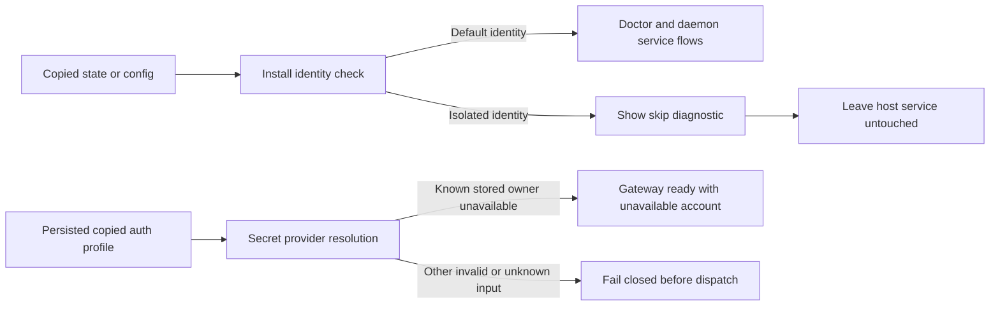

Codex review: needs maintainer review before merge. _Reviewed July 29, 2026, 11:05 AM ET / 15:05 UTC._

# ClawSweeper review

## What this changes

The branch makes Doctor and daemon service management skip copied or otherwise non-default OpenClaw state/config identities, while allowing a known copied auth-store account with an omitted SecretRef provider to start as configured-unavailable instead of aborting Gateway startup.

## Merge readiness

⚠️ **Ready for maintainer review - 3 items remain**

Keep this PR open for normal maintainer handling. The focused patch appears correct: it puts the copied-install boundary ahead of Doctor service inspection and shared daemon mutation, and the copied-auth exception stays limited to persisted known-owner assignments. The contributor’s updated PR body and follow-up comment provide redacted after-fix CLI results plus real Gateway-readiness coverage, so the prior proof blocker is cleared; the remaining compatibility and auth-provider behavior is explicitly accepted in the supplied maintainer work order.

**Priority:** P1
**Reviewed head:** `c5ef839bb79a46e46e27dbd10ce4f9e0466e16ff`

## Review scores

| Measure | Result | What it means |
|---|---|---|
| **Overall readiness** | 🐚 platinum hermit **(4/6)** | A focused, well-covered repair with real after-fix operator evidence; normal maintainer merge review remains appropriate because it deliberately changes service and auth-provider compatibility behavior. |
| **Proof confidence** | 🐚 platinum hermit **(4/6)** | Sufficient (live_output): The updated PR body and contributor follow-up provide redacted after-fix real CLI results for isolated Doctor behavior and report real Gateway `/readyz` readiness for the copied-auth case; the results directly cover the changed operator outcomes. |
| **Patch quality** | 🦞 diamond lobster **(5/6)** | No actionable review findings were identified. |

## Verification

| Check | Result | Evidence |
|---|---|---|
| **Real behavior** | Verified | Sufficient (live_output): The updated PR body and contributor follow-up provide redacted after-fix real CLI results for isolated Doctor behavior and report real Gateway `/readyz` readiness for the copied-auth case; the results directly cover the changed operator outcomes. |
| **Evidence reviewed** | 5 items | Service-boundary coverage: The branch introduces one default-install identity predicate and uses it both before Doctor Gateway service work and inside the shared assertion used by daemon install/start-repair paths, covering diagnostic and mutation seams rather than only one caller. Host-service mutation guard: The shared Gateway-supervision assertion rejects non-default state/config identities with recovery guidance, while the Doctor flows return before service inspection or rewrite work. Auth degradation stays narrow: The new not-configured provider code is mapped to configured-unavailable only for auth-store assignments with an identified owner; the PR’s tests cover copied-store readiness and provider dispatch remaining blocked for the unavailable account. |
| **Findings** | None | None. |
| **Security** | None | None. |

## How this fits together

Doctor health flows inspect, repair, install, and restart the local Gateway’s OS-managed service; this patch prevents an isolated copy from modifying that host-level service. During Gateway startup, secrets runtime resolves persisted auth profiles, so the patch also determines when a missing provider degrades one stored account rather than preventing readiness for the entire Gateway.

## Before merge

- [ ] **Resolve merge risk (P1)** - This intentionally changes existing non-default state/config installations from being able to inspect, install, repair, or restart native Gateway services to receiving a skip diagnostic; maintainers should land only the reviewed merge result and retain the explicit default-install ownership rule.
- [ ] **Resolve merge risk (P1)** - A persisted copied auth-store profile with an omitted provider now permits Gateway readiness as an unavailable account; the source/owner restrictions are tested, but this remains a compatibility-sensitive provider-startup policy.
- [ ] **Complete next step (P2)** - The patch has no discrete automated repair finding, but the protected maintainer label and intentional compatibility policy require a maintainer to approve the refreshed merge result.

<strong>Agent review details</strong>

### Security

None.

### PR surface

Source +127, Tests +293. Total +420 across 27 files.

View PR surface stats

| Area | Files | Added | Removed | Net |
|---|---:|---:|---:|---:|
| Source | 13 | 147 | 20 | +127 |
| Tests | 14 | 295 | 2 | +293 |
| Docs | 0 | 0 | 0 | 0 |
| Config | 0 | 0 | 0 | 0 |
| Generated | 0 | 0 | 0 | 0 |
| Other | 0 | 0 | 0 | 0 |
| **Total** | **27** | **442** | **22** | **+420** |

### Review metrics

None.

### Stored data model

Persistent data-model change detected: `migration/backfill/repair: src/cli/daemon-cli/start-repair.ts`, `migration/backfill/repair: src/commands/doctor-gateway-services.test.ts`, `migration/backfill/repair: src/commands/doctor-update.test.ts`, `migration/backfill/repair: src/flows/doctor-health-contributions.test.ts`, `unknown-data-model-change: src/commands/doctor-gateway-daemon-flow.test.ts`, `unknown-data-model-change: src/commands/doctor-gateway-services.ts`. Confirm migration or upgrade compatibility proof before merge.

### Merge-risk options

**Maintainer options:**
1. **Refresh the exact merge result (recommended)**  
   Rebase or otherwise refresh this clean-but-behind branch, then require the normal exact-head checks so the accepted isolation rule is evaluated with current main.
2. **Accept the explicit policy change**  
   Maintainers may land the reviewed boundary knowing that isolated state/config identities no longer manage the OS account’s native Gateway service and known copied auth-store owners may start unavailable.

### Technical review

Best possible solution:

Land the single install-identity policy only after refreshing the branch against current main and confirming the exact merge-result checks; preserve fail-closed handling for config-owned, invalid, mismatched, and unknown-owner SecretRef failures.

Do we have a high-confidence way to reproduce the issue?

Yes for source reproduction: copied state/config overrides reach the Doctor and daemon service seams, while the proposed tests and reported real CLI run exercise the isolated identity and unchanged-host-service result. I did not independently execute the destructive service scenario in this read-only review.

Is this the best way to solve the issue?

Yes. One canonical install-identity predicate shared by Doctor early exits and daemon mutation guards is the narrowest durable service-ownership fix, and the auth exception is constrained to persisted known-owner assignments rather than broadening missing-provider fallback behavior.

AGENTS.md: found and applied where relevant.

Codex review notes: model internal, reasoning high; reviewed against [5fa8c4a4e5c7](https://github.com/openclaw/openclaw/commit/5fa8c4a4e5c7e048f86ecc86e24dc83f33035178).

### Labels

Label changes:

- add `proof: sufficient`: Contributor real behavior proof is sufficient. The updated PR body and contributor follow-up provide redacted after-fix real CLI results for isolated Doctor behavior and report real Gateway `/readyz` readiness for the copied-auth case; the results directly cover the changed operator outcomes.
- add `rating: 🐚 platinum hermit`: Overall readiness is 🐚 platinum hermit; proof is 🐚 platinum hermit and patch quality is 🦞 diamond lobster.
- add `status: 👀 ready for maintainer look`: ClawSweeper has no concrete contributor-facing blocker left for this PR. Sufficient (live_output): The updated PR body and contributor follow-up provide redacted after-fix real CLI results for isolated Doctor behavior and report real Gateway `/readyz` readiness for the copied-auth case; the results directly cover the changed operator outcomes.
- remove `rating: 🧂 unranked krab`: Current PR rating is `rating: 🐚 platinum hermit`, so this older rating label is no longer current.
- remove `status: 📣 needs proof`: Current PR status label is `status: 👀 ready for maintainer look`.

Label justifications:

- `P1`: A copied-install Doctor run could otherwise rewrite or interrupt a real operator Gateway service, affecting an active core workflow.
- `merge-risk: 🚨 compatibility`: The new default-install predicate changes native service-management behavior for existing non-default state or config path setups.
- `merge-risk: 🚨 auth-provider`: Known persisted auth-store profiles with an omitted SecretRef provider receive a new degraded-startup outcome.
- `rating: 🐚 platinum hermit`: Overall readiness is 🐚 platinum hermit; proof is 🐚 platinum hermit and patch quality is 🦞 diamond lobster.
- `status: 👀 ready for maintainer look`: ClawSweeper has no concrete contributor-facing blocker left for this PR. Sufficient (live_output): The updated PR body and contributor follow-up provide redacted after-fix real CLI results for isolated Doctor behavior and report real Gateway `/readyz` readiness for the copied-auth case; the results directly cover the changed operator outcomes.
- `proof: sufficient`: Contributor real behavior proof is sufficient. The updated PR body and contributor follow-up provide redacted after-fix real CLI results for isolated Doctor behavior and report real Gateway `/readyz` readiness for the copied-auth case; the results directly cover the changed operator outcomes.

### Evidence

What I checked:

- **Service-boundary coverage:** The branch introduces one default-install identity predicate and uses it both before Doctor Gateway service work and inside the shared assertion used by daemon install/start-repair paths, covering diagnostic and mutation seams rather than only one caller. ([`src/config/paths.ts:119`](https://github.com/openclaw/openclaw/blob/c5ef839bb79a/src/config/paths.ts#L119), [c5ef839bb79a](https://github.com/openclaw/openclaw/commit/c5ef839bb79a))
- **Host-service mutation guard:** The shared Gateway-supervision assertion rejects non-default state/config identities with recovery guidance, while the Doctor flows return before service inspection or rewrite work. ([`src/infra/gateway-supervision.ts:39`](https://github.com/openclaw/openclaw/blob/c5ef839bb79a/src/infra/gateway-supervision.ts#L39), [c5ef839bb79a](https://github.com/openclaw/openclaw/commit/c5ef839bb79a))
- **Auth degradation stays narrow:** The new not-configured provider code is mapped to configured-unavailable only for auth-store assignments with an identified owner; the PR’s tests cover copied-store readiness and provider dispatch remaining blocked for the unavailable account. ([`src/secrets/runtime-owner-assignments.ts:85`](https://github.com/openclaw/openclaw/blob/c5ef839bb79a/src/secrets/runtime-owner-assignments.ts#L85), [c5ef839bb79a](https://github.com/openclaw/openclaw/commit/c5ef839bb79a))
- **After-fix real behavior proof:** The updated PR body and follow-up comment report a real CLI run against a new isolated state/config identity: doctor exited successfully, emitted the skip message, left the host plist unchanged, and left the existing listener unchanged. They also report a real Gateway `/readyz` run for the copied auth-store path. ([c5ef839bb79a](https://github.com/openclaw/openclaw/commit/c5ef839bb79a))
- **Current-main and history check:** The supplied current-main SHA is 5fa8c4a4e5c7e048f86ecc86e24dc83f33035178, distinct from this open branch head. GitHub history for the central paths shows steipete repeatedly maintaining state/config-path behavior, including the prior isolated-gateway work and its revert. ([`src/config/paths.ts:119`](https://github.com/openclaw/openclaw/blob/c5ef839bb79a/src/config/paths.ts#L119), [c5ef839bb79a](https://github.com/openclaw/openclaw/commit/c5ef839bb79a))

Likely related people:

- **steipete:** Current and historical path/config work repeatedly attributes isolation, state-directory, and Gateway-path behavior to this contributor; the same person authored the proposed boundary repair. (role: recent area contributor; confidence: high; commits: [34b18ea](https://github.com/openclaw/openclaw/commit/34b18ea), [7b172d6](https://github.com/openclaw/openclaw/commit/7b172d6), [96f0983](https://github.com/openclaw/openclaw/commit/96f0983); files: `src/config/paths.ts`, `src/infra/gateway-supervision.ts`, `src/commands/doctor-gateway-services.ts`)
- **PerfectPan:** Git history records a recent shared Gateway state-directory path fix with steipete, making this contributor a relevant adjacent routing candidate for identity/path semantics. (role: adjacent contributor; confidence: medium; commits: [2e5be0c](https://github.com/openclaw/openclaw/commit/2e5be0c); files: `src/config/paths.ts`)
- **vincentkoc:** Recent refactor history on the central path module provides an additional current-main contact for changes affecting its helper boundaries. (role: recent adjacent contributor; confidence: medium; commits: [1b6f3e4](https://github.com/openclaw/openclaw/commit/1b6f3e4), [0771ac8](https://github.com/openclaw/openclaw/commit/0771ac8); files: `src/config/paths.ts`)

### Rank-up moves

Optional improvements that raise the rating; they are not merge blockers.

- Refresh the exact merge result and required checks after the branch’s behind-main drift is resolved.

### Rating scale

| Score | Internal tier | Crab rank | Meaning |
|---:|:---:|---|---|
| **6/6** | S | 🦀 challenger crab | Exceptional readiness |
| **5/6** | A | 🦞 diamond lobster | Very strong readiness |
| **4/6** | B | 🐚 platinum hermit | Good normal PR; ordinary maintainer review |
| **3/6** | C | 🦐 gold shrimp | Useful, but confidence is limited |
| **2/6** | D | 🦪 silver shellfish | Proof or implementation needs work |
| **1/6** | F | 🧂 unranked krab | Not merge-ready |
| N/A | NA | 🌊 off-meta tidepool | Rating does not apply |

Overall follows the weaker of proof and patch quality.
Shiny media proof means a screenshot, video, or linked artifact directly shows the changed behavior. Runtime, network, CSP, and security claims still need visible diagnostics.

### Workflow

- ClawSweeper keeps one durable marker-backed review comment per issue or PR.
- Re-runs edit this comment so the latest verdict, findings, and automation markers stay together instead of adding duplicate bot comments.
- A fresh review can be triggered by eligible `@clawsweeper re-review` comments, exact-item GitHub events, scheduled/background review runs, or manual workflow dispatch.
- PR/issue authors and users with repository write access can comment `@clawsweeper re-review` or `@clawsweeper re-run` on an open PR or issue to request a fresh review only.
- Maintainers can also comment `@clawsweeper review` to request a fresh review only.
- Fresh-review commands do not start repair, autofix, rebase, CI repair, or automerge.
- Maintainer-only repair and merge flows require explicit commands such as `@clawsweeper autofix`, `@clawsweeper automerge`, `@clawsweeper fix ci`, or `@clawsweeper address review`.
- Maintainers can comment `@clawsweeper explain` to ask for more context, or `@clawsweeper stop` to stop active automation.

### History

Review history (4 earlier review cycles)

<!-- clawsweeper-review-history v=1 total=4 -->
- reviewed 2026-07-29T13:51:09.107Z sha 955bf55b8a46a4f2b74ac2acbbe53785f147217b :: needs real behavior proof before merge. :: none
- reviewed 2026-07-29T14:10:57.067Z sha 2c96efbc0caf1bc5b0bb3124f1e57dba83644190 :: needs real behavior proof before merge. :: none
- reviewed 2026-07-29T14:25:21.128Z sha ce8a1ff9f023cbfa4d21eb1d8d7c9b5bc96ca164 :: needs real behavior proof before merge. :: none
- reviewed 2026-07-29T14:45:20.961Z sha c5ef839bb79a46e46e27dbd10ce4f9e0466e16ff :: needs real behavior proof before merge. :: none

<!-- clawsweeper-verdict:needs-human item=115922 sha=c5ef839bb79a46e46e27dbd10ce4f9e0466e16ff confidence=high updated_at=2026-07-29T15:03:27Z reviewed_at=2026-07-29T15:05:08.657Z lease_owner=github-run-30463861571-1 lease_comment_id=5119630476 source_revision=b55429bdb5411d4e0413e4917243264db049f09ada3f86f8e135d0a3c3793f7a -->

<!-- clawsweeper-review-version item=115922 reviewed_at=2026-07-29T15:05:08.657Z sha=c5ef839bb79a46e46e27dbd10ce4f9e0466e16ff source_revision=b55429bdb5411d4e0413e4917243264db049f09ada3f86f8e135d0a3c3793f7a lease_owner=github-run-30463861571-1 lease_comment_id=5119630476 v=1 -->

<!-- clawsweeper-review item=115922 -->