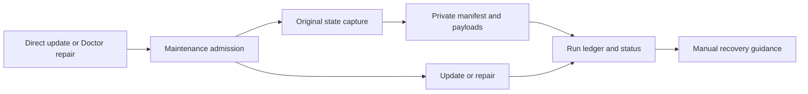

Codex review: blocked before merge. _Reviewed September 29, 2026, 12:07 PM ET / 16:07 UTC (Revision 12)._

# ClawSweeper review

## What this changes

Direct updates and standalone Doctor repairs retain original configuration, SQLite databases, and declared resources, then report capture status and deferred HTTP tracing through the CLI.

## Merge readiness

⛔ **Blocked before merge - 3 items remain**

Keep open: current main lacks the direct original-state capture path, and this branch has evidence of the intended update behavior. One confirmed recovery-status guidance defect remains before merge.

**Priority:** P1
**Reviewed head:** `e00db124b77c4266c35a9b487279d2278c51bb3c`

## Review scores

| Measure | Result | What it means |
|---|---|---|
| **Overall readiness** | 🦐 gold shrimp **(3/6)** | The central behavior has substantial installed-path evidence, but the confirmed status-guidance defect keeps the patch below merge-ready quality. |
| **Proof confidence** | 🦞 diamond lobster **(5/6)** | Sufficient (live_output): The installed CLI scenarios described in the PR body exercise the production update and Doctor capture path and report retained original bytes, history, and status after a refusal. Their source identities precede the final head; the final dry-run notice has focused CLI-test evidence rather than another installed run. No stored-data format change requires migration. |
| **Patch quality** | 🦐 gold shrimp **(3/6)** | 1 actionable review finding remain. |

## Verification

| Check | Result | Evidence |
|---|---|---|
| **Real behavior** | Verified | Sufficient (live_output): The installed CLI scenarios described in the PR body exercise the production update and Doctor capture path and report retained original bytes, history, and status after a refusal. Their source identities precede the final head; the final dry-run notice has focused CLI-test evidence rather than another installed run. No stored-data format change requires migration. |
| **Evidence reviewed** | 8 items | Current main lacks the direct capture entry point: The current-main update command enters initialization only when state needs initialization; the PR adds a separate direct-update capture path. A search of current-main update and Doctor sources found no new baseline-capture entry point. Introduced capture path: The PR-head command selects direct invocations for original capture and passes that decision to initialization before the admitted update runs. Prior finding remains on this head: For an unresolved sealed capture, the inspector sets nextAction to the same status command that renders the row; the existing recovery test asserts this value. The prior completed ClawSweeper review identified the same defect at this exact head. |
| **Findings** | 1 actionable finding | [P2] Give unresolved captures a useful recovery action |
| **Security** | None | None. |

## How this fits together

The installed updater and Doctor receive the selected installation, configuration, and state directories. They retain recovery evidence before repair or update work, record the outcome, and present it through update status.

## Before merge

- [ ] **Give unresolved captures a useful recovery action (P2)** - When a failed run has one sealed unresolved capture, this sets `nextAction` to `openclaw update status --json`. Text and JSON status then direct the user back to the command that produced the same row, without a recovery step. Provide safe guidance for preserving current state and inspecting the retained capture, and assert both outputs.
- [ ] **Complete next step (P2)** - Replace the self-referential action for unresolved captures with safe manual recovery guidance, and assert text and JSON status output.
- [ ] **Add data-model compatibility proof** - Confirm migration or upgrade compatibility proof before merge.

## Findings

- [P2] Give unresolved captures a useful recovery action — `src/infra/update-recovery-backup-status.ts:98`

<strong>Agent review details</strong>

### Security

None.

### PR surface

Source +1433, Tests +1114, Docs +36, Other +1. Total +2584 across 63 files.

View PR surface stats

| Area | Files | Added | Removed | Net |
|---|---:|---:|---:|---:|
| Source | 40 | 2237 | 804 | +1433 |
| Tests | 21 | 1291 | 177 | +1114 |
| Docs | 1 | 36 | 0 | +36 |
| Config | 0 | 0 | 0 | 0 |
| Generated | 0 | 0 | 0 | 0 |
| Other | 1 | 1 | 0 | +1 |
| **Total** | **63** | **3565** | **981** | **+2584** |

### Review metrics

| Metric | Value | Why it matters |
|---|---|---|
| **Production and test LOC** | production +2571/-827; tests +957/-154; other +37 | The stated capture and reader ownership work explains the substantial production growth, which merits focused boundary review. |

### Stored data model

Persistent data-model change detected: `migration/backfill/repair: src/cli/update-cli/update-command-fresh-doctor.ts`, `migration/backfill/repair: src/cli/update-cli/update-command-initialization-types.ts`, `migration/backfill/repair: src/cli/update-cli/update-command-run.ts`, `migration/backfill/repair: src/commands/doctor-maintenance-admission.ts`, `migration/backfill/repair: src/commands/doctor-maintenance-inspection.ts`, `migration/backfill/repair: src/commands/doctor-maintenance-state.ts`, and 5 more. Confirm migration or upgrade compatibility proof before merge.

### Technical review

Best possible solution:

Keep the private capture and existing recovery owner, and give unresolved sets a safe manual path to preserve current state and inspect the retained manifest and payloads.

Do we have a high-confidence way to reproduce the issue?

Yes. On this PR head, a failed run with one sealed unresolved capture deterministically emits the same status command as its next action; the existing test asserts that value. This read-only review did not execute the test.

Is this the best way to solve the issue?

No. The capture boundary is appropriate, but unresolved recovery status needs safe inspection guidance rather than a command that repeats the same output.

Full review comments:

- [P2] Give unresolved captures a useful recovery action — `src/infra/update-recovery-backup-status.ts:98`
  When a failed run has one sealed unresolved capture, this sets `nextAction` to `openclaw update status --json`. Text and JSON status then direct the user back to the command that produced the same row, without a recovery step. Provide safe guidance for preserving current state and inspecting the retained capture, and assert both outputs.
  Confidence: 0.96

Overall correctness: patch is incorrect
Overall confidence: 0.92

AGENTS.md: found and applied where relevant.

Codex review notes: model internal, reasoning high; reviewed against [42700f9d92dc](https://github.com/openclaw/openclaw/commit/42700f9d92dc8bc127ba31c634d90230b9b2b18e).

### Labels

Label changes:

No label changes.

Label justifications:

- `P1`: Preserving recoverable state during real update failures is an urgent existing user workflow.
- `merge-risk: 🚨 compatibility`: Configured HTTP tracing remains disabled in the updater process; the discussion explicitly accepts that limitation with a visible notice.
- `rating: 🦐 gold shrimp`: Overall readiness is 🦐 gold shrimp; proof is 🦞 diamond lobster and patch quality is 🦐 gold shrimp.
- `status: ⏳ waiting on author`: ClawSweeper has contributor-facing work open and is waiting for author action. Sufficient (live_output): The installed CLI scenarios described in the PR body exercise the production update and Doctor capture path and report retained original bytes, history, and status after a refusal. Their source identities precede the final head; the final dry-run notice has focused CLI-test evidence rather than another installed run. No stored-data format change requires migration.
- `proof: sufficient`: Contributor real behavior proof is sufficient. The installed CLI scenarios described in the PR body exercise the production update and Doctor capture path and report retained original bytes, history, and status after a refusal. Their source identities precede the final head; the final dry-run notice has focused CLI-test evidence rather than another installed run. No stored-data format change requires migration.

### Evidence

Acceptance criteria:

- [P1] node scripts/run-vitest.mjs src/cli/update-cli/status.recovery.test.ts --maxWorkers=1.
- [P1] node scripts/check-changed.mjs --dry-run -- src/infra/update-recovery-backup-status.ts src/cli/update-cli/status.recovery.test.ts.
- [P1] git diff --check.

What I checked:

- **Current main lacks the direct capture entry point:** The current-main update command enters initialization only when state needs initialization; the PR adds a separate direct-update capture path. A search of current-main update and Doctor sources found no new baseline-capture entry point. ([`src/cli/update-cli/update-command.ts:105`](https://github.com/openclaw/openclaw/blob/42700f9d92dc8bc127ba31c634d90230b9b2b18e/src/cli/update-cli/update-command.ts#L105), [42700f9d92dc](https://github.com/openclaw/openclaw/commit/42700f9d92dc8bc127ba31c634d90230b9b2b18e))
- **Introduced capture path:** The PR-head command selects direct invocations for original capture and passes that decision to initialization before the admitted update runs. ([`src/cli/update-cli/update-command.ts:115`](https://github.com/openclaw/openclaw/blob/e00db124b77c4266c35a9b487279d2278c51bb3c/src/cli/update-cli/update-command.ts#L115), [e00db124b77c](https://github.com/openclaw/openclaw/commit/e00db124b77c4266c35a9b487279d2278c51bb3c))
- **Prior finding remains on this head:** For an unresolved sealed capture, the inspector sets nextAction to the same status command that renders the row; the existing recovery test asserts this value. The prior completed ClawSweeper review identified the same defect at this exact head. ([`src/infra/update-recovery-backup-status.ts:98`](https://github.com/openclaw/openclaw/blob/e00db124b77c4266c35a9b487279d2278c51bb3c/src/infra/update-recovery-backup-status.ts#L98), [e00db124b77c](https://github.com/openclaw/openclaw/commit/e00db124b77c4266c35a9b487279d2278c51bb3c))
- **Status renders the repeated action:** Text output prints each recovery set's nextAction; JSON output includes that same field. ([`src/cli/update-cli/status.ts:423`](https://github.com/openclaw/openclaw/blob/e00db124b77c4266c35a9b487279d2278c51bb3c/src/cli/update-cli/status.ts#L423), [e00db124b77c](https://github.com/openclaw/openclaw/commit/e00db124b77c4266c35a9b487279d2278c51bb3c))
- **Qualified installed behavior evidence:** The PR body records an installed-CLI metadata-refusal scenario built from 1904ffc8: the prior history row and original payloads were retained, the failed run was recorded, and status reported it. The linked Testbox workflow is cancelled and exposes no artifact through the available read, so its overall conclusion is not a passing CI claim. Later head changes are described separately in the body. ([1904ffc8543f](https://github.com/openclaw/openclaw/commit/1904ffc8543f4b840e37b8808944bc7ce0535abe))
- **Accepted tracing tradeoff:** The PR discussion explicitly retains updater-parent HTTP tracing deferral with a visible notice; the head documents that limitation and reports it during dry runs. Public docs: [`docs/cli/update/repair-and-recovery.md`](https://docs.openclaw.ai/cli/update/repair-and-recovery). ([`docs/cli/update/repair-and-recovery.md:118`](https://docs.openclaw.ai/cli/update/repair-and-recovery), [e00db124b77c](https://github.com/openclaw/openclaw/commit/e00db124b77c4266c35a9b487279d2278c51bb3c))

Likely related people:

- **steipete:** Suggested for follow-up; no historical authorship or introduction is verified. (role: unverified routing candidate; confidence: low)
- **fuller-stack-dev:** Suggested for follow-up; no historical authorship or introduction is verified. (role: unverified routing candidate; confidence: low)

### Rank-up moves

Optional improvements that raise the rating; they are not merge blockers.

- Replace the unresolved-set action with safe recovery guidance and assert the emitted text and JSON.

### Rating scale

| Score | Internal tier | Crab rank | Meaning |
|---:|:---:|---|---|
| **6/6** | S | 🦀 challenger crab | Exceptional readiness |
| **5/6** | A | 🦞 diamond lobster | Very strong readiness |
| **4/6** | B | 🐚 platinum hermit | Good normal PR; ordinary maintainer review |
| **3/6** | C | 🦐 gold shrimp | Useful, but confidence is limited |
| **2/6** | D | 🦪 silver shellfish | Proof or implementation needs work |
| **1/6** | F | 🧂 unranked krab | Not merge-ready |
| N/A | NA | 🌊 off-meta tidepool | Rating does not apply |

Overall follows the weaker of proof and patch quality.
Shiny media proof means a screenshot, video, or linked artifact directly shows the changed behavior. Runtime, network, CSP, and security claims still need visible diagnostics.

### Workflow

- ClawSweeper keeps one durable marker-backed review comment per issue or PR.
- Re-runs edit this comment so the latest verdict, findings, and automation markers stay together instead of adding duplicate bot comments.
- A fresh review can be triggered by eligible `@clawsweeper re-review` comments, exact-item GitHub events, scheduled/background review runs, or manual workflow dispatch.
- PR/issue authors and users with repository write access can comment `@clawsweeper re-review` or `@clawsweeper re-run` on an open PR or issue to request a fresh review only.
- Maintainers can also comment `@clawsweeper review` to request a fresh review only.
- Fresh-review commands do not start repair, autofix, rebase, CI repair, or automerge.
- Maintainer-only repair and merge flows require explicit commands such as `@clawsweeper autofix`, `@clawsweeper automerge`, `@clawsweeper fix ci`, or `@clawsweeper address review`.
- Maintainers can comment `@clawsweeper explain` to ask for more context, or `@clawsweeper stop` to stop active automation.

### History

Review history (11 earlier review cycles; latest 8 shown)

<!-- clawsweeper-review-history v=1 total=11 -->
- reviewed 2026-09-29T10:02:46.595Z sha a4a9e9502fc5b817537bda704e2134898edcaa4e :: blocked before merge. :: none
- reviewed 2026-09-29T10:43:59.269Z sha 3f94b667dfa63bcc8a33ece886cd61f6f4717e0d :: blocked before merge. :: none
- reviewed 2026-09-29T11:02:49.764Z sha 3f94b667dfa63bcc8a33ece886cd61f6f4717e0d :: needs changes before merge. :: [P1] [P1] Preserve history for refusals before capture starts | [P2] [P2] Accept successful preflight steps in metadata assertions
- reviewed 2026-09-29T12:40:16.090Z sha 1904ffc8543f4b840e37b8808944bc7ce0535abe :: blocked before merge. :: none
- reviewed 2026-09-29T13:01:55.723Z sha dd1f009d230ca437e734c91af592a02e8390c053 :: blocked before merge. :: [P2] Report disabled HTTP tracing for dry-run updates
- reviewed 2026-09-29T13:49:44.016Z sha dd1f009d230ca437e734c91af592a02e8390c053 :: blocked before merge. :: [P2] Report tracing deferral on dry-run updates | [P2] Give unresolved recovery sets an actionable next step
- reviewed 2026-09-29T15:35:20.811Z sha e00db124b77c4266c35a9b487279d2278c51bb3c :: needs changes before merge. :: [P2] Give unresolved captures a useful recovery action
- reviewed 2026-09-29T15:51:28.343Z sha e00db124b77c4266c35a9b487279d2278c51bb3c :: needs changes before merge. :: [P2] Give unresolved captures a useful recovery action

<!-- clawsweeper-verdict:needs-human item=161044 sha=e00db124b77c4266c35a9b487279d2278c51bb3c confidence=high updated_at=2026-09-29T16:03:29Z reviewed_at=2026-09-29T16:07:14.664Z lease_owner=github-run-36594537429-1 lease_comment_id=5893928200 source_revision=e84dafdbb4b3a8b71a5541fae32a7d866b6879c0427dae08adce7378b685e64c live_verification=absent -->
<!-- clawsweeper-review-state:blocked item=161044 sha=e00db124b77c4266c35a9b487279d2278c51bb3c v=1 -->

<!-- clawsweeper-review-version item=161044 reviewed_at=2026-09-29T16:07:14.664Z sha=e00db124b77c4266c35a9b487279d2278c51bb3c source_revision=e84dafdbb4b3a8b71a5541fae32a7d866b6879c0427dae08adce7378b685e64c lease_owner=github-run-36594537429-1 lease_comment_id=5893928200 v=1 -->

<!-- clawsweeper-review item=161044 -->