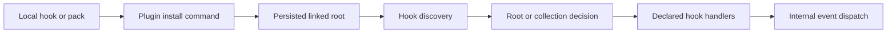

Codex review: needs maintainer review before merge. _Reviewed August 27, 2026, 4:09 AM ET / 08:09 UTC._

# ClawSweeper review

## What this changes

The PR lets linked local hooks and declared nested hook packs load from their exact root while preserving ordinary collection discovery.

## Merge readiness

⚠️ **Ready for maintainer review - 2 items remain**

Keep this maintainer-owned fix open: current main still scans linked roots only as collections, while this branch supplies the missing root-aware resolver and focused boundary coverage.

**Priority:** P2
**Reviewed head:** `8b00716eed80ad9da6fc9b9eeddb164bc592c7b5`
**Owner decision:** Required. See [Decision needed](#decision-needed).

## Review scores

| Measure | Result | What it means |
|---|---|---|
| **Overall readiness** | 🐚 platinum hermit **(4/6)** | A focused, net-negative loader repair with strong recorded boundary proof and aligned documentation. |
| **Proof confidence** | 🦞 diamond lobster **(5/6)** | Sufficient (live_output): The PR body records after-fix built-CLI and clean-process loader/dispatch results across all six layouts, using real installer, persistence, discovery, import, and dispatch boundaries. |
| **Patch quality** | 🐚 platinum hermit **(4/6)** | No actionable review findings were identified. |

## Verification

| Check | Result | Evidence |
|---|---|---|
| **Real behavior** | Verified | Sufficient (live_output): The PR body records after-fix built-CLI and clean-process loader/dispatch results across all six layouts, using real installer, persistence, discovery, import, and dispatch boundaries. |
| **Evidence reviewed** | 6 items | Current main still has the reported behavior: Current main scans each extra directory through the child-only collection resolver, so a linked root's own descriptor or package manifest is not considered.<br>Patch repairs the discovery owner: The branch resolves explicit roots as a hook or declared pack first, and falls back to immediate-child discovery only for collections.<br>Installer-to-dispatch regression coverage: The table-driven cases exercise copied and linked single-hook, nested-pack, and direct-child-pack layouts through persistence, discovery, loading, and event dispatch. |
| **Findings** | None | None. |
| **Security** | None | None. |


### Live Verification

**Command:** `pnpm openclaw hooks --help`

**Result:** PASS (completed)

```text
$ node scripts/run-node.mjs hooks --help
[openclaw] Building TypeScript (dist is stale: missing_build_stamp - build stamp missing).
[openclaw] Building bundled plugin assets.
[canvas] build: node scripts/bundle-a2ui.mjs
[log] ‹DIR›/a2ui.bundle.js  chunk │ size: 399.96 kB
[log] ‹DIR›/a2ui-v0.9.bundle.js  chunk │ size: 615.66 kB
[log]
[success] rolldown v1.2.0 Finished in 104.23 ms
[diffs] build: node --import tsx ../../scripts/build-diffs-viewer-runtime.mts curated
[diffs-language-pack] build: node --import tsx ../../scripts/build-diffs-viewer-runtime.mts full
[discord] build: node --import tsx ../../scripts/build-discord-activity-sdk.mts
[tsdown-build] invocation 1/2 finished in 0.7s
node_modules/playwright-core/lib/coreBundle.js (65821:28) [EVAL] Use of direct ˋevalˋ function is strongly discouraged as it poses security risks and may cause
issues with minification.
       ╭─[ node_modules/playwright-core/lib/coreBundle.js:65821:29 ]
       │
 65821 │               const value = eval(ˋ(${expr})ˋ);
       │                             ──┬─
       │                               ╰─── Use of direct ˋevalˋ here.
       │
       │ Help: Consider using indirect eval. For more information, check the documentation: https://rolldown.rs/guide/troubleshooting#avoiding-direct-eval
───────╯

node_modules/playwright-core/lib/coreBundle.js (65828:28) [EVAL] Use of direct ˋevalˋ function is strongly discouraged as it poses security risks and may cause
issues with minification.
       ╭─[ node_modules/playwright-core/lib/coreBundle.js:65828:29 ]
       │
 65828 │               const value = eval(ˋ(${expr})ˋ);
       │                             ──┬─
       │                               ╰─── Use of direct ˋevalˋ here.
       │
       │ Help: Consider using indirect eval. For more information, check the documentation: https://rolldown.rs/guide/troubleshooting#avoiding-direct-eval
───────╯

node_modules/web-tree-sitter/web-tree-sitter.js (2343:30) [EVAL] Use of direct ˋev
… output truncated …
s security risks and may cause
issues with minification.
      ╭─[ node_modules/web-tree-sitter/web-tree-sitter.js:2343:31 ]
      │
 2343 │           ASM_CONSTS[start] = eval(func);
      │                               ──┬─
      │                                 ╰─── Use of direct ˋevalˋ here.
      │
      │ Help: Consider using indirect eval. For more information, check the documentation: https://rolldown.rs/guide/troubleshooting#avoiding-direct-eval
──────╯

node_modules/web-tree-sitter/web-tree-sitter.js (2366:32) [EVAL] Use of direct ˋevalˋ function is strongly discouraged as it poses security risks and may cause
issues with minification.
      ╭─[ node_modules/web-tree-sitter/web-tree-sitter.js:2366:33 ]
      │
 2366 │           moduleExports[name] = eval(func);
      │                                 ──┬─
      │                                   ╰─── Use of direct ˋevalˋ here.
      │
      │ Help: Consider using indirect eval. For more information, check the documentation: https://rolldown.rs/guide/troubleshooting#avoiding-direct-eval
──────╯

[tsdown-build] invocation 2/2 finished in 14.4s
[plugin-control-plane-loads] verified 36 built modules with native require and checked doctor closures
runtime-postbuild: 11 phases completed in 4320ms (slowest: built plugin control-plane loads 3571ms)
│
◇

OpenClaw 2026.8.1 (8b00716) — All your chats, one OpenClaw.

Usage: openclaw hooks [options] [command]

Manage internal agent hooks

Options:
  --agent ‹id›  Agent id to inspect
  -h, --help    Display help for command
  --json        Output as JSON (default: false)

Commands:
  check         Check hooks eligibility status
  disable       Disable a hook
  enable        Enable a hook
  info          Show detailed information about a hook
  install       Deprecated: install a hook pack via ˋopenclaw plugins installˋ
  list          List all hooks
  update        Deprecated: update hook packs via ˋopenclaw plugins updateˋ

Docs: docs.openclaw.ai/cli/hooks
```

**Assertions:**

- PASS `expect_output`: Usage:

## How this fits together

Plugin installation persists a linked local path in hook configuration; hook discovery turns that path into eligible handler entries, which the loader imports and dispatches for internal events.



## Decision needed

| Question | Recommendation |
|---|---|
| Should this maintainer-labeled linked-root repair land once exact-head checks complete? | **Land after exact-head validation:** Accept the resolver and its installer-to-dispatch coverage once required checks are green. |

Why: The implementation is a coherent repair, but the maintainer label requires an explicit human merge decision.

## Before merge

- [ ] **Complete next step (P2)** - No discrete repair remains; this maintainer-owned PR awaits normal exact-head validation and merge review.


<details>
<summary><strong>Agent review details</strong></summary>

### Security

None.

### PR surface

Source -20, Tests +100, Docs +22. Total +102 across 5 files.

<details>
<summary>View PR surface stats</summary>

| Area | Files | Added | Removed | Net |
|---|---:|---:|---:|---:|
| Source | 1 | 48 | 68 | -20 |
| Tests | 2 | 236 | 136 | +100 |
| Docs | 2 | 41 | 19 | +22 |
| Config | 0 | 0 | 0 | 0 |
| Generated | 0 | 0 | 0 | 0 |
| Other | 0 | 0 | 0 | 0 |
| **Total** | **5** | **325** | **223** | **+102** |

</details>

### Review metrics

| Metric | Value | Why it matters |
|---|---|---|
| **Production versus test delta** | production -20 (+48/-68); tests +100 (+236/-136); docs +22 (+41/-19) | The loader repair is net-negative production code while adding boundary-level regression coverage and aligned operator documentation. |

### Root-cause cluster

Relationship: `fixed_by_candidate`
Canonical: https://github.com/openclaw/openclaw/issues/130783
Summary: This PR is the candidate repair for the linked-hook discovery bug tracked by the canonical issue.

Members:
- `canonical`: https://github.com/openclaw/openclaw/issues/130783 - The PR explicitly targets the same linked-root discovery and undeclared-sibling behavior described there.

Proposal only: this assessment does not dispatch repair, suppress jobs, mutate sibling items, close, or merge anything.

### Technical review

Best possible solution:

Land the root-aware discovery path after exact-head validation confirms the documented linked-hook contract.

Do we have a high-confidence way to reproduce the issue?

Yes. The reported linked-root behavior follows directly from current main's child-only scan, and the PR supplies a six-case installer-to-dispatch regression matrix.

Is this the best way to solve the issue?

Yes. Resolving explicit roots at the discovery owner preserves collection semantics while giving packs declared-leaf selection and bare hooks direct loading.

AGENTS.md: found and applied where relevant.

Codex review notes: model internal, reasoning high; reviewed against [2de73ebac9e6](https://github.com/openclaw/openclaw/commit/2de73ebac9e66995a916813ccbede6e8bcda0542).

### Labels

Label changes:

- add `P2`: This fixes silent hook non-discovery for a limited local linked-hook workflow rather than a default-path outage.
- add `proof: sufficient`: Contributor real behavior proof is sufficient. The PR body records after-fix built-CLI and clean-process loader/dispatch results across all six layouts, using real installer, persistence, discovery, import, and dispatch boundaries.
- add `rating: 🐚 platinum hermit`: Overall readiness is 🐚 platinum hermit; proof is 🦞 diamond lobster and patch quality is 🐚 platinum hermit.
- add `status: 👀 ready for maintainer look`: ClawSweeper has no concrete contributor-facing blocker left for this PR. Sufficient (live_output): The PR body records after-fix built-CLI and clean-process loader/dispatch results across all six layouts, using real installer, persistence, discovery, import, and dispatch boundaries.

Label justifications:

- `P2`: This fixes silent hook non-discovery for a limited local linked-hook workflow rather than a default-path outage.
- `rating: 🐚 platinum hermit`: Overall readiness is 🐚 platinum hermit; proof is 🦞 diamond lobster and patch quality is 🐚 platinum hermit.
- `status: 👀 ready for maintainer look`: ClawSweeper has no concrete contributor-facing blocker left for this PR. Sufficient (live_output): The PR body records after-fix built-CLI and clean-process loader/dispatch results across all six layouts, using real installer, persistence, discovery, import, and dispatch boundaries.
- `proof: sufficient`: Contributor real behavior proof is sufficient. The PR body records after-fix built-CLI and clean-process loader/dispatch results across all six layouts, using real installer, persistence, discovery, import, and dispatch boundaries.

### Evidence

What I checked:

- **Current main still has the reported behavior:** Current main scans each extra directory through the child-only collection resolver, so a linked root's own descriptor or package manifest is not considered. ([`src/hooks/workspace.ts:138`](https://github.com/openclaw/openclaw/blob/2de73ebac9e6/src/hooks/workspace.ts#L138), [2de73ebac9e6](https://github.com/openclaw/openclaw/commit/2de73ebac9e6))
- **Patch repairs the discovery owner:** The branch resolves explicit roots as a hook or declared pack first, and falls back to immediate-child discovery only for collections. ([`src/hooks/workspace.ts:134`](https://github.com/openclaw/openclaw/blob/8b00716eed80/src/hooks/workspace.ts#L134), [8b00716eed80](https://github.com/openclaw/openclaw/commit/8b00716eed80))
- **Installer-to-dispatch regression coverage:** The table-driven cases exercise copied and linked single-hook, nested-pack, and direct-child-pack layouts through persistence, discovery, loading, and event dispatch. ([`src/hooks/hooks-install.test.ts:69`](https://github.com/openclaw/openclaw/blob/8b00716eed80/src/hooks/hooks-install.test.ts#L69), [8b00716eed80](https://github.com/openclaw/openclaw/commit/8b00716eed80))
- **Installer caller preserves the supplied root:** The link path validates the hook source, stores the exact resolved path in extraDirs, and records the installation; the discovery change is therefore at the correct downstream owner boundary. ([`src/cli/plugins-install-hook-fallback.ts:83`](https://github.com/openclaw/openclaw/blob/8b00716eed80/src/cli/plugins-install-hook-fallback.ts#L83), [8b00716eed80](https://github.com/openclaw/openclaw/commit/8b00716eed80))
- **Documentation matches the resolver contract:** The updated hook and CLI docs distinguish explicit roots from collection directories and state that packs select only declared direct hook leaves. Public docs: [`docs/automation/hooks.md`](https://docs.openclaw.ai/automation/hooks). ([`docs/automation/hooks.md:351`](https://docs.openclaw.ai/automation/hooks), [8b00716eed80](https://github.com/openclaw/openclaw/commit/8b00716eed80))
- **Feature-history routing:** History shows Peter Steinberger as the dominant contributor to the hook workspace/install/loader area, including the current resolver change and recent hook repairs. ([`src/hooks/workspace.ts:134`](https://github.com/openclaw/openclaw/blob/8b00716eed80/src/hooks/workspace.ts#L134), [8b00716eed80](https://github.com/openclaw/openclaw/commit/8b00716eed80))

Likely related people:

- **steipete:** Dominant history contributor across hook workspace, installation, and loader paths; authored the current fix and multiple prior hook changes. (role: feature owner and recent area contributor; confidence: high; commits: [8b00716eed80](https://github.com/openclaw/openclaw/commit/8b00716eed80ad9da6fc9b9eeddb164bc592c7b5), [e348182e8123](https://github.com/openclaw/openclaw/commit/e348182e81236e8dece93483a29d77495342bff5), [2cc49503a600](https://github.com/openclaw/openclaw/commit/2cc49503a600aaf80df1f34ca57731d7f546423a); files: `src/hooks/workspace.ts`, `src/hooks/install.ts`, `src/hooks/loader.ts`)
- **cxbAsDev:** Authored the bounded hook-workspace metadata-read repair in the same discovery module. (role: adjacent boundary-hardening contributor; confidence: medium; commits: [4b2b5bcf8955](https://github.com/openclaw/openclaw/commit/4b2b5bcf89559b4c4e6ba24ba93ebf9d2c03d950); files: `src/hooks/workspace.ts`)

### Rank-up moves

Optional improvements that raise the rating; they are not merge blockers.

- Complete exact-head CI, then obtain the required maintainer merge decision.

### Rating scale

| Score | Internal tier | Crab rank | Meaning |
|---:|:---:|---|---|
| **6/6** | S | 🦀 challenger crab | Exceptional readiness |
| **5/6** | A | 🦞 diamond lobster | Very strong readiness |
| **4/6** | B | 🐚 platinum hermit | Good normal PR; ordinary maintainer review |
| **3/6** | C | 🦐 gold shrimp | Useful, but confidence is limited |
| **2/6** | D | 🦪 silver shellfish | Proof or implementation needs work |
| **1/6** | F | 🧂 unranked krab | Not merge-ready |
| N/A | NA | 🌊 off-meta tidepool | Rating does not apply |

Overall follows the weaker of proof and patch quality.
Shiny media proof means a screenshot, video, or linked artifact directly shows the changed behavior. Runtime, network, CSP, and security claims still need visible diagnostics.

### Workflow

- ClawSweeper keeps one durable marker-backed review comment per issue or PR.
- Re-runs edit this comment so the latest verdict, findings, and automation markers stay together instead of adding duplicate bot comments.
- A fresh review can be triggered by eligible `@clawsweeper re-review` comments, exact-item GitHub events, scheduled/background review runs, or manual workflow dispatch.
- PR/issue authors and users with repository write access can comment `@clawsweeper re-review` or `@clawsweeper re-run` on an open PR or issue to request a fresh review only.
- Maintainers can also comment `@clawsweeper review` to request a fresh review only.
- Fresh-review commands do not start repair, autofix, rebase, CI repair, or automerge.
- Maintainer-only repair and merge flows require explicit commands such as `@clawsweeper autofix`, `@clawsweeper automerge`, `@clawsweeper fix ci`, or `@clawsweeper address review`.
- Maintainers can comment `@clawsweeper explain` to ask for more context, or `@clawsweeper stop` to stop active automation.

</details>

<!-- clawsweeper-verdict:needs-human item=130813 sha=8b00716eed80ad9da6fc9b9eeddb164bc592c7b5 confidence=high updated_at=2026-08-27T08:05:59Z reviewed_at=2026-08-27T08:09:36.408Z lease_owner=github-run-33052317570-1 lease_comment_id=5436199502 source_revision=7e7dacc56adf3e26e4ae7e71e08a518af23f274f6148d38a6a8dffef930a621e -->

<!-- clawsweeper-review-version item=130813 reviewed_at=2026-08-27T08:09:36.408Z sha=8b00716eed80ad9da6fc9b9eeddb164bc592c7b5 source_revision=7e7dacc56adf3e26e4ae7e71e08a518af23f274f6148d38a6a8dffef930a621e lease_owner=github-run-33052317570-1 lease_comment_id=5436199502 v=1 -->

<!-- clawsweeper-review item=130813 -->