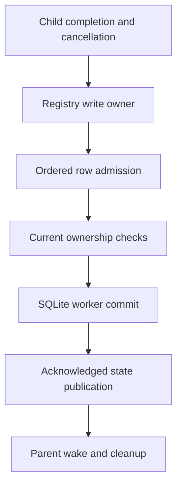

Codex review: blocked before merge. _Reviewed October 2, 2026, 2:06 AM ET / 06:06 UTC (Revision 6)._

# ClawSweeper review

## What this changes

The PR orders subagent state writes, publishes acknowledged results, and preserves completion ownership so concurrently finishing children can wake their parent.

## Merge readiness

⛔ **Blocked before merge - 1 item remains**

This remains a useful fix for parent sessions stranded by overlapping subagent writes. The previous compatibility blocker is unsupported by the complete inventory and inspected source; no actionable defect was found in the reviewed ownership, persistence, and completion paths.

**Priority:** P1
**Reviewed head:** `d6c37eb44bbc8889f94f08af4b397a7cac59209e`

## Review scores

| Measure | Result | What it means |
|---|---|---|
| **Overall readiness** | 🐚 platinum hermit **(4/6)** | Strong runtime evidence supports a coherent owner-level repair, with no actionable findings in the inspected production boundaries. |
| **Proof confidence** | 🦞 diamond lobster **(5/6)** | Sufficient (live_output): Refreshed real-model Gateway runs exercise concurrent child completion through the registry owner and SQLite workers, delivering 18/18 results and 3/3 parent finals without owner warnings. The subsequent head changes only benchmark imports and test cleanup; unchanged serialization, existing-schema coverage, and the source-backed compatibility decision support upgrades without migration. |
| **Patch quality** | 🐚 platinum hermit **(4/6)** | No actionable review findings were identified. |

## Verification

| Check | Result | Evidence |
|---|---|---|
| **Real behavior** | Verified | Sufficient (live_output): Refreshed real-model Gateway runs exercise concurrent child completion through the registry owner and SQLite workers, delivering 18/18 results and 3/3 parent finals without owner warnings. The subsequent head changes only benchmark imports and test cleanup; unchanged serialization, existing-schema coverage, and the source-backed compatibility decision support upgrades without migration. |
| **Evidence reviewed** | 9 items | Pinned mutation owner: The introduced owner reserves overlapping rows before awaiting predecessors, plans against immutable published rows, retries confirmed version conflicts at most three times, and publishes after acknowledgement. Unknown outcomes remain fenced until canonical restoration. Current main still needs the repair: Fetched main retains speculative snapshots and exact whole-row preimage comparison. It does not contain the inspected FIFO mutation owner, so nearby merged registry work does not make this fix redundant. Compatibility adjudication supported by source: The maintainer decision in issuecomment-5944927800 matches inspection: digests hash existing payload and indexed columns, serialization remains unchanged, and runtime incarnation keys live in a WeakMap. The complete inventory contains only a test under src/config and no plugin SDK, dependency, or workflow changes. Existing-schema coverage checks old rows and an older reader without changing user_version. |
| **Findings** | None | None. |
| **Security** | None | None. |

## How this fits together

The subagent registry tracks child executions and their completion obligations. Gateway lifecycle callbacks update its SQLite-backed state, which then drives parent wakes, result delivery, and cleanup.

## Before merge

- [ ] **Review config compatibility** - Confirm compatibility and upgrade impact for the changed config or default surface before merge.

<strong>Agent review details</strong>

### Security

None.

### PR surface

PR surface statistics unavailable: the file list is incomplete.

### Review metrics

| Metric | Value | Why it matters |
|---|---|---|
| **Production versus regression coverage** | production/tooling +2,416 lines; tests/support +3,318 lines | The PR explains production growth through ordered admission, runtime custody, commit receipts, and the complete writer cutover. |

### Stored data model

Persistent data-model change detected: `unknown-truncated-pull-files`. Migration or upgrade compatibility proof is recorded; maintainers should verify it before merge.

### Technical review

Best possible solution:

Use one ordered registry writer for lifecycle and completion updates while preserving current execution authority and existing stored formats.

Do we have a high-confidence way to reproduce the issue?

Yes: overlapping same-row writes expose the current-main preimage mechanism, and the PR supplies a real-worker regression plus before/after Gateway observations; this review did not execute it.

Is this the best way to solve the issue?

Yes: centralizing admission and acknowledged publication addresses competing writes at their owner without adding config, public APIs, or stored-format migrations.

AGENTS.md: found and applied where relevant.

Codex review notes: model internal, reasoning medium; reviewed against [2a522ab3f6d9](https://github.com/openclaw/openclaw/commit/2a522ab3f6d9cc4f4e15761d4fc731fd48c1985d).

### Labels

Label changes:

No label changes.

Label justifications:

- `P1`: Production observations show overlapping child completions can strand a parent and lose completion settlement.
- `rating: 🐚 platinum hermit`: Overall readiness is 🐚 platinum hermit; proof is 🦞 diamond lobster and patch quality is 🐚 platinum hermit.
- `status: 👀 ready for maintainer look`: ClawSweeper has no concrete contributor-facing blocker left for this PR. Sufficient (live_output): Refreshed real-model Gateway runs exercise concurrent child completion through the registry owner and SQLite workers, delivering 18/18 results and 3/3 parent finals without owner warnings. The subsequent head changes only benchmark imports and test cleanup; unchanged serialization, existing-schema coverage, and the source-backed compatibility decision support upgrades without migration.
- `proof: sufficient`: Contributor real behavior proof is sufficient. Refreshed real-model Gateway runs exercise concurrent child completion through the registry owner and SQLite workers, delivering 18/18 results and 3/3 parent finals without owner warnings. The subsequent head changes only benchmark imports and test cleanup; unchanged serialization, existing-schema coverage, and the source-backed compatibility decision support upgrades without migration.

### Evidence

What I checked:

- **Pinned mutation owner:** The introduced owner reserves overlapping rows before awaiting predecessors, plans against immutable published rows, retries confirmed version conflicts at most three times, and publishes after acknowledgement. Unknown outcomes remain fenced until canonical restoration. ([`src/agents/subagents/registry/subagent-registry-persistence.ts:418`](https://github.com/openclaw/openclaw/blob/d6c37eb44bbc8889f94f08af4b397a7cac59209e/src/agents/subagents/registry/subagent-registry-persistence.ts#L418), [d6c37eb44bbc](https://github.com/openclaw/openclaw/commit/d6c37eb44bbc8889f94f08af4b397a7cac59209e))
- **Current main still needs the repair:** Fetched main retains speculative snapshots and exact whole-row preimage comparison. It does not contain the inspected FIFO mutation owner, so nearby merged registry work does not make this fix redundant. ([`src/agents/subagents/registry/subagent-registry-persistence.ts:390`](https://github.com/openclaw/openclaw/blob/2a522ab3f6d9cc4f4e15761d4fc731fd48c1985d/src/agents/subagents/registry/subagent-registry-persistence.ts#L390), [2a522ab3f6d9](https://github.com/openclaw/openclaw/commit/2a522ab3f6d9cc4f4e15761d4fc731fd48c1985d))
- **Compatibility adjudication supported by source:** The maintainer decision in issuecomment-5944927800 matches inspection: digests hash existing payload and indexed columns, serialization remains unchanged, and runtime incarnation keys live in a WeakMap. The complete inventory contains only a test under src/config and no plugin SDK, dependency, or workflow changes. Existing-schema coverage checks old rows and an older reader without changing user_version. ([`src/agents/subagents/registry/subagent-registry.store.row.ts:8`](https://github.com/openclaw/openclaw/blob/d6c37eb44bbc8889f94f08af4b397a7cac59209e/src/agents/subagents/registry/subagent-registry.store.row.ts#L8), [d6c37eb44bbc](https://github.com/openclaw/openclaw/commit/d6c37eb44bbc8889f94f08af4b397a7cac59209e))
- **Live completion proof survives the final delta:** The refreshed report at https://github.com/openclaw/openclaw/pull/163195#issuecomment-5946071840 describes three isolated real-model Gateway runs using the embedded runtime and real SQLite workers: 18/18 child results, 3/3 parent finals, terminal rows/events and receipts present, and zero registry-owner warnings. Immutable commit inspection confirms the subsequent head changes only benchmark imports and fixture trigger cleanup. ([d6c37eb44bbc](https://github.com/openclaw/openclaw/commit/d6c37eb44bbc8889f94f08af4b397a7cac59209e))
- **Complete captured body inspected:** The API body matches the supplied SHA-256 ac3ab855ff335d166b68426011c786752982e27b9c5574129b0dfadb8becacf5 and 12,309 UTF-16 units. Its omitted tail preserves the refreshed live-proof reference and identifies the next-turn announcement loss as pre-existing, separately scoped work. ([d6c37eb44bbc](https://github.com/openclaw/openclaw/commit/d6c37eb44bbc8889f94f08af4b397a7cac59209e))
- **Authority and rollback boundaries:** Worker writes request live admission at transaction and commit, compare authoritative row versions before effects, and commit eligible terminal events with their rows. The inspected real-worker regression revokes the caller at either admission stage and checks that both durable and resident labels remain unchanged. Runtime ownership also checks execution identity rather than treating a retained key as authorization. ([`src/agents/subagents/registry/subagent-registry-worker.test.ts:448`](https://github.com/openclaw/openclaw/blob/d6c37eb44bbc8889f94f08af4b397a7cac59209e/src/agents/subagents/registry/subagent-registry-worker.test.ts#L448), [d6c37eb44bbc](https://github.com/openclaw/openclaw/commit/d6c37eb44bbc8889f94f08af4b397a7cac59209e))

Likely related people:

- **steipete:** Suggested for follow-up; no historical authorship or introduction is verified. (role: unverified routing candidate; confidence: low)

### Rating scale

| Score | Internal tier | Crab rank | Meaning |
|---:|:---:|---|---|
| **6/6** | S | 🦀 challenger crab | Exceptional readiness |
| **5/6** | A | 🦞 diamond lobster | Very strong readiness |
| **4/6** | B | 🐚 platinum hermit | Good normal PR; ordinary maintainer review |
| **3/6** | C | 🦐 gold shrimp | Useful, but confidence is limited |
| **2/6** | D | 🦪 silver shellfish | Proof or implementation needs work |
| **1/6** | F | 🧂 unranked krab | Not merge-ready |
| N/A | NA | 🌊 off-meta tidepool | Rating does not apply |

Overall follows the weaker of proof and patch quality.
Shiny media proof means a screenshot, video, or linked artifact directly shows the changed behavior. Runtime, network, CSP, and security claims still need visible diagnostics.

### Workflow

- ClawSweeper keeps one durable marker-backed review comment per issue or PR.
- Re-runs edit this comment so the latest verdict, findings, and automation markers stay together instead of adding duplicate bot comments.
- A fresh review can be triggered by eligible `@clawsweeper re-review` comments, exact-item GitHub events, scheduled/background review runs, or manual workflow dispatch.
- PR/issue authors and users with repository write access can comment `@clawsweeper re-review` or `@clawsweeper re-run` on an open PR or issue to request a fresh review only.
- Maintainers can also comment `@clawsweeper review` to request a fresh review only.
- Fresh-review commands do not start repair, autofix, rebase, CI repair, or automerge.
- Maintainer-only repair and merge flows require explicit commands such as `@clawsweeper autofix`, `@clawsweeper automerge`, `@clawsweeper fix ci`, or `@clawsweeper address review`.
- Maintainers can comment `@clawsweeper explain` to ask for more context, or `@clawsweeper stop` to stop active automation.

### History

Review history (5 earlier review cycles)

<!-- clawsweeper-review-history v=1 total=5 -->
- reviewed 2026-10-02T03:02:59.556Z sha d051f9fba4fe6e0cf8e3f22b5a70ddbd8cabf0e1 :: blocked before merge. :: none
- reviewed 2026-10-02T03:48:57.230Z sha 3d179099cacce8f6bb7edea0a6a0683be79f6b00 :: blocked before merge. :: none
- reviewed 2026-10-02T04:10:17.478Z sha 376e3a0003dc212d9b79282fffff30df8a8e90a2 :: blocked before merge. :: none
- reviewed 2026-10-02T04:57:42.238Z sha f2dfffeea37745bf1892dc1de428f537723c5b39 :: blocked before merge. :: none
- reviewed 2026-10-02T05:44:16.446Z sha d6c37eb44bbc8889f94f08af4b397a7cac59209e :: blocked before merge. :: none

<!-- clawsweeper-verdict:needs-human item=163195 sha=d6c37eb44bbc8889f94f08af4b397a7cac59209e confidence=high updated_at=2026-10-02T06:03:06Z reviewed_at=2026-10-02T06:06:21.069Z lease_owner=github-run-36971636626-1 lease_comment_id=5946462278 source_revision=24c17c4dd5e6cf2805ab7ebd6a563b3978deeea09f9b3318ca88972554bf1e1e live_verification=absent -->
<!-- clawsweeper-review-state:blocked item=163195 sha=d6c37eb44bbc8889f94f08af4b397a7cac59209e v=1 -->

<!-- clawsweeper-review-version item=163195 reviewed_at=2026-10-02T06:06:21.069Z sha=d6c37eb44bbc8889f94f08af4b397a7cac59209e source_revision=24c17c4dd5e6cf2805ab7ebd6a563b3978deeea09f9b3318ca88972554bf1e1e lease_owner=github-run-36971636626-1 lease_comment_id=5946462278 v=1 -->

<!-- clawsweeper-review item=163195 -->