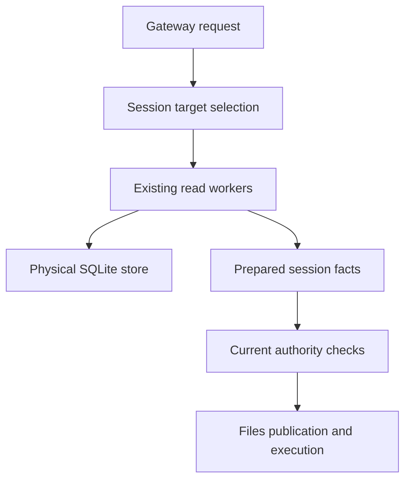

Codex review: needs real behavior proof before merge.

## What this changes

This PR moves durable session target discovery and entry preparation into existing workers and updates callers to consume prepared session facts.

**Example:** The Gateway selects agent:main:main for a session operation.
- **Before:** Target discovery and later caller checks can enter synchronous SQLite lookup paths.
- **After:** Callers await worker preparation and carry the selected target into subsequent operations.

## Review scores

| Measure | Result | What it means |
|---|---|---|
| **Overall readiness** | 🧂 unranked krab **(1/6)** | The useful migration still has two confirmed caller regressions and cannot receive an approval verdict. |
| **Proof confidence** | 🧂 unranked krab **(1/6)** | Real behavior proof is necessary before merge. See [Before merge](#before-merge). |
| **Patch quality** | 🦪 silver shellfish **(2/6)** | Security review found an item that needs attention. |

## Product

**Kind:** Performance · **Worth it:** Yes · **Fix scope:** Complete
**User problem:** Synchronous session discovery and repeated preparation can occupy the Gateway main thread during session operations.
**Reason:** The maintainer-authored direction follows the existing worker migration and preserves documented compatibility; the supplied measurements appropriately avoid claiming a demonstrated latency improvement.

## Merge readiness

⛔ **Blocked before merge - 7 items remain**

Keep this PR open: the maintainer-owned worker migration is useful, but both previously reported media and worktree regressions remain.

**Priority:** P2
**Reviewed head:** `f72f9f413d843a03766acba8708e3eb8afef4122`

## Before merge

- [ ] **Add real behavior proof** - Authority-chain proof required: the recorded Gateway workload at 7f33ab94d1d553280bc17a7646e3ea25488774c9 covers allowed turns, RPCs, cron, compaction, and shutdown, but does not demonstrate foreign-session denial or membership/workspace revocation before the changed file, publication, and worker effects; the inspected images belong to an earlier media PR. Supply bounded terminal evidence or redacted logs through those production owners, removing IPs, API keys, phone numbers, and non-public endpoints. After adding proof, update the PR body; ClawSweeper should re-review automatically. If it does not, the PR author or someone with repository write access can comment `@clawsweeper re-review`.
- [ ] **Prepare exact retained facts before reading the media policy (P2)** - For a persisted durable session whose actor facts are cold after restart or eviction, this list-only load returns an entry without installing eligible retained exact facts. The immediate readSession call discards that entry and reads the empty retained-facts cache, so resolveAssistantMediaPolicy returns undefined and the Control UI media endpoint returns not found for valid session media. The same pattern in mcp-app-host-files.ts can report local App files unavailable. Prepare eligible exact facts through the existing reader before installing these consumers; the media test's unconditional retained-facts mock hides this failure. This previously reported defect remains unchanged.
- [ ] **Use the selected physical source for the worktree file guard (P2)** - With a sessions/sessions.json locator, loaded.storePath remains the logical locator while loaded.readSource.path identifies the selected openclaw-agent.sqlite file. Passing the locator to readRetainedSessionEntryFacts searches for its write token and physical fact cache at the wrong path. A valid managed-worktree file request consequently throws "Session workspace changed during file read" despite an unchanged selected entry. Carry loaded.readSource.agentId and loaded.readSource.path into this guard, falling back only when no physical source was selected. This previously reported defect remains unchanged.
- [ ] **Resolve security concern: Verify retained worker grants against revoked authority** - Worker-grant preparation now retains authorization beyond its originating request lifetime; verify that a foreign-session principal is denied and membership or workspace revocation prevents subsequent I/O through the real owners.
- [ ] **Resolve merge risk** - Retained sharing and placement grants cross changed asynchronous lifetimes; stale membership or workspace authority reaching file, publication, or worker effects remains an unresolved security-boundary concern.
- [ ] **Complete next step** - Confirm the explicitly recorded Phase E landing hold has been lifted before landing.
- [ ] **Improve patch quality** - Add final-effect proof for a foreign-session caller and prove membership or workspace revocation invalidates retained authority before I/O.

## Findings

- [P2] Prepare exact retained facts before reading the media policy — `src/gateway/assistant-media-policy.ts:167-170`
- [P2] Use the selected physical source for the worktree file guard — `src/gateway/server-methods/sessions-files.ts:231-232`
- [medium] Verify retained worker grants against revoked authority — `src/gateway/session-sharing-authorization-async.ts:212`

### Tests

- Missing end-to-end proof: Missing changed-owner final-effect denial and revocation evidence, plus base-failing/head-passing regressions for cold media facts and logical-to-physical worktree selection.

<strong>Agent review details</strong>

### How this fits together

Gateway requests select logical sessions, workers read physical SQLite stores, and prepared facts feed session authorization, file access, publication, and execution.

### Technical review

Best possible solution:

Prepare eligible exact facts through the existing reader, preserve the selected physical source, and retain live authorization at every final effect.

Do we have a high-confidence way to reproduce the issue?

Both prior failures are source-reproducible: a cold list read cannot supply the required retained exact facts, and a logical sessions/sessions.json locator cannot identify the selected SQLite fact cache; no target code was executed.

Is this the best way to solve the issue?

The existing worker and receipt owners are the right implementation boundary, but the migrated consumers must explicitly satisfy their fact-preparation and physical-source contracts.

Full review comments:

- [P2] Prepare exact retained facts before reading the media policy — `src/gateway/assistant-media-policy.ts:167-170`
  For a persisted durable session whose actor facts are cold after restart or eviction, this list-only load returns an entry without installing eligible retained exact facts. The immediate readSession call discards that entry and reads the empty retained-facts cache, so resolveAssistantMediaPolicy returns undefined and the Control UI media endpoint returns not found for valid session media. The same pattern in mcp-app-host-files.ts can report local App files unavailable. Prepare eligible exact facts through the existing reader before installing these consumers; the media test's unconditional retained-facts mock hides this failure. This previously reported defect remains unchanged.
  Confidence: 0.98
- [P2] Use the selected physical source for the worktree file guard — `src/gateway/server-methods/sessions-files.ts:231-232`
  With a sessions/sessions.json locator, loaded.storePath remains the logical locator while loaded.readSource.path identifies the selected openclaw-agent.sqlite file. Passing the locator to readRetainedSessionEntryFacts searches for its write token and physical fact cache at the wrong path. A valid managed-worktree file request consequently throws "Session workspace changed during file read" despite an unchanged selected entry. Carry loaded.readSource.agentId and loaded.readSource.path into this guard, falling back only when no physical source was selected. This previously reported defect remains unchanged.
  Confidence: 0.99

Overall correctness: patch is incorrect
Overall confidence: 0.96

AGENTS.md: found and applied where relevant.

Codex review notes: model internal, reasoning medium; reviewed against [b1c08d51fab3](https://github.com/openclaw/openclaw/commit/b1c08d51fab31699976751e3a57ade20c06d1ac1).

### Merge-risk options

**Maintainer options:**
1. **Keep landing paused (recommended)**  
   Retain this PR while its author repairs the two regressions and demonstrates allowed access, foreign-session denial, and revocation before the affected final effects.

### Provenance checked

- `Session target worker preparation` keeps the original intent (a9b40cf325e8dfd3540200b6ac95aae740a324b4: The earlier merged caller migration moved discovery into workers while retaining process-owned incognito and synchronous SDK exceptions.)
- `Caller and session authority` keeps the original intent (da27b336c0e96cce29e8417cb82da863a57380bd: The authorization foundation binds delayed work to the original caller and session incarnation, preserving revocation and successor-run protection.)
- `Assistant-media workspace policy` keeps the original intent (7b1217e2e79e5b489ea542e3019f9e86c281529a: Authenticated previews follow the session's effective filesystem permissions and revalidate access before serving bytes.)
- `Transcript projection ownership rereads` changes intended behavior with a stated reason (5aa61b521663251b0f536ba15514bf3e1297980f: The earlier optimization retained final source validation; this PR explicitly accepts temporary derived-index staleness when removing further per-chunk ownership reads.)

### Testing

Proof path: shipped entry point.

### Security

Needs attention: The changed authority lifetimes need final-effect denial and revocation verification; source inspection established no concrete authorization bypass.

### Evidence

Security concerns:

- [medium] Verify retained worker grants against revoked authority — `src/gateway/session-sharing-authorization-async.ts:212`
  Worker-grant preparation now retains authorization beyond its originating request lifetime; verify that a foreign-session principal is denied and membership or workspace revocation prevents subsequent I/O through the real owners.
  Confidence: 0.88

What I checked:

- **Pinned introduction and prior findings:** Reviewed the introduced changes against the pinned base. Both finding locations have identical blob IDs at the previous reviewed head and current head, so neither prior defect was repaired by the latest integration. ([f72f9f413d84](https://github.com/openclaw/openclaw/commit/f72f9f413d843a03766acba8708e3eb8afef4122))
- **Cold media fact preparation:** The durable policy requests a list projection, then replaces the returned entry with an exact retained-facts lookup; list projections are excluded by the retained-facts eligibility contract. The Control UI HTTP handler returns not found when policy preparation produces no session. ([`src/gateway/assistant-media-policy.ts:167`](https://github.com/openclaw/openclaw/blob/f72f9f413d843a03766acba8708e3eb8afef4122/src/gateway/assistant-media-policy.ts#L167), [f72f9f413d84](https://github.com/openclaw/openclaw/commit/f72f9f413d843a03766acba8708e3eb8afef4122))
- **Retained-facts eligibility:** Retained exact facts accept full, sharing, exact, or unspecified projections; a list-only read does not establish the facts required by the new synchronous media consumer. ([`src/config/sessions/session-entry-read-facts.ts:119`](https://github.com/openclaw/openclaw/blob/f72f9f413d843a03766acba8708e3eb8afef4122/src/config/sessions/session-entry-read-facts.ts#L119), [f72f9f413d84](https://github.com/openclaw/openclaw/commit/f72f9f413d843a03766acba8708e3eb8afef4122))
- **Logical locator used as physical fact key:** The worktree file guard passes loaded.storePath to a lookup that reads physical file identity and committed write tokens, despite the worker publishing the selected physical source separately as readSource. ([`src/gateway/server-methods/sessions-files.ts:232`](https://github.com/openclaw/openclaw/blob/f72f9f413d843a03766acba8708e3eb8afef4122/src/gateway/server-methods/sessions-files.ts#L232), [f72f9f413d84](https://github.com/openclaw/openclaw/commit/f72f9f413d843a03766acba8708e3eb8afef4122))
- **Proof inspected and attributed:** Inspected all four prepared images; they are the before/after media images supplied by https://github.com/openclaw/openclaw/pull/138856. That earlier PR establishes the intended preview and revocation contract, but its images do not exercise this PR's worker cutover.
- **Accepted scope and tradeoffs:** The full current PR body records maintainer direction, retained synchronous SDK compatibility, and accepted bookkeeping and derived-index staleness edges; those accepted tradeoffs are not raised again as blockers. ([f72f9f413d84](https://github.com/openclaw/openclaw/commit/f72f9f413d843a03766acba8708e3eb8afef4122))

Likely related people:

- **Peter Steinberger:** Raw commit ad3fc06d6411996a2cf34d8853dab2899b7afab8 adds src/config/sessions/targets-read-availability.ts:14 relative to its recorded parents. This identifies author metadata, not feature responsibility or a PR merger. (role: source-line author; confidence: high; commits: [ad3fc06d6411](https://github.com/openclaw/openclaw/commit/ad3fc06d6411996a2cf34d8853dab2899b7afab8); files: `src/config/sessions/targets-read-availability.ts`)

### PR surface

PR surface statistics unavailable: the file list is incomplete.

### Labels

Label changes:

No label changes.

Label justifications:

- `P2`: This is a normal-priority performance migration with confirmed regressions in media previews and managed-worktree file access.
- `merge-risk: 🚨 security-boundary`: The patch changes retained authorization and worker-grant lifetimes used by filesystem, publication, and execution effects.
- `rating: 🧂 unranked krab`: Overall readiness is 🧂 unranked krab; proof is 🧂 unranked krab and patch quality is 🦪 silver shellfish.
- `status: 📣 needs proof`: The PR needs real behavior proof before ClawSweeper can clear the contributor ask.

### Rating scale

6/6 🦀 challenger crab · 5/6 🦞 diamond lobster · 4/6 🐚 platinum hermit · 3/6 🦐 gold shrimp · 2/6 🦪 silver shellfish · 1/6 🧂 unranked krab. Overall follows the weaker of proof and patch quality; ✨ marks media proof (a screenshot, video, or linked artifact) that directly shows the changed behavior.

### Workflow

ClawSweeper edits this one comment on every review. Comment `@clawsweeper re-review` for a fresh review only. Repair and merge execution lanes are retired.

### History

Review history (27 earlier review cycles; latest 8 shown)

<!-- clawsweeper-review-history v=1 total=27 -->
- reviewed 2026-10-12T22:53:49.332Z sha bde1a53c17ca7116e07f21889a11a52890a2c951 :: needs real behavior proof before merge. :: [P1] Retain the session execution-host override | [P2] Prepare exact retained facts before installing the media reader | [P2] Use the selected physical source for worktree file guards | [P2] Do not fail empty cancellation on an unused session snapshot | [P2] Remove the duplicate runtime-config imports
- reviewed 2026-10-12T23:43:33.331Z sha 50c76686de63a75478b6e6cfa9d99fc5087aa4d2 :: needs real behavior proof before merge. :: [P2] Prepare retained exact facts before reading the media policy | [P2] Use the selected physical source for the worktree file guard
- reviewed 2026-10-13T00:18:28.628Z sha ea03539367f3d182282548f6ff3fe8bccb72d452 :: needs real behavior proof before merge. :: [P2] Prepare exact retained facts before reading the media policy | [P2] Use the selected physical source for the worktree file guard
- reviewed 2026-10-13T01:15:09.004Z sha f240bc082d469971602ede3f359f5d3deb8cf264 :: needs real behavior proof before merge. :: [P2] Prepare exact retained facts before reading the media policy | [P2] Use the selected physical source for the worktree file guard
- reviewed 2026-10-13T01:31:19.645Z sha 792a9f1a39759ca052786383851e244620014395 :: needs real behavior proof before merge. :: [P2] Prepare exact retained facts before reading the media policy | [P2] Use the selected physical source for the worktree file guard
- reviewed 2026-10-13T02:10:23.720Z sha 7f33ab94d1d553280bc17a7646e3ea25488774c9 :: needs real behavior proof before merge. :: [P2] Prepare exact retained facts before reading the media policy | [P2] Use the selected physical source for the worktree file guard
- reviewed 2026-10-13T02:35:31.938Z sha 7f33ab94d1d553280bc17a7646e3ea25488774c9 :: needs real behavior proof before merge. :: [P2] Prepare exact retained facts before reading the media policy | [P2] Use the selected physical source for the worktree file guard
- reviewed 2026-10-13T03:35:14.714Z sha 7f33ab94d1d553280bc17a7646e3ea25488774c9 :: needs real behavior proof before merge. :: [P2] Prepare exact retained facts before reading the media policy | [P2] Use the selected physical source for the worktree file guard

_Reviewed October 12, 2026, 11:52 PM ET / October 13, 2026, 03:52 UTC (Revision 28)._

<!-- clawsweeper-security:security-sensitive item=169757 sha=f72f9f413d843a03766acba8708e3eb8afef4122 confidence=high updated_at=2026-10-13T03:47:31Z reviewed_at=2026-10-13T03:52:55.436Z lease_owner=github-run-38343289352-1 lease_comment_id=6137779583 source_revision=194939a5102de0c555bd713cb8686a588e795ab32bc6fcd0e834a283bde4f496 -->
<!-- clawsweeper-verdict:needs-human item=169757 sha=f72f9f413d843a03766acba8708e3eb8afef4122 confidence=high updated_at=2026-10-13T03:47:31Z reviewed_at=2026-10-13T03:52:55.436Z lease_owner=github-run-38343289352-1 lease_comment_id=6137779583 source_revision=194939a5102de0c555bd713cb8686a588e795ab32bc6fcd0e834a283bde4f496 hold=security findings=2 -->
<!-- clawsweeper-review-state:blocked item=169757 sha=f72f9f413d843a03766acba8708e3eb8afef4122 v=1 -->

<!-- clawsweeper-review-version item=169757 reviewed_at=2026-10-13T03:52:55.436Z sha=f72f9f413d843a03766acba8708e3eb8afef4122 source_revision=194939a5102de0c555bd713cb8686a588e795ab32bc6fcd0e834a283bde4f496 lease_owner=github-run-38343289352-1 lease_comment_id=6137779583 v=1 -->

<!-- clawsweeper-review item=169757 -->