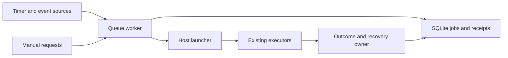

Codex review: needs real behavior proof before merge.

## What this changes

This PR centralizes durable Cron requests, execution capacity, and activation in the SQLite worker behind one host launcher.

**Example:** Eight runs occupy service A while sibling service B requests report-job against the same store.
- **Before:** Separate service admission counters can admit a ninth execution.
- **After:** The worker queues report-job until shared capacity becomes available.

## Review scores

| Measure | Result | What it means |
|---|---|---|
| **Overall readiness** | 🧂 unranked krab **(1/6)** | The approved refactor has useful boundary coverage, but three availability defects and unresolved authority and existing-state evidence prevent readiness. |
| **Proof confidence** | 🧂 unranked krab **(1/6)** | Real behavior proof is necessary before merge. See [Before merge](#before-merge). |
| **Patch quality** | 🧂 unranked krab **(1/6)** | Security review found an item that needs attention. |

## Product

**Kind:** Refactor · **Worth it:** Yes · **Fix scope:** Complete
**User problem:** Competing host and receipt owners complicate shared capacity, acknowledged manual runs, and restart recovery.
**Reason:** The maintainer-authored change implements the approved queue stage and explicitly leaves schedule and wake production for the next stage.

## Merge readiness

⛔ **Blocked before merge - 7 items remain**

Keep open: this PR implements the approved Cron queue redesign, but two previous lifecycle defects remain and an additional unobserved rejection can terminate the Gateway.

**Priority:** P2
**Reviewed head:** `3bd070a013683455df8c1564c78b004866110094`

## Before merge

- [ ] **Add real behavior proof** - Authority-chain proof required: demonstrate an authorized queued caller reaching real executor I/O after acknowledgement and a caller revoked before slot release being rejected before that I/O; supplied tests mock execution and the inspected images cover unrelated UI behavior. Provide redacted terminal output or logs without credentials, IPs, phone numbers, or non-public endpoints. After adding proof, update the PR body; ClawSweeper should re-review automatically. If it does not, the PR author or someone with repository write access can comment `@clawsweeper re-review`.
- [ ] **Reconcile local ownership when an activation reply is lost (P1)** - This previous finding remains present. If cron.drainQueue commits activation and its worker exits before replying, this await rejects before launch cleanup is installed. Submission has already claimed local receipt ownership, while the worker has replaced queued markers with running markers. Later drains cannot launch those rows, and same-process recovery treats the retained local claim as live. Unexecuted jobs can therefore occupy capacity indefinitely and leave accepted completion promises pending. Release or reconcile unlaunched local contexts after an uncertain activation result so recovery records interruption without replay.
- [ ] **Observe completion rejections for reconstructed timed requests (P1)** - This previous finding remains present. A persisted timed request drained without a host context gets a completion promise without a consumer or rejection observer, unlike ordinary submissions. A launch or finalization failure rejects that promise in running.catch; handling running does not handle completion. An ordinary non-transient error reaches the installed unhandled-rejection handler and terminates the Gateway. Observe reconstructed completions or avoid allocating an unused rejectable promise.
- [ ] **Observe the queue drain started when scheduling resumes (P1)** - When scheduling resumes with queued work, this detached drain can reject on worker admission or database failure. The surrounding synchronous try does not catch an async rejection, so an ordinary non-transient failure reaches the Gateway's fatal unhandled-rejection path. Attach a rejection handler, as the queue wake owner already does. This is a late discovery: comparison with the earlier reviewed source confirms this call was already present unchanged.
- [ ] **Resolve security concern: Verify queued caller revocation before executor I/O** - The launcher retains the originating caller across acknowledgement and queue waiting, then dispatches under a detached Gateway lifetime; inspected authority tests replace execution and do not establish rejection before real I/O.
- [ ] **Resolve merge risk** - Queued caller authority survives acknowledgement and detached launch; its rejection boundary for a caller revoked before capacity release remains unverified at executor I/O.
- [ ] **Add data-model compatibility proof** - The review found that existing stored data may not work after upgrade. Show that existing data still loads and works with this change.

## Findings

- [P1] Reconcile local ownership when an activation reply is lost — `src/cron/service/run-queue.ts:300-302`
- [P1] Observe completion rejections for reconstructed timed requests — `src/cron/service/run-queue.ts:340-341`
- [P1] Observe the queue drain started when scheduling resumes — `src/cron/service/ops-lifecycle.ts:395`
- [medium] Verify queued caller revocation before executor I/O — `src/cron/service/run-queue.ts:407`

### Tests

- Missing end-to-end proof: Supply redacted queued-caller final-effect evidence and inspectable copied-release recovery output preserving settings, receipt IDs, and history joins; no base-fail/head-pass execution of the reported defects was supplied.

<strong>Agent review details</strong>

### How this fits together

Timer, manual, and event sources submit durable requests; the host launches existing executors and returns outcomes to receipt, history, and recovery owners.

### Technical review

Best possible solution:

Complete activation-failure reconciliation and rejection handling while preserving existing effect checks and the approved crash semantics.

Do we have a high-confidence way to reproduce the issue?

Source establishes the lost activation-reply and unobserved rejection paths; no target code was executed during this read-only review.

Is this the best way to solve the issue?

The approved worker queue provides the appropriate owner, but failure cleanup and promise observation must cover every entry point.

Full review comments:

- [P1] Reconcile local ownership when an activation reply is lost — `src/cron/service/run-queue.ts:300-302`
  This previous finding remains present. If cron.drainQueue commits activation and its worker exits before replying, this await rejects before launch cleanup is installed. Submission has already claimed local receipt ownership, while the worker has replaced queued markers with running markers. Later drains cannot launch those rows, and same-process recovery treats the retained local claim as live. Unexecuted jobs can therefore occupy capacity indefinitely and leave accepted completion promises pending. Release or reconcile unlaunched local contexts after an uncertain activation result so recovery records interruption without replay.
  Confidence: 0.98
- [P1] Observe completion rejections for reconstructed timed requests — `src/cron/service/run-queue.ts:340-341`
  This previous finding remains present. A persisted timed request drained without a host context gets a completion promise without a consumer or rejection observer, unlike ordinary submissions. A launch or finalization failure rejects that promise in running.catch; handling running does not handle completion. An ordinary non-transient error reaches the installed unhandled-rejection handler and terminates the Gateway. Observe reconstructed completions or avoid allocating an unused rejectable promise.
  Confidence: 0.99
- [P1] Observe the queue drain started when scheduling resumes — `src/cron/service/ops-lifecycle.ts:395`
  When scheduling resumes with queued work, this detached drain can reject on worker admission or database failure. The surrounding synchronous try does not catch an async rejection, so an ordinary non-transient failure reaches the Gateway's fatal unhandled-rejection path. Attach a rejection handler, as the queue wake owner already does. This is a late discovery: comparison with the earlier reviewed source confirms this call was already present unchanged.
  Confidence: 0.99
  Late finding: first raised on code an earlier review cycle already covered.

Overall correctness: patch is incorrect
Overall confidence: 0.97

AGENTS.md: found and applied where relevant.

Codex review notes: model internal, reasoning medium; reviewed against [c8dea3b59901](https://github.com/openclaw/openclaw/commit/c8dea3b599011b11d99842704ff13e6b613081c4).

### Merge-risk options

**Maintainer options:**
1. **Hold for authority evidence (recommended)**  
   Keep this PR open until allowed queued execution and revocation before slot release are demonstrated at real executor I/O.

### Provenance checked

- `Host admission and capacity` changes intended behavior with a stated reason (https://github.com/openclaw/openclaw/pull/119195: Bound cross-tick execution while preserving receipt ownership, immediate capacity refill, and cleanup.)
- `Durable receipt ownership` changes intended behavior with a stated reason (https://github.com/openclaw/openclaw/pull/122948: Prevent duplicate executions and stale run mutations using durable receipts.)
- `Manual runs outliving their originating turn` keeps the original intent (https://github.com/openclaw/openclaw/pull/162780: Detach acknowledged execution from the originating transcript lifecycle so its delivery remains possible.)
- `Interrupted one-shot recovery` changes intended behavior with a stated reason (https://github.com/openclaw/openclaw/pull/159873: Prevent duplicate delivery after restart while recovering runs whose delivery was known not to have started.)
- `Worker transaction and finalization ownership` keeps the original intent (https://github.com/openclaw/openclaw/pull/168619: Remove host handshakes from SQLite transactions so busy Gateway work cannot retain the shared writer.)

### Testing

Proof path: in-process harness.

### Security

Needs attention: No concrete authorization bypass was found, but retained queued-caller authority needs final-effect evidence.

### Evidence

Security concerns:

- [medium] Verify queued caller revocation before executor I/O — `src/cron/service/run-queue.ts:407`
  The launcher retains the originating caller across acknowledgement and queue waiting, then dispatches under a detached Gateway lifetime; inspected authority tests replace execution and do not establish rejection before real I/O.
  Confidence: 0.96

What I checked:

- **Pinned introduction and current main:** The merge-base-to-head diff adds the worker queue and host launcher and removes host admission ownership; fetched main still has service-local capacity accounting. ([`src/cron/service/run-queue.ts:300`](https://github.com/openclaw/openclaw/blob/3bd070a013683455df8c1564c78b004866110094/src/cron/service/run-queue.ts#L300), [3bd070a01368](https://github.com/openclaw/openclaw/commit/3bd070a013683455df8c1564c78b004866110094))
- **Lost activation reply:** Submission claims local receipt ownership, activation commits running markers, and a rejected drain has no reconciliation handler; same-process recovery treats locally owned receipts as live. ([`src/cron/service/run-queue.ts:300`](https://github.com/openclaw/openclaw/blob/3bd070a013683455df8c1564c78b004866110094/src/cron/service/run-queue.ts#L300), [3bd070a01368](https://github.com/openclaw/openclaw/commit/3bd070a013683455df8c1564c78b004866110094))
- **Unobserved promise failures:** Reconstructed completions and the drain started by resumeScheduling lack rejection observers; ordinary non-transient unhandled rejections invoke the Gateway exit path. ([`src/infra/unhandled-rejections.ts:311`](https://github.com/openclaw/openclaw/blob/3bd070a013683455df8c1564c78b004866110094/src/infra/unhandled-rejections.ts#L311), [3bd070a01368](https://github.com/openclaw/openclaw/commit/3bd070a013683455df8c1564c78b004866110094))
- **Earlier reviewed source comparison:** The earlier reviewed ops-lifecycle.ts was retrieved through GitHub and compared with HEAD; resumeScheduling's unobserved drain is unchanged. Local comparison against the earlier commit object failed because that object is unavailable. ([`src/cron/service/ops-lifecycle.ts:395`](https://github.com/openclaw/openclaw/blob/3bd070a013683455df8c1564c78b004866110094/src/cron/service/ops-lifecycle.ts#L395), [3bd070a01368](https://github.com/openclaw/openclaw/commit/3bd070a013683455df8c1564c78b004866110094))
- **Approved scope and crash tradeoffs:** The maintainer-authored design accepts a missed occurrence between activation commit and launch, a disable racing dispatch, and interruption instead of replay for uncertain active runs; these are not findings. Public design: https://docs.openclaw.ai/refactor/cron-worker-owned. ([`docs/refactor/cron-worker-owned.md:10`](https://docs.openclaw.ai/refactor/cron-worker-owned), [3bd070a01368](https://github.com/openclaw/openclaw/commit/3bd070a013683455df8c1564c78b004866110094))
- **Authority coverage:** Native-attempt tests exercise acknowledgement, caller revocation, cancellation, and cleanup through real routing owners but replace runIsolatedAgentJob, stopping before executor I/O. ([`src/cron/service/ops.native-attempt.test.ts:97`](https://github.com/openclaw/openclaw/blob/3bd070a013683455df8c1564c78b004866110094/src/cron/service/ops.native-attempt.test.ts#L97), [3bd070a01368](https://github.com/openclaw/openclaw/commit/3bd070a013683455df8c1564c78b004866110094))

Likely related people:

- **Peter Steinberger:** Raw commit 3a696002c87a63883b8c0e92d785aa9483dbbd4b adds docs/refactor/cron-worker-owned.md:11 relative to its recorded parents. This identifies author metadata, not feature responsibility or a PR merger. (role: source-line author; confidence: high; commits: [3a696002c87a](https://github.com/openclaw/openclaw/commit/3a696002c87a63883b8c0e92d785aa9483dbbd4b); files: `docs/refactor/cron-worker-owned.md`)
- **mjzcng:** Raw commit 8f8895c141345fe81e254f8471ade2fe9c44bb94 adds src/cron/service/timer-scheduler.ts:123 relative to its recorded parents. This identifies author metadata, not feature responsibility or a PR merger. (role: source-line author; confidence: medium; commits: [8f8895c14134](https://github.com/openclaw/openclaw/commit/8f8895c141345fe81e254f8471ade2fe9c44bb94); files: `src/cron/service/timer-scheduler.ts`)
- **Ayaan Zaidi:** Raw commit 9f330efbe677af4e38a0df67fa5ceae20801c8a0 adds src/cron/service/ops-run.ts:7 relative to its recorded parents. This identifies author metadata, not feature responsibility or a PR merger. (role: source-line author; confidence: medium; commits: [9f330efbe677](https://github.com/openclaw/openclaw/commit/9f330efbe677af4e38a0df67fa5ceae20801c8a0); files: `src/cron/service/ops-run.ts`)

### PR surface

PR surface statistics unavailable: the file list is incomplete.

### Review metrics

| Metric | Value | Why it matters |
|---|---|---|
| **Production versus test changes** | Production +1,861/−3,588; tests and support +2,281/−4,063. | The pinned introduction removes more code than it adds by retiring host admission orchestration and adapting coverage to the queue owner. |

### Labels

Label changes:

No label changes.

Label justifications:

- `P2`: This is approved Cron consolidation with defects confined to the unmerged candidate.
- `merge-risk: 🚨 availability`: Lost activation replies can strand capacity, and unobserved rejection paths can terminate the Gateway.
- `merge-risk: 🚨 security-boundary`: Caller authority crosses acknowledgement, queue waiting, and detached launch without final-effect revocation evidence.
- `rating: 🧂 unranked krab`: Overall readiness is 🧂 unranked krab; proof is 🧂 unranked krab and patch quality is 🧂 unranked krab.
- `status: 📣 needs proof`: The PR needs real behavior proof before ClawSweeper can clear the contributor ask.

### Rating scale

6/6 🦀 challenger crab · 5/6 🦞 diamond lobster · 4/6 🐚 platinum hermit · 3/6 🦐 gold shrimp · 2/6 🦪 silver shellfish · 1/6 🧂 unranked krab. Overall follows the weaker of proof and patch quality; ✨ marks media proof (a screenshot, video, or linked artifact) that directly shows the changed behavior.

### Workflow

ClawSweeper edits this one comment on every review. Comment `@clawsweeper re-review` for a fresh review only. Repair and merge execution lanes are retired.

### History

Review history (3 earlier review cycles)

<!-- clawsweeper-review-history v=1 total=3 -->
- reviewed 2026-10-11T21:20:02.335Z sha 570b1e72a708ff0d3d08cfbe78f5cc9ece8b80ef :: needs real behavior proof before merge. :: [P1] Reconcile local ownership when an activation reply is lost | [P1] Observe completion rejections for reconstructed timed requests
- reviewed 2026-10-11T22:17:21.845Z sha 33514fc0a36b15430c5ce707d705822ea4d326af :: needs real behavior proof before merge. :: [P1] Reconcile local ownership when an activation reply is lost | [P1] Observe completion rejections for reconstructed timed requests
- reviewed 2026-10-11T22:38:59.887Z sha d62a08096e50d22c1cfa4008a9823c0b80f31610 :: needs real behavior proof before merge. :: [P1] Reconcile local ownership when an activation reply is lost | [P1] Observe completion rejections for reconstructed timed requests

_Reviewed October 11, 2026, 7:52 PM ET / 23:52 UTC (Revision 4)._

<!-- clawsweeper-security:security-sensitive item=169364 sha=3bd070a013683455df8c1564c78b004866110094 confidence=high updated_at=2026-10-11T23:48:50Z reviewed_at=2026-10-11T23:52:42.734Z lease_owner=github-run-38185619144-1 lease_comment_id=6115271871 source_revision=998713ba3e381e7f86656366c6661ece0e08c148d37d4164eb9872168e414b93 -->
<!-- clawsweeper-verdict:needs-human item=169364 sha=3bd070a013683455df8c1564c78b004866110094 confidence=high updated_at=2026-10-11T23:48:50Z reviewed_at=2026-10-11T23:52:42.734Z lease_owner=github-run-38185619144-1 lease_comment_id=6115271871 source_revision=998713ba3e381e7f86656366c6661ece0e08c148d37d4164eb9872168e414b93 hold=security findings=3 -->
<!-- clawsweeper-review-state:blocked item=169364 sha=3bd070a013683455df8c1564c78b004866110094 v=1 -->

<!-- clawsweeper-review-version item=169364 reviewed_at=2026-10-11T23:52:42.734Z sha=3bd070a013683455df8c1564c78b004866110094 source_revision=998713ba3e381e7f86656366c6661ece0e08c148d37d4164eb9872168e414b93 lease_owner=github-run-38185619144-1 lease_comment_id=6115271871 v=1 -->

<!-- clawsweeper-review item=169364 -->