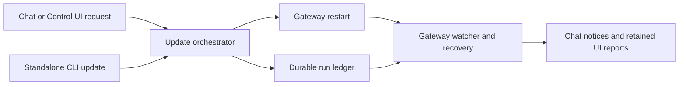

Codex review: blocked before merge. _Reviewed September 5, 2026, 1:48 AM ET / 05:48 UTC._

# ClawSweeper review

## What this changes

The PR gives chat, CLI, and Control UI a shared update progress view and retained reports that survive Gateway restarts.

## Merge readiness

⛔ **Blocked before merge - 8 items remain**

Keep open: the native retry finding is resolved, but both acknowledged lifecycle blockers remain. Current main contains the ledger foundation, not this PR’s complete UI and notification behavior.

**Priority:** P2
**Reviewed head:** `0847f56ccf74b3aa9edfb63699df1632705e63f8`
**Owner decision:** Required. See [Decision needed](#decision-needed).

## Review scores

| Measure | Result | What it means |
|---|---|---|
| **Overall readiness** | 🦐 gold shrimp **(3/6)** | Coherent shared-owner implementation and a resolved native retry defect, with two acknowledged lifecycle blockers still open. |
| **Proof confidence** | 🌊 off-meta tidepool | Not applicable: The maintainer-authored exemption applies. Supplied CLI previews cover durable JSON reports, and browser tests cover retained views and native handoff; earlier AWS campaign evidence does not establish final-head interruption recovery or idle-Gateway discovery. |
| **Patch quality** | 🦐 gold shrimp **(3/6)** | 2 actionable review findings remain. |

## Verification

| Check | Result | Evidence |
|---|---|---|
| **Real behavior** | Not applicable | Not applicable: The maintainer-authored exemption applies. Supplied CLI previews cover durable JSON reports, and browser tests cover retained views and native handoff; earlier AWS campaign evidence does not establish final-head interruption recovery or idle-Gateway discovery. |
| **Evidence reviewed** | 12 items | Introduced scope: Inspected the pinned merge-base-to-head delta. The supplied test merge is stale, so no claim here attributes current-main drift to this PR. Persistent UI interlock: The new projection treats every running ledger row as busy. The existing bootstrap consumer suspends configuration writes from these flags at ui/src/app/bootstrap.ts:295. Interrupted-writer ownership gap: CLI admission creates a running row; terminalization requires a subsequent explicit write. The ledger has no writer-liveness reconciliation, and restart recovery returns immediately when no sentinel exists. |
| **Findings** | 2 actionable findings | [P2] Reconcile interrupted runs before using them as a persistent UI lock [P2] Wake the Gateway watcher for standalone CLI admissions |
| **Security** | None | None. |

## How this fits together

Update requests enter through chat, the CLI, or Control UI and write progress to a shared SQLite ledger. The Gateway observes those records to notify conversations and refresh browser controls after restart.

## Decision needed

| Question | Recommendation |
|---|---|
| Should the run-owned writer-transfer and interruption-recovery prerequisite be implemented here, or should this PR wait for the update campaign to provide it? | **Approve owner-level recovery here:** Accept a ledger/orchestrator claim-transfer design, then complete interruption recovery and cross-process discovery before landing these surfaces. |

Why: The remaining repair changes persistent lifecycle ownership; the discussion explicitly leaves that design unaccepted, and a surviving detached updater makes heuristic cleanup unsafe.

## Before merge

- [ ] **Reconcile interrupted runs before using them as a persistent UI lock (P2)** - If a standalone CLI updater dies after admission but before publishing a restart sentinel, its ledger row remains `running`. These new flags restore that row as a permanent interlock, and `bootstrap.ts:295` suspends configuration writes after reconnect or reload. Neither the watcher deadline nor sentinel recovery terminalizes that case. The previously reported blocker remains: reconcile through the ledger/orchestrator owner while preserving any surviving detached updater’s claim.
- [ ] **Wake the Gateway watcher for standalone CLI admissions (P2)** - The new live run view depends on `update.run.changed`, but this watcher stops scheduling reads when no run exists. A subsequently launched CLI writes SQLite without waking the Gateway’s process-local callback. With no campaign or Gateway restart, the connected UI misses admission and completion; a manually loaded running row also receives no terminal event. The earlier discovery blocker remains: connect standalone admission to a Gateway-owned cross-process discovery path and cover the idle-to-running-to-finished sequence.
- [ ] **Resolve merge risk (P1)** - An existing orphaned running row can become a persistent configuration/update interlock when the new UI loads; upgrade recovery remains unresolved.
- [ ] **Resolve merge risk (P1)** - Safe reconciliation must distinguish a dead initiating process from a surviving detached updater, so helper-PID or elapsed-time inference could permit overlapping updates.
- [ ] **Complete next step (P2)** - Accept the lifecycle recovery contract, resolve both retained findings, and establish interruption and idle-Gateway discovery evidence before merge.
- [ ] **Resolve maintainer decision** - Resolve the maintainer decision shown above before merge.
- [ ] **Review config compatibility** - Confirm compatibility and upgrade impact for the changed config or default surface before merge.
- [ ] **Add data-model compatibility proof** - Confirm migration or upgrade compatibility proof before merge.

## Findings

- [P2] Reconcile interrupted runs before using them as a persistent UI lock — `ui/src/app/overlays-updates.ts:161-163`
- [P2] Wake the Gateway watcher for standalone CLI admissions — `src/gateway/update-run-watcher.ts:34-37`

<strong>Agent review details</strong>

### Security

None.

### PR surface

PR surface statistics unavailable: the file list is incomplete.

### Review metrics

| Metric | Value | Why it matters |
|---|---|---|
| **Production versus test growth** | Production +214 net; tests/support −848 net; schema extraction is a move | Feature growth adds the shared view and notice routing while removing browser inference and duplicate paths. |
| **Public update output** | 1 additive JSON field: run; 0 new configuration options | CLI consumers gain the durable record without another operator policy knob. |

### Stored data model

Persistent data-model change detected: `database schema: src/infra/update-run-schema.ts`, `migration/backfill/repair: src/cli/update-cli/progress.ts`, `migration/backfill/repair: ui/src/test-helpers/update-run.ts`, `serialized state: src/gateway/update-run-summary.ts`, `serialized state: ui/src/app/update-run-receipts.ts`, `serialized state: ui/src/components/sidebar-attention-store.ts`, and 4 more. Confirm migration or upgrade compatibility proof before merge.

### Merge-risk options

**Maintainer options:**
1. **Complete recovery at the ledger owner (recommended)**  
   Approve and implement writer reconciliation, then verify fresh and pre-existing interrupted rows without invalidating a surviving updater.
2. **Pause behind lifecycle prerequisites**  
   Retain the contribution while the campaign supplies interruption recovery and idle-Gateway discovery.

### Technical review

Best possible solution:

Keep the ledger as the single outcome owner, with accepted writer-transfer reconciliation, cross-process discovery, and visible recovery that safely releases stranded controls.

Do we have a high-confidence way to reproduce the issue?

Yes for the remaining findings: source establishes a stranded interlock after CLI death before sentinel publication, and missed updates when standalone CLI admission occurs after the Gateway watcher becomes idle. These scenarios were not executed during this read-only review.

Is this the best way to solve the issue?

The shared-ledger direction is sound, but incomplete: reconciliation and discovery belong in the updater/Gateway owners, rather than browser timeouts or another client-side outcome model.

Full review comments:

- [P2] Reconcile interrupted runs before using them as a persistent UI lock — `ui/src/app/overlays-updates.ts:161-163`
  If a standalone CLI updater dies after admission but before publishing a restart sentinel, its ledger row remains `running`. These new flags restore that row as a permanent interlock, and `bootstrap.ts:295` suspends configuration writes after reconnect or reload. Neither the watcher deadline nor sentinel recovery terminalizes that case. The previously reported blocker remains: reconcile through the ledger/orchestrator owner while preserving any surviving detached updater’s claim.
  Confidence: 0.99
- [P2] Wake the Gateway watcher for standalone CLI admissions — `src/gateway/update-run-watcher.ts:34-37`
  The new live run view depends on `update.run.changed`, but this watcher stops scheduling reads when no run exists. A subsequently launched CLI writes SQLite without waking the Gateway’s process-local callback. With no campaign or Gateway restart, the connected UI misses admission and completion; a manually loaded running row also receives no terminal event. The earlier discovery blocker remains: connect standalone admission to a Gateway-owned cross-process discovery path and cover the idle-to-running-to-finished sequence.
  Confidence: 0.98

Overall correctness: patch is incorrect
Overall confidence: 0.97

AGENTS.md: found and applied where relevant.

Codex review notes: model internal, reasoning high; reviewed against [7b1217e2e79e](https://github.com/openclaw/openclaw/commit/7b1217e2e79e5b489ea542e3019f9e86c281529a).

### Labels

Label justifications:

- `P2`: This useful update-observability feature has bounded lifecycle defects requiring completion before merge.
- `merge-risk: 🚨 compatibility`: Loading an orphaned ledger row can newly disable existing update and configuration controls across reconnects.
- `rating: 🦐 gold shrimp`: Overall readiness is 🦐 gold shrimp; proof is 🌊 off-meta tidepool and patch quality is 🦐 gold shrimp.
- `status: ⏳ waiting on author`: ClawSweeper has contributor-facing work open and is waiting for author action. Not applicable: The maintainer-authored exemption applies. Supplied CLI previews cover durable JSON reports, and browser tests cover retained views and native handoff; earlier AWS campaign evidence does not establish final-head interruption recovery or idle-Gateway discovery.
- `proof: telegram-e2e`: This PR needs Telegram Test Server proof with the repository E2E skill. Acknowledgement, restart, verification, and final-report messages change observable Telegram chat behavior.

### Evidence

What I checked:

- **Introduced scope:** Inspected the pinned merge-base-to-head delta. The supplied test merge is stale, so no claim here attributes current-main drift to this PR. ([0847f56ccf74](https://github.com/openclaw/openclaw/commit/0847f56ccf74b3aa9edfb63699df1632705e63f8))
- **Persistent UI interlock:** The new projection treats every running ledger row as busy. The existing bootstrap consumer suspends configuration writes from these flags at ui/src/app/bootstrap.ts:295. ([`ui/src/app/overlays-updates.ts:161`](https://github.com/openclaw/openclaw/blob/0847f56ccf74b3aa9edfb63699df1632705e63f8/ui/src/app/overlays-updates.ts#L161), [0847f56ccf74](https://github.com/openclaw/openclaw/commit/0847f56ccf74b3aa9edfb63699df1632705e63f8))
- **Interrupted-writer ownership gap:** CLI admission creates a running row; terminalization requires a subsequent explicit write. The ledger has no writer-liveness reconciliation, and restart recovery returns immediately when no sentinel exists. ([`src/infra/update-run-ledger.ts:486`](https://github.com/openclaw/openclaw/blob/0847f56ccf74b3aa9edfb63699df1632705e63f8/src/infra/update-run-ledger.ts#L486), [0847f56ccf74](https://github.com/openclaw/openclaw/commit/0847f56ccf74b3aa9edfb63699df1632705e63f8))
- **Standalone CLI discovery gap:** An idle watcher returns without scheduling another read. Its wake callback is process-local; callers are Gateway admission and automatic campaigns, while standalone CLI admission only writes the ledger. The watcher test explicitly invokes the local wake function. ([`src/gateway/update-run-watcher.ts:34`](https://github.com/openclaw/openclaw/blob/0847f56ccf74b3aa9edfb63699df1632705e63f8/src/gateway/update-run-watcher.ts#L34), [0847f56ccf74](https://github.com/openclaw/openclaw/commit/0847f56ccf74b3aa9edfb63699df1632705e63f8))
- **Native retry repair:** Retained-report retries now call hasNativeUpdateBridge(), matching fresh updates. The browser ownership test covers available, failed, and skipped states, one native start message, and one Gateway handoff after native decline. ([`ui/src/components/sidebar-update-card.ts:124`](https://github.com/openclaw/openclaw/blob/0847f56ccf74b3aa9edfb63699df1632705e63f8/ui/src/components/sidebar-update-card.ts#L124), [0847f56ccf74](https://github.com/openclaw/openclaw/commit/0847f56ccf74b3aa9edfb63699df1632705e63f8))
- **Review continuity and proof boundaries:** The supplied body and https://github.com/openclaw/openclaw/pull/138737#issuecomment-5549569811 explicitly defer interrupted-run recovery and idle-Gateway discovery before landing. They report 702 targeted checks and final-head CI success, while identifying browser proof as mocked and AWS evidence as an earlier integrated campaign. ([0847f56ccf74](https://github.com/openclaw/openclaw/commit/0847f56ccf74b3aa9edfb63699df1632705e63f8))

Likely related people:

- **steipete:** Suggested for follow-up; no historical authorship or introduction is verified. (role: unverified routing candidate; confidence: low)

### Rank-up moves

Optional improvements that raise the rating; they are not merge blockers.

- Accept and implement run-owned interruption recovery covering a killed CLI writer and a surviving detached updater.
- Verify standalone CLI admission and completion reach an idle Gateway without restarting it.

### Rating scale

| Score | Internal tier | Crab rank | Meaning |
|---:|:---:|---|---|
| **6/6** | S | 🦀 challenger crab | Exceptional readiness |
| **5/6** | A | 🦞 diamond lobster | Very strong readiness |
| **4/6** | B | 🐚 platinum hermit | Good normal PR; ordinary maintainer review |
| **3/6** | C | 🦐 gold shrimp | Useful, but confidence is limited |
| **2/6** | D | 🦪 silver shellfish | Proof or implementation needs work |
| **1/6** | F | 🧂 unranked krab | Not merge-ready |
| N/A | NA | 🌊 off-meta tidepool | Rating does not apply |

Overall follows the weaker of proof and patch quality.
Shiny media proof means a screenshot, video, or linked artifact directly shows the changed behavior. Runtime, network, CSP, and security claims still need visible diagnostics.

### Workflow

- ClawSweeper keeps one durable marker-backed review comment per issue or PR.
- Re-runs edit this comment so the latest verdict, findings, and automation markers stay together instead of adding duplicate bot comments.
- A fresh review can be triggered by eligible `@clawsweeper re-review` comments, exact-item GitHub events, scheduled/background review runs, or manual workflow dispatch.
- PR/issue authors and users with repository write access can comment `@clawsweeper re-review` or `@clawsweeper re-run` on an open PR or issue to request a fresh review only.
- Maintainers can also comment `@clawsweeper review` to request a fresh review only.
- Fresh-review commands do not start repair, autofix, rebase, CI repair, or automerge.
- Maintainer-only repair and merge flows require explicit commands such as `@clawsweeper autofix`, `@clawsweeper automerge`, `@clawsweeper fix ci`, or `@clawsweeper address review`.
- Maintainers can comment `@clawsweeper explain` to ask for more context, or `@clawsweeper stop` to stop active automation.

### History

Review history (3 earlier review cycles)

<!-- clawsweeper-review-history v=1 total=3 -->
- reviewed 2026-09-05T01:09:39.970Z sha f0d016b945b0807d6a976d46b6ca8dcb1f57ea06 :: blocked before merge. :: [P2] Reconcile interrupted runs before using them as a persistent UI lock | [P3] Qualify the four-message promise until managed staging supports it
- reviewed 2026-09-05T01:50:49.644Z sha ceaa2a4eaa11b07522efa75142f7b0fe87b48ec8 :: blocked before merge. :: [P2] Reconcile interrupted runs before using them as a persistent UI lock | [P2] Wake the update watcher for standalone CLI admissions
- reviewed 2026-09-05T03:54:12.105Z sha 838309172d83dc9ac3513341920ef2bb64aca79f :: blocked before merge. :: [P2] Reconcile interrupted runs before using them as a persistent UI lock | [P2] Wake the Gateway watcher for standalone CLI admissions | [P2] Preserve native update ownership when retrying a sidebar report

<!-- clawsweeper-verdict:needs-human item=138737 sha=0847f56ccf74b3aa9edfb63699df1632705e63f8 confidence=high updated_at=2026-09-05T05:43:56Z reviewed_at=2026-09-05T05:48:40.959Z lease_owner=github-run-33947906735-1 lease_comment_id=5549751776 source_revision=9bbeb76b8c6712e4cdcf5d68059ef5b04ac23952eed532b9aa3f03a153f6c0c1 live_verification=absent -->
<!-- clawsweeper-review-state:blocked item=138737 sha=0847f56ccf74b3aa9edfb63699df1632705e63f8 v=1 -->

<!-- clawsweeper-review-version item=138737 reviewed_at=2026-09-05T05:48:40.959Z sha=0847f56ccf74b3aa9edfb63699df1632705e63f8 source_revision=9bbeb76b8c6712e4cdcf5d68059ef5b04ac23952eed532b9aa3f03a153f6c0c1 lease_owner=github-run-33947906735-1 lease_comment_id=5549751776 v=1 -->

<!-- clawsweeper-review item=138737 -->