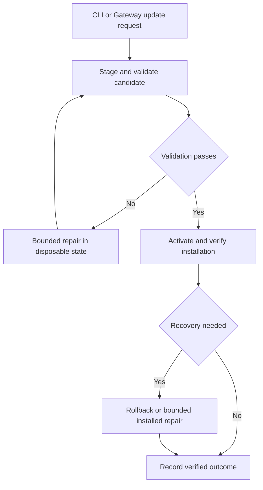

Codex review: blocked before merge. _Reviewed September 6, 2026, 7:01 AM ET / 11:01 UTC._

# ClawSweeper review

## What this changes

Adds bounded model-assisted recovery to failed updates, with disposable candidate repair, updater-controlled service recovery, and operator-visible attempt reports.

## Merge readiness

⛔ **Blocked before merge - 2 items remain**

Keep open as useful, maintainer-owned work. The earlier isolation and requester-authority findings are addressed, and no remaining blocking defect was established. The previous generic compatibility warning does not identify an additional unresolved contract change.

**Priority:** P2
**Reviewed head:** `d4b18e843258254f95777d49c8eb4e58854eb525`

## Review scores

| Measure | Result | What it means |
|---|---|---|
| **Overall readiness** | 🐚 platinum hermit **(4/6)** | Useful integration with meaningful production-boundary proof and repaired prior findings; no additional blocking patch defect was found. |
| **Proof confidence** | 🐚 platinum hermit **(4/6)** | Sufficient (terminal): Reported built-helper runs exercise the production repair entrypoint and real local HTTP inference client in both phases: allowed requesters produce later spawn/write effects, while revocation during pending inference prevents them. Staged-isolation runs preserve serving files and reject config promotion; the separately disclosed macOS EPIPE failure is not counted as a passing case. |
| **Patch quality** | 🐚 platinum hermit **(4/6)** | No actionable review findings were identified. |

## Verification

| Check | Result | Evidence |
|---|---|---|
| **Real behavior** | Verified | Sufficient (terminal): Reported built-helper runs exercise the production repair entrypoint and real local HTTP inference client in both phases: allowed requesters produce later spawn/write effects, while revocation during pending inference prevents them. Staged-isolation runs preserve serving files and reject config promotion; the separately disclosed macOS EPIPE failure is not counted as a passing case. |
| **Evidence reviewed** | 10 items | Pinned introduction and review continuity: The local merge-base-to-head diff supplies all 95 introduced paths, overcoming the supplied file-list truncation. HEAD matches the previous completed review revision; its empty findings and historical compatibility next step were evaluated against current source. The stale test merge was not used to infer removals. Automatic integration remains absent on inspected main: Current main’s candidate callback returns failed validation steps without invoking bounded repair. The merged prerequisite https://github.com/openclaw/openclaw/pull/138839 explicitly leaves automatic repair integration to subsequent work, so it does not supersede this PR. Existing repair owner and historical routing: Main history identifies the standalone configured-inference repair work at d12357e, authored by Peter Steinberger. Its recorded commit message explicitly separates later updater integration. This also corrects the PR body’s unrelated prerequisite link to https://github.com/openclaw/openclaw/pull/138738; the repair history names https://github.com/openclaw/openclaw/pull/138673. |
| **Findings** | None | None. |
| **Security** | None | None. |

## How this fits together

OpenClaw’s updater receives CLI or Gateway update requests, validates a candidate installation, and controls activation and recovery. Repair uses configured inference, while independent checks determine whether the installation can proceed or must report failure.

## Before merge

- [ ] **Review config compatibility** - Confirm compatibility and upgrade impact for the changed config or default surface before merge.
- [ ] **Add data-model compatibility proof** - Confirm migration or upgrade compatibility proof before merge.

<strong>Agent review details</strong>

### Security

None.

### PR surface

PR surface statistics unavailable: the file list is incomplete.

### Review metrics

| Metric | Value | Why it matters |
|---|---|---|
| **Production versus test growth** | Production net +1,905 lines; tests and test support net +3,300; tooling net +4 | Production growth implements repair orchestration, isolated execution and lifecycle ownership; the larger validation surface covers their failure boundaries. |
| **Requester authority scenarios** | 4 allowed/revoked scenarios across 2 repair phases | The proof checks actual later spawn, command and file effects after authorization changes during inference. |

### Stored data model

Persistent data-model change detected: `migration/backfill/repair: scripts/lib/vitest-build-prerequisites.mts`, `migration/backfill/repair: src/cli/update-cli/update-command-execution.ts`, `migration/backfill/repair: src/cli/update-cli/update-command-post-update.ts`, `migration/backfill/repair: src/cli/update-cli/update-command-repair-service.ts`, `migration/backfill/repair: src/cli/update-cli/update-command-repair.ts`, `migration/backfill/repair: src/infra/runtime-process-entrypoints.ts`, and 10 more. Confirm migration or upgrade compatibility proof before merge.

### Technical review

Best possible solution:

Keep repair inside the existing updater lifecycle, with disposable pre-activation state, current requester checks at effects, and independent verification deciding every recovery outcome.

Do we have a high-confidence way to reproduce the issue?

Not applicable as a new recovery capability; current main’s validation callback establishes the missing integration, and the supplied boundary runs exercise repaired and revoked outcomes.

Is this the best way to solve the issue?

Yes. Reusing the existing repair loop while retaining deterministic validation, isolated rehearsal and updater-owned lifecycle control is a coherent extension; the prior concrete findings are addressed.

AGENTS.md: found and applied where relevant.

Codex review notes: model internal, reasoning medium; reviewed against [9c56ee41de73](https://github.com/openclaw/openclaw/commit/9c56ee41de7382d42492e18a4a8c693947f286b9).

### Labels

Label justifications:

- `P2`: This is a bounded recovery improvement for failed updates, with no newly established urgent regression.
- `rating: 🐚 platinum hermit`: Overall readiness is 🐚 platinum hermit; proof is 🐚 platinum hermit and patch quality is 🐚 platinum hermit.
- `status: 👀 ready for maintainer look`: ClawSweeper has no concrete contributor-facing blocker left for this PR. Sufficient (terminal): Reported built-helper runs exercise the production repair entrypoint and real local HTTP inference client in both phases: allowed requesters produce later spawn/write effects, while revocation during pending inference prevents them. Staged-isolation runs preserve serving files and reject config promotion; the separately disclosed macOS EPIPE failure is not counted as a passing case.
- `proof: sufficient`: Contributor real behavior proof is sufficient. Reported built-helper runs exercise the production repair entrypoint and real local HTTP inference client in both phases: allowed requesters produce later spawn/write effects, while revocation during pending inference prevents them. Staged-isolation runs preserve serving files and reject config promotion; the separately disclosed macOS EPIPE failure is not counted as a passing case.

### Evidence

What I checked:

- **Pinned introduction and review continuity:** The local merge-base-to-head diff supplies all 95 introduced paths, overcoming the supplied file-list truncation. HEAD matches the previous completed review revision; its empty findings and historical compatibility next step were evaluated against current source. The stale test merge was not used to infer removals. ([d4b18e843258](https://github.com/openclaw/openclaw/commit/d4b18e843258254f95777d49c8eb4e58854eb525))
- **Automatic integration remains absent on inspected main:** Current main’s candidate callback returns failed validation steps without invoking bounded repair. The merged prerequisite https://github.com/openclaw/openclaw/pull/138839 explicitly leaves automatic repair integration to subsequent work, so it does not supersede this PR. ([`src/cli/update-cli/update-command-execution.ts:364`](https://github.com/openclaw/openclaw/blob/9c56ee41de7382d42492e18a4a8c693947f286b9/src/cli/update-cli/update-command-execution.ts#L364), [9c56ee41de73](https://github.com/openclaw/openclaw/commit/9c56ee41de7382d42492e18a4a8c693947f286b9))
- **Existing repair owner and historical routing:** Main history identifies the standalone configured-inference repair work at d12357e, authored by Peter Steinberger. Its recorded commit message explicitly separates later updater integration. This also corrects the PR body’s unrelated prerequisite link to https://github.com/openclaw/openclaw/pull/138738; the repair history names https://github.com/openclaw/openclaw/pull/138673. ([`src/infra/update-repair-agent.ts`](https://github.com/openclaw/openclaw/blob/d12357eaa4b615bf293ef3544ba7c434291b0429/src/infra/update-repair-agent.ts), [d12357eaa4b6](https://github.com/openclaw/openclaw/commit/d12357eaa4b615bf293ef3544ba7c434291b0429))
- **Staged repair isolation and independent revalidation:** Repair receives disposable configuration, state, workspace and environment selectors. Changed configuration keys prevent promotion, and the updater validates surviving candidate changes again after rehearsal cleanup. The inspected isolation E2E checks serving config and SQLite/WAL/SHM bytes, inode and mtime, alongside successful candidate-only repair. ([`src/cli/update-cli/update-command-execution.ts:338`](https://github.com/openclaw/openclaw/blob/d4b18e843258254f95777d49c8eb4e58854eb525/src/cli/update-cli/update-command-execution.ts#L338), [d4b18e843258](https://github.com/openclaw/openclaw/commit/d4b18e843258254f95777d49c8eb4e58854eb525))
- **Current requester authority reaches effects:** The requester is captured separately from mutable repair state and checked against current installation policy. The execution-budget guard composes that predicate into existing filesystem and process effect guards; the candidate worker reconstructs the requester predicate rather than treating the stored run identifier as authorization. ([`src/infra/update-requester-authority.ts:57`](https://github.com/openclaw/openclaw/blob/d4b18e843258254f95777d49c8eb4e58854eb525/src/infra/update-requester-authority.ts#L57), [d4b18e843258](https://github.com/openclaw/openclaw/commit/d4b18e843258254f95777d49c8eb4e58854eb525))
- **Allowed and revoked production-boundary proof:** The captured PR body and https://github.com/openclaw/openclaw/pull/139495#issuecomment-5558091501 report passing all four validating/verifying allowed/revoked cases. Inspection confirms a real local HTTP provider, built agent execution, actual spawn/write markers, and revocation during pending inference; assertions require second effects only for the allowed requester and requester-revoked otherwise. These are production-boundary fault scenarios, beyond isolated mocked transport tests. ([`src/infra/update-managed-service-handoff-lifecycle.test.ts:252`](https://github.com/openclaw/openclaw/blob/d4b18e843258254f95777d49c8eb4e58854eb525/src/infra/update-managed-service-handoff-lifecycle.test.ts#L252), [d4b18e843258](https://github.com/openclaw/openclaw/commit/d4b18e843258254f95777d49c8eb4e58854eb525))

Likely related people:

- **steipete:** Suggested for follow-up; no historical authorship or introduction is verified. (role: unverified routing candidate; confidence: low)
- **Jason (Json):** Suggested for follow-up; no historical authorship or introduction is verified. (role: unverified routing candidate; confidence: low)

### Rating scale

| Score | Internal tier | Crab rank | Meaning |
|---:|:---:|---|---|
| **6/6** | S | 🦀 challenger crab | Exceptional readiness |
| **5/6** | A | 🦞 diamond lobster | Very strong readiness |
| **4/6** | B | 🐚 platinum hermit | Good normal PR; ordinary maintainer review |
| **3/6** | C | 🦐 gold shrimp | Useful, but confidence is limited |
| **2/6** | D | 🦪 silver shellfish | Proof or implementation needs work |
| **1/6** | F | 🧂 unranked krab | Not merge-ready |
| N/A | NA | 🌊 off-meta tidepool | Rating does not apply |

Overall follows the weaker of proof and patch quality.
Shiny media proof means a screenshot, video, or linked artifact directly shows the changed behavior. Runtime, network, CSP, and security claims still need visible diagnostics.

### Workflow

- ClawSweeper keeps one durable marker-backed review comment per issue or PR.
- Re-runs edit this comment so the latest verdict, findings, and automation markers stay together instead of adding duplicate bot comments.
- A fresh review can be triggered by eligible `@clawsweeper re-review` comments, exact-item GitHub events, scheduled/background review runs, or manual workflow dispatch.
- PR/issue authors and users with repository write access can comment `@clawsweeper re-review` or `@clawsweeper re-run` on an open PR or issue to request a fresh review only.
- Maintainers can also comment `@clawsweeper review` to request a fresh review only.
- Fresh-review commands do not start repair, autofix, rebase, CI repair, or automerge.
- Maintainer-only repair and merge flows require explicit commands such as `@clawsweeper autofix`, `@clawsweeper automerge`, `@clawsweeper fix ci`, or `@clawsweeper address review`.
- Maintainers can comment `@clawsweeper explain` to ask for more context, or `@clawsweeper stop` to stop active automation.

### History

Review history (11 earlier review cycles; latest 8 shown)

<!-- clawsweeper-review-history v=1 total=11 -->
- reviewed 2026-09-06T01:56:11.178Z sha ffdc2a6ee078201fccd8919e066e4ee32cec8a9c :: needs real behavior proof before merge. :: [P1] [P1] Keep staged repair commands off the serving installation's state | [P1] [P1] Revalidate the chat requester before repair tool effects
- reviewed 2026-09-06T02:22:57.806Z sha ce6c31bf9f7165501edb2480e904ab06f053b17a :: needs real behavior proof before merge. :: [P1] [P1] Keep staged repair commands off live installation state | [P1] [P1] Revalidate the chat requester before repair tool effects
- reviewed 2026-09-06T02:41:07.162Z sha ce6c31bf9f7165501edb2480e904ab06f053b17a :: needs real behavior proof before merge. :: [P1] Keep staged repair commands off live configuration and state | [P1] Revalidate the chat requester before repair tool effects
- reviewed 2026-09-06T07:29:29.570Z sha 46d540e9ee1570b4597d2e8dd8a6e773875da9a8 :: blocked before merge. :: none
- reviewed 2026-09-06T08:47:59.337Z sha d09aed8c7ae6739ff364ab3127e18673b3819f39 :: blocked before merge. :: none
- reviewed 2026-09-06T09:52:04.393Z sha e8504dcbde52e81c2848c38554e0544bb59e2b00 :: blocked before merge. :: none
- reviewed 2026-09-06T10:05:00.272Z sha ec44c83b3e8bf9111ee44fde6bd17be707f6929b :: blocked before merge. :: none
- reviewed 2026-09-06T10:42:52.367Z sha d4b18e843258254f95777d49c8eb4e58854eb525 :: blocked before merge. :: none

<!-- clawsweeper-verdict:needs-human item=139495 sha=d4b18e843258254f95777d49c8eb4e58854eb525 confidence=high updated_at=2026-09-06T10:57:37Z reviewed_at=2026-09-06T11:01:40.286Z lease_owner=github-run-34028782494-1 lease_comment_id=5558758359 source_revision=7f0cc7ea4993b52d8fad16999529bb907e939674401d2126551fc6f832deabc7 live_verification=absent -->
<!-- clawsweeper-review-state:blocked item=139495 sha=d4b18e843258254f95777d49c8eb4e58854eb525 v=1 -->

<!-- clawsweeper-review-version item=139495 reviewed_at=2026-09-06T11:01:40.286Z sha=d4b18e843258254f95777d49c8eb4e58854eb525 source_revision=7f0cc7ea4993b52d8fad16999529bb907e939674401d2126551fc6f832deabc7 lease_owner=github-run-34028782494-1 lease_comment_id=5558758359 v=1 -->

<!-- clawsweeper-review item=139495 -->