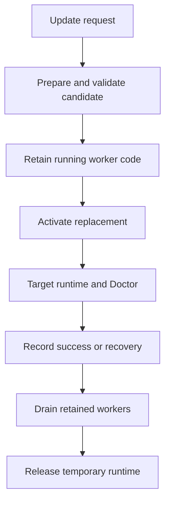

Codex review: blocked before merge. _Reviewed September 22, 2026, 3:46 AM ET / 07:46 UTC (Revision 20)._

# ClawSweeper review

## What this changes

The PR preserves update validation failures and Doctor diagnostics through recovery, retains running SQLite worker code during installation replacement, and delegates finalization to the selected target runtime.

## Merge readiness

⛔ **Blocked before merge - 2 items remain**

Keep open: this remains useful, distinct updater work, and no concrete introduced correctness defect was established. The current composition's declared upgrade qualification remains incomplete.

**Priority:** P2
**Reviewed head:** `f4291a7463b6dc2d1320174b591ed6d31fd59b19`

## Review scores

| Measure | Result | What it means |
|---|---|---|
| **Overall readiness** | 🦐 gold shrimp **(3/6)** | The implementation and regression coverage provide useful confidence, but the declared current-composition upgrade proof remains incomplete. |
| **Proof confidence** | 🦐 gold shrimp **(3/6)** | Not applicable: Real behavior proof is not required for maintainer- or bot-authored pull requests. |
| **Patch quality** | 🐚 platinum hermit **(4/6)** | No actionable review findings were identified. |

## Verification

| Check | Result | Evidence |
|---|---|---|
| **Real behavior** | Not applicable | Not applicable: Real behavior proof is not required for maintainer- or bot-authored pull requests. |
| **Evidence reviewed** | 10 items | Pinned change ownership: Reviewed the introduced delta from 5c42f636bb9b9f3bc78cbc14cf775fc28a875550 to f4291a7463b6dc2d1320174b591ed6d31fd59b19. Raw commit inspection confirmed the original head's recorded parent and the test merge's ordered base/head parents. Base-only UI, session-share, and Gateway changes were excluded from PR attribution. Current main still loses recorded verification details: Current main's verification wrapper replaces a thrown callback outcome with a generic verification failure; it lacks the branch's recorded-step preservation. Current main also lacks the two new runtime-retention modules, so the central work remains distinct. Latest release comparison: The supplied latest release, v2026.9.5, likewise converts thrown verification callbacks into a generic failure rather than preserving their recorded Doctor result. The release blob was inspected through GitHub after local object retrieval failed. |
| **Findings** | None | None. |
| **Security** | None | None. |

## How this fits together

The updater prepares and validates a replacement installation before activating it, running Doctor, and recording recovery outcomes. Its SQLite workers must remain compatible with the running updater while installation files change.

## Before merge

- [ ] **Resolve merge risk (P1)** - The changed worker-generation and target-finalization paths remain unqualified in the current compiled composition. An existing installation could encounter incompatible worker commands or incomplete recovery; published-driver upgrade evidence must establish worker settlement, native service recovery, and session preservation.
- [ ] **Complete next step (P2)** - Complete and record the declared current-composition compiled-worker, published 2026.9.2 upgrade, and completion-guard qualification before lifting the landing hold.

<strong>Agent review details</strong>

### Security

None.

### PR surface

Source +528, Tests +2065, Other +1. Total +2594 across 65 files.

View PR surface stats

| Area | Files | Added | Removed | Net |
|---|---:|---:|---:|---:|
| Source | 30 | 991 | 463 | +528 |
| Tests | 34 | 2913 | 848 | +2065 |
| Docs | 0 | 0 | 0 | 0 |
| Config | 0 | 0 | 0 | 0 |
| Generated | 0 | 0 | 0 | 0 |
| Other | 1 | 1 | 0 | +1 |
| **Total** | **65** | **3905** | **1311** | **+2594** |

### Review metrics

| Metric | Value | Why it matters |
|---|---|---|
| **Production versus test growth** | Application +528 net lines; tooling +1; tests/support +2,065 | Production growth is explicitly justified by failure preservation and retained worker lifecycle; test growth includes expanded existing regression matrices. |

### Merge-risk options

**Maintainer options:**
1. **Complete the declared upgrade qualification (recommended)**  
   Retain the landing hold until source-bound compiled-worker and published-updater results demonstrate service recovery and preserved sessions.

### Technical review

Best possible solution:

Keep activation, Doctor, and recovery with their existing owners, and qualify the retained-worker transition against the published updater before landing.

Do we have a high-confidence way to reproduce the issue?

Yes, from source: current main replaces a recorded Doctor outcome with a generic failure when verification throws, and lacks the proposed worker-generation retention. No failing runtime execution was performed in this review.

Is this the best way to solve the issue?

Yes at the source-design level: extending the existing failure classifier, CLI finalizer, dependency copier, and SQLite broker avoids competing owners. Compiled and published-updater qualification is still needed to establish upgrade safety.

AGENTS.md: found and applied where relevant.

Codex review notes: model internal, reasoning medium; reviewed against [b3f097deb9e3](https://github.com/openclaw/openclaw/commit/b3f097deb9e3fdba85c0eea45520a907f43c444a).

### Labels

Label changes:

No label changes.

Label justifications:

- `P2`: This is a concrete updater reliability repair, without evidence establishing an emergency caused by the proposed patch.
- `merge-risk: 🚨 compatibility`: Installation replacement now retains worker generations and changes finalization ordering, while current-composition published-updater compatibility remains unqualified.
- `rating: 🦐 gold shrimp`: Overall readiness is 🦐 gold shrimp; proof is 🦐 gold shrimp and patch quality is 🐚 platinum hermit.
- `status: 👀 ready for maintainer look`: ClawSweeper has no concrete contributor-facing blocker left for this PR. Not applicable: Real behavior proof is not required for maintainer- or bot-authored pull requests.

### Evidence

What I checked:

- **Pinned change ownership:** Reviewed the introduced delta from 5c42f636bb9b9f3bc78cbc14cf775fc28a875550 to f4291a7463b6dc2d1320174b591ed6d31fd59b19. Raw commit inspection confirmed the original head's recorded parent and the test merge's ordered base/head parents. Base-only UI, session-share, and Gateway changes were excluded from PR attribution. ([f4291a7463b6](https://github.com/openclaw/openclaw/commit/f4291a7463b6dc2d1320174b591ed6d31fd59b19))
- **Current main still loses recorded verification details:** Current main's verification wrapper replaces a thrown callback outcome with a generic verification failure; it lacks the branch's recorded-step preservation. Current main also lacks the two new runtime-retention modules, so the central work remains distinct. ([`src/infra/package-update-verification-step.ts:52`](https://github.com/openclaw/openclaw/blob/b3f097deb9e3fdba85c0eea45520a907f43c444a/src/infra/package-update-verification-step.ts#L52), [b3f097deb9e3](https://github.com/openclaw/openclaw/commit/b3f097deb9e3fdba85c0eea45520a907f43c444a))
- **Latest release comparison:** The supplied latest release, v2026.9.5, likewise converts thrown verification callbacks into a generic failure rather than preserving their recorded Doctor result. The release blob was inspected through GitHub after local object retrieval failed. ([`src/infra/package-update-verification-step.ts:26`](https://github.com/openclaw/openclaw/blob/ec9c1a13db8938e5a3eaa51fca2e981cde2395a9/src/infra/package-update-verification-step.ts#L26), [ec9c1a13db89](https://github.com/openclaw/openclaw/commit/ec9c1a13db8938e5a3eaa51fca2e981cde2395a9))
- **Failure preservation:** The branch preserves the recorded process result, adds the thrown failure fact, removes advisory classification, and propagates uncertain process cleanup instead of treating it as settled verification. ([`src/infra/package-update-verification-step.ts:163`](https://github.com/openclaw/openclaw/blob/f4291a7463b6dc2d1320174b591ed6d31fd59b19/src/infra/package-update-verification-step.ts#L163), [f4291a7463b6](https://github.com/openclaw/openclaw/commit/f4291a7463b6dc2d1320174b591ed6d31fd59b19))
- **Retained runtime lifecycle:** The updater copies its runtime through the existing dependency-tree owner. Worker generation is captured before detached admission, broker slots remain generation-specific, and retained files are released only after registered worker cleanup succeeds. Failed settlement retains the directory. ([`src/infra/runtime-worker-generation.ts:61`](https://github.com/openclaw/openclaw/blob/f4291a7463b6dc2d1320174b591ed6d31fd59b19/src/infra/runtime-worker-generation.ts#L61), [f4291a7463b6](https://github.com/openclaw/openclaw/commit/f4291a7463b6dc2d1320174b591ed6d31fd59b19))
- **Supplemental regression coverage:** Inspected coverage includes zero-exit timeout/output-limit failures, Doctor receipt preservation, config-attribution failure, requester revocation, package rollback, five retained dependency layouts, and generation-specific worker drain. These tests were not executed during this read-only review. ([`src/infra/update-retained-runtime.test.ts:167`](https://github.com/openclaw/openclaw/blob/f4291a7463b6dc2d1320174b591ed6d31fd59b19/src/infra/update-retained-runtime.test.ts#L167), [f4291a7463b6](https://github.com/openclaw/openclaw/commit/f4291a7463b6dc2d1320174b591ed6d31fd59b19))

Likely related people:

- **steipete:** Suggested for follow-up; no historical authorship or introduction is verified. (role: unverified routing candidate; confidence: low)
- **Vincent Koc:** Suggested for follow-up; no historical authorship or introduction is verified. (role: unverified routing candidate; confidence: low)

### Rank-up moves

Optional improvements that raise the rating; they are not merge blockers.

- Publish the declared compiled-worker, published-updater, and completion-guard results with source/package identities and service/session observations; preserve original failures and redact private details.
- Update the PR body with the qualification results to trigger re-review; if it does not refresh, ask a maintainer to comment @clawsweeper re-review.

### Rating scale

| Score | Internal tier | Crab rank | Meaning |
|---:|:---:|---|---|
| **6/6** | S | 🦀 challenger crab | Exceptional readiness |
| **5/6** | A | 🦞 diamond lobster | Very strong readiness |
| **4/6** | B | 🐚 platinum hermit | Good normal PR; ordinary maintainer review |
| **3/6** | C | 🦐 gold shrimp | Useful, but confidence is limited |
| **2/6** | D | 🦪 silver shellfish | Proof or implementation needs work |
| **1/6** | F | 🧂 unranked krab | Not merge-ready |
| N/A | NA | 🌊 off-meta tidepool | Rating does not apply |

Overall follows the weaker of proof and patch quality.
Shiny media proof means a screenshot, video, or linked artifact directly shows the changed behavior. Runtime, network, CSP, and security claims still need visible diagnostics.

### Workflow

- ClawSweeper keeps one durable marker-backed review comment per issue or PR.
- Re-runs edit this comment so the latest verdict, findings, and automation markers stay together instead of adding duplicate bot comments.
- A fresh review can be triggered by eligible `@clawsweeper re-review` comments, exact-item GitHub events, scheduled/background review runs, or manual workflow dispatch.
- PR/issue authors and users with repository write access can comment `@clawsweeper re-review` or `@clawsweeper re-run` on an open PR or issue to request a fresh review only.
- Maintainers can also comment `@clawsweeper review` to request a fresh review only.
- Fresh-review commands do not start repair, autofix, rebase, CI repair, or automerge.
- Maintainer-only repair and merge flows require explicit commands such as `@clawsweeper autofix`, `@clawsweeper automerge`, `@clawsweeper fix ci`, or `@clawsweeper address review`.
- Maintainers can comment `@clawsweeper explain` to ask for more context, or `@clawsweeper stop` to stop active automation.

### History

Review history (19 earlier review cycles; latest 8 shown)

<!-- clawsweeper-review-history v=1 total=19 -->
- reviewed 2026-09-21T06:07:25.526Z sha e8df73059b71e10c9d4638aeb9986e13a7992cce :: blocked before merge. :: none
- reviewed 2026-09-21T06:23:59.084Z sha d561f32f342cadef65ad175786b3f70e48dfa451 :: blocked before merge. :: none
- reviewed 2026-09-21T08:01:02.380Z sha 971871eb7fb19d33fb2b5b015275f1f1b82514be :: blocked before merge. :: none
- reviewed 2026-09-21T08:42:25.505Z sha 5db79d71b24ac07ee17ebbdbf8b8ea99184d2998 :: blocked before merge. :: none
- reviewed 2026-09-21T10:59:37.420Z sha 144d389eb43f5a312adac9aa8655c4dd454b584a :: blocked before merge. :: none
- reviewed 2026-09-22T03:46:44.268Z sha 6b7bb15166937936a547be237327c2435fa6a45c :: blocked before merge. :: none
- reviewed 2026-09-22T05:02:19.312Z sha 0509bad4ddb8c751b0efd7c970e652167c7931c0 :: blocked before merge. :: none
- reviewed 2026-09-22T07:17:35.597Z sha f4291a7463b6dc2d1320174b591ed6d31fd59b19 :: blocked before merge. :: none

<!-- clawsweeper-verdict:needs-human item=153764 sha=f4291a7463b6dc2d1320174b591ed6d31fd59b19 confidence=high updated_at=2026-09-22T07:42:29Z reviewed_at=2026-09-22T07:46:48.884Z lease_owner=github-run-35700818332-1 lease_comment_id=5772894785 source_revision=4e400d1001769b4ec12910c1f8d5a87e98aabb60e143b8439209cee15f2daa86 live_verification=absent -->
<!-- clawsweeper-review-state:blocked item=153764 sha=f4291a7463b6dc2d1320174b591ed6d31fd59b19 v=1 -->

<!-- clawsweeper-review-version item=153764 reviewed_at=2026-09-22T07:46:48.884Z sha=f4291a7463b6dc2d1320174b591ed6d31fd59b19 source_revision=4e400d1001769b4ec12910c1f8d5a87e98aabb60e143b8439209cee15f2daa86 lease_owner=github-run-35700818332-1 lease_comment_id=5772894785 v=1 -->

<!-- clawsweeper-review item=153764 -->