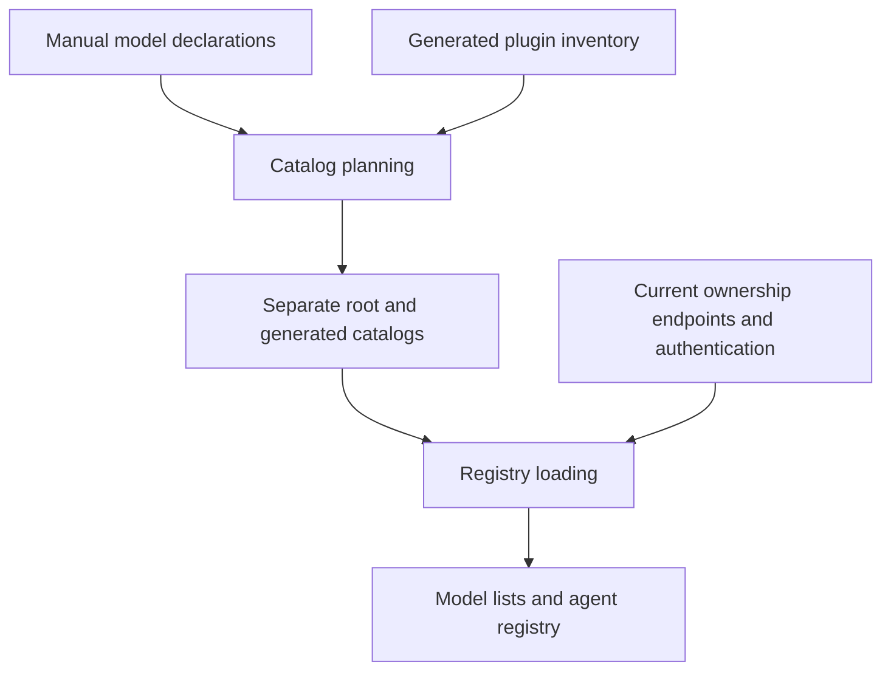

Codex review: needs maintainer review before merge. _Reviewed September 8, 2026, 12:36 PM ET / 16:36 UTC._

# ClawSweeper review

## What this changes

Preserves manually authored model entries during generated catalog refresh and requires current authentication before deferred plugins contribute cached models.

## Merge readiness

✅ **Ready for maintainer review**

This focused repair remains useful: current main still combines authored and generated providers before planning. No blocking introduced defect was established, and the related staging PR does not supersede this work.

**Priority:** P2
**Reviewed head:** `856a646937955076eacd0175fa16b0b430a36482`

## Review scores

| Measure | Result | What it means |
|---|---|---|
| **Overall readiness** | 🐚 platinum hermit **(4/6)** | A focused owner-level repair with meaningful regression coverage and no established blocking defect. |
| **Proof confidence** | 🌊 off-meta tidepool | Not applicable: The authoritative repository context identifies a MEMBER author, so the external-contributor proof gate does not apply. Supplemental body evidence reports compiled planner and CLI checks preserving authored rows and excluding unauthenticated deferred inventory; production code is unchanged since that tested revision. |
| **Patch quality** | 🐚 platinum hermit **(4/6)** | No actionable review findings were identified. |

## Verification

| Check | Result | Evidence |
|---|---|---|
| **Real behavior** | Not applicable | Not applicable: The authoritative repository context identifies a MEMBER author, so the external-contributor proof gate does not apply. Supplemental body evidence reports compiled planner and CLI checks preserving authored rows and excluding unauthenticated deferred inventory; production code is unchanged since that tested revision. |
| **Evidence reviewed** | 8 items | Current main still contains the reported overwrite: The current-main helper copies root providers, then assigns generated providers under the same IDs before planning, replacing the authored provider object. Separate planning preserves authorship: Generated recovery uses plugin catalogs separately; the root merge retains existing root declarations and reapplies normalization and managed-secret enforcement. Explicit replace still bypasses preservation. Membership filtering stays inside the catalog boundary: Ownership and endpoint filtering precede the deferred-plugin authentication check. ModelRegistry supplies existing AuthStorage and configured-key predicates; this changes inventory membership without adding request authority or a Codex dependency. |
| **Findings** | None | None. |
| **Security** | None | None. |

## How this fits together

OpenClaw combines manually declared models with plugin-generated inventory to populate model lists and agent registries. Catalog planning maintains those sources, while registry loading decides which generated entries are currently eligible.

## Before merge

None.

<strong>Agent review details</strong>

### Security

None.

### PR surface

Source +10, Tests +262, Docs +6, Other 0. Total +278 across 11 files.

View PR surface stats

| Area | Files | Added | Removed | Net |
|---|---:|---:|---:|---:|
| Source | 5 | 91 | 81 | +10 |
| Tests | 3 | 263 | 1 | +262 |
| Docs | 2 | 6 | 0 | +6 |
| Config | 0 | 0 | 0 | 0 |
| Generated | 0 | 0 | 0 | 0 |
| Other | 1 | 1 | 1 | 0 |
| **Total** | **11** | **361** | **83** | **+278** |

### Review metrics

None.

### Technical review

Best possible solution:

Keep authored declarations independent from generated inventory while preserving existing replacement, secret-management, and request-authorization contracts.

Do we have a high-confidence way to reproduce the issue?

Yes, from source: a generated catalog sharing a provider ID overwrites its manual root declaration before current-main planning. The PR reports compiled before/after reproduction; this review did not execute it.

Is this the best way to solve the issue?

Yes. Separating the two sources at the planning owner directly repairs the overwrite, and registry admission reuses existing ownership, endpoint, and authentication predicates.

AGENTS.md: found and applied where relevant.

Codex review notes: model internal, reasoning medium; reviewed against [0ce2595f8904](https://github.com/openclaw/openclaw/commit/0ce2595f89045bb00db09be2952ce7ce99077238).

### Labels

Label changes:

- add `P2`: This repairs bounded model-catalog preservation and membership behavior without evidence of an urgent system-wide outage.
- add `rating: 🐚 platinum hermit`: Overall readiness is 🐚 platinum hermit; proof is 🌊 off-meta tidepool and patch quality is 🐚 platinum hermit.
- add `status: 👀 ready for maintainer look`: ClawSweeper has no concrete contributor-facing blocker left for this PR. Not applicable: The authoritative repository context identifies a MEMBER author, so the external-contributor proof gate does not apply. Supplemental body evidence reports compiled planner and CLI checks preserving authored rows and excluding unauthenticated deferred inventory; production code is unchanged since that tested revision.

Label justifications:

- `P2`: This repairs bounded model-catalog preservation and membership behavior without evidence of an urgent system-wide outage.
- `rating: 🐚 platinum hermit`: Overall readiness is 🐚 platinum hermit; proof is 🌊 off-meta tidepool and patch quality is 🐚 platinum hermit.
- `status: 👀 ready for maintainer look`: ClawSweeper has no concrete contributor-facing blocker left for this PR. Not applicable: The authoritative repository context identifies a MEMBER author, so the external-contributor proof gate does not apply. Supplemental body evidence reports compiled planner and CLI checks preserving authored rows and excluding unauthenticated deferred inventory; production code is unchanged since that tested revision.

### Evidence

What I checked:

- **Current main still contains the reported overwrite:** The current-main helper copies root providers, then assigns generated providers under the same IDs before planning, replacing the authored provider object. ([`src/agents/models-config.ts:184`](https://github.com/openclaw/openclaw/blob/0ce2595f89045bb00db09be2952ce7ce99077238/src/agents/models-config.ts#L184), [0ce2595f8904](https://github.com/openclaw/openclaw/commit/0ce2595f89045bb00db09be2952ce7ce99077238))
- **Separate planning preserves authorship:** Generated recovery uses plugin catalogs separately; the root merge retains existing root declarations and reapplies normalization and managed-secret enforcement. Explicit replace still bypasses preservation. ([`src/agents/models-config.plan.ts:363`](https://github.com/openclaw/openclaw/blob/856a646937955076eacd0175fa16b0b430a36482/src/agents/models-config.plan.ts#L363), [856a64693795](https://github.com/openclaw/openclaw/commit/856a646937955076eacd0175fa16b0b430a36482))
- **Membership filtering stays inside the catalog boundary:** Ownership and endpoint filtering precede the deferred-plugin authentication check. ModelRegistry supplies existing AuthStorage and configured-key predicates; this changes inventory membership without adding request authority or a Codex dependency. ([`src/agents/plugin-model-catalog.ts:739`](https://github.com/openclaw/openclaw/blob/856a646937955076eacd0175fa16b0b430a36482/src/agents/plugin-model-catalog.ts#L739), [856a64693795](https://github.com/openclaw/openclaw/commit/856a646937955076eacd0175fa16b0b430a36482))
- **Regression coverage and reported runtime observations:** The new tests exercise root preservation through the production planner and cache admission through captured-source discovery, including credential removal, configured keys, ordinary plugins, and unowned providers. The captured PR body reports compiled before/after preservation and authenticated/unauthenticated CLI observations. This review did not execute tests. ([`src/agents/models-config.root-authorship.test.ts:63`](https://github.com/openclaw/openclaw/blob/856a646937955076eacd0175fa16b0b430a36482/src/agents/models-config.root-authorship.test.ts#L63), [856a64693795](https://github.com/openclaw/openclaw/commit/856a646937955076eacd0175fa16b0b430a36482))
- **Proof revision continuity:** The reported compiled candidate used fc66841597eaaaff6442d692fe7aa42517944fda. Its only difference from the reviewed head is the assertion-baseline reduction, so the production behavior exercised by that candidate is unchanged. ([`config/assertion-safety-baseline.txt:1870`](https://github.com/openclaw/openclaw/blob/856a646937955076eacd0175fa16b0b430a36482/config/assertion-safety-baseline.txt#L1870), [856a64693795](https://github.com/openclaw/openclaw/commit/856a646937955076eacd0175fa16b0b430a36482))
- **Related work and prior area ownership:** The body identifies this as an extraction from the still-open staging PR https://github.com/openclaw/openclaw/pull/136257. GitHub separately verifies obviyus authored the merged endpoint-eligibility work at https://github.com/openclaw/openclaw/pull/142158; that work is adjacent and does not implement root preservation. ([`src/agents/plugin-model-catalog.ts`](https://github.com/openclaw/openclaw/blob/f9ea6dbb69c04883999225dc6cbf8a404d64443c/src/agents/plugin-model-catalog.ts), [f9ea6dbb69c0](https://github.com/openclaw/openclaw/commit/f9ea6dbb69c04883999225dc6cbf8a404d64443c))

Likely related people:

- **obviyus:** Suggested for follow-up; no historical authorship or introduction is verified. (role: unverified routing candidate; confidence: low)
- **Peter Steinberger:** Suggested for follow-up; no historical authorship or introduction is verified. (role: unverified routing candidate; confidence: low)

### Rating scale

| Score | Internal tier | Crab rank | Meaning |
|---:|:---:|---|---|
| **6/6** | S | 🦀 challenger crab | Exceptional readiness |
| **5/6** | A | 🦞 diamond lobster | Very strong readiness |
| **4/6** | B | 🐚 platinum hermit | Good normal PR; ordinary maintainer review |
| **3/6** | C | 🦐 gold shrimp | Useful, but confidence is limited |
| **2/6** | D | 🦪 silver shellfish | Proof or implementation needs work |
| **1/6** | F | 🧂 unranked krab | Not merge-ready |
| N/A | NA | 🌊 off-meta tidepool | Rating does not apply |

Overall follows the weaker of proof and patch quality.
Shiny media proof means a screenshot, video, or linked artifact directly shows the changed behavior. Runtime, network, CSP, and security claims still need visible diagnostics.

### Workflow

- ClawSweeper keeps one durable marker-backed review comment per issue or PR.
- Re-runs edit this comment so the latest verdict, findings, and automation markers stay together instead of adding duplicate bot comments.
- A fresh review can be triggered by eligible `@clawsweeper re-review` comments, exact-item GitHub events, scheduled/background review runs, or manual workflow dispatch.
- PR/issue authors and users with repository write access can comment `@clawsweeper re-review` or `@clawsweeper re-run` on an open PR or issue to request a fresh review only.
- Maintainers can also comment `@clawsweeper review` to request a fresh review only.
- Fresh-review commands do not start repair, autofix, rebase, CI repair, or automerge.
- Maintainer-only repair and merge flows require explicit commands such as `@clawsweeper autofix`, `@clawsweeper automerge`, `@clawsweeper fix ci`, or `@clawsweeper address review`.
- Maintainers can comment `@clawsweeper explain` to ask for more context, or `@clawsweeper stop` to stop active automation.

<!-- clawsweeper-verdict:needs-human item=142302 sha=856a646937955076eacd0175fa16b0b430a36482 confidence=high updated_at=2026-09-08T16:33:35Z reviewed_at=2026-09-08T16:36:34.058Z lease_owner=github-run-34251587334-1 lease_comment_id=5588522305 source_revision=22d94f13c9a1deb559069ca950d4f4a5deacec601b405d90b6e949f774f735fe live_verification=absent -->
<!-- clawsweeper-review-state:ready item=142302 sha=856a646937955076eacd0175fa16b0b430a36482 v=1 -->

<!-- clawsweeper-review-version item=142302 reviewed_at=2026-09-08T16:36:34.058Z sha=856a646937955076eacd0175fa16b0b430a36482 source_revision=22d94f13c9a1deb559069ca950d4f4a5deacec601b405d90b6e949f774f735fe lease_owner=github-run-34251587334-1 lease_comment_id=5588522305 v=1 -->

<!-- clawsweeper-review item=142302 -->