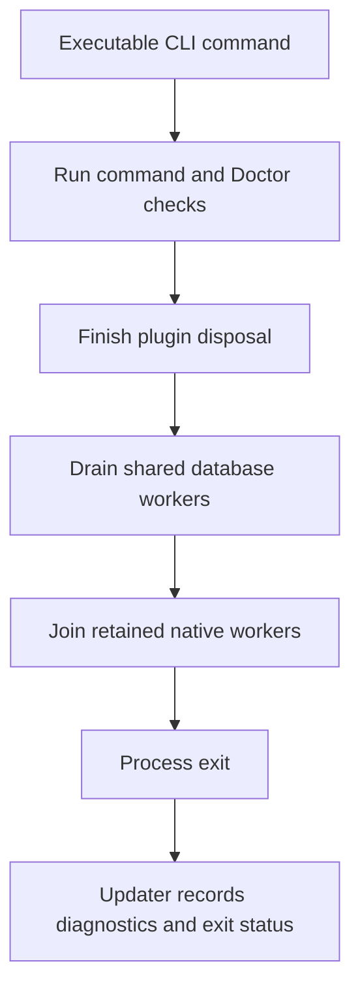

Codex review: needs changes before merge. _Reviewed October 4, 2026, 5:56 AM ET / 09:56 UTC (Revision 2)._

# ClawSweeper review

## What this changes

The PR drains shared database workers and joins retained native workers before executable CLI commands exit, and preserves Doctor completion diagnostics when a later crash fails an update.

## Merge readiness

⛔ **Needs changes before merge - 1 item remains**

The repair remains useful: current main still omits this terminal cleanup, and no introduced correctness defect was found. The new Windows evidence addresses native cleanup coverage; the previously requested published-updater compatibility check remains outstanding.

**Priority:** P1
**Reviewed head:** `f802f09091605675b25f154a7c466ac9b457e8df`

## Review scores

| Measure | Result | What it means |
|---|---|---|
| **Overall readiness** | 🐚 platinum hermit **(4/6)** | A focused owner-boundary repair with strong real shutdown evidence and meaningful negative controls. |
| **Proof confidence** | 🦞 diamond lobster **(5/6)** | Sufficient (live_output): The captured Linux run exercises the real Doctor entrypoint and shows the native supervisor and ports absent after executable cleanup; the pinned Windows replay supplements native boundary coverage. Published-updater validation remains a separate repository gate. No stored-data format or migration contract changes. |
| **Patch quality** | 🐚 platinum hermit **(4/6)** | No actionable review findings were identified. |

## Verification

| Check | Result | Evidence |
|---|---|---|
| **Real behavior** | Verified | Sufficient (live_output): The captured Linux run exercises the real Doctor entrypoint and shows the native supervisor and ports absent after executable cleanup; the pinned Windows replay supplements native boundary coverage. Published-updater validation remains a separate repository gate. No stored-data format or migration contract changes. |
| **Evidence reviewed** | 10 items | Verified introduced patch: The pinned merge-base-to-head diff introduces only command cleanup, native-source cleanup exposure, completion diagnostics, associated regressions, and Doctor documentation. The verified test-merge comparison contains those same six paths, without the unrelated endpoint drift. Existing ownership and cleanup order: The executable-only guard excludes embedded calls and Gateway boot. runCli releases plugin resources before returning through the new finally block, which waits for pending disposers, drains the canonical database cache, and closes the existing default native source without creating another owner. Current-main necessity: Fetched main still returns directly from the command scope without whole-cache drainage or default-native-source closure. Its existing teardown helpers therefore do not already implement the requested executable-boundary repair. |
| **Findings** | None | None. |
| **Security** | None | None. |

## How this fits together

Executable CLI commands own resources acquired during command execution and plugin disposal. During updates, the updater runs the candidate’s Doctor and records its output and exit status before accepting the candidate.

## Before merge

- [ ] **Complete next step (P2)** - Record the required published-updater × candidate compatibility result using existing operator state before merge.

<strong>Agent review details</strong>

### Security

None.

### PR surface

Source +23, Tests +69, Docs +5. Total +97 across 6 files.

View PR surface stats

| Area | Files | Added | Removed | Net |
|---|---:|---:|---:|---:|
| Source | 3 | 27 | 4 | +23 |
| Tests | 2 | 69 | 0 | +69 |
| Docs | 1 | 5 | 0 | +5 |
| Config | 0 | 0 | 0 | 0 |
| Generated | 0 | 0 | 0 | 0 |
| Other | 0 | 0 | 0 | 0 |
| **Total** | **6** | **101** | **4** | **+97** |

### Review metrics

None.

### Technical review

Best possible solution:

Keep terminal shutdown in the executable CLI owner and confirm that a shipped updater accepts the repaired candidate using existing operator state.

Do we have a high-confidence way to reproduce the issue?

Yes for the retained-worker lifecycle gap: current-main cleanup omits the terminal owners, and the captured real Doctor comparison demonstrates the survivor. The exact reported Windows assertion was not reproduced in this review.

Is this the best way to solve the issue?

Yes: invoking existing teardown owners after plugin disposal is a narrow repair that preserves borrowed lifetimes and crash failure classification; upgrade-boundary validation remains required.

AGENTS.md: found and applied where relevant.

Codex review notes: model internal, reasoning medium; reviewed against [a0a1f184a386](https://github.com/openclaw/openclaw/commit/a0a1f184a3867aa4dd3493a743e0c59a4ebfbecd).

### Labels

Label changes:

No label changes.

Label justifications:

- `P1`: A Doctor shutdown crash can reject an otherwise completed candidate and interrupt Windows updates.
- `rating: 🐚 platinum hermit`: Overall readiness is 🐚 platinum hermit; proof is 🦞 diamond lobster and patch quality is 🐚 platinum hermit.
- `status: 👀 ready for maintainer look`: ClawSweeper has no concrete contributor-facing blocker left for this PR. Sufficient (live_output): The captured Linux run exercises the real Doctor entrypoint and shows the native supervisor and ports absent after executable cleanup; the pinned Windows replay supplements native boundary coverage. Published-updater validation remains a separate repository gate. No stored-data format or migration contract changes.
- `proof: sufficient`: Contributor real behavior proof is sufficient. The captured Linux run exercises the real Doctor entrypoint and shows the native supervisor and ports absent after executable cleanup; the pinned Windows replay supplements native boundary coverage. Published-updater validation remains a separate repository gate. No stored-data format or migration contract changes.

### Evidence

What I checked:

- **Verified introduced patch:** The pinned merge-base-to-head diff introduces only command cleanup, native-source cleanup exposure, completion diagnostics, associated regressions, and Doctor documentation. The verified test-merge comparison contains those same six paths, without the unrelated endpoint drift. ([`src/cli/runtime-cleanup-scope.ts:77`](https://github.com/openclaw/openclaw/blob/f802f09091605675b25f154a7c466ac9b457e8df/src/cli/runtime-cleanup-scope.ts#L77), [f802f0909160](https://github.com/openclaw/openclaw/commit/f802f09091605675b25f154a7c466ac9b457e8df))
- **Existing ownership and cleanup order:** The executable-only guard excludes embedded calls and Gateway boot. runCli releases plugin resources before returning through the new finally block, which waits for pending disposers, drains the canonical database cache, and closes the existing default native source without creating another owner. ([`src/cli/runtime-cleanup-scope.ts:82`](https://github.com/openclaw/openclaw/blob/f802f09091605675b25f154a7c466ac9b457e8df/src/cli/runtime-cleanup-scope.ts#L82), [f802f0909160](https://github.com/openclaw/openclaw/commit/f802f09091605675b25f154a7c466ac9b457e8df))
- **Current-main necessity:** Fetched main still returns directly from the command scope without whole-cache drainage or default-native-source closure. Its existing teardown helpers therefore do not already implement the requested executable-boundary repair. ([`src/cli/runtime-cleanup-scope.ts:77`](https://github.com/openclaw/openclaw/blob/a0a1f184a3867aa4dd3493a743e0c59a4ebfbecd/src/cli/runtime-cleanup-scope.ts#L77), [a0a1f184a386](https://github.com/openclaw/openclaw/commit/a0a1f184a3867aa4dd3493a743e0c59a4ebfbecd))
- **Released behavior:** The latest supplied release, v2026.9.8, likewise lacks the added cleanup at this command boundary. Its Doctor environment builder already sets update markers; the patch adds no new updater handshake, configuration option, or stored-data contract. ([`src/cli/runtime-cleanup-scope.ts:77`](https://github.com/openclaw/openclaw/blob/fc23bc864e4553c2d215e479eeec47b67a0bf943/src/cli/runtime-cleanup-scope.ts#L77), [fc23bc864e45](https://github.com/openclaw/openclaw/commit/fc23bc864e4553c2d215e479eeec47b67a0bf943))
- **Real Doctor shutdown evidence:** The captured PR body reports before/after execution of the real Doctor command on Linux with Node 24.19.0 and synthetic state. The retained native supervisor, one Worker, and nine MessagePorts survive before the fix and are absent at fixed-process exit; SQLite handles are zero in both runs. This proves the lifecycle repair, rather than the exact Windows/Node 26.4.0 assertion. No local execution was performed during this review. ([`src/cli/runtime-cleanup-scope.ts:86`](https://github.com/openclaw/openclaw/blob/f802f09091605675b25f154a7c466ac9b457e8df/src/cli/runtime-cleanup-scope.ts#L86), [f802f0909160](https://github.com/openclaw/openclaw/commit/f802f09091605675b25f154a7c466ac9b457e8df))
- **Native Windows replay:** https://github.com/openclaw/openclaw/actions/runs/37193125930 completed successfully at the exact reviewed head. The jobs API confirms one executed Windows probe and successful exact-replay steps; the captured body identifies the real-worker cleanup regression on Windows 2025/Node 24.19.0. This is native cleanup-boundary coverage, not a demonstrated published-updater flow. Detailed log retrieval was blocked by the review environment’s storage-host allowlist. ([`src/cli/runtime-cleanup-scope.workers.test.ts:21`](https://github.com/openclaw/openclaw/blob/f802f09091605675b25f154a7c466ac9b457e8df/src/cli/runtime-cleanup-scope.workers.test.ts#L21), [f802f0909160](https://github.com/openclaw/openclaw/commit/f802f09091605675b25f154a7c466ac9b457e8df))

Likely related people:

- **steipete:** Suggested for follow-up; no historical authorship or introduction is verified. (role: unverified routing candidate; confidence: low)

### Rank-up moves

Optional improvements that raise the rating; they are not merge blockers.

- Record a published-updater × candidate run against existing operator state, including the candidate Doctor exit and updater acceptance outcome.

### Rating scale

| Score | Internal tier | Crab rank | Meaning |
|---:|:---:|---|---|
| **6/6** | S | 🦀 challenger crab | Exceptional readiness |
| **5/6** | A | 🦞 diamond lobster | Very strong readiness |
| **4/6** | B | 🐚 platinum hermit | Good normal PR; ordinary maintainer review |
| **3/6** | C | 🦐 gold shrimp | Useful, but confidence is limited |
| **2/6** | D | 🦪 silver shellfish | Proof or implementation needs work |
| **1/6** | F | 🧂 unranked krab | Not merge-ready |
| N/A | NA | 🌊 off-meta tidepool | Rating does not apply |

Overall follows the weaker of proof and patch quality.
Shiny media proof means a screenshot, video, or linked artifact directly shows the changed behavior. Runtime, network, CSP, and security claims still need visible diagnostics.

### Workflow

- ClawSweeper keeps one durable marker-backed review comment per issue or PR.
- Re-runs edit this comment so the latest verdict, findings, and automation markers stay together instead of adding duplicate bot comments.
- A fresh review can be triggered by eligible `@clawsweeper re-review` comments, exact-item GitHub events, scheduled/background review runs, or manual workflow dispatch.
- PR/issue authors and users with repository write access can comment `@clawsweeper re-review` or `@clawsweeper re-run` on an open PR or issue to request a fresh review only.
- Maintainers can also comment `@clawsweeper review` to request a fresh review only.
- Fresh-review commands do not start repair, autofix, rebase, CI repair, or automerge.
- Maintainer-only repair and merge flows require explicit commands such as `@clawsweeper autofix`, `@clawsweeper automerge`, `@clawsweeper fix ci`, or `@clawsweeper address review`.
- Maintainers can comment `@clawsweeper explain` to ask for more context, or `@clawsweeper stop` to stop active automation.

### History

Review history (1 earlier review cycle)

<!-- clawsweeper-review-history v=1 total=1 -->
- reviewed 2026-10-04T09:48:07.774Z sha f802f09091605675b25f154a7c466ac9b457e8df :: needs changes before merge. :: none

<!-- clawsweeper-verdict:needs-human item=164853 sha=f802f09091605675b25f154a7c466ac9b457e8df confidence=high updated_at=2026-10-04T09:54:06Z reviewed_at=2026-10-04T09:56:37.874Z lease_owner=github-run-37193583201-1 lease_comment_id=5978711917 source_revision=3ec8fae18009b4f19fd42ebcfb052600a7e7596880702ed507c45d69a130f10b live_verification=absent -->
<!-- clawsweeper-review-state:needs-changes item=164853 sha=f802f09091605675b25f154a7c466ac9b457e8df v=1 -->

<!-- clawsweeper-review-version item=164853 reviewed_at=2026-10-04T09:56:37.874Z sha=f802f09091605675b25f154a7c466ac9b457e8df source_revision=3ec8fae18009b4f19fd42ebcfb052600a7e7596880702ed507c45d69a130f10b lease_owner=github-run-37193583201-1 lease_comment_id=5978711917 v=1 -->

<!-- clawsweeper-review item=164853 -->