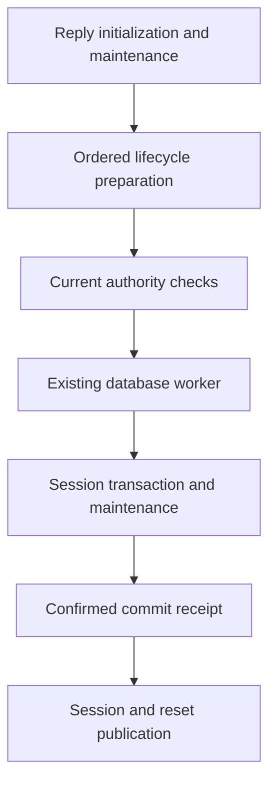

Codex review: needs maintainer review before merge. _Reviewed October 4, 2026, 7:27 AM ET / 11:27 UTC (Revision 10)._

# ClawSweeper review

## What this changes

Moves durable session inventory counts and snapshot writes into the existing database worker while preserving ordered preparation, live commit checks, and acknowledged state publication.

## Merge readiness

✅ **Ready for maintainer review**

This remains useful work: current main still excludes lifecycle upserts from worker execution. No actionable introduced defect remains, and the completed current-head SDK report satisfies the previous review request.

**Priority:** P2
**Reviewed head:** `494871c186eaf8edfd1fa3c84fa97d3a224847fb`

## Review scores

| Measure | Result | What it means |
|---|---|---|
| **Overall readiness** | 🐚 platinum hermit **(4/6)** | A focused worker cutover with strong production-path evidence, resolved prior feedback, and no remaining actionable patch finding. |
| **Proof confidence** | 🦞 diamond lobster **(5/6)** | Sufficient (live_output): The real Gateway workload exercises lifecycle inventory and snapshot persistence through the production worker, showing zero direct caller-thread statements after the cutover. Real worker-boundary and Gateway-close evidence covers revocation, rollback, lost replies, and accepted-write settlement; current-head supplemental coverage and the completed SDK comparison are recorded separately. The shared storage kernel, schemas, and serialized contracts remain unchanged. |
| **Patch quality** | 🐚 platinum hermit **(4/6)** | No actionable review findings were identified. |

## Verification

| Check | Result | Evidence |
|---|---|---|
| **Real behavior** | Verified | Sufficient (live_output): The real Gateway workload exercises lifecycle inventory and snapshot persistence through the production worker, showing zero direct caller-thread statements after the cutover. Real worker-boundary and Gateway-close evidence covers revocation, rollback, lost replies, and accepted-write settlement; current-head supplemental coverage and the completed SDK comparison are recorded separately. The shared storage kernel, schemas, and serialized contracts remain unchanged. |
| **Evidence reviewed** | 8 items | Pinned introduction reviewed: Reviewed the complete introduced patch against incorporated main, including production, documentation, and test changes. The checkout matches the original PR head; the supplied test merge is stale relative to the pinned base and was not used to infer removal of current-main behavior. Still necessary on current main: Fetched main still requires upserts.length === 0 before selecting worker execution. The merged schema-facts prerequisite and adjacent entry-read and patch work do not implement this lifecycle-upsert cutover. Shared transaction and authority owners: The worker calls the existing lifecycle transaction kernel, checks durable subagent facts around the mutation, and transfers its exact publication candidate through the existing receipt protocol. The host adapter supplies current execution, source, commit, and maintenance-preservation checks to transaction and commit admission. |
| **Findings** | None | None. |
| **Security** | None | None. |

## How this fits together

Session lifecycle persistence records session creation, replacement, reset, and maintenance results. Reply initialization and maintenance feed this owner, which commits SQLite state and publishes changes to Gateway session consumers.

## Before merge

None.

<strong>Agent review details</strong>

### Security

None.

### PR surface

Source +234, Tests +356, Docs +12. Total +602 across 25 files.

View PR surface stats

| Area | Files | Added | Removed | Net |
|---|---:|---:|---:|---:|
| Source | 15 | 265 | 31 | +234 |
| Tests | 9 | 419 | 63 | +356 |
| Docs | 1 | 12 | 0 | +12 |
| Config | 0 | 0 | 0 | 0 |
| Generated | 0 | 0 | 0 | 0 |
| Other | 0 | 0 | 0 | 0 |
| **Total** | **25** | **696** | **94** | **+602** |

### Review metrics

| Metric | Value | Why it matters |
|---|---|---|
| **Production versus test growth** | production net +234; tests net +356 | Production growth implements the existing worker handoff and publication contract; tests cover SQL placement, revocation, FIFO ordering, and shutdown settlement. |
| **Measured caller-thread SQL** | 6 → 0 direct statements per warmed turn | The paired production-path workload demonstrates the intended inventory and snapshot cutover without claiming a latency improvement. |

### Technical review

Best possible solution:

Complete the lifecycle worker cutover through the existing persistence owner, retaining native callback exceptions, FIFO ordering, live authority checks, and receipt-based settlement.

Do we have a high-confidence way to reproduce the issue?

Not applicable as a bug reproduction: source confirms the remaining caller-thread lifecycle path, and the recorded paired Gateway workload measures its SQL placement.

Is this the best way to solve the issue?

Yes. Reusing the existing worker, synchronous transaction kernel, and publication protocol is a focused solution, and the prior FIFO correction preserves preparation ordering.

AGENTS.md: found and applied where relevant.

Codex review notes: model internal, reasoning medium; reviewed against [e318434756f9](https://github.com/openclaw/openclaw/commit/e318434756f9b0d1dd15fccb1cadaa4058b3e763).

### Labels

Label changes:

No label changes.

Label justifications:

- `P2`: This is a bounded session-persistence performance improvement with no intentional user-facing contract change.
- `rating: 🐚 platinum hermit`: Overall readiness is 🐚 platinum hermit; proof is 🦞 diamond lobster and patch quality is 🐚 platinum hermit.
- `status: 👀 ready for maintainer look`: ClawSweeper has no concrete contributor-facing blocker left for this PR. Sufficient (live_output): The real Gateway workload exercises lifecycle inventory and snapshot persistence through the production worker, showing zero direct caller-thread statements after the cutover. Real worker-boundary and Gateway-close evidence covers revocation, rollback, lost replies, and accepted-write settlement; current-head supplemental coverage and the completed SDK comparison are recorded separately. The shared storage kernel, schemas, and serialized contracts remain unchanged.
- `proof: sufficient`: Contributor real behavior proof is sufficient. The real Gateway workload exercises lifecycle inventory and snapshot persistence through the production worker, showing zero direct caller-thread statements after the cutover. Real worker-boundary and Gateway-close evidence covers revocation, rollback, lost replies, and accepted-write settlement; current-head supplemental coverage and the completed SDK comparison are recorded separately. The shared storage kernel, schemas, and serialized contracts remain unchanged.

### Evidence

What I checked:

- **Pinned introduction reviewed:** Reviewed the complete introduced patch against incorporated main, including production, documentation, and test changes. The checkout matches the original PR head; the supplied test merge is stale relative to the pinned base and was not used to infer removal of current-main behavior. ([494871c186ea](https://github.com/openclaw/openclaw/commit/494871c186eaf8edfd1fa3c84fa97d3a224847fb))
- **Still necessary on current main:** Fetched main still requires upserts.length === 0 before selecting worker execution. The merged schema-facts prerequisite and adjacent entry-read and patch work do not implement this lifecycle-upsert cutover. ([`src/config/sessions/session-accessor.sqlite-projection.ts:100`](https://github.com/openclaw/openclaw/blob/e318434756f9b0d1dd15fccb1cadaa4058b3e763/src/config/sessions/session-accessor.sqlite-projection.ts#L100), [e318434756f9](https://github.com/openclaw/openclaw/commit/e318434756f9b0d1dd15fccb1cadaa4058b3e763))
- **Shared transaction and authority owners:** The worker calls the existing lifecycle transaction kernel, checks durable subagent facts around the mutation, and transfers its exact publication candidate through the existing receipt protocol. The host adapter supplies current execution, source, commit, and maintenance-preservation checks to transaction and commit admission. ([`src/config/sessions/session-lifecycle-projection.worker.ts:16`](https://github.com/openclaw/openclaw/blob/494871c186eaf8edfd1fa3c84fa97d3a224847fb/src/config/sessions/session-lifecycle-projection.worker.ts#L16), [494871c186ea](https://github.com/openclaw/openclaw/commit/494871c186eaf8edfd1fa3c84fa97d3a224847fb))
- **Prior FIFO finding resolved:** Upsert preparation retains foreground FIFO reservation while the reentrant worker executes SQL. The existing prepared-admission test retains the awaited-builder ordering assertion; the PR records the original failing control and correction d08f737c142945d5557ec1a6320f9ebc8181a74e. ([`src/config/sessions/session-accessor.sqlite-projection.ts:312`](https://github.com/openclaw/openclaw/blob/494871c186eaf8edfd1fa3c84fa97d3a224847fb/src/config/sessions/session-accessor.sqlite-projection.ts#L312), [494871c186ea](https://github.com/openclaw/openclaw/commit/494871c186eaf8edfd1fa3c84fa97d3a224847fb))
- **Real production-path proof:** The captured body records paired Node 24 Gateway workloads with isolated synthetic state and a loopback provider: all 13 chats, child execution, cron, compaction, and graceful shutdown completed. Direct inventory and projected-snapshot statements fell from six to zero per warmed turn. Real worker-boundary coverage additionally exercises transaction and commit revocation, preservation changes, stale-row refusal, lost-reply reconciliation without replay, and accepted persistence through Gateway close. Measurements retain their original source identities rather than being restamped as current-head measurements. ([`src/config/sessions/session-lifecycle-projection.worker.test.ts:178`](https://github.com/openclaw/openclaw/blob/494871c186eaf8edfd1fa3c84fa97d3a224847fb/src/config/sessions/session-lifecycle-projection.worker.test.ts#L178), [494871c186ea](https://github.com/openclaw/openclaw/commit/494871c186eaf8edfd1fa3c84fa97d3a224847fb))
- **Completed SDK request and complete body coverage:** Read the omitted body remainder through GitHub and verified SHA-256 b01e24447490c5629c32ed0d29986162c5e3fd9161dd5b725d0aab84090e342a, matching the captured snapshot. It records the completed comparison for exact head 494871c186eaf8edfd1fa3c84fa97d3a224847fb against v2026.9.8, exit zero in 507.37 seconds, report digest 7afc05dd315c010ecd872993d3172d37a39bd36f6621101cd95d5f530d1fc49e. Cumulative main changes are distinguished from this lane, whose callable lifecycle shapes and conflict-class re-export remain compatible. ([`src/config/sessions/session-accessor.lifecycle-types.ts:162`](https://github.com/openclaw/openclaw/blob/494871c186eaf8edfd1fa3c84fa97d3a224847fb/src/config/sessions/session-accessor.lifecycle-types.ts#L162), [494871c186ea](https://github.com/openclaw/openclaw/commit/494871c186eaf8edfd1fa3c84fa97d3a224847fb))

Likely related people:

- **steipete:** Suggested for follow-up; no historical authorship or introduction is verified. (role: unverified routing candidate; confidence: low)

### Rating scale

| Score | Internal tier | Crab rank | Meaning |
|---:|:---:|---|---|
| **6/6** | S | 🦀 challenger crab | Exceptional readiness |
| **5/6** | A | 🦞 diamond lobster | Very strong readiness |
| **4/6** | B | 🐚 platinum hermit | Good normal PR; ordinary maintainer review |
| **3/6** | C | 🦐 gold shrimp | Useful, but confidence is limited |
| **2/6** | D | 🦪 silver shellfish | Proof or implementation needs work |
| **1/6** | F | 🧂 unranked krab | Not merge-ready |
| N/A | NA | 🌊 off-meta tidepool | Rating does not apply |

Overall follows the weaker of proof and patch quality.
Shiny media proof means a screenshot, video, or linked artifact directly shows the changed behavior. Runtime, network, CSP, and security claims still need visible diagnostics.

### Workflow

- ClawSweeper keeps one durable marker-backed review comment per issue or PR.
- Re-runs edit this comment so the latest verdict, findings, and automation markers stay together instead of adding duplicate bot comments.
- A fresh review can be triggered by eligible `@clawsweeper re-review` comments, exact-item GitHub events, scheduled/background review runs, or manual workflow dispatch.
- PR/issue authors and users with repository write access can comment `@clawsweeper re-review` or `@clawsweeper re-run` on an open PR or issue to request a fresh review only.
- Maintainers can also comment `@clawsweeper review` to request a fresh review only.
- Fresh-review commands do not start repair, autofix, rebase, CI repair, or automerge.
- Maintainer-only repair and merge flows require explicit commands such as `@clawsweeper autofix`, `@clawsweeper automerge`, `@clawsweeper fix ci`, or `@clawsweeper address review`.
- Maintainers can comment `@clawsweeper explain` to ask for more context, or `@clawsweeper stop` to stop active automation.

### History

Review history (9 earlier review cycles; latest 8 shown)

<!-- clawsweeper-review-history v=1 total=9 -->
- reviewed 2026-10-04T04:22:52.114Z sha 8a7c6d9c49978e52225e28ddadd0d79bc41d9f19 :: blocked before merge. :: none
- reviewed 2026-10-04T07:34:31.688Z sha 8a7c6d9c49978e52225e28ddadd0d79bc41d9f19 :: blocked before merge. :: [P2] Preserve FIFO admission while preparing lifecycle upserts
- reviewed 2026-10-04T08:22:39.056Z sha d07ce205da51855c79d183d648e2a361bb965634 :: blocked before merge. :: none
- reviewed 2026-10-04T08:49:15.046Z sha d07ce205da51855c79d183d648e2a361bb965634 :: needs maintainer review before merge. :: none
- reviewed 2026-10-04T09:18:16.226Z sha d07ce205da51855c79d183d648e2a361bb965634 :: blocked before merge. :: none
- reviewed 2026-10-04T09:35:26.425Z sha 415796221e007174b10cc521ebb8a94b51457f90 :: needs changes before merge. :: none
- reviewed 2026-10-04T10:11:20.941Z sha adf8394622967029451dcb85e4e9cada26e24f09 :: needs changes before merge. :: none
- reviewed 2026-10-04T10:53:57.110Z sha 494871c186eaf8edfd1fa3c84fa97d3a224847fb :: needs changes before merge. :: none

<!-- clawsweeper-verdict:needs-human item=164755 sha=494871c186eaf8edfd1fa3c84fa97d3a224847fb confidence=high updated_at=2026-10-04T11:23:51Z reviewed_at=2026-10-04T11:27:10.333Z lease_owner=github-run-37198547218-1 lease_comment_id=5979422770 source_revision=8cdb449ee66f28d2a196fef9023614c7ec898df367e902667cfb23590f3ff018 live_verification=absent -->
<!-- clawsweeper-review-state:ready item=164755 sha=494871c186eaf8edfd1fa3c84fa97d3a224847fb v=1 -->

<!-- clawsweeper-review-version item=164755 reviewed_at=2026-10-04T11:27:10.333Z sha=494871c186eaf8edfd1fa3c84fa97d3a224847fb source_revision=8cdb449ee66f28d2a196fef9023614c7ec898df367e902667cfb23590f3ff018 lease_owner=github-run-37198547218-1 lease_comment_id=5979422770 v=1 -->

<!-- clawsweeper-review item=164755 -->