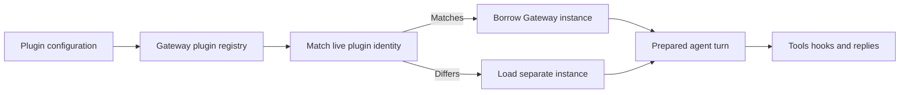

Codex review: blocked before merge. _Reviewed September 30, 2026, 5:26 AM ET / 09:26 UTC (Revision 11)._

# ClawSweeper review

## What this changes

Prepared agent runtimes borrow matching live Gateway plugin instances during model changes, with lifecycle guards, regression tests, and Plugin SDK guidance for reload and shutdown.

## Merge readiness

⛔ **Blocked before merge - 2 items remain**

Keep this PR open. Current main still prepares separate plugin instances, while the branch has substantial real Gateway proof for the reported model-change freeze. The remaining blocker is adjudication of a failed, apparently unrelated browser-mock CI check through the native landing process.

**Priority:** P0
**Reviewed head:** `a232fab538672f4cbf6ad4d62b5b73a1089259fb`
**Owner decision:** Required. See [Decision needed](#decision-needed).

## Review scores

| Measure | Result | What it means |
|---|---|---|
| **Overall readiness** | 🦞 diamond lobster **(5/6)** | Strong Gateway and upgrade evidence supports a coherent lifecycle repair; the unresolved CI exception is a landing decision rather than a patch-quality finding. |
| **Proof confidence** | 🦞 diamond lobster **(5/6)** | Sufficient (terminal): Paired isolated Gateways exercised large-plugin model republishes through config.patch; installed-release-to-candidate proof exercised plugin survivors through public chat.send turns, and exact-head public-client turns showed recovery after the lending Gateway closed. The first capture remains outside this fix. No stored-data contract changes. |
| **Patch quality** | 🦞 diamond lobster **(5/6)** | No actionable review findings were identified. |

## Verification

| Check | Result | Evidence |
|---|---|---|
| **Real behavior** | Verified | Sufficient (terminal): Paired isolated Gateways exercised large-plugin model republishes through config.patch; installed-release-to-candidate proof exercised plugin survivors through public chat.send turns, and exact-head public-client turns showed recovery after the lending Gateway closed. The first capture remains outside this fix. No stored-data contract changes. |
| **Evidence reviewed** | 9 items | Current-main gap: Current main retains predecessor-only registry reuse and has no borrowing option for prepared loads; the latest release has the same loader shape. Introduced borrowing boundary: The introduced loader path selects an active lending record only when its load identity matches, then marks the record as borrowed before projecting its contributions. Admitting Gateway selection: Prepared loads resolve the current registry through their request-scoped Gateway owner and require the same workspace; an absent owner supplies no lender. |
| **Findings** | None | None. |
| **Security** | None | None. |

## How this fits together

The Gateway loads configured plugins, while prepared agent runtimes select plugin registrations for model turns. Those registrations supply tools, hooks, providers, and channel behavior to the turn.

## Decision needed

| Question | Recommendation |
|---|---|
| Does the source-independent emoji-editor CI failure on the pinned historical merge qualify for the native prior-CI exception before this PR lands? | **Adjudicate the native exception:** An authorized organization admin reviews the preserved failure and admits the targeted exception only if it meets the native policy. |

Why: The UI test uses a browser MockWebSocket and its UI tree is unchanged by the PR, but the test failed twice on the PR merge, the same failure was not reproduced on current main, and the bot's native exception preflight requires an organization admin.

## Before merge

- [ ] **Complete next step (P2)** - Have an authorized organization admin adjudicate the native prior-CI exception for the browser-mock emoji test; if it is denied, resolve that UI failure before landing.
- [ ] **Resolve maintainer decision** - Resolve the maintainer decision shown above before merge.

<strong>Agent review details</strong>

### Security

None.

### PR surface

Source +213, Tests +1194, Docs +13. Total +1420 across 24 files.

View PR surface stats

| Area | Files | Added | Removed | Net |
|---|---:|---:|---:|---:|
| Source | 13 | 261 | 48 | +213 |
| Tests | 10 | 1241 | 47 | +1194 |
| Docs | 1 | 19 | 6 | +13 |
| Config | 0 | 0 | 0 | 0 |
| Generated | 0 | 0 | 0 | 0 |
| Other | 0 | 0 | 0 | 0 |
| **Total** | **24** | **1521** | **101** | **+1420** |

### Review metrics

| Metric | Value | Why it matters |
|---|---|---|
| **Production and test growth** | production +213 net lines, tests +1,194 net lines, docs +13 net lines | The production growth implements scoped borrowing and retirement recovery; the larger test delta exercises owner selection, reload, and shutdown. |

### Root-cause cluster

Relationship: `partial_overlap`
Canonical: https://github.com/openclaw/openclaw/issues/160959
Summary: This PR addresses the repeated-capture and model-republish portion of the open Gateway-stall report; that report also covers the first capture, which this branch leaves unchanged.

Members:
- `canonical`: https://github.com/openclaw/openclaw/issues/160959 - The open report documents both initial and repeated large-plugin capture stalls.
- `superseded`: https://github.com/openclaw/openclaw/pull/160983 - The earlier capture-sharing approach closed unmerged; this branch addresses repeated capture through Gateway-instance borrowing.
- `adjacent_distinct`: https://github.com/openclaw/openclaw/pull/159410 - The merged change adopted Gateway tool registrations to restore service-backed tools, but did not remove repeated prepared-runtime plugin captures.

Proposal only: this assessment does not dispatch repair, suppress jobs, mutate sibling items, close, or merge anything.

### Technical review

Best possible solution:

Use one Gateway-owned instance for each unchanged plugin in prepared turns, load a separate instance on mismatch, and preserve admitted work through reload; track the remaining first-capture stall in the existing issue.

Do we have a high-confidence way to reproduce the issue?

Yes. Current-main source still prepares separate plugin instances, and the PR records paired isolated-Gateway runs showing repeated large-plugin captures and minute-long model republishes; this read-only review did not execute the run.

Is this the best way to solve the issue?

Yes. Matching live Gateway instances are reused through their existing owner, while mismatched plugins keep separate instances and retirement guards fence borrowed callbacks.

AGENTS.md: found and applied where relevant.

Codex review notes: model internal, reasoning high; reviewed against [94ee9b54006b](https://github.com/openclaw/openclaw/commit/94ee9b54006bb4bec0be4882a65648f3fa9861df).

### Labels

Label changes:

No label changes.

Label justifications:

- `P0`: The reported large-plugin path leaves the core Gateway unresponsive for minutes during startup or model republishing.
- `merge-risk: 🚨 compatibility`: Unchanged plugins use the Gateway's full-mode registrations and registration-time config snapshots in prepared turns, a documented lifecycle tradeoff recorded as accepted for this head.
- `merge-risk: 🚨 availability`: An admitted long turn can hold a plugin through the existing 60-second explicit-reload drain, whose timeout behavior is recorded as accepted for this head.
- `rating: 🦞 diamond lobster`: Overall readiness is 🦞 diamond lobster; proof is 🦞 diamond lobster and patch quality is 🦞 diamond lobster.
- `status: 👀 ready for maintainer look`: ClawSweeper has no concrete contributor-facing blocker left for this PR. Sufficient (terminal): Paired isolated Gateways exercised large-plugin model republishes through config.patch; installed-release-to-candidate proof exercised plugin survivors through public chat.send turns, and exact-head public-client turns showed recovery after the lending Gateway closed. The first capture remains outside this fix. No stored-data contract changes.
- `proof: sufficient`: Contributor real behavior proof is sufficient. Paired isolated Gateways exercised large-plugin model republishes through config.patch; installed-release-to-candidate proof exercised plugin survivors through public chat.send turns, and exact-head public-client turns showed recovery after the lending Gateway closed. The first capture remains outside this fix. No stored-data contract changes.

### Evidence

What I checked:

- **Current-main gap:** Current main retains predecessor-only registry reuse and has no borrowing option for prepared loads; the latest release has the same loader shape. ([`src/plugins/loader-runtime-core.ts:334`](https://github.com/openclaw/openclaw/blob/94ee9b54006bb4bec0be4882a65648f3fa9861df/src/plugins/loader-runtime-core.ts#L334), [94ee9b54006b](https://github.com/openclaw/openclaw/commit/94ee9b54006bb4bec0be4882a65648f3fa9861df))
- **Introduced borrowing boundary:** The introduced loader path selects an active lending record only when its load identity matches, then marks the record as borrowed before projecting its contributions. ([`src/plugins/loader-runtime-core.ts:98`](https://github.com/openclaw/openclaw/blob/a232fab538672f4cbf6ad4d62b5b73a1089259fb/src/plugins/loader-runtime-core.ts#L98), [a232fab53867](https://github.com/openclaw/openclaw/commit/a232fab538672f4cbf6ad4d62b5b73a1089259fb))
- **Admitting Gateway selection:** Prepared loads resolve the current registry through their request-scoped Gateway owner and require the same workspace; an absent owner supplies no lender. ([`src/agents/prepared-model-runtime.inbound-registry.ts:72`](https://github.com/openclaw/openclaw/blob/a232fab538672f4cbf6ad4d62b5b73a1089259fb/src/agents/prepared-model-runtime.inbound-registry.ts#L72), [a232fab53867](https://github.com/openclaw/openclaw/commit/a232fab538672f4cbf6ad4d62b5b73a1089259fb))
- **Borrowed authority and tests:** Borrowed lifecycle authority checks both lender authority and borrower retirement. The real-loader channel test exercises Gateway A while B is active, then checks that borrower and invocation closure reject channel sends and read grants. ([`src/plugins/registry-lifecycle.ts:446`](https://github.com/openclaw/openclaw/blob/a232fab538672f4cbf6ad4d62b5b73a1089259fb/src/plugins/registry-lifecycle.ts#L446), [a232fab53867](https://github.com/openclaw/openclaw/commit/a232fab538672f4cbf6ad4d62b5b73a1089259fb))
- **Real behavior and upgrade proof:** The captured PR body hash matches the complete body read through the REST API. It reports paired large-plugin model republishes improving from 68–142 seconds with recovery restarts to 0.6–1.4 seconds without them; an installed 2026.9.6 updater-to-candidate run preserved two installed plugins and their SQLite rows. Later exact-head public-client evidence reports successful agent turns after a lending sibling Gateway closed. ([a232fab53867](https://github.com/openclaw/openclaw/commit/a232fab538672f4cbf6ad4d62b5b73a1089259fb))
- **Recorded lifecycle tradeoffs:** The discussion records acceptance at this head of full-mode registrations for unchanged plugins and the existing 60-second explicit-reload drain, which can leave the old instance serving a long admitted turn. ([a232fab53867](https://github.com/openclaw/openclaw/commit/a232fab538672f4cbf6ad4d62b5b73a1089259fb))

Likely related people:

- **steipete:** Suggested for follow-up; no historical authorship or introduction is verified. (role: unverified routing candidate; confidence: low)
- **Erick Kinnee:** Suggested for follow-up; no historical authorship or introduction is verified. (role: unverified routing candidate; confidence: low)
- **obviyus:** Suggested for follow-up; no historical authorship or introduction is verified. (role: unverified routing candidate; confidence: low)

### Rating scale

| Score | Internal tier | Crab rank | Meaning |
|---:|:---:|---|---|
| **6/6** | S | 🦀 challenger crab | Exceptional readiness |
| **5/6** | A | 🦞 diamond lobster | Very strong readiness |
| **4/6** | B | 🐚 platinum hermit | Good normal PR; ordinary maintainer review |
| **3/6** | C | 🦐 gold shrimp | Useful, but confidence is limited |
| **2/6** | D | 🦪 silver shellfish | Proof or implementation needs work |
| **1/6** | F | 🧂 unranked krab | Not merge-ready |
| N/A | NA | 🌊 off-meta tidepool | Rating does not apply |

Overall follows the weaker of proof and patch quality.
Shiny media proof means a screenshot, video, or linked artifact directly shows the changed behavior. Runtime, network, CSP, and security claims still need visible diagnostics.

### Workflow

- ClawSweeper keeps one durable marker-backed review comment per issue or PR.
- Re-runs edit this comment so the latest verdict, findings, and automation markers stay together instead of adding duplicate bot comments.
- A fresh review can be triggered by eligible `@clawsweeper re-review` comments, exact-item GitHub events, scheduled/background review runs, or manual workflow dispatch.
- PR/issue authors and users with repository write access can comment `@clawsweeper re-review` or `@clawsweeper re-run` on an open PR or issue to request a fresh review only.
- Maintainers can also comment `@clawsweeper review` to request a fresh review only.
- Fresh-review commands do not start repair, autofix, rebase, CI repair, or automerge.
- Maintainer-only repair and merge flows require explicit commands such as `@clawsweeper autofix`, `@clawsweeper automerge`, `@clawsweeper fix ci`, or `@clawsweeper address review`.
- Maintainers can comment `@clawsweeper explain` to ask for more context, or `@clawsweeper stop` to stop active automation.

### History

Review history (10 earlier review cycles; latest 8 shown)

<!-- clawsweeper-review-history v=1 total=10 -->
- reviewed 2026-09-29T16:44:18.544Z sha 08328a0d6f4657e09316c03800857cdf5294d457 :: needs real behavior proof before merge. :: [P1] Borrow only from the admitting Gateway
- reviewed 2026-09-29T17:18:24.775Z sha 08328a0d6f4657e09316c03800857cdf5294d457 :: needs real behavior proof before merge. :: [P1] Borrow only from the admitting Gateway | [P3] Await owned reload signals instead of polling
- reviewed 2026-09-30T02:48:48.427Z sha d32d58d7dacac047538607fc723facbfc45b3d87 :: blocked before merge. :: none
- reviewed 2026-09-30T04:30:25.887Z sha d32d58d7dacac047538607fc723facbfc45b3d87 :: blocked before merge. :: none
- reviewed 2026-09-30T05:02:26.270Z sha 3d163b3aa10184d7a69175c040d5efea5b4db83d :: blocked before merge. :: none
- reviewed 2026-09-30T05:48:48.195Z sha 3e945724b406d31fe4c7009b7ec4def8d0ae98a4 :: blocked before merge. :: none
- reviewed 2026-09-30T07:20:43.970Z sha a232fab538672f4cbf6ad4d62b5b73a1089259fb :: blocked before merge. :: none
- reviewed 2026-09-30T09:06:54.393Z sha a232fab538672f4cbf6ad4d62b5b73a1089259fb :: blocked before merge. :: none

<!-- clawsweeper-verdict:needs-human item=161267 sha=a232fab538672f4cbf6ad4d62b5b73a1089259fb confidence=high updated_at=2026-09-30T09:22:45Z reviewed_at=2026-09-30T09:26:37.860Z lease_owner=github-run-36695629017-1 lease_comment_id=5908182070 source_revision=e6ab1875d7ed4fde47e0a7669ea0394b7b08ab1b4894675d6962eadcf5c38ff6 live_verification=absent -->
<!-- clawsweeper-review-state:blocked item=161267 sha=a232fab538672f4cbf6ad4d62b5b73a1089259fb v=1 -->

<!-- clawsweeper-review-version item=161267 reviewed_at=2026-09-30T09:26:37.860Z sha=a232fab538672f4cbf6ad4d62b5b73a1089259fb source_revision=e6ab1875d7ed4fde47e0a7669ea0394b7b08ab1b4894675d6962eadcf5c38ff6 lease_owner=github-run-36695629017-1 lease_comment_id=5908182070 v=1 -->

<!-- clawsweeper-review item=161267 -->