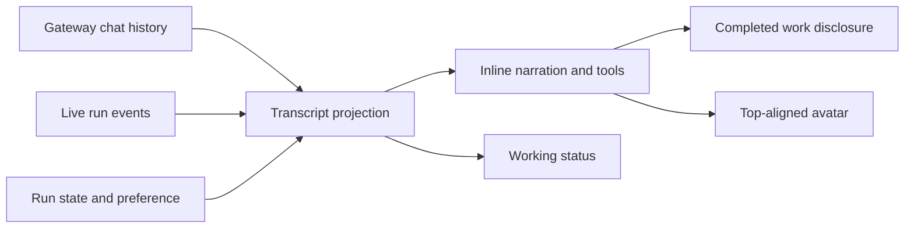

Codex review: blocked before merge. _Reviewed September 23, 2026, 10:22 PM ET / September 24, 2026, 02:22 UTC (Revision 2)._

# ClawSweeper review

## What this changes

The branch keeps agent narration in Control UI chat rows, labels completed work by elapsed time, and top-aligns avatars on tall replies, with matching documentation and tests.

## Merge readiness

⛔ **Blocked before merge - 3 items remain**

Current main still has the transient narration status and bottom-aligned avatars, so this PR remains useful. The patch has strong visual proof and no identified code defect. Before merge, the product owner should directly confirm the proposed reversal of the recently merged narration presentation; the PR discussion currently contains the author's account of that approval.

**Priority:** P2
**Reviewed head:** `69f068f43b6421b70f28ce317adf2ceb1601f938`
**Owner decision:** Required. See [Decision needed](#decision-needed).

## Review scores

| Measure | Result | What it means |
|---|---|---|
| **Overall readiness** | 🦞 diamond lobster **(5/6)** | Focused owner-level changes, meaningful browser coverage, and inspected visual proof support a strong rating; the product decision is a separate merge gate. |
| **Proof confidence** | 🦞 diamond lobster **(5/6)** ✨ media proof bonus | Sufficient (screenshot): Inspected before/after captures of the actual Control UI with a mocked Gateway show the changed transcript narration, completed-work heading, and avatar position; the PR also records browser recovery scenarios. The introduced diff changes no stored-data contract. |
| **Patch quality** | 🦞 diamond lobster **(5/6)** | No actionable review findings were identified. |

## Verification

| Check | Result | Evidence |
|---|---|---|
| **Real behavior** | Verified | Sufficient (screenshot): Inspected before/after captures of the actual Control UI with a mocked Gateway show the changed transcript narration, completed-work heading, and avatar position; the PR also records browser recovery scenarios. The introduced diff changes no stored-data contract. |
| **Evidence reviewed** | 10 items | Current-main behavior: Current main still moves the latest commentary into the working indicator and assigns its text to the status row. Current-main avatar layout: The shared avatar rule on current main uses bottom alignment. Documented existing presentation: Current-main documentation describes latest commentary as temporary working status, establishing that the proposed inline presentation changes a recently intentional UI behavior. |
| **Findings** | None | None. |
| **Security** | None | None. |

## How this fits together

The Control UI combines Gateway chat history, live events, run state, and the Keep commentary preference into a conversation view. Its transcript projection determines the chat rows, working status, and completed-work disclosure shown to the user.

## Decision needed

| Question | Recommendation |
|---|---|
| Should active agent narration remain inline in the Control UI transcript, replacing the latest-commentary status presentation merged in https://github.com/openclaw/openclaw/pull/156340? | **Approve inline narration:** Confirm the requested transcript presentation and retain the separate working indicator and completed-work disclosure. |

Why: The prior presentation was intentional, and the replacement PR reports approval through its author and a linked team session that this review cannot independently verify.

## Before merge

- [ ] **Resolve merge risk (P1)** - The branch reverses the intentionally merged transient-status presentation from https://github.com/openclaw/openclaw/pull/156340; the claimed approval for that product change is not directly confirmed by a maintainer in the reviewable PR discussion.
- [ ] **Complete next step (P2)** - Record direct confirmation from the named presentation owner that inline narration intentionally replaces the recently merged transient-status behavior.
- [ ] **Resolve maintainer decision** - Resolve the maintainer decision shown above before merge.

<strong>Agent review details</strong>

### Security

None.

### PR surface

Source -110, Tests +79, Docs +3. Total -28 across 24 files.

View PR surface stats

| Area | Files | Added | Removed | Net |
|---|---:|---:|---:|---:|
| Source | 10 | 33 | 143 | -110 |
| Tests | 13 | 199 | 120 | +79 |
| Docs | 1 | 9 | 6 | +3 |
| Config | 0 | 0 | 0 | 0 |
| Generated | 0 | 0 | 0 | 0 |
| Other | 0 | 0 | 0 | 0 |
| **Total** | **24** | **241** | **269** | **-28** |

### Review metrics

None.

### Root-cause cluster

Relationship: `canonical`
Canonical: https://github.com/openclaw/openclaw/pull/156926
Summary: This branch is the designated replacement for the still-open original branch; the earlier merged status PR establishes the behavior this proposal would change.

Members:
- `superseded`: https://github.com/openclaw/openclaw/pull/156856 - The current PR explicitly carries the reviewed change from this original branch as its replacement landing candidate.
- `partial_overlap`: https://github.com/openclaw/openclaw/pull/156340 - That merged PR introduced the transient-status narration behavior that the current proposal would intentionally replace.

Proposal only: this assessment does not dispatch repair, suppress jobs, mutate sibling items, close, or merge anything.

### Merge-risk options

**Maintainer options:**
1. **Confirm the presentation (recommended)**  
   Have the named product owner directly confirm inline narration for this replacement before landing the proven UI change.
2. **Pause the replacement**  
   Keep the prior status presentation if the product owner does not accept the new transcript layout.

### Technical review

Best possible solution:

Use one maintainer-confirmed narration presentation in the Control UI while retaining the existing transcript, run-progress, and completed-work owners.

Do we have a high-confidence way to reproduce the issue?

Not applicable as a defined existing-behavior bug: current main deliberately shows the latest narration as status. Source and before/after browser images establish both that presentation and the avatar offset.

Is this the best way to solve the issue?

Yes technically: the branch reuses the transcript, progress, and disclosure owners and makes a small shared avatar-layout change. The product presentation choice still needs direct maintainer confirmation.

AGENTS.md: found and applied where relevant.

Codex review notes: model internal, reasoning high; reviewed against [d9d8f0829d87](https://github.com/openclaw/openclaw/commit/d9d8f0829d87bcedd2b3ab6735334289c83defb0).

### Labels

Label changes:

No label changes.

Label justifications:

- `P2`: This is a bounded, user-visible Control UI readability improvement with substantial browser and visual evidence.
- `merge-risk: 🚨 other`: Merging changes a recently intentional narration presentation whose replacement direction needs direct product-owner confirmation.
- `rating: 🦞 diamond lobster`: Overall readiness is 🦞 diamond lobster; proof is 🦞 diamond lobster and patch quality is 🦞 diamond lobster.
- `status: 👀 ready for maintainer look`: ClawSweeper has no concrete contributor-facing blocker left for this PR. Sufficient (screenshot): Inspected before/after captures of the actual Control UI with a mocked Gateway show the changed transcript narration, completed-work heading, and avatar position; the PR also records browser recovery scenarios. The introduced diff changes no stored-data contract.
- `proof: sufficient`: Contributor real behavior proof is sufficient. Inspected before/after captures of the actual Control UI with a mocked Gateway show the changed transcript narration, completed-work heading, and avatar position; the PR also records browser recovery scenarios. The introduced diff changes no stored-data contract.
- `proof: 📸 screenshot`: Contributor real behavior proof includes screenshot evidence. Inspected before/after captures of the actual Control UI with a mocked Gateway show the changed transcript narration, completed-work heading, and avatar position; the PR also records browser recovery scenarios. The introduced diff changes no stored-data contract.

### Evidence

What I checked:

- **Current-main behavior:** Current main still moves the latest commentary into the working indicator and assigns its text to the status row. ([`ui/src/pages/chat/chat-thread-build.ts:619`](https://github.com/openclaw/openclaw/blob/d9d8f0829d87bcedd2b3ab6735334289c83defb0/ui/src/pages/chat/chat-thread-build.ts#L619), [d9d8f0829d87](https://github.com/openclaw/openclaw/commit/d9d8f0829d87bcedd2b3ab6735334289c83defb0))
- **Current-main avatar layout:** The shared avatar rule on current main uses bottom alignment. ([`ui/src/styles/chat/startup-layout.css:224`](https://github.com/openclaw/openclaw/blob/d9d8f0829d87bcedd2b3ab6735334289c83defb0/ui/src/styles/chat/startup-layout.css#L224), [d9d8f0829d87](https://github.com/openclaw/openclaw/commit/d9d8f0829d87bcedd2b3ab6735334289c83defb0))
- **Documented existing presentation:** Current-main documentation describes latest commentary as temporary working status, establishing that the proposed inline presentation changes a recently intentional UI behavior. Public docs: [`docs/web/control-ui.md`](https://docs.openclaw.ai/web/control-ui). ([`docs/web/control-ui.md:40`](https://docs.openclaw.ai/web/control-ui), [d9d8f0829d87](https://github.com/openclaw/openclaw/commit/d9d8f0829d87bcedd2b3ab6735334289c83defb0))
- **Introduced transcript behavior:** The pinned introduced diff removes the latest-commentary relocation and retains durable commentary belonging to the active run through the existing progress identity. ([`ui/src/pages/chat/chat-thread-build.ts:143`](https://github.com/openclaw/openclaw/blob/69f068f43b6421b70f28ce317adf2ceb1601f938/ui/src/pages/chat/chat-thread-build.ts#L143), [69f068f43b64](https://github.com/openclaw/openclaw/commit/69f068f43b6421b70f28ce317adf2ceb1601f938))
- **Completed-work rendering:** The branch uses the existing disclosure to show an elapsed-time heading while preserving prepared blocked, unknown, and failed outcomes. ([`ui/src/pages/chat/components/chat-message-stream.ts:190`](https://github.com/openclaw/openclaw/blob/69f068f43b6421b70f28ce317adf2ceb1601f938/ui/src/pages/chat/components/chat-message-stream.ts#L190), [69f068f43b64](https://github.com/openclaw/openclaw/commit/69f068f43b6421b70f28ce317adf2ceb1601f938))
- **Latest-head correction:** The commit after the previous completed review changes only the wrapped-footer browser assertion from bottom to top alignment; the production CSS is unchanged by that commit. ([`ui/src/pages/chat/chat-responsive.browser.test.ts:1778`](https://github.com/openclaw/openclaw/blob/69f068f43b6421b70f28ce317adf2ceb1601f938/ui/src/pages/chat/chat-responsive.browser.test.ts#L1778), [69f068f43b64](https://github.com/openclaw/openclaw/commit/69f068f43b6421b70f28ce317adf2ceb1601f938))

Likely related people:

- **vincentkoc:** Suggested for follow-up; no historical authorship or introduction is verified. (role: unverified routing candidate; confidence: low)
- **vyctorbrzezowski:** Suggested for follow-up; no historical authorship or introduction is verified. (role: unverified routing candidate; confidence: low)
- **Peter Steinberger:** Suggested for follow-up; no historical authorship or introduction is verified. (role: unverified routing candidate; confidence: low)

### Rating scale

| Score | Internal tier | Crab rank | Meaning |
|---:|:---:|---|---|
| **6/6** | S | 🦀 challenger crab | Exceptional readiness |
| **5/6** | A | 🦞 diamond lobster | Very strong readiness |
| **4/6** | B | 🐚 platinum hermit | Good normal PR; ordinary maintainer review |
| **3/6** | C | 🦐 gold shrimp | Useful, but confidence is limited |
| **2/6** | D | 🦪 silver shellfish | Proof or implementation needs work |
| **1/6** | F | 🧂 unranked krab | Not merge-ready |
| N/A | NA | 🌊 off-meta tidepool | Rating does not apply |

Overall follows the weaker of proof and patch quality.
Shiny media proof means a screenshot, video, or linked artifact directly shows the changed behavior. Runtime, network, CSP, and security claims still need visible diagnostics.

### Workflow

- ClawSweeper keeps one durable marker-backed review comment per issue or PR.
- Re-runs edit this comment so the latest verdict, findings, and automation markers stay together instead of adding duplicate bot comments.
- A fresh review can be triggered by eligible `@clawsweeper re-review` comments, exact-item GitHub events, scheduled/background review runs, or manual workflow dispatch.
- PR/issue authors and users with repository write access can comment `@clawsweeper re-review` or `@clawsweeper re-run` on an open PR or issue to request a fresh review only.
- Maintainers can also comment `@clawsweeper review` to request a fresh review only.
- Fresh-review commands do not start repair, autofix, rebase, CI repair, or automerge.
- Maintainer-only repair and merge flows require explicit commands such as `@clawsweeper autofix`, `@clawsweeper automerge`, `@clawsweeper fix ci`, or `@clawsweeper address review`.
- Maintainers can comment `@clawsweeper explain` to ask for more context, or `@clawsweeper stop` to stop active automation.

### History

Review history (1 earlier review cycle)

<!-- clawsweeper-review-history v=1 total=1 -->
- reviewed 2026-09-24T02:07:14.994Z sha 5c77fc78664bec9982dd127122503c68ae49078a :: blocked before merge. :: none

<!-- clawsweeper-verdict:needs-human item=156926 sha=69f068f43b6421b70f28ce317adf2ceb1601f938 confidence=high updated_at=2026-09-24T02:18:55Z reviewed_at=2026-09-24T02:22:58.017Z lease_owner=github-run-35946574215-1 lease_comment_id=5806289661 source_revision=8382a17200268940939fa1d508ca618094f22d2e68e7520dd57819da027f0f6f live_verification=absent -->
<!-- clawsweeper-review-state:blocked item=156926 sha=69f068f43b6421b70f28ce317adf2ceb1601f938 v=1 -->

<!-- clawsweeper-review-version item=156926 reviewed_at=2026-09-24T02:22:58.017Z sha=69f068f43b6421b70f28ce317adf2ceb1601f938 source_revision=8382a17200268940939fa1d508ca618094f22d2e68e7520dd57819da027f0f6f lease_owner=github-run-35946574215-1 lease_comment_id=5806289661 v=1 -->

<!-- clawsweeper-review item=156926 -->