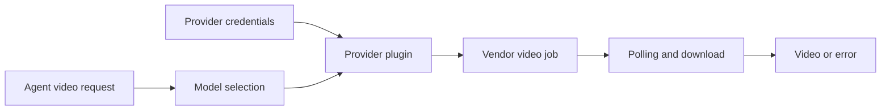

Codex review: blocked before merge. _Reviewed September 28, 2026, 8:10 AM ET / 12:10 UTC (Revision 5)._

# ClawSweeper review

## What this changes

The branch adds Kie AI, Z.AI, and Novita video generation through plugins, enables credential-only Kie and Runway configuration, and updates provider documentation and live checks.

## Merge readiness

⛔ **Blocked before merge - 6 items remain**

Keep this PR open: its provider support is absent from current main and the latest release. Two previously reported credential-redaction defects remain and block merge.

**Priority:** P2
**Reviewed head:** `ccd69aff4bf2678e0debe64d3860aa8931f1b5db`

## Review scores

| Measure | Result | What it means |
|---|---|---|
| **Overall readiness** | 🦐 gold shrimp **(3/6)** | Concrete live provider results support the feature, but credential-reflection defects prevent a merge-ready rating. |
| **Proof confidence** | 🦞 diamond lobster **(5/6)** | Sufficient (live_output): The PR body reports real keyed generation and local-image runs through the provider plugins, with MP4 results for Kie, Z.AI, and Novita; combined-branch mocked checks are supplemental. The overlay-ID change accepts configuration without changing a stored-data format. |
| **Patch quality** | 🦐 gold shrimp **(3/6)** | Security review found an item that needs attention. |

## Verification

| Check | Result | Evidence |
|---|---|---|
| **Real behavior** | Verified | Sufficient (live_output): The PR body reports real keyed generation and local-image runs through the provider plugins, with MP4 results for Kie, Z.AI, and Novita; combined-branch mocked checks are supplemental. The overlay-ID change accepts configuration without changing a stored-data format. |
| **Evidence reviewed** | 9 items | Current-main necessity: Current main contains none of the three introduced provider implementations. Release check: The latest stated release commit also contains none of those provider implementations. Kie error path: Kie's HTTP error call omits the active request headers; its HTTP-200 message and failed-job message are also thrown directly. |
| **Findings** | 2 actionable findings | [P2] Redact Kie credentials before surfacing provider errors [P2] Redact Z.AI and Novita polling failure text |
| **Security** | Needs attention | Kie error responses can expose a Bearer key: Kie's HTTP error call lacks request-header redaction, and its body-level failure messages are surfaced directly. Polling failures can expose provider credentials: Z.AI and Novita return vendor failure text that the shared poller throws without exact-key redaction. |

## How this fits together

An agent's video request enters OpenClaw's shared video tool, which selects a configured provider plugin. The plugin submits a vendor job, polls for completion, and returns a downloaded video or an error.

## Before merge

- [ ] **Redact Kie credentials before surfacing provider errors (P2)** - This HTTP error call omits the active request headers, while the same provider also throws HTTP-200 `msg` and `failMsg` text directly. If Kie or a proxy reflects the Bearer key, `video_generate` can surface it. Pass the active headers to HTTP error handling and redact body-level messages before throwing them.
- [ ] **Redact Z.AI and Novita polling failure text (P2)** - The polling helper throws this returned message verbatim; Novita likewise returns `task.reason` verbatim. A failed provider response that reflects the active key therefore leaks it through the video error. Redact both callbacks against their active headers and cover reflected-key failures.
- [ ] **Resolve security concern: Kie error responses can expose a Bearer key** - Kie's HTTP error call lacks request-header redaction, and its body-level failure messages are surfaced directly.
- [ ] **Resolve security concern: Polling failures can expose provider credentials** - Z.AI and Novita return vendor failure text that the shared poller throws without exact-key redaction.
- [ ] **Resolve merge risk (P1)** - A provider or proxy that reflects an active Bearer key in an error can place it in a surfaced video-generation failure.
- [ ] **Complete next step (P2)** - Redact Kie HTTP and body errors and Z.AI/Novita polling failures using the active request headers, then add reflected-key regression coverage.

## Findings

- [P2] Redact Kie credentials before surfacing provider errors — `extensions/kie/video-generation-provider.ts:195`
- [P2] Redact Z.AI and Novita polling failure text — `extensions/zai/video-generation-provider.ts:223-228`
- [medium] Kie error responses can expose a Bearer key — `extensions/kie/video-generation-provider.ts:195`
- [medium] Polling failures can expose provider credentials — `extensions/zai/video-generation-provider.ts:223`

<strong>Agent review details</strong>

### Security

Needs attention: No new third-party package or broader CI permission was found, but introduced provider error paths can expose reflected API credentials.

### PR surface

Source +1239, Tests +921, Docs +253, Config +34, Generated 0, Other +6. Total +2453 across 43 files.

View PR surface stats

| Area | Files | Added | Removed | Net |
|---|---:|---:|---:|---:|
| Source | 11 | 1241 | 2 | +1239 |
| Tests | 13 | 926 | 5 | +921 |
| Docs | 13 | 259 | 6 | +253 |
| Config | 3 | 42 | 8 | +34 |
| Generated | 2 | 3 | 3 | 0 |
| Other | 1 | 6 | 0 | +6 |
| **Total** | **43** | **2477** | **24** | **+2453** |

### Review metrics

| Metric | Value | Why it matters |
|---|---|---|
| **Configuration surface** | 2 credential-only provider overlays, 1 new onboarding flag | These are the user-facing setup paths that need to remain aligned with plugin discovery and authentication. |
| **Runtime versus test growth** | runtime TypeScript +1,164; tests and harness +926 | The vendor-specific adapters and model catalog explain the production growth; the new coverage exercises registered provider paths. |

### Merge-risk options

**Maintainer options:**
1. **Redact reflected credentials (recommended)**  
   Use the active request headers when normalizing errors for all three providers and cover a synthetic response that reflects an opaque key.

### Technical review

Best possible solution:

Keep the vendor integrations in their plugins and apply the SDK's exact-secret redactor to HTTP, body-level, and polling errors before they reach the shared video tool.

Do we have a high-confidence way to reproduce the issue?

Yes, from source: return a synthetic provider error containing the active Bearer key through a registered video provider and inspect the resulting error. This read-only review did not execute that check.

Is this the best way to solve the issue?

No, not yet: the plugin-owned implementation fits the existing video tool, but its error paths must redact exact active credentials before merge.

Full review comments:

- [P2] Redact Kie credentials before surfacing provider errors — `extensions/kie/video-generation-provider.ts:195`
  This HTTP error call omits the active request headers, while the same provider also throws HTTP-200 `msg` and `failMsg` text directly. If Kie or a proxy reflects the Bearer key, `video_generate` can surface it. Pass the active headers to HTTP error handling and redact body-level messages before throwing them.
  Confidence: 0.97
- [P2] Redact Z.AI and Novita polling failure text — `extensions/zai/video-generation-provider.ts:223-228`
  The polling helper throws this returned message verbatim; Novita likewise returns `task.reason` verbatim. A failed provider response that reflects the active key therefore leaks it through the video error. Redact both callbacks against their active headers and cover reflected-key failures.
  Confidence: 0.96

Overall correctness: patch is incorrect
Overall confidence: 0.95

AGENTS.md: found and applied where relevant.

Codex review notes: model internal, reasoning high; reviewed against [f8ae4fc466a9](https://github.com/openclaw/openclaw/commit/f8ae4fc466a98cb028bf2b1b644067166a8b9d8a).

### Labels

Label changes:

No label changes.

Label justifications:

- `P2`: The feature has useful provider coverage, while the identified security defects are bounded to error paths.
- `merge-risk: 🚨 security-boundary`: The introduced provider paths can surface response text containing an active API credential.
- `rating: 🦐 gold shrimp`: Overall readiness is 🦐 gold shrimp; proof is 🦞 diamond lobster and patch quality is 🦐 gold shrimp.
- `status: ⏳ waiting on author`: ClawSweeper has contributor-facing work open and is waiting for author action. Sufficient (live_output): The PR body reports real keyed generation and local-image runs through the provider plugins, with MP4 results for Kie, Z.AI, and Novita; combined-branch mocked checks are supplemental. The overlay-ID change accepts configuration without changing a stored-data format.
- `proof: sufficient`: Contributor real behavior proof is sufficient. The PR body reports real keyed generation and local-image runs through the provider plugins, with MP4 results for Kie, Z.AI, and Novita; combined-branch mocked checks are supplemental. The overlay-ID change accepts configuration without changing a stored-data format.

### Evidence

Security concerns:

- [medium] Kie error responses can expose a Bearer key — `extensions/kie/video-generation-provider.ts:195`
  Kie's HTTP error call lacks request-header redaction, and its body-level failure messages are surfaced directly.
  Confidence: 0.97
- [medium] Polling failures can expose provider credentials — `extensions/zai/video-generation-provider.ts:223`
  Z.AI and Novita return vendor failure text that the shared poller throws without exact-key redaction.
  Confidence: 0.96

What I checked:

- **Current-main necessity:** Current main contains none of the three introduced provider implementations. ([f8ae4fc466a9](https://github.com/openclaw/openclaw/commit/f8ae4fc466a98cb028bf2b1b644067166a8b9d8a))
- **Release check:** The latest stated release commit also contains none of those provider implementations. ([eb377ac59e6c](https://github.com/openclaw/openclaw/commit/eb377ac59e6c9fd6c7705028034812becf00271b))
- **Kie error path:** Kie's HTTP error call omits the active request headers; its HTTP-200 message and failed-job message are also thrown directly. ([`extensions/kie/video-generation-provider.ts:195`](https://github.com/openclaw/openclaw/blob/ccd69aff4bf2678e0debe64d3860aa8931f1b5db/extensions/kie/video-generation-provider.ts#L195), [ccd69aff4bf2](https://github.com/openclaw/openclaw/commit/ccd69aff4bf2678e0debe64d3860aa8931f1b5db))
- **Polling error paths:** Z.AI returns provider failure text directly from its polling callback; Novita does the same with task.reason at line 364 of its provider file. ([`extensions/zai/video-generation-provider.ts:223`](https://github.com/openclaw/openclaw/blob/ccd69aff4bf2678e0debe64d3860aa8931f1b5db/extensions/zai/video-generation-provider.ts#L223), [ccd69aff4bf2](https://github.com/openclaw/openclaw/commit/ccd69aff4bf2678e0debe64d3860aa8931f1b5db))
- **Shared error behavior:** The polling helper throws callback failure text as an Error. The SDK has a request-header-aware redactor, while HTTP error extraction only uses it when requestHeaders is supplied. ([`src/media-understanding/shared.ts:230`](https://github.com/openclaw/openclaw/blob/ccd69aff4bf2678e0debe64d3860aa8931f1b5db/src/media-understanding/shared.ts#L230), [ccd69aff4bf2](https://github.com/openclaw/openclaw/commit/ccd69aff4bf2678e0debe64d3860aa8931f1b5db))
- **Previous-head continuity:** The Kie, Z.AI, and Novita provider file blob IDs at the previous reviewed head equal those at this head; the prior findings were not changed by the latest merge commit. ([`extensions/kie/video-generation-provider.ts:195`](https://github.com/openclaw/openclaw/blob/ccd69aff4bf2678e0debe64d3860aa8931f1b5db/extensions/kie/video-generation-provider.ts#L195), [ccd69aff4bf2](https://github.com/openclaw/openclaw/commit/ccd69aff4bf2678e0debe64d3860aa8931f1b5db))

Likely related people:

- **steipete:** Suggested for follow-up; no historical authorship or introduction is verified. (role: unverified routing candidate; confidence: low)
- **Ayaan Zaidi:** Suggested for follow-up; no historical authorship or introduction is verified. (role: unverified routing candidate; confidence: low)
- **Vincent Koc:** Suggested for follow-up; no historical authorship or introduction is verified. (role: unverified routing candidate; confidence: low)

### Rank-up moves

Optional improvements that raise the rating; they are not merge blockers.

- Cover Kie, Z.AI, and Novita failures with synthetic responses reflecting an opaque active key and verify it is absent from surfaced errors.

### Rating scale

| Score | Internal tier | Crab rank | Meaning |
|---:|:---:|---|---|
| **6/6** | S | 🦀 challenger crab | Exceptional readiness |
| **5/6** | A | 🦞 diamond lobster | Very strong readiness |
| **4/6** | B | 🐚 platinum hermit | Good normal PR; ordinary maintainer review |
| **3/6** | C | 🦐 gold shrimp | Useful, but confidence is limited |
| **2/6** | D | 🦪 silver shellfish | Proof or implementation needs work |
| **1/6** | F | 🧂 unranked krab | Not merge-ready |
| N/A | NA | 🌊 off-meta tidepool | Rating does not apply |

Overall follows the weaker of proof and patch quality.
Shiny media proof means a screenshot, video, or linked artifact directly shows the changed behavior. Runtime, network, CSP, and security claims still need visible diagnostics.

### Workflow

- ClawSweeper keeps one durable marker-backed review comment per issue or PR.
- Re-runs edit this comment so the latest verdict, findings, and automation markers stay together instead of adding duplicate bot comments.
- A fresh review can be triggered by eligible `@clawsweeper re-review` comments, exact-item GitHub events, scheduled/background review runs, or manual workflow dispatch.
- PR/issue authors and users with repository write access can comment `@clawsweeper re-review` or `@clawsweeper re-run` on an open PR or issue to request a fresh review only.
- Maintainers can also comment `@clawsweeper review` to request a fresh review only.
- Fresh-review commands do not start repair, autofix, rebase, CI repair, or automerge.
- Maintainer-only repair and merge flows require explicit commands such as `@clawsweeper autofix`, `@clawsweeper automerge`, `@clawsweeper fix ci`, or `@clawsweeper address review`.
- Maintainers can comment `@clawsweeper explain` to ask for more context, or `@clawsweeper stop` to stop active automation.

### History

Review history (4 earlier review cycles)

<!-- clawsweeper-review-history v=1 total=4 -->
- reviewed 2026-09-28T03:58:59.012Z sha 726410110866d2a5d8c2b1aeaaf7ca9292ac09a8 :: needs maintainer review before merge. :: none
- reviewed 2026-09-28T05:19:11.375Z sha e32769c37543e0ab088ff1691d915972f9be5a02 :: blocked before merge. :: none
- reviewed 2026-09-28T06:14:05.268Z sha 829c43edd595d1d0809efc7d076fc15b1c423926 :: blocked before merge. :: [P2] Redact Kie credentials from provider errors
- reviewed 2026-09-28T08:25:41.200Z sha d6adf5a293618a37b428e60997b7b6538418b8eb :: blocked before merge. :: [P2] Redact Kie credentials from provider errors | [P2] Redact Z.AI and Novita polling failure text

<!-- clawsweeper-security:security-sensitive item=160080 sha=ccd69aff4bf2678e0debe64d3860aa8931f1b5db confidence=high updated_at=2026-09-28T12:06:03Z reviewed_at=2026-09-28T12:10:10.673Z lease_owner=github-run-36419456594-1 lease_comment_id=5869486261 source_revision=74c0ed83097f0c574f4320a890c3fe4ec25e0e36babe5b2b07c7bd9564886ee9 live_verification=absent -->
<!-- clawsweeper-verdict:needs-human item=160080 sha=ccd69aff4bf2678e0debe64d3860aa8931f1b5db confidence=high updated_at=2026-09-28T12:06:03Z reviewed_at=2026-09-28T12:10:10.673Z lease_owner=github-run-36419456594-1 lease_comment_id=5869486261 source_revision=74c0ed83097f0c574f4320a890c3fe4ec25e0e36babe5b2b07c7bd9564886ee9 live_verification=absent -->
<!-- clawsweeper-review-state:blocked item=160080 sha=ccd69aff4bf2678e0debe64d3860aa8931f1b5db v=1 -->

<!-- clawsweeper-review-version item=160080 reviewed_at=2026-09-28T12:10:10.673Z sha=ccd69aff4bf2678e0debe64d3860aa8931f1b5db source_revision=74c0ed83097f0c574f4320a890c3fe4ec25e0e36babe5b2b07c7bd9564886ee9 lease_owner=github-run-36419456594-1 lease_comment_id=5869486261 v=1 -->

<!-- clawsweeper-review item=160080 -->