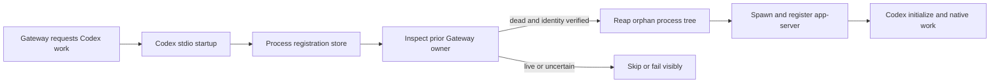

Codex review: needs maintainer review before merge. _Reviewed August 29, 2026, 11:03 AM ET / 15:03 UTC._

# ClawSweeper review

## What this changes

The PR records POSIX Codex stdio app-server processes durably, reaps verified children left by a dead Gateway before reconnecting, and makes startup awaitable for deadline and authorization checks.

## Merge readiness

⚠️ **Ready for maintainer review - 4 items remain**

Keep open for maintainer review: current main still lacks the orphan-registration/reaping path, and the PR is maintainer-labeled. No source-level defect was confirmed, but this reviewer could not perform the repository-required direct sibling Codex source check.

**Priority:** P1
**Reviewed head:** `b8ec3a6f63d046b68df56c6f7c70473947cb0e84`
**Owner decision:** Required. See [Decision needed](#decision-needed).

## Review scores

| Measure | Result | What it means |
|---|---|---|
| **Overall readiness** | 🦐 gold shrimp **(3/6)** | The patch is coherent and behavior-tested at its owner boundary, but the required direct upstream Codex contract check prevents a merge-ready Codex verdict in this environment. |
| **Proof confidence** | 🌊 off-meta tidepool | Not applicable: This maintainer-authored PR is exempt from the external-contributor proof gate. Its body describes native crash/reconnect probes and the checked source contains a behavior-level process test, but this reviewer did not independently execute them and could not complete the required sibling Codex contract check. |
| **Patch quality** | 🦐 gold shrimp **(3/6)** | No actionable review findings were identified. |

## Verification

| Check | Result | Evidence |
|---|---|---|
| **Real behavior** | Not applicable | Not applicable: This maintainer-authored PR is exempt from the external-contributor proof gate. Its body describes native crash/reconnect probes and the checked source contains a behavior-level process test, but this reviewer did not independently execute them and could not complete the required sibling Codex contract check. |
| **Evidence reviewed** | 8 items | Current main lacks this recovery path: Current main still returns the spawned stdio child directly; it has neither pre-spawn registration cleanup nor durable process registration, so the central behavior remains necessary. Introduced owner boundary: The PR places recovery before spawn and persists the parent/child identity after spawn but before the caller can initialize the app-server. Caller and lifecycle deadline: Shared-client startup awaits the new async start under its existing acquisition deadline and disposes a client that resolves after ownership has been released. |
| **Findings** | None | None. |
| **Security** | None | None. |

## How this fits together

The Codex plugin launches an app-server subprocess for native work. The new startup path reads prior process registrations, removes a verified orphan when its Gateway parent is gone, then persists the replacement process identity before Codex initialization.

## Decision needed

| Question | Recommendation |
|---|---|
| Should this maintainer-owned POSIX recovery design proceed after a reviewer with the required sibling Codex checkout verifies the initialization and shutdown assumptions that bound orphan cleanup? | **Complete upstream contract check:** Have a Codex-area reviewer inspect the pinned app-server initialization and EOF/shutdown behavior, then resume normal merge review. |

Why: The PR directly launches and drives the Codex app-server, and repository policy requires direct sibling-source inspection before a Codex verdict or proof-sufficient claim; that checkout is unavailable here.

## Before merge

- [ ] **Resolve merge risk (P1)** - The new fail-closed recovery path can prevent Codex stdio startup when process inspection or bounded cleanup is unavailable; that is intentional, but requires maintainer acceptance for existing POSIX deployments.
- [ ] **Resolve merge risk (P1)** - The repository-required direct inspection of the Codex app-server protocol/runtime could not be completed because ../codex is absent in this review environment.
- [ ] **Complete next step (P1)** - A Codex-area maintainer must complete the direct upstream contract check and accept the intentional fail-closed startup behavior before merge.

<strong>Agent review details</strong>

### Security

None.

### PR surface

Source +406, Tests +289, Docs +33. Total +728 across 22 files.

View PR surface stats

| Area | Files | Added | Removed | Net |
|---|---:|---:|---:|---:|
| Source | 8 | 519 | 113 | +406 |
| Tests | 13 | 730 | 441 | +289 |
| Docs | 1 | 33 | 0 | +33 |
| Config | 0 | 0 | 0 | 0 |
| Generated | 0 | 0 | 0 | 0 |
| Other | 0 | 0 | 0 | 0 |
| **Total** | **22** | **1282** | **554** | **+728** |

### Review metrics

| Metric | Value | Why it matters |
|---|---|---|
| **Production versus test delta** | production +425/-113 (net +312); tests/test support +824/-441; docs +33 | The bug fix adds a substantial durable lifecycle owner, so its compatibility and startup-failure behavior merit maintainer review. |

### Stored data model

Persistent data-model change detected: `serialized state: extensions/codex/src/app-server/transport-orphan.test-helper.ts`, `serialized state: extensions/codex/src/app-server/transport-process-snapshot.ts`. Confirm migration or upgrade compatibility proof before merge.

### Merge-risk options

**Maintainer options:**
1. **Verify the upstream lifecycle contract (recommended)**  
   Before merge, record direct Codex-source confirmation that initialization prevents native work until the durable registration point and that shutdown behavior matches the recovery assumptions.
2. **Accept the fail-closed recovery tradeoff**  
   Merge with explicit maintainer acceptance that inaccessible process inspection blocks a fresh POSIX Codex stdio connection rather than risking overlap.

### Technical review

Best possible solution:

Retain the owner-plugin registration design if a Codex-area maintainer confirms the direct upstream initialization and shutdown contract, then merge only after the normal exact-head CI gates are green.

Do we have a high-confidence way to reproduce the issue?

Yes, source-reproducible with high confidence: current main starts a detached POSIX stdio child without a durable registration or reconnect-time reaper, and the added crash test encodes the hard-kill/reconnect sequence. This reviewer did not execute that sequence.

Is this the best way to solve the issue?

Unclear: the repair is located at the spawn owner and reuses the existing containment owner, which is the right architectural boundary, but the required direct Codex runtime-contract inspection remains unavailable.

AGENTS.md: found and applied where relevant.

Codex review notes: model internal, reasoning high; reviewed against [3399dd67b7e8](https://github.com/openclaw/openclaw/commit/3399dd67b7e8efb0698481cc9fc72b00c092858f).

### Labels

Label changes:

- add `rating: 🦐 gold shrimp`: Overall readiness is 🦐 gold shrimp; proof is 🌊 off-meta tidepool and patch quality is 🦐 gold shrimp.
- remove `rating: 🐚 platinum hermit`: Current PR rating is `rating: 🦐 gold shrimp`, so this older rating label is no longer current.

Label justifications:

- `P1`: A hard Gateway stop can otherwise permit overlapping native Codex work after reconnect.
- `merge-risk: 🚨 compatibility`: Existing POSIX stdio deployments newly depend on process inspection and durable registration before startup.
- `merge-risk: 🚨 availability`: When cleanup cannot verify an old child is gone, the PR intentionally blocks replacement startup.
- `rating: 🦐 gold shrimp`: Overall readiness is 🦐 gold shrimp; proof is 🌊 off-meta tidepool and patch quality is 🦐 gold shrimp.
- `status: 👀 ready for maintainer look`: ClawSweeper has no concrete contributor-facing blocker left for this PR. Not applicable: This maintainer-authored PR is exempt from the external-contributor proof gate. Its body describes native crash/reconnect probes and the checked source contains a behavior-level process test, but this reviewer did not independently execute them and could not complete the required sibling Codex contract check.

### Evidence

What I checked:

- **Current main lacks this recovery path:** Current main still returns the spawned stdio child directly; it has neither pre-spawn registration cleanup nor durable process registration, so the central behavior remains necessary. ([`extensions/codex/src/app-server/transport-stdio.ts:128`](https://github.com/openclaw/openclaw/blob/3399dd67b7e8/extensions/codex/src/app-server/transport-stdio.ts#L128), [3399dd67b7e8](https://github.com/openclaw/openclaw/commit/3399dd67b7e8))
- **Introduced owner boundary:** The PR places recovery before spawn and persists the parent/child identity after spawn but before the caller can initialize the app-server. ([`extensions/codex/src/app-server/transport-process-registration.ts:16`](https://github.com/openclaw/openclaw/blob/b8ec3a6f63d0/extensions/codex/src/app-server/transport-process-registration.ts#L16), [b8ec3a6f63d0](https://github.com/openclaw/openclaw/commit/b8ec3a6f63d0))
- **Caller and lifecycle deadline:** Shared-client startup awaits the new async start under its existing acquisition deadline and disposes a client that resolves after ownership has been released. ([`extensions/codex/src/app-server/shared-client.ts:1107`](https://github.com/openclaw/openclaw/blob/b8ec3a6f63d0/extensions/codex/src/app-server/shared-client.ts#L1107), [b8ec3a6f63d0](https://github.com/openclaw/openclaw/commit/b8ec3a6f63d0))
- **Persistent-store contract:** The SDK keyed store performs synchronous SQLite-backed register/delete operations, matching the PR's use of a durable registration before initialization. ([`src/plugin-state/plugin-state-store.ts:213`](https://github.com/openclaw/openclaw/blob/b8ec3a6f63d0/src/plugin-state/plugin-state-store.ts#L213), [b8ec3a6f63d0](https://github.com/openclaw/openclaw/commit/b8ec3a6f63d0))
- **Behavior-level regression coverage:** The added crash-recovery test kills one owner, verifies its child and detached descendant remain alive, starts a successor, then verifies only the dead owner's tree is gone while live and separate-state controls survive. ([`extensions/codex/src/app-server/transport-orphan.test.ts:25`](https://github.com/openclaw/openclaw/blob/b8ec3a6f63d0/extensions/codex/src/app-server/transport-orphan.test.ts#L25), [b8ec3a6f63d0](https://github.com/openclaw/openclaw/commit/b8ec3a6f63d0))
- **History and likely ownership:** Blame attributes the async stdio startup and registration call to the PR's initial commit; earlier surrounding transport lines date to the prior current-main implementation. ([`extensions/codex/src/app-server/transport-stdio.ts:140`](https://github.com/openclaw/openclaw/blob/b661be4679a8/extensions/codex/src/app-server/transport-stdio.ts#L140), [b661be4679a8](https://github.com/openclaw/openclaw/commit/b661be4679a8))

Likely related people:

- **steipete:** Current-main transport history and blame attribute the surrounding stdio startup path to Peter Steinberger, and the supplied PR metadata maps the current lifecycle work to steipete. (role: recent area contributor; confidence: high; commits: [3a16070e979b](https://github.com/openclaw/openclaw/commit/3a16070e979bbf4abc56a990e4b2d644295a981e), [b661be4679a8](https://github.com/openclaw/openclaw/commit/b661be4679a8268dac8a59df2fa6c864f9b186af); files: `extensions/codex/src/app-server/transport-stdio.ts`, `extensions/codex/src/app-server/shared-client.ts`)
- **Ming Yoo:** The prior process-containment repair established the descendant-cleanup surface that this PR extends to recovery after a crashed parent. (role: adjacent lifecycle contributor; confidence: medium; commits: [cde3458c842e](https://github.com/openclaw/openclaw/commit/cde3458c842e71f851d6d3e887aaf41a60c2ea9a); files: `extensions/codex/src/app-server/transport-process-containment.ts`)

### Rank-up moves

Optional improvements that raise the rating; they are not merge blockers.

- Record direct inspection of the required sibling Codex app-server initialization and shutdown contract before merge.

### Rating scale

| Score | Internal tier | Crab rank | Meaning |
|---:|:---:|---|---|
| **6/6** | S | 🦀 challenger crab | Exceptional readiness |
| **5/6** | A | 🦞 diamond lobster | Very strong readiness |
| **4/6** | B | 🐚 platinum hermit | Good normal PR; ordinary maintainer review |
| **3/6** | C | 🦐 gold shrimp | Useful, but confidence is limited |
| **2/6** | D | 🦪 silver shellfish | Proof or implementation needs work |
| **1/6** | F | 🧂 unranked krab | Not merge-ready |
| N/A | NA | 🌊 off-meta tidepool | Rating does not apply |

Overall follows the weaker of proof and patch quality.
Shiny media proof means a screenshot, video, or linked artifact directly shows the changed behavior. Runtime, network, CSP, and security claims still need visible diagnostics.

### Workflow

- ClawSweeper keeps one durable marker-backed review comment per issue or PR.
- Re-runs edit this comment so the latest verdict, findings, and automation markers stay together instead of adding duplicate bot comments.
- A fresh review can be triggered by eligible `@clawsweeper re-review` comments, exact-item GitHub events, scheduled/background review runs, or manual workflow dispatch.
- PR/issue authors and users with repository write access can comment `@clawsweeper re-review` or `@clawsweeper re-run` on an open PR or issue to request a fresh review only.
- Maintainers can also comment `@clawsweeper review` to request a fresh review only.
- Fresh-review commands do not start repair, autofix, rebase, CI repair, or automerge.
- Maintainer-only repair and merge flows require explicit commands such as `@clawsweeper autofix`, `@clawsweeper automerge`, `@clawsweeper fix ci`, or `@clawsweeper address review`.
- Maintainers can comment `@clawsweeper explain` to ask for more context, or `@clawsweeper stop` to stop active automation.

### History

Review history (2 earlier review cycles)

<!-- clawsweeper-review-history v=1 total=2 -->
- reviewed 2026-08-29T13:52:45.105Z sha 463d050af6f90b9e9c630677b487fb2a682557bd :: found issues before merge. :: [P1] Preserve startup when process inspection is unavailable
- reviewed 2026-08-29T14:52:58.052Z sha 40df98625c11268fffe58b8e6cd8e638d93f6a6e :: needs maintainer review before merge. :: none

<!-- clawsweeper-verdict:needs-human item=132610 sha=b8ec3a6f63d046b68df56c6f7c70473947cb0e84 confidence=high updated_at=2026-08-29T15:00:31Z reviewed_at=2026-08-29T15:03:52.066Z lease_owner=github-run-33259005520-1 lease_comment_id=5463115389 source_revision=d1b8380561a5872b45fe3417760c1fbf00eeb4b6f1d814bcaf29c4eb98082d21 live_verification=absent -->

<!-- clawsweeper-review-version item=132610 reviewed_at=2026-08-29T15:03:52.066Z sha=b8ec3a6f63d046b68df56c6f7c70473947cb0e84 source_revision=d1b8380561a5872b45fe3417760c1fbf00eeb4b6f1d814bcaf29c4eb98082d21 lease_owner=github-run-33259005520-1 lease_comment_id=5463115389 v=1 -->

<!-- clawsweeper-review item=132610 -->