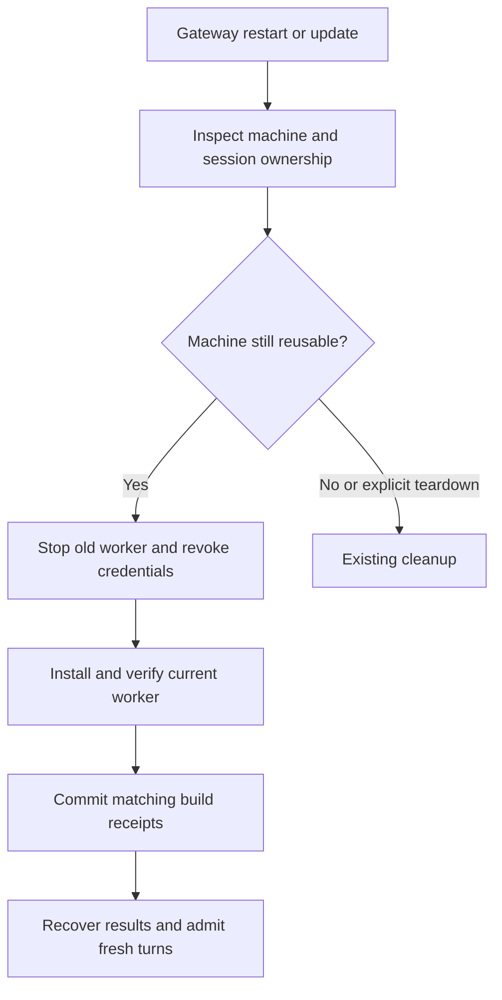

Codex review: blocked before merge. _Reviewed September 10, 2026, 5:47 AM ET / 09:47 UTC (Revision 5)._

# ClawSweeper review

## What this changes

Refreshes cloud worker software on the existing machine and recovers interrupted node sessions while preserving their workspace, installed packages, and desktop.

## Merge readiness

⛔ **Blocked before merge - 1 item remains**

The PR remains useful: current main and the latest release still retire mismatched attached workers. The previous SSH recovery finding is fixed, and this review found no remaining blocking defect.

**Priority:** P1
**Reviewed head:** `c6cf93c53e3c6a8baf67ae0cabb9778e77bc5b49`

## Review scores

| Measure | Result | What it means |
|---|---|---|
| **Overall readiness** | 🐚 platinum hermit **(4/6)** | A focused lifecycle repair with meaningful regression coverage and no remaining actionable finding. |
| **Proof confidence** | 🌊 off-meta tidepool | Not applicable: The maintainer-authored exemption applies. Supplied service/store regression evidence covers retained leases, SSH retry, persistence, and stale ownership; an actual cloud-machine Gateway restart and desktop continuity were not demonstrated. |
| **Patch quality** | 🐚 platinum hermit **(4/6)** | No actionable review findings were identified. |

## Verification

| Check | Result | Evidence |
|---|---|---|
| **Real behavior** | Not applicable | Not applicable: The maintainer-authored exemption applies. Supplied service/store regression evidence covers retained leases, SSH retry, persistence, and stale ownership; an actual cloud-machine Gateway restart and desktop continuity were not demonstrated. |
| **Evidence reviewed** | 9 items | Current main still destroys mismatched workers: The attached/node-backed reconciliation path calls finishDestroy when the admitted worker build differs from the current Gateway bundle. Latest release retains the old behavior: The v2026.9.3 source also destroys stale attached workers; the requested machine-retention behavior is not present in that release. Refresh preserves ownership checks: The refresher stops the existing runtime, revokes its credential through the existing lifecycle owner, rechecks placement generation and teardown intent, and passes current-owner assertions into both installers. These are OpenClaw-owned bundle and transport contracts; no Codex harness dependency is established by this change. |
| **Findings** | None | None. |
| **Security** | None | None. |

## How this fits together

The Gateway’s worker lifecycle connects session placements to cloud machines and their installed worker software. During restart recovery, it reconciles workspace results and decides whether to retain, refresh, or destroy each machine.

## Before merge

- [ ] **Add data-model compatibility proof** - Confirm migration or upgrade compatibility proof before merge.

<strong>Agent review details</strong>

### Security

None.

### PR surface

Source +366, Tests +862, Docs +4. Total +1232 across 26 files.

View PR surface stats

| Area | Files | Added | Removed | Net |
|---|---:|---:|---:|---:|
| Source | 12 | 448 | 82 | +366 |
| Tests | 12 | 1101 | 239 | +862 |
| Docs | 2 | 5 | 1 | +4 |
| Config | 0 | 0 | 0 | 0 |
| Generated | 0 | 0 | 0 | 0 |
| Other | 0 | 0 | 0 | 0 |
| **Total** | **26** | **1554** | **322** | **+1232** |

### Review metrics

| Metric | Value | Why it matters |
|---|---|---|
| **Production versus regression coverage** | Production +366 lines; tests and support +862 lines | Production growth implements retained-machine recovery and ownership guards, with most added coverage targeting failure, restart, and persistence boundaries. |
| **Persisted receipt coordination** | 2 existing records updated atomically; 0 schema fields added | Environment and placement build identities must advance together without replacing the workspace owner. |

### Stored data model

Persistent data-model change detected: `serialized state: src/gateway/worker-environments/provider-lifecycle.ts`, `unknown-data-model-change: src/gateway/worker-environments/provider-lifecycle.ts`. Confirm migration or upgrade compatibility proof before merge.

### Technical review

Best possible solution:

Keep machine and workspace ownership stable while replacing executable authority through verified installation, fresh credentials, and fresh turn claims.

Do we have a high-confidence way to reproduce the issue?

Yes, from source: reconcile an attached machine whose recorded worker build differs from the Gateway build, and current main invokes destruction. This review did not execute that path.

Is this the best way to solve the issue?

Yes. Updating the existing lease through the lifecycle and installation owners addresses machine loss while preserving explicit teardown and exact-build admission.

AGENTS.md: found and applied where relevant.

Codex review notes: model internal, reasoning medium; reviewed against [ff1d91f6711b](https://github.com/openclaw/openclaw/commit/ff1d91f6711b301ad0bb8f8f9485bfb05d770d84).

### Labels

Label justifications:

- `P1`: Gateway updates currently destroy attached cloud machines, disrupting active cloud workflows and losing machine-local installations.
- `rating: 🐚 platinum hermit`: Overall readiness is 🐚 platinum hermit; proof is 🌊 off-meta tidepool and patch quality is 🐚 platinum hermit.
- `status: 👀 ready for maintainer look`: ClawSweeper has no concrete contributor-facing blocker left for this PR. Not applicable: The maintainer-authored exemption applies. Supplied service/store regression evidence covers retained leases, SSH retry, persistence, and stale ownership; an actual cloud-machine Gateway restart and desktop continuity were not demonstrated.

### Evidence

What I checked:

- **Current main still destroys mismatched workers:** The attached/node-backed reconciliation path calls finishDestroy when the admitted worker build differs from the current Gateway bundle. ([`src/gateway/worker-environments/provider-lifecycle.ts:593`](https://github.com/openclaw/openclaw/blob/ff1d91f6711b301ad0bb8f8f9485bfb05d770d84/src/gateway/worker-environments/provider-lifecycle.ts#L593), [ff1d91f6711b](https://github.com/openclaw/openclaw/commit/ff1d91f6711b301ad0bb8f8f9485bfb05d770d84))
- **Latest release retains the old behavior:** The v2026.9.3 source also destroys stale attached workers; the requested machine-retention behavior is not present in that release. ([`src/gateway/worker-environments/provider-lifecycle.ts:596`](https://github.com/openclaw/openclaw/blob/1391f7cd2d40ab5bbcf2f5f831d3a64f520e72d7/src/gateway/worker-environments/provider-lifecycle.ts#L596), [1391f7cd2d40](https://github.com/openclaw/openclaw/commit/1391f7cd2d40ab5bbcf2f5f831d3a64f520e72d7))
- **Refresh preserves ownership checks:** The refresher stops the existing runtime, revokes its credential through the existing lifecycle owner, rechecks placement generation and teardown intent, and passes current-owner assertions into both installers. These are OpenClaw-owned bundle and transport contracts; no Codex harness dependency is established by this change. ([`src/gateway/worker-environments/provider-runtime-refresh.ts:87`](https://github.com/openclaw/openclaw/blob/c6cf93c53e3c6a8baf67ae0cabb9778e77bc5b49/src/gateway/worker-environments/provider-runtime-refresh.ts#L87), [c6cf93c53e3c](https://github.com/openclaw/openclaw/commit/c6cf93c53e3c6a8baf67ae0cabb9778e77bc5b49))
- **Atomic receipt update and persistence coverage:** The store updates existing environment and placement build fields in one synchronous transaction, requires revoked credentials and exact ownership, and preserves the workspace epoch. Tests cover reopen persistence, rejected stale inputs, explicit teardown, and rollback when the environment write fails; no schema fields are introduced. ([`src/gateway/worker-environments/store-runtime-refresh.test.ts:198`](https://github.com/openclaw/openclaw/blob/c6cf93c53e3c6a8baf67ae0cabb9778e77bc5b49/src/gateway/worker-environments/store-runtime-refresh.test.ts#L198), [c6cf93c53e3c](https://github.com/openclaw/openclaw/commit/c6cf93c53e3c6a8baf67ae0cabb9778e77bc5b49))
- **Previous SSH finding resolved:** Startup recovery now preserves WorkerRuntimeRefreshPendingError instead of failing and destroying the placement. The regression exercises failed installation followed by successful retry on the original SSH lease. The contributor’s discussion reports that this regression failed before the repair. ([`src/gateway/worker-environments/placement-dispatch-recovery.ts:166`](https://github.com/openclaw/openclaw/blob/c6cf93c53e3c6a8baf67ae0cabb9778e77bc5b49/src/gateway/worker-environments/placement-dispatch-recovery.ts#L166), [c6cf93c53e3c](https://github.com/openclaw/openclaw/commit/c6cf93c53e3c6a8baf67ae0cabb9778e77bc5b49))
- **Authority reaches the dispatch boundary:** The node installer passes its current-owner callback to transport dispatch and artifact transfer. Transport checks authorization immediately before dispatch; artifact transfer rejects throwing or stale owners. Existing worker admission also checks current credentials and live claims, while startup-inherited claims remain recovery-only. ([`src/gateway/worker-environments/node-worker-bundle-installer.ts:36`](https://github.com/openclaw/openclaw/blob/c6cf93c53e3c6a8baf67ae0cabb9778e77bc5b49/src/gateway/worker-environments/node-worker-bundle-installer.ts#L36), [c6cf93c53e3c](https://github.com/openclaw/openclaw/commit/c6cf93c53e3c6a8baf67ae0cabb9778e77bc5b49))

Likely related people:

- **steipete:** Suggested for follow-up; no historical authorship or introduction is verified. (role: unverified routing candidate; confidence: low)

### Rating scale

| Score | Internal tier | Crab rank | Meaning |
|---:|:---:|---|---|
| **6/6** | S | 🦀 challenger crab | Exceptional readiness |
| **5/6** | A | 🦞 diamond lobster | Very strong readiness |
| **4/6** | B | 🐚 platinum hermit | Good normal PR; ordinary maintainer review |
| **3/6** | C | 🦐 gold shrimp | Useful, but confidence is limited |
| **2/6** | D | 🦪 silver shellfish | Proof or implementation needs work |
| **1/6** | F | 🧂 unranked krab | Not merge-ready |
| N/A | NA | 🌊 off-meta tidepool | Rating does not apply |

Overall follows the weaker of proof and patch quality.
Shiny media proof means a screenshot, video, or linked artifact directly shows the changed behavior. Runtime, network, CSP, and security claims still need visible diagnostics.

### Workflow

- ClawSweeper keeps one durable marker-backed review comment per issue or PR.
- Re-runs edit this comment so the latest verdict, findings, and automation markers stay together instead of adding duplicate bot comments.
- A fresh review can be triggered by eligible `@clawsweeper re-review` comments, exact-item GitHub events, scheduled/background review runs, or manual workflow dispatch.
- PR/issue authors and users with repository write access can comment `@clawsweeper re-review` or `@clawsweeper re-run` on an open PR or issue to request a fresh review only.
- Maintainers can also comment `@clawsweeper review` to request a fresh review only.
- Fresh-review commands do not start repair, autofix, rebase, CI repair, or automerge.
- Maintainer-only repair and merge flows require explicit commands such as `@clawsweeper autofix`, `@clawsweeper automerge`, `@clawsweeper fix ci`, or `@clawsweeper address review`.
- Maintainers can comment `@clawsweeper explain` to ask for more context, or `@clawsweeper stop` to stop active automation.

### History

Review history (4 earlier review cycles)

<!-- clawsweeper-review-history v=1 total=4 -->
- reviewed 2026-09-10T08:12:13.582Z sha e7f182dbac5f852c7653b6bbbe6651efc92640e2 :: blocked before merge. :: [P1] Preserve failed SSH refreshes through startup placement recovery
- reviewed 2026-09-10T08:20:42.694Z sha e7f182dbac5f852c7653b6bbbe6651efc92640e2 :: blocked before merge. :: [P1] Preserve failed SSH refreshes through startup placement recovery
- reviewed 2026-09-10T08:42:46.398Z sha c6ea02e7bcd27ba82d28129360cfd4e5ca29b38d :: blocked before merge. :: none
- reviewed 2026-09-10T09:01:04.106Z sha 878ba179b8082461ebe280c1f88692df9c494071 :: blocked before merge. :: none

<!-- clawsweeper-verdict:needs-human item=143858 sha=c6cf93c53e3c6a8baf67ae0cabb9778e77bc5b49 confidence=high updated_at=2026-09-10T09:44:00Z reviewed_at=2026-09-10T09:47:30.107Z lease_owner=github-run-34462076547-1 lease_comment_id=5616540194 source_revision=1ce6bf8841ed25e7e84aa5fda6266eaafcd153b153bb3f722501e662211fa0af live_verification=absent -->
<!-- clawsweeper-review-state:blocked item=143858 sha=c6cf93c53e3c6a8baf67ae0cabb9778e77bc5b49 v=1 -->

<!-- clawsweeper-review-version item=143858 reviewed_at=2026-09-10T09:47:30.107Z sha=c6cf93c53e3c6a8baf67ae0cabb9778e77bc5b49 source_revision=1ce6bf8841ed25e7e84aa5fda6266eaafcd153b153bb3f722501e662211fa0af lease_owner=github-run-34462076547-1 lease_comment_id=5616540194 v=1 -->

<!-- clawsweeper-review item=143858 -->