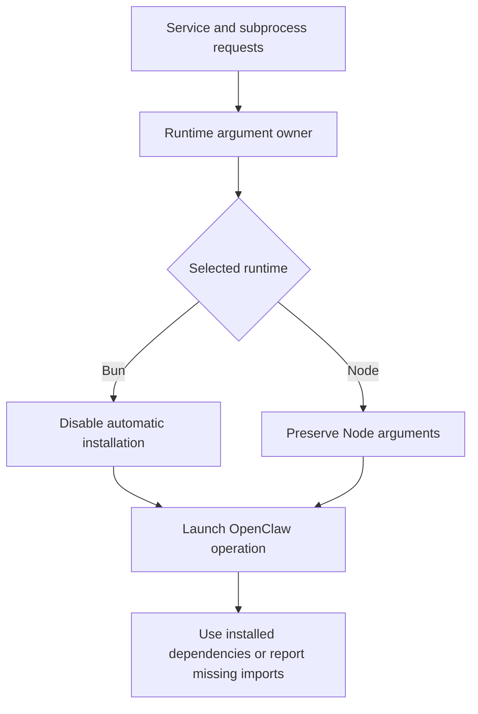

Codex review: needs maintainer review before merge. _Reviewed October 2, 2026, 3:01 AM ET / 07:01 UTC (Revision 4)._

# ClawSweeper review

## What this changes

The branch disables automatic dependency installation in OpenClaw-owned Bun launches and updates service inspection, update handoff handling, tests, and installation guidance.

## Merge readiness

✅ **Ready for maintainer review**

The PR remains useful and has no actionable review findings. The prior fixture conflict is resolved, and the existing runtime and upgrade proof remains applicable to the final head.

**Priority:** P2
**Reviewed head:** `5956035dc7795331963a74aca4c8f6c80b03e147`

## Review scores

| Measure | Result | What it means |
|---|---|---|
| **Overall readiness** | 🦞 diamond lobster **(5/6)** | Strong production-boundary and published-driver evidence supports a focused owner-level patch with no actionable findings. |
| **Proof confidence** | 🦞 diamond lobster **(5/6)** | Sufficient (live_output): Captured registry observations exercise the changed CLI, service, worker, and secret-provider launch owners on verified Bun b368 and show zero fetches or package execution after the fix. The published v2026.9.7-to-candidate systemd upgrade verifies saved service compatibility and preserved settings; only Doctor test fixtures changed afterward. |
| **Patch quality** | 🦞 diamond lobster **(5/6)** | No actionable review findings were identified. |

## Verification

| Check | Result | Evidence |
|---|---|---|
| **Real behavior** | Verified | Sufficient (live_output): Captured registry observations exercise the changed CLI, service, worker, and secret-provider launch owners on verified Bun b368 and show zero fetches or package execution after the fix. The published v2026.9.7-to-candidate systemd upgrade verifies saved service compatibility and preserved settings; only Doctor test fixtures changed afterward. |
| **Evidence reviewed** | 10 items | Introduced runtime policy: The pinned merge-base-to-head diff adds one Bun-only argument helper and applies it at owned launch sites. Worker threads retain their separate argument builder; Node arguments and explicit installation commands retain their contracts. Final fixture repair and proof continuity: GitHub's pinned comparison from artifact source 779e60e1635c7a9f022f2c8c408950a2c71b5192 to the reviewed head contains only two Doctor test files. The final runtime-probe fixture matches the complete fixture retrieved at inspected main dd7fe36e95f0b4a1e18b5699381f1b46bfc8178c. GitHub reports the exact reviewed head as mergeable, resolving the previous conflict concern. Real runtime and published-driver upgrade evidence: The captured PR body, sourceRevision fa7d4a484afdd84dfe4da63b4f9dfb171abed15f1603574993cf729f26acfab9, records four real launch paths against a logging localhost registry: packaged CLI fallback, Gateway service, worker subprocess, and plugin-integrated secret provider. Patched launches made zero GETs and executed no synthetic package, including cwd fallback configuration. The unchanged published v2026.9.7 Bun/systemd driver updated to artifact source 779e60e in 99 seconds with 21 passing assertions, refreshed service argv, preserved runtime pin/settings, readiness HTTP 200, and the candidate RPC build identity. |
| **Findings** | None | None. |
| **Security** | None | None. |

## How this fits together

OpenClaw constructs runtime commands for managed services, workers, maintenance tasks, and plugin secret providers. Those commands determine how Bun resolves dependencies before the requested OpenClaw operation runs.

## Before merge

None.

<strong>Agent review details</strong>

### Security

None.

### PR surface

Source +60, Tests +175, Docs +9. Total +244 across 37 files.

View PR surface stats

| Area | Files | Added | Removed | Net |
|---|---:|---:|---:|---:|
| Source | 18 | 114 | 54 | +60 |
| Tests | 18 | 396 | 221 | +175 |
| Docs | 1 | 11 | 2 | +9 |
| Config | 0 | 0 | 0 | 0 |
| Generated | 0 | 0 | 0 | 0 |
| Other | 0 | 0 | 0 | 0 |
| **Total** | **37** | **521** | **277** | **+244** |

### Review metrics

| Metric | Value | Why it matters |
|---|---|---|
| **Production versus test growth** | production +60 net lines; tests and test support +175 net lines | Production growth supports shared runtime policy and handoff integration; regression coverage includes the real IPC boundary. |

### Technical review

Best possible solution:

Keep dependency installation explicit at owned Bun launch sites and refresh saved service arguments through the existing installer while preserving Node and operator-command behavior.

Do we have a high-confidence way to reproduce the issue?

Yes: current-main launch arguments omit the Bun guard, and the captured before/after registry runs demonstrate package fetching and execution through four real entrypoints. This review did not independently execute those runs.

Is this the best way to solve the issue?

Yes: a shared Bun-only argument policy at existing launch owners is a narrow repair, and the final fixture alignment preserves the tested production inputs.

AGENTS.md: found and applied where relevant.

Codex review notes: model internal, reasoning medium; reviewed against [dd7fe36e95f0](https://github.com/openclaw/openclaw/commit/dd7fe36e95f0b4a1e18b5699381f1b46bfc8178c).

### Labels

Label changes:

- add `rating: 🦞 diamond lobster`: Overall readiness is 🦞 diamond lobster; proof is 🦞 diamond lobster and patch quality is 🦞 diamond lobster.
- remove `rating: 🐚 platinum hermit`: Current PR rating is `rating: 🦞 diamond lobster`, so this older rating label is no longer current.

Label justifications:

- `P2`: This is bounded runtime hardening for opt-in Bun installations with direct behavior and upgrade evidence.
- `merge-risk: 🚨 compatibility`: Missing imports now fail locally instead of being automatically installed; the maintainer explicitly accepts this behavior and supplies published-driver upgrade proof.
- `rating: 🦞 diamond lobster`: Overall readiness is 🦞 diamond lobster; proof is 🦞 diamond lobster and patch quality is 🦞 diamond lobster.
- `status: 👀 ready for maintainer look`: ClawSweeper has no concrete contributor-facing blocker left for this PR. Sufficient (live_output): Captured registry observations exercise the changed CLI, service, worker, and secret-provider launch owners on verified Bun b368 and show zero fetches or package execution after the fix. The published v2026.9.7-to-candidate systemd upgrade verifies saved service compatibility and preserved settings; only Doctor test fixtures changed afterward.
- `proof: sufficient`: Contributor real behavior proof is sufficient. Captured registry observations exercise the changed CLI, service, worker, and secret-provider launch owners on verified Bun b368 and show zero fetches or package execution after the fix. The published v2026.9.7-to-candidate systemd upgrade verifies saved service compatibility and preserved settings; only Doctor test fixtures changed afterward.

### Evidence

What I checked:

- **Introduced runtime policy:** The pinned merge-base-to-head diff adds one Bun-only argument helper and applies it at owned launch sites. Worker threads retain their separate argument builder; Node arguments and explicit installation commands retain their contracts. ([`src/infra/runtime-worker-url.ts:53`](https://github.com/openclaw/openclaw/blob/5956035dc7795331963a74aca4c8f6c80b03e147/src/infra/runtime-worker-url.ts#L53), [5956035dc779](https://github.com/openclaw/openclaw/commit/5956035dc7795331963a74aca4c8f6c80b03e147))
- **Final fixture repair and proof continuity:** GitHub's pinned comparison from artifact source 779e60e1635c7a9f022f2c8c408950a2c71b5192 to the reviewed head contains only two Doctor test files. The final runtime-probe fixture matches the complete fixture retrieved at inspected main dd7fe36e95f0b4a1e18b5699381f1b46bfc8178c. GitHub reports the exact reviewed head as mergeable, resolving the previous conflict concern. ([`src/commands/doctor-gateway-daemon-flow.test-support.ts:13`](https://github.com/openclaw/openclaw/blob/5956035dc7795331963a74aca4c8f6c80b03e147/src/commands/doctor-gateway-daemon-flow.test-support.ts#L13), [5956035dc779](https://github.com/openclaw/openclaw/commit/5956035dc7795331963a74aca4c8f6c80b03e147))
- **Real runtime and published-driver upgrade evidence:** The captured PR body, sourceRevision fa7d4a484afdd84dfe4da63b4f9dfb171abed15f1603574993cf729f26acfab9, records four real launch paths against a logging localhost registry: packaged CLI fallback, Gateway service, worker subprocess, and plugin-integrated secret provider. Patched launches made zero GETs and executed no synthetic package, including cwd fallback configuration. The unchanged published v2026.9.7 Bun/systemd driver updated to artifact source 779e60e in 99 seconds with 21 passing assertions, refreshed service argv, preserved runtime pin/settings, readiness HTTP 200, and the candidate RPC build identity. ([779e60e1635c](https://github.com/openclaw/openclaw/commit/779e60e1635c7a9f022f2c8c408950a2c71b5192))
- **Explicitly accepted compatibility tradeoff:** The maintainer-authored body explicitly adopts local missing-import failures, including bunfig fallback, and documents explicit dependency installation. Existing service definitions gain the flag through normal reinstall/update. The published-driver cell verifies that persisted service settings survive; no database or config schema changes are introduced. Public docs: [`docs/install/bun.md`](https://docs.openclaw.ai/install/bun). ([`docs/install/bun.md:54`](https://docs.openclaw.ai/install/bun), [5956035dc779](https://github.com/openclaw/openclaw/commit/5956035dc7795331963a74aca4c8f6c80b03e147))
- **Verified dependency contract:** The PR's Bun b368 proof and added --no-install argument establish an affirmative runtime dependency. Repository identity and the release tag's commit were verified through GitHub. At b368, Bun parses --no-install before -i and --install and sets the global cache mode to disable. ([`src/runtime/cli/Arguments.rs:1310`](https://github.com/openclaw/bun/blob/b3684189fe1f3592dfc5f9774060b405a243d9a6/src/runtime/cli/Arguments.rs#L1310), [b3684189fe1f](https://github.com/openclaw/bun/commit/b3684189fe1f3592dfc5f9774060b405a243d9a6))
- **Security and admission boundaries:** The secret-provider change prepends runtime arguments after existing trusted-plugin and entrypoint admission without broadening environment inheritance. Update IPC accepts the additional argument while retaining live lease, executor identity, requester, and native-placement checks. No dependency, permission, credential-storage, or authorization-policy expansion appears in the introduced diff. ([`src/secrets/provider-integrations.ts:150`](https://github.com/openclaw/openclaw/blob/5956035dc7795331963a74aca4c8f6c80b03e147/src/secrets/provider-integrations.ts#L150), [5956035dc779](https://github.com/openclaw/openclaw/commit/5956035dc7795331963a74aca4c8f6c80b03e147))

Likely related people:

- **unknown:** The claimed source-line change could not be verified from bounded local history. (role: source history unknown; confidence: low)

### Rating scale

| Score | Internal tier | Crab rank | Meaning |
|---:|:---:|---|---|
| **6/6** | S | 🦀 challenger crab | Exceptional readiness |
| **5/6** | A | 🦞 diamond lobster | Very strong readiness |
| **4/6** | B | 🐚 platinum hermit | Good normal PR; ordinary maintainer review |
| **3/6** | C | 🦐 gold shrimp | Useful, but confidence is limited |
| **2/6** | D | 🦪 silver shellfish | Proof or implementation needs work |
| **1/6** | F | 🧂 unranked krab | Not merge-ready |
| N/A | NA | 🌊 off-meta tidepool | Rating does not apply |

Overall follows the weaker of proof and patch quality.
Shiny media proof means a screenshot, video, or linked artifact directly shows the changed behavior. Runtime, network, CSP, and security claims still need visible diagnostics.

### Workflow

- ClawSweeper keeps one durable marker-backed review comment per issue or PR.
- Re-runs edit this comment so the latest verdict, findings, and automation markers stay together instead of adding duplicate bot comments.
- A fresh review can be triggered by eligible `@clawsweeper re-review` comments, exact-item GitHub events, scheduled/background review runs, or manual workflow dispatch.
- PR/issue authors and users with repository write access can comment `@clawsweeper re-review` or `@clawsweeper re-run` on an open PR or issue to request a fresh review only.
- Maintainers can also comment `@clawsweeper review` to request a fresh review only.
- Fresh-review commands do not start repair, autofix, rebase, CI repair, or automerge.
- Maintainer-only repair and merge flows require explicit commands such as `@clawsweeper autofix`, `@clawsweeper automerge`, `@clawsweeper fix ci`, or `@clawsweeper address review`.
- Maintainers can comment `@clawsweeper explain` to ask for more context, or `@clawsweeper stop` to stop active automation.

### History

Review history (3 earlier review cycles)

<!-- clawsweeper-review-history v=1 total=3 -->
- reviewed 2026-10-02T05:14:02.602Z sha 5c86935ba62d78be2a9c2f69dfa5b8210fea5e25 :: blocked before merge. :: none
- reviewed 2026-10-02T05:52:55.023Z sha 779e60e1635c7a9f022f2c8c408950a2c71b5192 :: blocked before merge. :: none
- reviewed 2026-10-02T06:41:52.987Z sha 7bf254c12b32887105d05d12825c4a24d7e0c59b :: needs changes before merge. :: none

<!-- clawsweeper-verdict:needs-human item=163270 sha=5956035dc7795331963a74aca4c8f6c80b03e147 confidence=high updated_at=2026-10-02T06:57:39Z reviewed_at=2026-10-02T07:01:44.711Z lease_owner=github-run-36976001922-1 lease_comment_id=5947016135 source_revision=fa7d4a484afdd84dfe4da63b4f9dfb171abed15f1603574993cf729f26acfab9 live_verification=absent -->
<!-- clawsweeper-review-state:ready item=163270 sha=5956035dc7795331963a74aca4c8f6c80b03e147 v=1 -->

<!-- clawsweeper-review-version item=163270 reviewed_at=2026-10-02T07:01:44.711Z sha=5956035dc7795331963a74aca4c8f6c80b03e147 source_revision=fa7d4a484afdd84dfe4da63b4f9dfb171abed15f1603574993cf729f26acfab9 lease_owner=github-run-36976001922-1 lease_comment_id=5947016135 v=1 -->

<!-- clawsweeper-review item=163270 -->