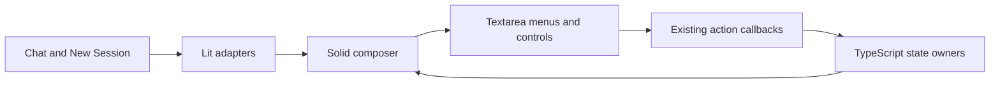

Codex review: needs changes before merge.

## What this changes

This PR ports the shared chat composer, suggestion menus, model controls, and recovery dialogs from Lit to Solid.

**Example:** A user types “hello 日本語” while an assistant response updates.
- **Before:** The Lit composer preserves the native textarea and unfinished composition.
- **After:** The Solid composer preserves the same input behavior through retained components.

## Review scores

| Measure | Result | What it means |
|---|---|---|
| **Overall readiness** | 🦐 gold shrimp **(3/6)** | Strong inspected visual proof supports a useful migration, but two verified P2 findings still block approval. |
| **Proof confidence** | 🦞 diamond lobster **(5/6)** ✨ media proof bonus | Sufficient (screenshot): Inspected browser captures show the migrated composer in desktop conversation and empty states; linked source-pinned retention, IME, undo, and chat gates support the interaction claims. |
| **Patch quality** | 🦐 gold shrimp **(3/6)** | 2 actionable review findings remain. |

## Product

**Kind:** Refactor · **Worth it:** Yes · **Fix scope:** Complete
**User problem:** No intended appearance or interaction change; chat and New Session must retain drafts, focus, menus, and controls during the renderer migration.
**Reason:** The maintainer-authored migration follows explicit repository direction and shares the new renderers across both composers without replacing domain owners.

## Merge readiness

⛔ **Needs changes before merge - 2 items remain**

Keep this PR open: the approved Solid migration remains necessary, but both previously reported P2 findings remain unresolved.

**Priority:** P2
**Reviewed head:** `ba100ae3d2dfe0991aff094dbaf5c9382dcac63c`

## Before merge

- [ ] **Use the reactive translator throughout migrated presentation (P2)** - When locale publication occurs while the permission picker remains mounted, its heading and Learn more label stay in the previous language. The plain I18nManager translator registers no Solid dependency, and these expressions read no props, so even a parent refresh cannot invalidate them. Other migrated components use the same import. Use the existing translator from lib/reactive/i18n.ts in Solid presentation and cover locale publication while retaining draft, focus, and controls. This previously reported finding remains unresolved.
- [ ] **Complete the suggestion-renderer ownership cutover (P2)** - Production suggestion menus now use this Solid renderer, but the overflow case in chat-composer-overflow.browser.test.tsx and the hover case in menu-surface.browser.test.ts still import the old Lit renderers from components/composer-menu.ts. Those checks can pass when the shipped Solid menu's overflow or hover behavior regresses, and they keep a second, test-only presentation implementation alive contrary to the required complete cutover. Move those cases to the Solid renderer, retain keyboard navigation as a shared plain TypeScript helper, and remove the obsolete Lit rendering functions. This previously reported finding remains unresolved.

## Findings

- [P2] Use the reactive translator throughout migrated presentation — `ui/src/pages/chat/components/chat-permission-picker.tsx:4`
- [P2] Complete the suggestion-renderer ownership cutover — `ui/src/pages/chat/components/chat-composer-menu.tsx:5-7`

<strong>Agent review details</strong>

### How this fits together

The Control UI composer consumes session, draft, queue, and capability state from existing TypeScript owners and sends user actions through their existing callbacks.

### Technical review

Best possible solution:

Complete the Solid cutover with reactive translations and production-renderer coverage while preserving the existing TypeScript state owners.

Do we have a high-confidence way to reproduce the issue?

Source establishes the retained-component locale failure and obsolete-renderer test path at the reviewed head; no target code or tests were executed.

Is this the best way to solve the issue?

The renderer migration fits the approved UI direction and preserves domain ownership, but its translation dependency and suggestion-test cutover need the focused repairs listed below.

Full review comments:

- [P2] Use the reactive translator throughout migrated presentation — `ui/src/pages/chat/components/chat-permission-picker.tsx:4`
  When locale publication occurs while the permission picker remains mounted, its heading and Learn more label stay in the previous language. The plain I18nManager translator registers no Solid dependency, and these expressions read no props, so even a parent refresh cannot invalidate them. Other migrated components use the same import. Use the existing translator from lib/reactive/i18n.ts in Solid presentation and cover locale publication while retaining draft, focus, and controls. This previously reported finding remains unresolved.
  Confidence: 0.99
- [P2] Complete the suggestion-renderer ownership cutover — `ui/src/pages/chat/components/chat-composer-menu.tsx:5-7`
  Production suggestion menus now use this Solid renderer, but the overflow case in chat-composer-overflow.browser.test.tsx and the hover case in menu-surface.browser.test.ts still import the old Lit renderers from components/composer-menu.ts. Those checks can pass when the shipped Solid menu's overflow or hover behavior regresses, and they keep a second, test-only presentation implementation alive contrary to the required complete cutover. Move those cases to the Solid renderer, retain keyboard navigation as a shared plain TypeScript helper, and remove the obsolete Lit rendering functions. This previously reported finding remains unresolved.
  Confidence: 0.97

Overall correctness: patch is incorrect
Overall confidence: 0.95

AGENTS.md: found and applied where relevant.

Codex review notes: model internal, reasoning medium; reviewed against [1f8307fe90a9](https://github.com/openclaw/openclaw/commit/1f8307fe90a967155dc9cf571fce7a18e6ee30ad).

### Provenance checked

- `Composer state and presentation` keeps the original intent (049a17860c5b47a88cc470edee1a65f53bb79442: The earlier composer split separated interaction state and presentation; this PR keeps synchronous owners while replacing rendering.)
- `Multiline composer and attached queue` keeps the original intent (64853b1a9d505dc3980e4bedfc39ee79c043ffbf: The multiline restructure preserved composer interaction and permission contracts; the Solid port retains their existing callbacks and layout.)
- `Shared suggestion presentation` keeps the original intent (caec9c81e73e87fe538e3a5ad7578e58adfa1f22: One shared renderer was established for listbox presentation, navigation, and accessibility; production moves together, but obsolete test rendering remains.)

### Testing

Proof path: shipped entry point.

### Security

None.

### Evidence

Acceptance criteria:

- pnpm test ui/src/pages/chat/chat-composer-solid.test.tsx --maxWorkers=1
- pnpm test ui/src/pages/chat/components/chat-composer-menu.test.tsx --maxWorkers=1
- pnpm test ui/src/pages/chat/chat-composer-overflow.browser.test.tsx --maxWorkers=1
- pnpm test ui/src/components/menu-surface.browser.test.ts --maxWorkers=1
- git diff --check

What I checked:

- **Pinned revision and re-review delta:** The checkout matches the reviewed head and remains clean; the change since the previous review only makes a goal-test cleanup callback return void. ([`ui/src/pages/chat/chat-view-goals.test.ts:165`](https://github.com/openclaw/openclaw/blob/ba100ae3d2dfe0991aff094dbaf5c9382dcac63c/ui/src/pages/chat/chat-view-goals.test.ts#L165), [ba100ae3d2df](https://github.com/openclaw/openclaw/commit/ba100ae3d2dfe0991aff094dbaf5c9382dcac63c))
- **Current main still needs the migration:** Fetched main still implements the composer and permission picker with Lit. ([`ui/src/pages/chat/components/chat-permission-picker.ts:1`](https://github.com/openclaw/openclaw/blob/1f8307fe90a967155dc9cf571fce7a18e6ee30ad/ui/src/pages/chat/components/chat-permission-picker.ts#L1), [1f8307fe90a9](https://github.com/openclaw/openclaw/commit/1f8307fe90a967155dc9cf571fce7a18e6ee30ad))
- **Nonreactive presentation translations:** The Solid permission picker imports the plain translator, while the existing reactive translator subscribes to locale publication; the heading and Learn more expressions read no props that could invalidate them. ([`ui/src/pages/chat/components/chat-permission-picker.tsx:4`](https://github.com/openclaw/openclaw/blob/ba100ae3d2dfe0991aff094dbaf5c9382dcac63c/ui/src/pages/chat/components/chat-permission-picker.tsx#L4), [ba100ae3d2df](https://github.com/openclaw/openclaw/commit/ba100ae3d2dfe0991aff094dbaf5c9382dcac63c))
- **Suggestion-renderer cutover remains incomplete:** Production menus use the Solid renderer, but overflow and hover tests still call the old Lit renderers; https://github.com/openclaw/openclaw/pull/140633 established one shared presentation owner. ([`ui/src/pages/chat/chat-composer-overflow.browser.test.tsx:709`](https://github.com/openclaw/openclaw/blob/ba100ae3d2dfe0991aff094dbaf5c9382dcac63c/ui/src/pages/chat/chat-composer-overflow.browser.test.tsx#L709), [ba100ae3d2df](https://github.com/openclaw/openclaw/commit/ba100ae3d2dfe0991aff094dbaf5c9382dcac63c))
- **Inspected visual proof:** The prepared desktop light conversation and desktop dark empty-composer before/after images show matching composer layout and controls.
- **Focused checks pin the exercised source:** The successful linked retention and chat-gate workflow explicitly checks out and verifies d103e26; the subsequent head change affects only test cleanup. ([`.github/workflows/composer-inherited-proof.yml:25`](https://github.com/openclaw/openclaw/blob/966730981341fef3f42101103f94bafbf5a8d371/.github/workflows/composer-inherited-proof.yml#L25), [966730981341](https://github.com/openclaw/openclaw/commit/966730981341fef3f42101103f94bafbf5a8d371))

Likely related people:

- **Peter Steinberger:** Raw commit 049a17860c5b47a88cc470edee1a65f53bb79442 adds ui/src/pages/chat/components/chat-composer.ts:37 relative to its recorded parents. This identifies author metadata, not feature responsibility or a PR merger. (role: source-line author; confidence: high; commits: [049a17860c5b](https://github.com/openclaw/openclaw/commit/049a17860c5b47a88cc470edee1a65f53bb79442); files: `ui/src/pages/chat/components/chat-composer.ts`)
- **Vyctor H. Brzezowski:** Raw commit 64853b1a9d505dc3980e4bedfc39ee79c043ffbf adds ui/src/pages/chat/components/chat-composer.ts:88 relative to its recorded parents. This identifies author metadata, not feature responsibility or a PR merger. (role: source-line author; confidence: high; commits: [64853b1a9d50](https://github.com/openclaw/openclaw/commit/64853b1a9d505dc3980e4bedfc39ee79c043ffbf); files: `ui/src/pages/chat/components/chat-composer.ts`)
- **Jason (Json):** Raw commit d579e4f0f3018783a44fbd7685cd54b66ee60977 adds ui/src/pages/chat/components/chat-composer.ts:103 relative to its recorded parents. This identifies author metadata, not feature responsibility or a PR merger. (role: source-line author; confidence: medium; commits: [d579e4f0f301](https://github.com/openclaw/openclaw/commit/d579e4f0f3018783a44fbd7685cd54b66ee60977); files: `ui/src/pages/chat/components/chat-composer.ts`)

### PR surface

PR surface statistics unavailable: the file list is incomplete.

### Labels

Label changes:

No label changes.

Label justifications:

- `P2`: This planned UI migration has localized translation and coverage defects, without evidence of an urgent production outage.
- `rating: 🦐 gold shrimp`: Overall readiness is 🦐 gold shrimp; proof is 🦞 diamond lobster and patch quality is 🦐 gold shrimp.
- `status: ⏳ waiting on author`: ClawSweeper has contributor-facing work open and is waiting for author action.
- `proof: sufficient`: Contributor real behavior proof is sufficient.
- `proof: 📸 screenshot`: Contributor real behavior proof includes screenshot evidence.

### Rating scale

6/6 🦀 challenger crab · 5/6 🦞 diamond lobster · 4/6 🐚 platinum hermit · 3/6 🦐 gold shrimp · 2/6 🦪 silver shellfish · 1/6 🧂 unranked krab. Overall follows the weaker of proof and patch quality; ✨ marks media proof (a screenshot, video, or linked artifact) that directly shows the changed behavior.

### Workflow

ClawSweeper edits this one comment on every review. Comment `@clawsweeper re-review` for a fresh review only. Repair and merge execution lanes are retired.

### History

Review history (32 earlier review cycles; latest 8 shown)

<!-- clawsweeper-review-history v=1 total=32 -->
- reviewed 2026-10-11T17:21:40.299Z sha eba421050e06b5329f10532ee30aac4273c64b23 :: needs changes before merge. :: [P2] Use the reactive translator throughout migrated presentation | [P2] Complete the suggestion-renderer ownership cutover | [P2] Make nested adapter property commits safe in Solid renders
- reviewed 2026-10-11T17:46:38.674Z sha c6b24588b3df8fdd3cf14e871b8969281a99170c :: needs changes before merge. :: [P2] Use the reactive translator throughout migrated presentation | [P2] Complete the suggestion-renderer ownership cutover
- reviewed 2026-10-11T18:25:13.919Z sha 07ef3a5de0fb2008f1b43f0b4acb559c2410e484 :: blocked before merge. :: [P2] Use the reactive translator throughout migrated presentation | [P2] Complete the suggestion-renderer ownership cutover
- reviewed 2026-10-11T19:34:24.520Z sha 1975f2074e6c8633f0e8e42751856bf6da49214d :: blocked before merge. :: [P2] Use the reactive translator throughout migrated presentation | [P2] Complete the suggestion-renderer ownership cutover
- reviewed 2026-10-11T20:10:18.384Z sha 7f9567ad3635d6f8b4b0cc6a852f815ff06bc15e :: needs changes before merge. :: [P2] Use the reactive translator throughout migrated presentation | [P2] Complete the suggestion-renderer ownership cutover
- reviewed 2026-10-11T23:23:10.465Z sha b56b879aa6744d0bada0b9deca3d31197d6bb80c :: needs changes before merge. :: [P2] Use the reactive translator throughout migrated presentation | [P2] Complete the suggestion-renderer ownership cutover
- reviewed 2026-10-11T23:48:16.932Z sha d103e26be23aa984f243f19206d52b35772b2dcd :: needs changes before merge. :: [P2] Use the reactive translator throughout migrated presentation | [P2] Complete the suggestion-renderer ownership cutover
- reviewed 2026-10-12T00:27:40.899Z sha d103e26be23aa984f243f19206d52b35772b2dcd :: needs changes before merge. :: [P2] Use the reactive translator throughout migrated presentation | [P2] Complete the suggestion-renderer ownership cutover

_Reviewed October 11, 2026, 9:51 PM ET / October 12, 2026, 01:51 UTC (Revision 33)._

<!-- clawsweeper-verdict:needs-changes item=168779 sha=ba100ae3d2dfe0991aff094dbaf5c9382dcac63c confidence=high updated_at=2026-10-12T01:46:35Z reviewed_at=2026-10-12T01:51:55.214Z lease_owner=github-run-38193126474-1 lease_comment_id=6116292691 source_revision=05853ebf6ab4e1ce52335a8d8f3ada8154a0ea7d79523c34aafbd3adf9fa6086 -->
<!-- clawsweeper-review-state:needs-changes item=168779 sha=ba100ae3d2dfe0991aff094dbaf5c9382dcac63c v=1 -->

<!-- clawsweeper-review-version item=168779 reviewed_at=2026-10-12T01:51:55.214Z sha=ba100ae3d2dfe0991aff094dbaf5c9382dcac63c source_revision=05853ebf6ab4e1ce52335a8d8f3ada8154a0ea7d79523c34aafbd3adf9fa6086 lease_owner=github-run-38193126474-1 lease_comment_id=6116292691 v=1 -->

<!-- clawsweeper-review item=168779 -->