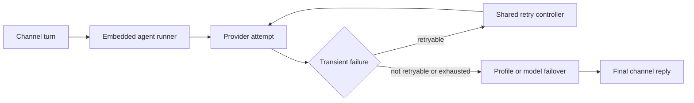

Codex review: needs maintainer review before merge. _Reviewed September 1, 2026, 1:49 AM ET / 05:49 UTC._

# ClawSweeper review

## What this changes

The branch centralizes transient provider retries in the embedded agent runner, disables overlapping SDK and native transport retries, and uses the existing session retry setting as a turn-wide retry budget.

## Merge readiness

⚠️ **Needs maintainer review before merge - 3 items remain**

Keep open for maintainer review: the branch is not on current main and coherently removes stacked transient retry owners, but it intentionally changes the scope of an existing saved retry setting and needs explicit compatibility acceptance plus direct pinned-SDK contract verification before merge.

**Priority:** P1
**Reviewed head:** `d03a45df2d0ab4b1adb17dd328206acceb5873e9`
**Owner decision:** Required. See [Decision needed](#decision-needed).

## Review scores

| Measure | Result | What it means |
|---|---|---|
| **Overall readiness** | 🦐 gold shrimp **(3/6)** | The retry design and Telegram proof are strong, but compatibility acceptance and direct verification of the configured pinned SDK contracts remain merge-relevant gaps. |
| **Proof confidence** | 🦞 diamond lobster **(5/6)** | Sufficient (live_output): The changed owner is the embedded-run retry controller; supplied PR evidence reports a Telegram Test Server fault-injection run with a first transient HTTP failure, one controller-driven retry, one visible reply, and a no-fault control, while source tests cover the controller and native transport boundaries. |
| **Patch quality** | 🦐 gold shrimp **(3/6)** | No actionable review findings were identified. |

## Verification

| Check | Result | Evidence |
|---|---|---|
| **Real behavior** | Verified | Sufficient (live_output): The changed owner is the embedded-run retry controller; supplied PR evidence reports a Telegram Test Server fault-injection run with a first transient HTTP failure, one controller-driven retry, one visible reply, and a no-fault control, while source tests cover the controller and native transport boundaries. |
| **Evidence reviewed** | 9 items | Single retry owner: The introduced controller accepts only transient rate-limit, overload, server-error, and timeout classes; it applies one budget and 90-second window before allowing failover. Caller and failure-route coverage: The run loop creates one controller per embedded run, installs the session-owned retry budget on each dispatch, and passes it into both prompt and assistant failure processing. Native transport behavior: The ChatGPT Responses transport now performs one HTTP attempt, preserves Retry-After timing in terminal error text, and retains only encrypted-content semantic replay rather than transient request replay. |
| **Findings** | None | None. |
| **Security** | None | None. |

## How this fits together

OpenClaw’s embedded agent runner converts a channel turn into provider attempts, failover decisions, and a final channel reply. This change makes one controller own retry timing before a failed attempt can rotate credentials, switch models, or surface an error.

## Decision needed

| Question | Recommendation |
|---|---|
| Should existing retry.provider.maxRetries configurations be accepted as a turn-wide transient-retry budget, including a fixed 90-second ceiling, rather than as per-SDK-request retry counts? | **Accept centralized budget:** Confirm the documented turn-wide budget and fixed ceiling are the intended upgrade behavior after direct SDK contract verification. |

Why: This is a deliberate compatibility and operator-behavior change to a retained persisted setting; source review cannot decide whether that upgrade tradeoff is acceptable.

## Before merge

- [ ] **Resolve merge risk (P1)** - Existing retry.provider.maxRetries configurations change from SDK/request retry counts to a shared turn-wide budget that may stop early when the 90-second retry window expires.
- [ ] **Resolve merge risk (P1)** - The checkout did not contain the pinned upstream SDK sources, so the review verified OpenClaw’s maxRetries: 0 calls but not each SDK’s runtime contract directly.

<strong>Agent review details</strong>

### Security

None.

### PR surface

PR surface statistics unavailable: the file list is incomplete.

### Review metrics

| Metric | Value | Why it matters |
|---|---|---|
| **Production versus test delta** | production +469/-699 (net -230); tests/test support +478/-699 (net -221); docs -39 | The substantial net-negative production diff comes from deleting duplicate retry loops while retaining focused regression coverage. |
| **Persisted retry-setting behavior** | 1 existing setting changed | retry.provider.maxRetries remains persisted but changes from a provider request option to the shared embedded-run retry budget. |

### Stored data model

Persistent data-model change detected: `unknown-truncated-pull-files`. Confirm migration or upgrade compatibility proof before merge.

### Merge-risk options

**Maintainer options:**
1. **Confirm the centralized upgrade contract (recommended)**  
   Verify the pinned SDK retry-disable contract and have an area owner explicitly accept the retained setting’s turn-wide 90-second behavior before merge.
2. **Retain legacy retry scope**  
   Pause this approach if preserving per-request retry semantics for existing saved settings is more important than one controller.

### Technical review

Best possible solution:

Retain the single controller, explicitly accept the turn-wide saved-setting semantics, and verify the pinned SDK clients honor retry disabling before merge.

Do we have a high-confidence way to reproduce the issue?

Yes—source and regression tests give a high-confidence path: trigger a replay-safe transient provider failure during an embedded run and observe the controller’s retry/failover decisions; this review did not execute it locally.

Is this the best way to solve the issue?

Yes for the duplicate-retry failure class: one controller makes accounting visible and bounded, contingent on confirming the retained SDK and saved-setting compatibility contracts.

AGENTS.md: found and applied where relevant.

Codex review notes: model internal, reasoning high; reviewed against [b9c3958eef13](https://github.com/openclaw/openclaw/commit/b9c3958eef13feb8e9a8161368a59039ed41eeca).

### Labels

Label changes:

- add `rating: 🦐 gold shrimp`: Overall readiness is 🦐 gold shrimp; proof is 🦞 diamond lobster and patch quality is 🦐 gold shrimp.
- remove `rating: 🐚 platinum hermit`: Current PR rating is `rating: 🦐 gold shrimp`, so this older rating label is no longer current.

Label justifications:

- `P1`: The change repairs transient provider-failure recovery on active agent turns, where stacked retries can delay a visible user outcome for minutes.
- `merge-risk: 🚨 compatibility`: Existing persisted retry.provider.maxRetries values receive a different scope and a new fixed time ceiling after merge.
- `rating: 🦐 gold shrimp`: Overall readiness is 🦐 gold shrimp; proof is 🦞 diamond lobster and patch quality is 🦐 gold shrimp.
- `status: 👀 ready for maintainer look`: ClawSweeper has no concrete contributor-facing blocker left for this PR. Sufficient (live_output): The changed owner is the embedded-run retry controller; supplied PR evidence reports a Telegram Test Server fault-injection run with a first transient HTTP failure, one controller-driven retry, one visible reply, and a no-fault control, while source tests cover the controller and native transport boundaries.
- `proof: sufficient`: Contributor real behavior proof is sufficient. The changed owner is the embedded-run retry controller; supplied PR evidence reports a Telegram Test Server fault-injection run with a first transient HTTP failure, one controller-driven retry, one visible reply, and a no-fault control, while source tests cover the controller and native transport boundaries.
- `proof: telegram-e2e`: This PR needs Telegram Test Server proof with the repository E2E skill. Retry timing determines when a Telegram user receives a reply; supplied Telegram Test Server evidence is therefore directly relevant.

### Evidence

Acceptance criteria:

- [P1] Inspect the pinned OpenAI, Anthropic, and Mistral SDK retry-option contracts or run a direct contract check.
- [P1] Validate an existing persisted retry.provider.maxRetries configuration across retry, profile rotation, and failover.

What I checked:

- **Single retry owner:** The introduced controller accepts only transient rate-limit, overload, server-error, and timeout classes; it applies one budget and 90-second window before allowing failover. ([`src/agents/embedded-agent-runner/run/failover-retry-controller.ts:222`](https://github.com/openclaw/openclaw/blob/d03a45df2d0a/src/agents/embedded-agent-runner/run/failover-retry-controller.ts#L222), [d03a45df2d0a](https://github.com/openclaw/openclaw/commit/d03a45df2d0a))
- **Caller and failure-route coverage:** The run loop creates one controller per embedded run, installs the session-owned retry budget on each dispatch, and passes it into both prompt and assistant failure processing. ([`src/agents/embedded-agent-runner/run-loop.ts:253`](https://github.com/openclaw/openclaw/blob/d03a45df2d0a/src/agents/embedded-agent-runner/run-loop.ts#L253), [d03a45df2d0a](https://github.com/openclaw/openclaw/commit/d03a45df2d0a))
- **Native transport behavior:** The ChatGPT Responses transport now performs one HTTP attempt, preserves Retry-After timing in terminal error text, and retains only encrypted-content semantic replay rather than transient request replay. ([`packages/ai/src/providers/openai-chatgpt-responses.ts:451`](https://github.com/openclaw/openclaw/blob/d03a45df2d0a/packages/ai/src/providers/openai-chatgpt-responses.ts#L451), [d03a45df2d0a](https://github.com/openclaw/openclaw/commit/d03a45df2d0a))
- **Regression coverage:** Controller tests cover cross-reason budgeting, Retry-After timing, time-window truncation, and the retained saved budget; native transport tests assert retryable ChatGPT failures make one request and preserve Retry-After evidence. ([`src/agents/embedded-agent-runner/run/failover-retry-controller.test.ts:61`](https://github.com/openclaw/openclaw/blob/d03a45df2d0a/src/agents/embedded-agent-runner/run/failover-retry-controller.test.ts#L61), [d03a45df2d0a](https://github.com/openclaw/openclaw/commit/d03a45df2d0a))
- **Compatibility surface:** The existing retry.provider.maxRetries value is still read from session settings, but the branch changes it from a provider SDK/request option into the shared per-turn transient retry budget, which can be truncated by the fixed 90-second window. ([`src/agents/sessions/settings-storage.ts:18`](https://github.com/openclaw/openclaw/blob/d03a45df2d0a/src/agents/sessions/settings-storage.ts#L18), [d03a45df2d0a](https://github.com/openclaw/openclaw/commit/d03a45df2d0a))
- **Dependency signal and limitation:** The branch directly configures the pinned OpenAI, Anthropic, and Mistral SDK clients to disable retries. Repository source establishes the configured API calls, but installed upstream SDK source was unavailable in this checkout, so their runtime contracts were not independently inspected. ([`packages/ai/package.json:106`](https://github.com/openclaw/openclaw/blob/d03a45df2d0a/packages/ai/package.json#L106), [d03a45df2d0a](https://github.com/openclaw/openclaw/commit/d03a45df2d0a))

Likely related people:

- **Peter Steinberger:** Suggested for follow-up; no historical authorship or introduction is verified. (role: unverified routing candidate; confidence: low)
- **Jason (Json):** Suggested for follow-up; no historical authorship or introduction is verified. (role: unverified routing candidate; confidence: low)

### Rank-up moves

Optional improvements that raise the rating; they are not merge blockers.

- Verify from the pinned OpenAI, Anthropic, and Mistral SDK sources or a direct contract run that maxRetries: 0 disables internal retries.
- Have an area owner confirm the retained setting’s turn-wide 90-second upgrade behavior.

### Rating scale

| Score | Internal tier | Crab rank | Meaning |
|---:|:---:|---|---|
| **6/6** | S | 🦀 challenger crab | Exceptional readiness |
| **5/6** | A | 🦞 diamond lobster | Very strong readiness |
| **4/6** | B | 🐚 platinum hermit | Good normal PR; ordinary maintainer review |
| **3/6** | C | 🦐 gold shrimp | Useful, but confidence is limited |
| **2/6** | D | 🦪 silver shellfish | Proof or implementation needs work |
| **1/6** | F | 🧂 unranked krab | Not merge-ready |
| N/A | NA | 🌊 off-meta tidepool | Rating does not apply |

Overall follows the weaker of proof and patch quality.
Shiny media proof means a screenshot, video, or linked artifact directly shows the changed behavior. Runtime, network, CSP, and security claims still need visible diagnostics.

### Workflow

- ClawSweeper keeps one durable marker-backed review comment per issue or PR.
- Re-runs edit this comment so the latest verdict, findings, and automation markers stay together instead of adding duplicate bot comments.
- A fresh review can be triggered by eligible `@clawsweeper re-review` comments, exact-item GitHub events, scheduled/background review runs, or manual workflow dispatch.
- PR/issue authors and users with repository write access can comment `@clawsweeper re-review` or `@clawsweeper re-run` on an open PR or issue to request a fresh review only.
- Maintainers can also comment `@clawsweeper review` to request a fresh review only.
- Fresh-review commands do not start repair, autofix, rebase, CI repair, or automerge.
- Maintainer-only repair and merge flows require explicit commands such as `@clawsweeper autofix`, `@clawsweeper automerge`, `@clawsweeper fix ci`, or `@clawsweeper address review`.
- Maintainers can comment `@clawsweeper explain` to ask for more context, or `@clawsweeper stop` to stop active automation.

### History

Review history (6 earlier review cycles)

<!-- clawsweeper-review-history v=1 total=6 -->
- reviewed 2026-08-31T16:56:11.927Z sha ed0593f692e663f6023a638e9c38f795eb6e67ec :: found issues before merge. :: [P1] Route zero-output server errors through the shared retry budget | [P1] Measure the retry budget from turn start | [P1] Do not silently discard the Sessions provider retry setting | [P2] Carry response retry hints out of the ChatGPT transport
- reviewed 2026-08-31T17:21:48.265Z sha 59422dddc37d9376c4e44bb45817bf32a205147d :: needs changes before merge. :: [P1] Preserve the Sessions provider retry setting | [P1] Charge zero-output server errors to the shared retry budget | [P2] Preserve HTTP Retry-After evidence for native ChatGPT failures | [P2] Measure the retry ceiling from turn admission | [P2] Record the retry count after scheduling the assistant retry
- reviewed 2026-08-31T17:54:00.599Z sha cca85513b9c92bca4398447c44b3ff592cf21425 :: found issues before merge. :: [P1] Update the SDK-options test call | [P1] Migrate the retired provider retry setting | [P2] Read the retry count after scheduling the retry
- reviewed 2026-08-31T18:09:52.239Z sha 4cc02986dc2e716908b762131dacf9be138fd27b :: found issues before merge. :: [P1] Update the SDK-options test call | [P1] Migrate the retired provider retry preference | [P2] Read retry count after scheduling the retry
- reviewed 2026-09-01T04:23:40.413Z sha 27c93e488d2d0e1e4cbd05d3a0318ec29cfdfdcf :: needs maintainer review before merge. :: none
- reviewed 2026-09-01T05:31:47.000Z sha d03a45df2d0ab4b1adb17dd328206acceb5873e9 :: needs maintainer review before merge. :: none

<!-- clawsweeper-verdict:needs-human item=134281 sha=d03a45df2d0ab4b1adb17dd328206acceb5873e9 confidence=high updated_at=2026-09-01T05:44:12Z reviewed_at=2026-09-01T05:49:20.966Z lease_owner=github-run-33474648160-1 lease_comment_id=5489472605 source_revision=b58c6351a797e63ad199ebcf6da7e446318262eb91b2b336b3c3a7aa6dc3a226 live_verification=absent -->

<!-- clawsweeper-review-version item=134281 reviewed_at=2026-09-01T05:49:20.966Z sha=d03a45df2d0ab4b1adb17dd328206acceb5873e9 source_revision=b58c6351a797e63ad199ebcf6da7e446318262eb91b2b336b3c3a7aa6dc3a226 lease_owner=github-run-33474648160-1 lease_comment_id=5489472605 v=1 -->

<!-- clawsweeper-review item=134281 -->