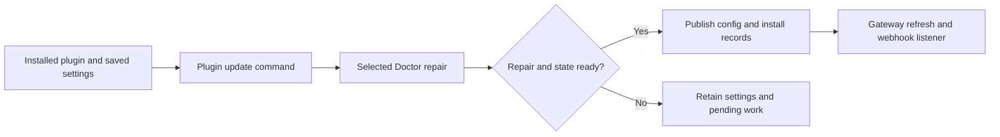

Codex review: blocked before merge. _Reviewed September 28, 2026, 4:45 PM ET / 20:45 UTC (Revision 2)._

# ClawSweeper review

## What this changes

The branch runs selected plugin Doctor config repairs during plugin updates and replacement installs, then coordinates config writes, install records, pending migration state, rollback, documentation, and integration coverage.

## Merge readiness

⛔ **Blocked before merge - 4 items remain**

Current main still lacks the plugin update repair path, so this PR remains useful. Review found one case where it can complete a pending migration without repairing its retained config input. The required installed-updater upgrade proof is also outstanding.

**Priority:** P1
**Reviewed head:** `1dc0415bc9bd9c9ffb4abeda066d6020bf587083`

## Review scores

| Measure | Result | What it means |
|---|---|---|
| **Overall readiness** | 🦐 gold shrimp **(3/6)** | The owner-boundary tests give useful signal, but a fixable pending-row defect and missing installed-upgrade proof prevent merge readiness. |
| **Proof confidence** | 🦐 gold shrimp **(3/6)** | Not applicable: Real behavior proof is not required for maintainer- or bot-authored pull requests. |
| **Patch quality** | 🦐 gold shrimp **(3/6)** | 1 actionable review finding remain. |

## Verification

| Check | Result | Evidence |
|---|---|---|
| **Real behavior** | Not applicable | Not applicable: Real behavior proof is not required for maintainer- or bot-authored pull requests. |
| **Evidence reviewed** | 10 items | Current main still needs the repair: The fetched main update command only enters persistence when a plugin or hook package changes and has no selected Doctor config-migration preparation. Introduced completion guard: For pending config paths, the new guard checks whether the inspection map contains an entry, while the Doctor registry can record an entry with value false when its module has no config-repair surface. Doctor inspection value: The registry passes false to the inspection callback when a loaded Doctor module has neither legacy config rules nor a config normalizer. |
| **Findings** | 1 actionable finding | [P1] Require a config repair before clearing retained inputs |
| **Security** | None | None. |

## How this fits together

The plugin CLI selects package updates and uses plugin-provided Doctor contracts to repair saved settings. It publishes config and install records before the Gateway refreshes the plugin and serves its configured webhook listener.

## Before merge

- [ ] **Require a config repair before clearing retained inputs (P1)** - Late discovery: an undeclared Doctor module can load successfully for an unrelated surface and set `inspected` to `false`, but this condition accepts mere map presence. For an active plugin with pending `configPaths`, no config repair, and a permissive candidate schema, publication can complete the pending row while leaving the legacy setting untouched; the new runtime may then use defaults. Require an actual repair surface or prove the retained input is gone before completing that row.
- [ ] **Resolve merge risk (P1)** - The published 2026.9.6 updater can reject legacy listener settings before candidate code runs. The supported core-first upgrade through this head, pending-state settlement, and actual listener delivery have not yet been observed; operators may otherwise encounter an update refusal or an endpoint using defaults.
- [ ] **Complete next step (P2)** - Repair the pending-row completion guard and obtain the published-driver-to-candidate listener proof before merge.
- [ ] **Add data-model compatibility proof** - Confirm migration or upgrade compatibility proof before merge.

## Findings

- [P1] Require a config repair before clearing retained inputs — `src/commands/doctor/shared/plugin-update-config-migration.ts:162`

<strong>Agent review details</strong>

### Security

None.

### PR surface

Source +519, Tests +775, Docs +14. Total +1308 across 18 files.

View PR surface stats

| Area | Files | Added | Removed | Net |
|---|---:|---:|---:|---:|
| Source | 12 | 681 | 162 | +519 |
| Tests | 5 | 777 | 2 | +775 |
| Docs | 1 | 14 | 0 | +14 |
| Config | 0 | 0 | 0 | 0 |
| Generated | 0 | 0 | 0 | 0 |
| Other | 0 | 0 | 0 | 0 |
| **Total** | **18** | **1472** | **164** | **+1308** |

### Review metrics

| Metric | Value | Why it matters |
|---|---|---|
| **Production and test growth** | production +521 net lines; tests +775 net lines; docs +14 lines | The added coordination spans config, install records, and SQLite rollback; its substantial production growth has a stated ownership and recovery purpose. |
| **New integration suite cost** | 36 cases; 62.67 s single-worker test time | The PR now reports the prior review's requested wall time, which exceeds the repository's 30-second explanation threshold. |

### Stored data model

Persistent data-model change detected: `migration/backfill/repair: src/commands/doctor/shared/plugin-update-config-migration.ts`, `migration/backfill/repair: src/plugins/doctor-contract-registry.ts`, `unknown-data-model-change: src/commands/doctor/shared/plugin-update-config-migration.ts`, `unknown-data-model-change: src/plugins/doctor-contract-registry.ts`. Confirm migration or upgrade compatibility proof before merge.

### Merge-risk options

**Maintainer options:**
1. **Repair and prove the upgrade (recommended)**  
   Keep pending rows until their retained settings are resolved, then show the published-updater core-first sequence preserving the configured endpoint and receiving a callback.

### Technical review

Best possible solution:

Complete pending config work only when the selected Doctor contract repairs its retained input or that input is demonstrably absent, then verify the preserved listener through an installed 2026.9.6 core-first upgrade.

Do we have a high-confidence way to reproduce the issue?

Yes. Current-main source omits the update-time Doctor repair, and the related installed-upgrade report observed fallback to a default listener port; this review did not execute that path.

Is this the best way to solve the issue?

No, not yet. Reusing Doctor and the existing publication owners is appropriate, but inspection of an unrelated Doctor surface must not authorize completion of retained config inputs.

Full review comments:

- [P1] Require a config repair before clearing retained inputs — `src/commands/doctor/shared/plugin-update-config-migration.ts:162`
  Late discovery: an undeclared Doctor module can load successfully for an unrelated surface and set `inspected` to `false`, but this condition accepts mere map presence. For an active plugin with pending `configPaths`, no config repair, and a permissive candidate schema, publication can complete the pending row while leaving the legacy setting untouched; the new runtime may then use defaults. Require an actual repair surface or prove the retained input is gone before completing that row.
  Confidence: 0.88
  Late finding: first raised on code an earlier review cycle already covered.

Overall correctness: patch is incorrect
Overall confidence: 0.84

AGENTS.md: found and applied where relevant.

Codex review notes: model internal, reasoning high; reviewed against [9366fd94e19f](https://github.com/openclaw/openclaw/commit/9366fd94e19ffde0b90ce7d22274176fa426a373).

### Labels

Label changes:

- add `merge-risk: 🚨 message-delivery`: Completing a pending row without moving retained listener settings can activate a plugin on the wrong webhook endpoint.
- add `status: ⏳ waiting on author`: ClawSweeper has contributor-facing work open and is waiting for author action. Not applicable: Real behavior proof is not required for maintainer- or bot-authored pull requests.
- remove `status: 👀 ready for maintainer look`: Current PR status label is `status: ⏳ waiting on author`.

Label justifications:

- `P1`: An incorrect plugin update can make an existing webhook listener use defaults and interrupt channel delivery.
- `merge-risk: 🚨 compatibility`: The patch rewrites existing plugin settings and changes when pending migration records are completed, while the published-driver upgrade remains unproven.
- `merge-risk: 🚨 message-delivery`: Completing a pending row without moving retained listener settings can activate a plugin on the wrong webhook endpoint.
- `rating: 🦐 gold shrimp`: Overall readiness is 🦐 gold shrimp; proof is 🦐 gold shrimp and patch quality is 🦐 gold shrimp.
- `status: ⏳ waiting on author`: ClawSweeper has contributor-facing work open and is waiting for author action. Not applicable: Real behavior proof is not required for maintainer- or bot-authored pull requests.

### Evidence

Acceptance criteria:

- [P1] pnpm test src/cli/plugins-update-command.migrations.integration.test.ts --maxWorkers=1.
- [P1] git diff --check.

What I checked:

- **Current main still needs the repair:** The fetched main update command only enters persistence when a plugin or hook package changes and has no selected Doctor config-migration preparation. ([`src/cli/plugins-update-command.ts:594`](https://github.com/openclaw/openclaw/blob/9366fd94e19ffde0b90ce7d22274176fa426a373/src/cli/plugins-update-command.ts#L594), [9366fd94e19f](https://github.com/openclaw/openclaw/commit/9366fd94e19ffde0b90ce7d22274176fa426a373))
- **Introduced completion guard:** For pending config paths, the new guard checks whether the inspection map contains an entry, while the Doctor registry can record an entry with value false when its module has no config-repair surface. ([`src/commands/doctor/shared/plugin-update-config-migration.ts:162`](https://github.com/openclaw/openclaw/blob/1dc0415bc9bd9c9ffb4abeda066d6020bf587083/src/commands/doctor/shared/plugin-update-config-migration.ts#L162), [1dc0415bc9bd](https://github.com/openclaw/openclaw/commit/1dc0415bc9bd9c9ffb4abeda066d6020bf587083))
- **Doctor inspection value:** The registry passes false to the inspection callback when a loaded Doctor module has neither legacy config rules nor a config normalizer. ([`src/plugins/doctor-contract-registry.ts:732`](https://github.com/openclaw/openclaw/blob/1dc0415bc9bd9c9ffb4abeda066d6020bf587083/src/plugins/doctor-contract-registry.ts#L732), [1dc0415bc9bd](https://github.com/openclaw/openclaw/commit/1dc0415bc9bd9c9ffb4abeda066d6020bf587083))
- **Durable completion effect:** After file publication, the new transaction marks selected pending migration rows completed, making an incorrect inspection result consequential for retained inputs. ([`src/infra/deferred-plugin-migrations.ts:360`](https://github.com/openclaw/openclaw/blob/1dc0415bc9bd9c9ffb4abeda066d6020bf587083/src/infra/deferred-plugin-migrations.ts#L360), [1dc0415bc9bd](https://github.com/openclaw/openclaw/commit/1dc0415bc9bd9c9ffb4abeda066d6020bf587083))
- **Boundary coverage and gap:** The new suite exercises the CLI with real config files, install records, and pending SQLite rows, including revocation and rollback cases. It mocks package transport and Gateway RPC; its unrelated-Doctor-surface cases do not combine an undeclared, unrelated surface with retained legacy config input and a permissive candidate schema. ([`src/cli/plugins-update-command.migrations.integration.test.ts:43`](https://github.com/openclaw/openclaw/blob/1dc0415bc9bd9c9ffb4abeda066d6020bf587083/src/cli/plugins-update-command.migrations.integration.test.ts#L43), [1dc0415bc9bd](https://github.com/openclaw/openclaw/commit/1dc0415bc9bd9c9ffb4abeda066d6020bf587083))
- **Prior review continuity:** The prior completed ClawSweeper review recorded no code findings and requested a published-driver-to-candidate listener proof and single-worker test duration. The current PR body supplies the duration but says installed Feishu receiving proof remains in progress. Source: https://github.com/openclaw/openclaw/pull/160682#issuecomment-5877561125.

Likely related people:

- **steipete:** Suggested for follow-up; no historical authorship or introduction is verified. (role: unverified routing candidate; confidence: low)
- **Dallin Romney:** Suggested for follow-up; no historical authorship or introduction is verified. (role: unverified routing candidate; confidence: low)
- **Jason (Json):** Suggested for follow-up; no historical authorship or introduction is verified. (role: unverified routing candidate; confidence: low)

### Rank-up moves

Optional improvements that raise the rating; they are not merge blockers.

- Add a regression with retained legacy config input and an undeclared Doctor artifact exposing only an unrelated surface; keep the pending row until repair is proven.
- Provide a redacted installed 2026.9.6 to candidate core-first trace showing the configured listener receiving a callback and pending state settling correctly.

### Rating scale

| Score | Internal tier | Crab rank | Meaning |
|---:|:---:|---|---|
| **6/6** | S | 🦀 challenger crab | Exceptional readiness |
| **5/6** | A | 🦞 diamond lobster | Very strong readiness |
| **4/6** | B | 🐚 platinum hermit | Good normal PR; ordinary maintainer review |
| **3/6** | C | 🦐 gold shrimp | Useful, but confidence is limited |
| **2/6** | D | 🦪 silver shellfish | Proof or implementation needs work |
| **1/6** | F | 🧂 unranked krab | Not merge-ready |
| N/A | NA | 🌊 off-meta tidepool | Rating does not apply |

Overall follows the weaker of proof and patch quality.
Shiny media proof means a screenshot, video, or linked artifact directly shows the changed behavior. Runtime, network, CSP, and security claims still need visible diagnostics.

### Workflow

- ClawSweeper keeps one durable marker-backed review comment per issue or PR.
- Re-runs edit this comment so the latest verdict, findings, and automation markers stay together instead of adding duplicate bot comments.
- A fresh review can be triggered by eligible `@clawsweeper re-review` comments, exact-item GitHub events, scheduled/background review runs, or manual workflow dispatch.
- PR/issue authors and users with repository write access can comment `@clawsweeper re-review` or `@clawsweeper re-run` on an open PR or issue to request a fresh review only.
- Maintainers can also comment `@clawsweeper review` to request a fresh review only.
- Fresh-review commands do not start repair, autofix, rebase, CI repair, or automerge.
- Maintainer-only repair and merge flows require explicit commands such as `@clawsweeper autofix`, `@clawsweeper automerge`, `@clawsweeper fix ci`, or `@clawsweeper address review`.
- Maintainers can comment `@clawsweeper explain` to ask for more context, or `@clawsweeper stop` to stop active automation.

### History

Review history (1 earlier review cycle)

<!-- clawsweeper-review-history v=1 total=1 -->
- reviewed 2026-09-28T20:05:31.291Z sha 8e9972a572694ffd294c6a291755c82928595a90 :: blocked before merge. :: none

<!-- clawsweeper-verdict:needs-human item=160682 sha=1dc0415bc9bd9c9ffb4abeda066d6020bf587083 confidence=high updated_at=2026-09-28T20:40:50Z reviewed_at=2026-09-28T20:45:13.329Z lease_owner=github-run-36480645743-1 lease_comment_id=5878112630 source_revision=96340179efa8c4ec4f560626935dc620e1cb34f0a1b83e4e3e650ca4d7a13183 live_verification=absent -->
<!-- clawsweeper-review-state:blocked item=160682 sha=1dc0415bc9bd9c9ffb4abeda066d6020bf587083 v=1 -->

<!-- clawsweeper-review-version item=160682 reviewed_at=2026-09-28T20:45:13.329Z sha=1dc0415bc9bd9c9ffb4abeda066d6020bf587083 source_revision=96340179efa8c4ec4f560626935dc620e1cb34f0a1b83e4e3e650ca4d7a13183 lease_owner=github-run-36480645743-1 lease_comment_id=5878112630 v=1 -->

<!-- clawsweeper-review item=160682 -->